**IP**:  172.17.0.3
**S.O:** Linux
**Source:** DockeLabs
**Level:** Fácil
**Date:** 13 enero 2026
**Autor**:
**Descripción**: 

Enumeración Web
Crypto Challenge - B64 Cipher
Enumeración del Sistema de Archivos
[[Escalada de Privilegios]]

**Flags**:  

**Begin**:

---

Comenzamos haciendo un ping:
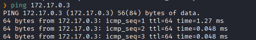
Hay conexión 
TTL: 64 -> Linux

Escaneo de Puertos abiertos TCP
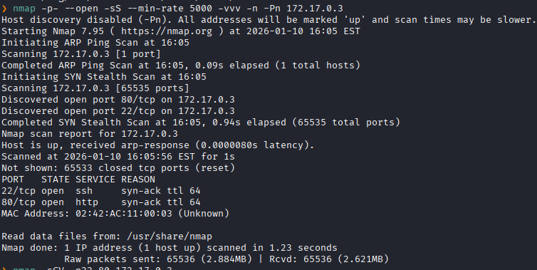
Puertos abiertos: 
Puertos 22 (SSH)
Puertos 80 (HTTP)

Escaneo de versión a los puertos específicos.
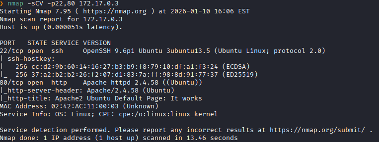

Accedemos al servicio web
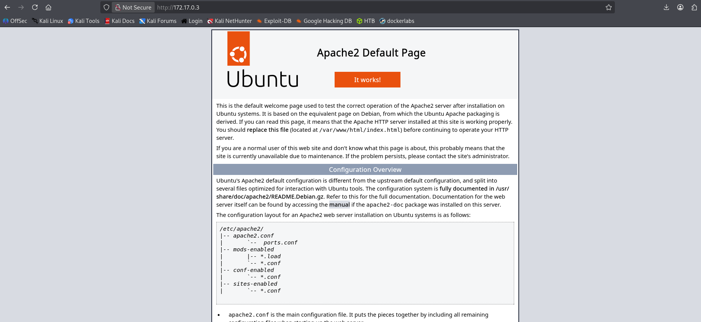
El servidor respondió con la página por defecto de Apache2

Realizamos un fuzzing de directorios.
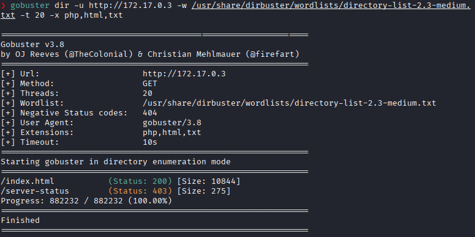
No encontramos nada.

Inspeccionando mas la pagina web, vemos que abajo del todo vemos una cadena de texto en B64.
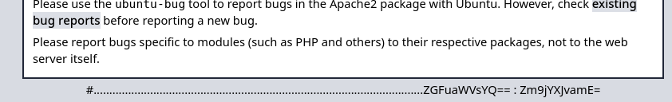

Lo llevamos a `CyberChef`
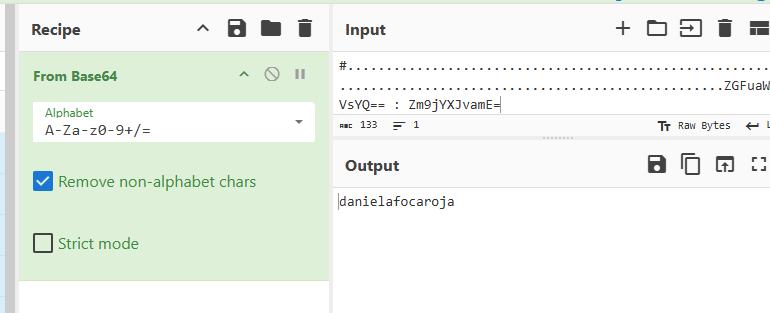
Y nos da una cadena de texto que parece ser unas credenciales
`daniela:focaroja`

Accedemos al servicio SSH
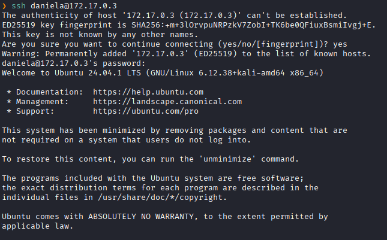

Listamos los archivos y directorios del usuario
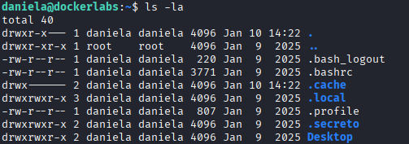
Y vemos un directorio llamado `.secreto`.

Entramos al directorio `.secreto`
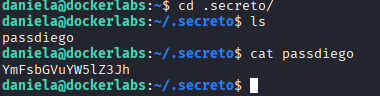
Y dentro de ello hay una carpeta llamada `passdiego` que parece ser la contraseña del usuario `diego` al leerlo nos da una cadena de texto.

La cadena de texto lo pasamos por `CyberChef` y nos da la palabra `ballenanegra`
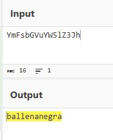

Accedemos como el usuario `diego`
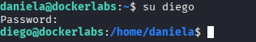

Listamos los archivos del usuario
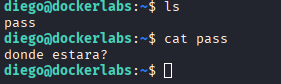
Vemos un archivo `pass` que solo dice: `donde estara`

Listamos los archivos ocultos tambien.
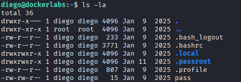

Leemos el `.bash_logout`
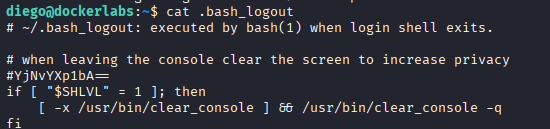
Vemos una cadena de texto de B64

Lo llevamos a `CyberChef`
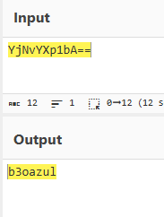
Nos da la palabra `b3oazul`

Intentamos acceder a **root** de contraseña `b3oazul`
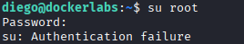
Y al parecer no es 

Después de buscar en varios lugares, en el directorio `share` se encuentra un archivo llamado `.-`  
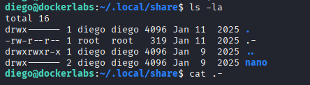

Que al leerlo nos da una adivinanza sobre la contraseña de **root**
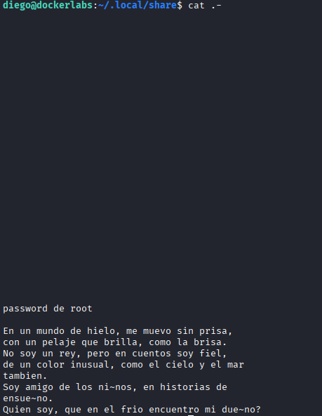
Buscando la respuesta a la contraseña y guiándome de `b3oazul`
Se logra encontrar la respuesta que es: `osoazul`

Accedemos con **root**
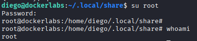
Escalada exitosa a root.
